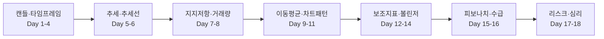

# 📈 차트 공부 — 초보자를 위한 A to Z

매일 아침 텔레그램으로 그날 분량(개념 10~20개)이 도착하고, 같은 내용이 아래 포스팅으로 정리됩니다.
캔들 하나 읽는 법에서 시작해 추세·지지저항·거래량·보조지표·볼린저 밴드·리스크 관리까지 순서대로 갑니다.

총 **18일 · 개념 221개**

| Day | 주제 | 개념 수 |
|:-:|---|:-:|
| 1 | [캔들 차트 첫걸음](posts/day01.md) | 13 |
| 2 | [시간의 단위 — 분봉에서 연봉까지](posts/day02.md) | 12 |
| 3 | [캔들 하나로 읽는 심리](posts/day03.md) | 12 |
| 4 | [캔들 2~3개 조합 패턴](posts/day04.md) | 12 |
| 5 | [추세 — 차트의 방향](posts/day05.md) | 12 |
| 6 | [추세선과 채널](posts/day06.md) | 12 |
| 7 | [지지선과 저항선](posts/day07.md) | 12 |
| 8 | [거래량 — 가격의 연료](posts/day08.md) | 12 |
| 9 | [이동평균선](posts/day09.md) | 12 |
| 10 | [반전 패턴 — 추세가 뒤집힐 때](posts/day10.md) | 12 |
| 11 | [지속 패턴 — 잠깐 쉬고 가던 길로](posts/day11.md) | 12 |
| 12 | [RSI와 스토캐스틱 — 과열을 재는 온도계](posts/day12.md) | 12 |
| 13 | [MACD와 추세 강도 지표](posts/day13.md) | 12 |
| 14 | [볼린저 밴드 — 존 볼린저의 방법](posts/day14.md) | 15 |
| 15 | [피보나치와 갭](posts/day15.md) | 12 |
| 16 | [수급과 공시 — 차트 뒤의 사람들](posts/day16.md) | 12 |
| 17 | [매매 계획과 리스크 관리](posts/day17.md) | 13 |
| 18 | [투자 심리와 습관](posts/day18.md) | 12 |

## 단계별 흐름

## 파일 구성

- `lessons.md` — 커리큘럼 원본 (이 파일만 고치면 포스팅·텔레그램이 같이 바뀜)
- `posts/` — Day별 포스팅 (`python chart-study/study_bot.py build`로 생성)
- `img/` — 개념 그림 (`python chart-study/make_figures.py`로 생성)
- `progress.json` — 텔레그램 진도
- 발송: `.github/workflows/chart-study.yml` (매일 아침 7시대)
