# 차트 공부 커리큘럼 (A → Z)

형식: `## Day N · 제목` / `> 한 줄 소개` / `` / `- **개념**: 설명`
이 파일만 고치면 텔레그램 메시지와 GitHub 포스팅이 같이 바뀝니다.

## Day 1 · 캔들 차트 첫걸음
> 차트의 가장 작은 단위, 캔들(봉) 하나를 읽는 법부터 시작합니다.
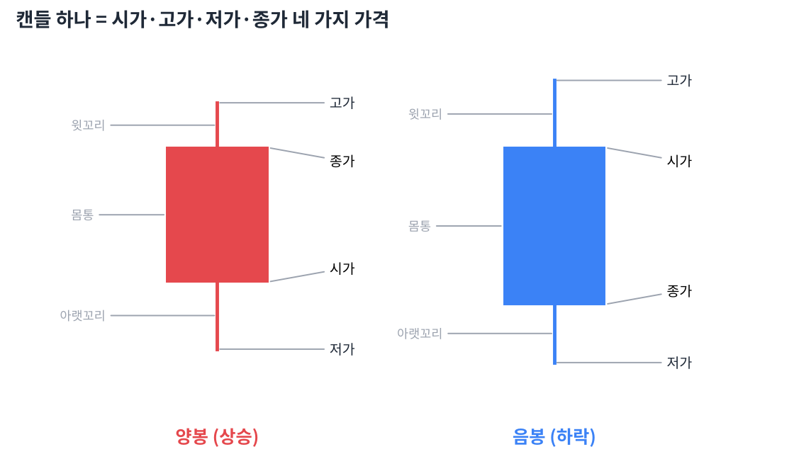
- **차트**: 가격이 시간에 따라 어떻게 움직였는지 그린 그림입니다. 가로축은 시간, 세로축은 가격입니다.
- **캔들(봉)**: 정해진 시간(하루, 일주일 등) 동안의 가격 움직임을 막대 하나로 압축한 것입니다. 일본 쌀 상인들이 쓰던 표기법이라 '일본식 캔들차트'라고도 부릅니다.
- **시가**: 그 기간에 처음 거래된 가격입니다. 일봉이면 오전 9시 첫 체결 가격입니다.
- **종가**: 그 기간의 마지막 가격입니다. 하루의 최종 합의 가격이라 네 가지 가격 중 가장 중요하게 봅니다.
- **고가 / 저가**: 그 기간 중 가장 비쌌던 가격과 가장 쌌던 가격입니다.
- **양봉**: 종가가 시가보다 높게 끝난 캔들입니다. 한국 차트에서는 빨간색입니다.
- **음봉**: 종가가 시가보다 낮게 끝난 캔들입니다. 한국 차트에서는 파란색입니다.
- **색깔 주의 (한국 vs 미국)**: 한국은 상승=빨강·하락=파랑, 미국은 상승=초록·하락=빨강입니다. 미국 주식을 볼 때 빨간색은 '떨어졌다'는 뜻입니다.
- **몸통**: 시가와 종가 사이의 굵은 부분입니다. 몸통이 길수록 한쪽(매수 또는 매도)이 강하게 이겼다는 뜻입니다.
- **윗꼬리**: 몸통 위로 뻗은 선입니다. 장중에 올라갔다가 밀려 내려왔다는 뜻으로, 위에서 파는 힘(매도 압력)이 있었다는 흔적입니다.
- **아랫꼬리**: 몸통 아래로 뻗은 선입니다. 장중에 떨어졌다가 다시 올라왔다는 뜻으로, 아래에서 사는 힘(매수세)이 있었다는 흔적입니다.
- **꼬리 읽기 연습**: 같은 양봉이라도 윗꼬리가 길면 "올랐지만 위에서 많이 팔았다", 아랫꼬리가 길면 "떨어졌지만 많이 사들였다"로 읽습니다.
- **거래량 막대**: 차트 아래의 막대는 그 기간 동안 거래된 주식 수입니다. 가격이 '무엇이 일어났는지'라면 거래량은 '얼마나 많은 사람이 참여했는지'입니다.

## Day 2 · 시간의 단위 — 분봉에서 연봉까지
> 같은 종목도 어떤 시간 단위로 보느냐에 따라 완전히 다르게 보입니다.
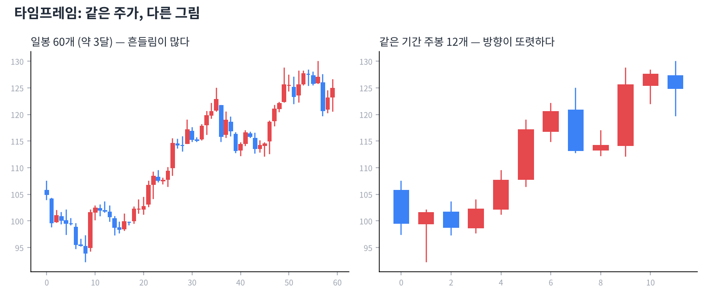
- **타임프레임**: 캔들 하나가 담는 시간의 길이입니다. 분봉·일봉·주봉·월봉·연봉이 있습니다.
- **분봉**: 1분, 5분, 15분, 60분 등 하루 안의 움직임을 보는 차트입니다. 단타(데이트레이딩)용이며 잡음(의미 없는 흔들림)이 많습니다.
- **일봉**: 캔들 하나 = 하루입니다. 가장 기본이 되는 차트로, 며칠~몇 주 보유하는 스윙 매매의 기준입니다.
- **주봉**: 캔들 하나 = 일주일(월요일 시가 ~ 금요일 종가)입니다. 일봉의 잡음이 걸러져 중기 추세가 잘 보입니다.
- **월봉**: 캔들 하나 = 한 달입니다. 몇 년 단위의 큰 흐름과 역사적 고점·저점을 확인할 때 씁니다.
- **연봉**: 캔들 하나 = 1년입니다. 기업의 장기 성장 궤적을 볼 때 유용하고, 가치투자자가 즐겨 봅니다.
- **큰 그림부터 (탑다운)**: 월봉/주봉으로 큰 방향을 먼저 보고, 일봉으로 들어갈 자리를 찾는 순서가 기본입니다. 주봉이 하락 중인데 일봉 반등만 보고 사면 역행하기 쉽습니다.
- **타임프레임과 신뢰도**: 긴 시간 단위의 신호일수록 더 믿을 만합니다. 월봉의 지지선은 5분봉의 지지선보다 훨씬 강합니다.
- **등락률**: 전날 종가 대비 오늘 가격이 몇 % 올랐거나 내렸는지입니다. '시가 대비'가 아니라 '전일 종가 대비'라는 점이 중요합니다.
- **상한가 / 하한가**: 한국 주식은 하루에 전일 종가 대비 ±30%까지만 움직일 수 있습니다. 미국 주식에는 이런 제한이 없습니다.
- **갭(Gap)**: 오늘 시가가 어제 가격 범위를 벗어나서 시작해 차트에 빈 공간이 생긴 것입니다. 밤사이 큰 뉴스(공시, 실적)가 있었다는 신호입니다.
- **시가총액**: 주가 × 발행 주식 수, 즉 회사 전체의 시장 가격입니다. 주가 자체가 싸다고 회사가 싼 것은 아닙니다.

## Day 3 · 캔들 하나로 읽는 심리
> 모양이 독특한 캔들 하나에도 매수·매도 세력의 싸움이 담겨 있습니다.
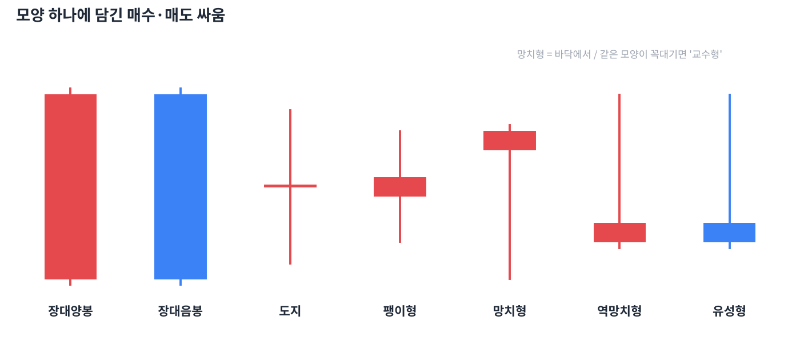
- **장대양봉**: 몸통이 아주 긴 양봉입니다. 시작부터 끝까지 매수세가 압도했다는 뜻으로, 바닥권이나 저항 돌파 시점에 나오면 강한 신호입니다.
- **장대음봉**: 몸통이 아주 긴 음봉입니다. 매도세가 압도했다는 뜻이며, 지지선을 깨면서 나오면 위험 신호입니다.
- **도지(십자형)**: 시가와 종가가 거의 같아 몸통이 선처럼 얇은 캔들입니다. 사는 쪽과 파는 쪽이 팽팽했다는 뜻이고, 긴 추세 끝에 나오면 방향 전환의 예고일 수 있습니다.
- **팽이형**: 몸통이 작고 위아래 꼬리가 비슷한 캔들입니다. 망설임·관망을 뜻하며 단독으로는 큰 의미가 없습니다.
- **망치형**: 하락 추세 끝에서 몸통은 작고 아랫꼬리가 몸통의 2배 이상 긴 캔들입니다. 많이 떨어졌다가 강하게 되사들였다는 뜻으로 바닥 신호 후보입니다.
- **교수형**: 망치형과 모양은 같지만 상승 추세 꼭대기에서 나온 것입니다. 장중 매도가 쏟아졌다는 경고로 읽습니다.
- **역망치형**: 하락 추세 끝에서 윗꼬리가 긴 작은 캔들입니다. 매수세가 시험 삼아 올려 본 흔적이라, 다음 날 양봉이 나와야 의미가 생깁니다.
- **유성형**: 역망치형과 모양은 같지만 상승 추세 꼭대기에서 나온 것입니다. 올랐다가 크게 밀렸다는 뜻이라 천장 신호 후보입니다.
- **같은 모양, 다른 이름**: 망치형·교수형, 역망치형·유성형은 모양이 같습니다. 이름(의미)을 정하는 건 '어디서 나왔느냐(위치)'입니다.
- **위치가 전부**: 캔들 신호는 추세의 끝, 지지선·저항선 근처에서 나올 때만 의미가 있습니다. 박스권 한가운데의 망치형은 그냥 잡음입니다.
- **확인 캔들**: 신호 캔들 다음 날 캔들이 방향을 확인해 줘야 합니다. 망치형 다음 날 양봉으로 망치형 고가를 넘으면 신뢰도가 크게 올라갑니다.
- **거래량 확인**: 신호 캔들에 평소보다 많은 거래량이 실리면 더 믿을 만합니다. 거래량 없는 신호는 소수의 움직임일 수 있습니다.

## Day 4 · 캔들 2~3개 조합 패턴
> 캔들 여러 개가 만드는 패턴은 하나짜리보다 신뢰도가 높습니다.
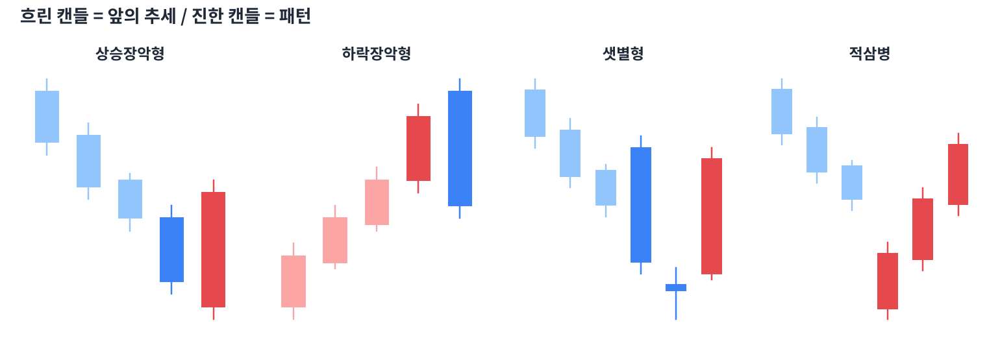
- **상승장악형**: 하락 중 작은 음봉 다음에 그 몸통을 완전히 감싸는 큰 양봉이 나온 패턴입니다. 매도세를 매수세가 '장악'했다는 뜻의 바닥 신호입니다.
- **하락장악형**: 상승 중 작은 양봉 다음에 그 몸통을 완전히 감싸는 큰 음봉이 나온 패턴입니다. 천장 신호입니다.
- **상승잉태형(하라미)**: 큰 음봉 다음에 그 몸통 안에 쏙 들어가는 작은 캔들이 나온 패턴입니다. 하락 힘이 약해졌다는 뜻이지만 장악형보다는 약한 신호입니다.
- **관통형**: 하락 중 음봉 다음 날 갭하락으로 시작했다가 전날 음봉 몸통의 절반 이상까지 올라온 양봉입니다. 바닥 반전 신호입니다.
- **먹구름형**: 관통형의 반대입니다. 상승 중 양봉 다음 날 갭상승으로 시작했다가 전날 양봉 몸통 절반 아래까지 밀린 음봉입니다.
- **샛별형(모닝스타)**: 큰 음봉 → 작은 캔들(별) → 큰 양봉의 3개 조합입니다. 어둠 끝에 샛별이 뜬다는 뜻의 강한 바닥 신호입니다.
- **석별형(이브닝스타)**: 큰 양봉 → 작은 캔들(별) → 큰 음봉입니다. 샛별형의 반대인 강한 천장 신호입니다.
- **적삼병**: 양봉 3개가 연속으로 종가를 높여 가는 패턴입니다. 바닥권에서 나오면 상승 전환의 신호입니다.
- **흑삼병**: 음봉 3개가 연속으로 종가를 낮춰 가는 패턴입니다. 고점권에서 나오면 하락 전환 신호입니다.
- **패턴 신뢰도 높이는 3가지**: ① 추세 끝에서 나왔는가 ② 지지·저항 근처인가 ③ 거래량이 늘었는가. 셋 다 맞으면 신뢰도가 높습니다.
- **캔들 패턴의 한계**: 캔들 패턴은 '단기(며칠)' 심리 변화를 보여 줄 뿐 목표가를 알려 주지 않습니다. 추세·지지저항과 함께 봐야 합니다.
- **외우기보다 읽기**: 패턴 이름을 외우는 것보다 "누가 이겼고, 진 쪽이 얼마나 버텼나"를 캔들에서 읽는 연습이 훨씬 중요합니다.

## Day 5 · 추세 — 차트의 방향
> "추세는 친구다." 방향을 아는 것이 모든 매매의 출발점입니다.
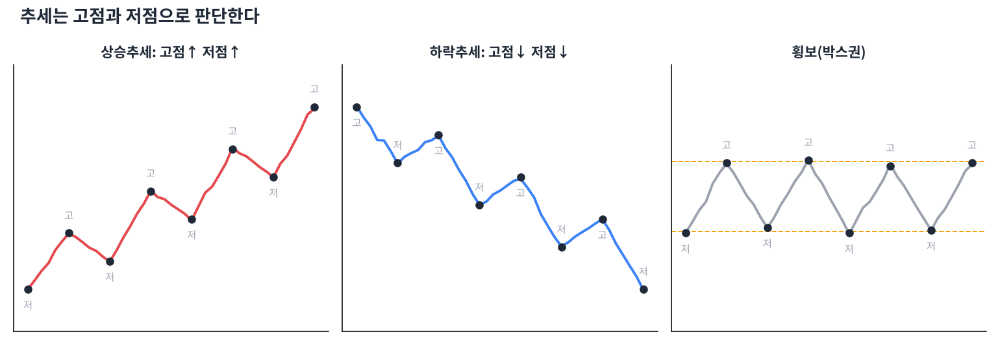
- **추세**: 가격이 일정 기간 한 방향으로 움직이는 경향입니다. 상승, 하락, 횡보 세 가지뿐입니다.
- **상승추세**: 고점과 저점이 계속 높아지는 상태입니다. (고점↑ 저점↑) 눌릴 때마다 사는 사람이 더 높은 가격에서 기다린다는 뜻입니다.
- **하락추세**: 고점과 저점이 계속 낮아지는 상태입니다. (고점↓ 저점↓) 반등할 때마다 파는 사람이 더 낮은 가격에서 기다립니다.
- **횡보(박스권)**: 고점과 저점이 일정한 범위 안에서 반복되는 상태입니다. 방향이 정해지지 않은 '힘 비축' 구간입니다.
- **고점·저점 찾기**: 주변 캔들보다 확실히 튀어나온 꼭짓점이 고점, 움푹 들어간 곳이 저점입니다. 추세 판단은 이 꼭짓점들을 잇는 것에서 시작합니다.
- **추세 전환 신호**: 상승추세에서 직전 저점이 깨지면(저점↓) 추세가 꺾였을 가능성이 커집니다. 하락추세에서는 직전 고점 돌파가 전환 신호입니다.
- **다우 이론**: 찰스 다우가 정리한 추세 이론으로, 시장에는 주추세(1년 이상)·중기추세(몇 주~몇 달)·단기추세(며칠)가 겹쳐 있다고 봅니다.
- **추세의 관성**: 한 번 생긴 추세는 확실한 반전 신호가 나올 때까지 이어지려는 성질이 있습니다. "바닥 같다"는 느낌만으로 하락추세를 거슬러 사면 안 됩니다.
- **추세 순응 매매**: 상승추세에서는 사는 쪽(눌림목 매수)만, 하락추세에서는 쉬거나 현금 보유가 초보에게 가장 안전한 원칙입니다.
- **눌림목**: 상승추세 중 잠깐 쉬며 내려오는 구간입니다. 추세가 살아 있다면 눌림목은 싸게 살 기회입니다.
- **추세의 기간**: 일봉으로는 하락인데 주봉으로는 상승일 수 있습니다. 내가 몇 일~몇 주 보유할 계획인지에 맞는 타임프레임의 추세를 기준으로 삼습니다.
- **횡보에서의 함정**: 박스권 안에서는 추세 신호(돌파처럼 보이는 움직임)가 자주 실패합니다. 박스를 확실히 벗어날 때까지 추세 매매를 쉬는 것도 방법입니다.

## Day 6 · 추세선과 채널
> 고점과 저점을 선으로 이으면 추세가 눈에 보이게 됩니다.
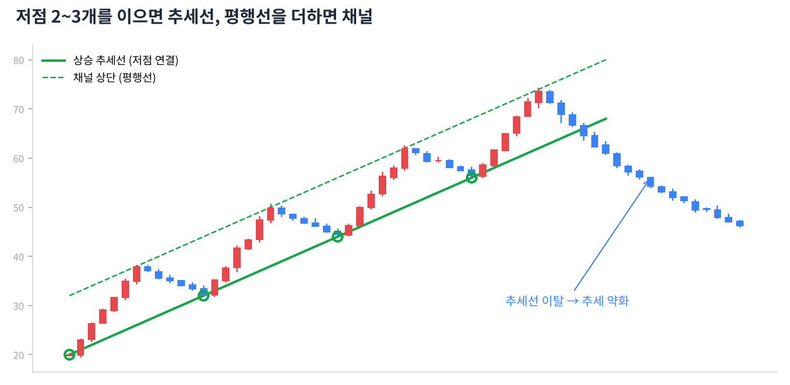
- **추세선**: 상승추세에서는 저점들을, 하락추세에서는 고점들을 이은 직선입니다.
- **상승 추세선 긋기**: 최소 2개의 저점을 잇고, 3번째 저점이 선에 닿으면 '확인된' 추세선이 됩니다. 닿은 횟수가 많을수록 강합니다.
- **하락 추세선 긋기**: 낮아지는 고점 2~3개를 잇습니다. 이 선을 뚫고 올라가는 것이 하락추세 탈출의 첫 신호입니다.
- **꼬리냐 몸통이냐**: 추세선을 꼬리 끝에 맞출지 몸통(종가)에 맞출지 정답은 없습니다. 많은 점에 자연스럽게 닿는 쪽을 고르고, 일관되게 쓰는 게 중요합니다.
- **추세선 이탈**: 상승 추세선 아래로 종가가 확실히 내려가면 추세가 약해졌다는 신호입니다. 하루 살짝 뚫은 것보다 2~3일 연속 이탈이나 큰 음봉 이탈을 더 믿습니다.
- **기울기**: 추세선이 너무 가파르면(급등) 오래 못 갑니다. 45도 안팎의 완만한 추세가 오래 지속되는 경향이 있습니다.
- **추세선 다시 긋기**: 추세가 빨라지거나 느려지면 새 저점을 기준으로 선을 다시 긋습니다. 차트는 계속 업데이트하는 지도입니다.
- **채널**: 추세선과 평행하게 반대쪽 꼭짓점에 선을 하나 더 그은 것입니다. 가격이 두 선 사이를 오가는 통로가 됩니다.
- **상승 채널 활용**: 아래 선 근처는 매수 후보 자리, 위 선 근처는 일부 이익 실현 자리로 봅니다.
- **채널 이탈**: 상승 채널 위로 강하게 뚫으면 가속, 아래로 뚫으면 추세 약화입니다. 어느 쪽이든 거래량이 실려야 진짜입니다.
- **역할 전환**: 깨진 상승 추세선은 이후 반등 때 저항선 역할을 하는 경우가 많습니다. 다시 올라와 선에 닿고 밀리면 이탈이 확인된 것입니다.
- **선은 영역이다**: 추세선을 칼같은 한 가격으로 보지 말고 약간의 폭이 있는 '구역'으로 보세요. 몇 원 차이로 판단을 뒤집지 않게 됩니다.

## Day 7 · 지지선과 저항선
> 가격이 자꾸 멈추는 자리에는 이유가 있습니다.
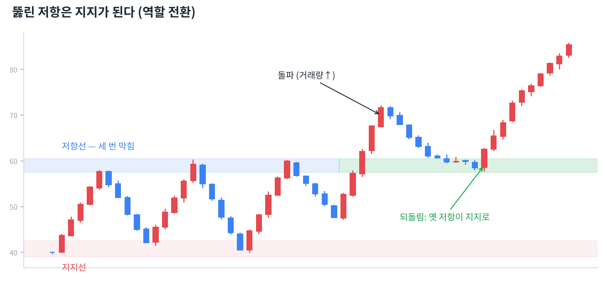
- **지지선**: 가격이 내려오다 여러 번 멈추고 반등한 가격대입니다. 그 가격이면 사겠다는 사람이 많이 모여 있는 곳입니다.
- **저항선**: 가격이 올라가다 여러 번 막히고 밀린 가격대입니다. 그 가격이면 팔겠다는 사람이 많은 곳입니다.
- **왜 생길까 (심리)**: 예전에 그 가격에 산 사람은 본전이 오면 팔고 싶고(저항), 놓친 사람은 다시 오면 사고 싶어 합니다(지지). 사람의 기억이 선을 만듭니다.
- **매물대**: 과거에 거래가 많이 일어난 가격 구간입니다. 그 가격에 물려 있는 사람이 많아 위로는 저항, 아래로는 지지가 되기 쉽습니다.
- **전고점 / 전저점**: 직전 고점과 저점은 가장 기본적인 저항과 지지입니다. 많은 사람이 같은 자리를 보기 때문에 실제로 반응이 잘 나옵니다.
- **라운드 넘버**: 10,000원, 50,000원, 100달러 같은 딱 떨어지는 가격도 심리적 지지·저항이 됩니다.
- **역할 전환**: 저항선을 뚫고 올라가면 그 선이 이후 지지선이 되고, 지지선이 깨지면 저항선이 됩니다. 가장 자주 쓰이는 차트 원리 중 하나입니다.
- **돌파**: 종가가 저항선 위에서 마감하는 것입니다. 장중에 잠깐 넘은 건 돌파가 아닙니다. 거래량이 평소의 1.5~2배 이상 실리면 신뢰도가 높습니다.
- **거짓 돌파(속임수)**: 저항을 넘는 것처럼 보이다가 다시 아래로 들어오는 것입니다. 돌파 직후 바로 따라 사면 이런 함정에 자주 걸립니다.
- **되돌림(풀백) 매수**: 돌파 후 가격이 다시 내려와 옛 저항선(이제 지지선)에서 버티는지 확인하고 사는 방법입니다. 추격 매수보다 안전합니다.
- **여러 번 테스트**: 지지선을 여러 번 건드릴수록 그 자리의 매수 물량이 소진되어 결국 깨질 가능성도 커집니다. "많이 버텼다 = 영원히 버틴다"가 아닙니다.
- **박스권 매매**: 횡보장에서는 지지선 근처에서 사고 저항선 근처에서 파는 전략을 씁니다. 단, 지지선이 깨지면 바로 손절하는 규칙이 꼭 필요합니다.

## Day 8 · 거래량 — 가격의 연료
> 가격은 거짓말을 해도 거래량은 잘 속이지 못합니다.
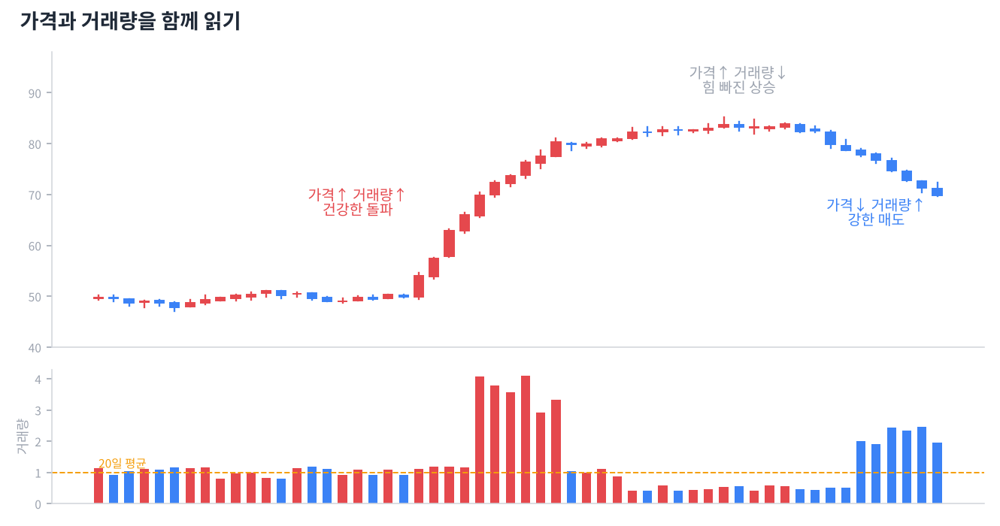
- **거래량**: 일정 기간 거래된 주식 수입니다. 시장 참여자들의 관심과 확신의 크기를 보여 줍니다.
- **거래대금**: 거래량 × 가격, 즉 실제로 오간 돈의 양입니다. 주가가 다른 종목끼리 비교할 때는 거래대금이 더 정확합니다.
- **가격↑ 거래량↑**: 건강한 상승입니다. 많은 사람이 높은 가격에도 사려고 한다는 뜻입니다.
- **가격↑ 거래량↓**: 힘 빠진 상승입니다. 사는 사람이 줄고 있어 오래 못 갈 수 있습니다.
- **가격↓ 거래량↑**: 강한 매도입니다. 특히 지지선을 깨면서 거래량이 터지면 위험 신호입니다.
- **가격↓ 거래량↓**: 매도세가 지쳐 가는 하락입니다. 바닥이 가까울 수 있지만 반등 확인이 필요합니다.
- **거래량 급증**: 평소의 3~5배 이상 거래량이 터지면 큰 뉴스나 큰손의 움직임이 있다는 뜻입니다. 위치(바닥/천장)에 따라 의미가 정반대가 됩니다.
- **바닥권 대량 거래**: 오래 떨어진 뒤 큰 거래량과 함께 아랫꼬리가 나오면 '투매 후 손바뀜'으로 바닥 신호일 수 있습니다.
- **천장권 대량 거래**: 오래 오른 뒤 거래량이 폭발하는데 가격이 더 못 오르면, 큰손이 개인에게 물량을 넘기는 '설거지' 신호일 수 있습니다.
- **평균 거래량**: 보통 최근 20일 평균과 비교합니다. "오늘 거래량이 많다/적다"는 항상 평소 대비로 판단합니다.
- **유동성**: 거래가 얼마나 활발한지입니다. 거래대금이 너무 적은 종목은 원하는 가격에 사고팔기 어렵고, 소수가 가격을 흔들기 쉽습니다.
- **OBV(누적 거래량)**: 오른 날 거래량은 더하고 내린 날은 빼서 누적한 지표입니다. 가격은 제자리인데 OBV가 오르면 조용히 매집 중일 가능성이 있습니다.

## Day 9 · 이동평균선
> 들쭉날쭉한 가격을 부드럽게 만든 선. 추세를 한눈에 보는 가장 대중적인 도구입니다.
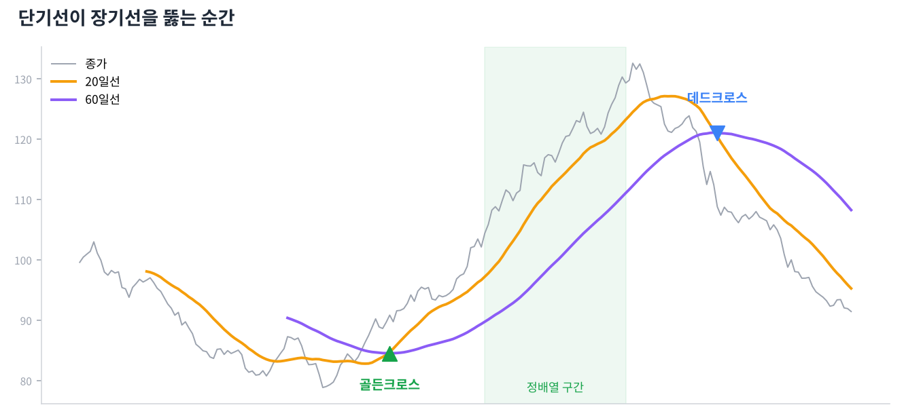
- **이동평균선(이평선)**: 최근 N일 종가의 평균을 이어 그린 선입니다. 20일선 = 최근 20거래일 평균 가격입니다.
- **주요 이평선**: 5일(1주), 20일(1달), 60일(분기), 120일(반년), 200일·240일(1년)이 많이 쓰입니다.
- **단기 vs 장기**: 짧은 이평선은 가격을 빠르게 따라가고, 긴 이평선은 천천히 움직이며 큰 추세를 보여 줍니다.
- **단순(SMA) vs 지수(EMA)**: 단순이평은 모든 날을 똑같이, 지수이평은 최근 가격에 더 큰 비중을 줍니다. 지수이평이 더 빨리 반응합니다.
- **이평선 위/아래**: 가격이 이평선 위에 있으면 그 기간 평균 매수자들이 이익 상태, 아래면 손실 상태입니다. 그래서 이평선 자체가 지지·저항이 됩니다.
- **정배열**: 위에서부터 단기 → 장기 순서로 이평선이 나란히 놓인 상태(5 > 20 > 60 > 120)입니다. 건강한 상승추세의 모습입니다.
- **역배열**: 장기 → 단기 순서로 위에서부터 놓인 상태입니다. 하락추세이며, 반등이 나와도 위의 이평선들이 차례로 저항이 됩니다.
- **골든크로스**: 단기 이평선이 장기 이평선을 아래에서 위로 뚫는 것입니다. 상승 전환 신호로 봅니다.
- **데드크로스**: 단기 이평선이 장기 이평선을 위에서 아래로 뚫는 것입니다. 하락 전환 신호로 봅니다.
- **200일선**: 1년 평균 가격으로, 장기 추세의 기준선입니다. 토스봇 미국 전략도 QQQ가 200일선 위에 있을 때만 레버리지를 씁니다.
- **이격도**: 현재 가격이 이평선에서 얼마나 떨어져 있는지(%)입니다. 너무 멀리 떨어지면 다시 평균 쪽으로 돌아오려는 경향이 있습니다.
- **이평선의 약점(후행성)**: 과거 평균이라 항상 늦습니다. 골든크로스가 나왔을 때는 이미 꽤 오른 뒤인 경우가 많고, 횡보장에서는 크로스가 자주 헛신호를 냅니다.

## Day 10 · 반전 패턴 — 추세가 뒤집힐 때
> 오래 이어진 추세가 끝날 때 차트에 자주 나타나는 모양들입니다.
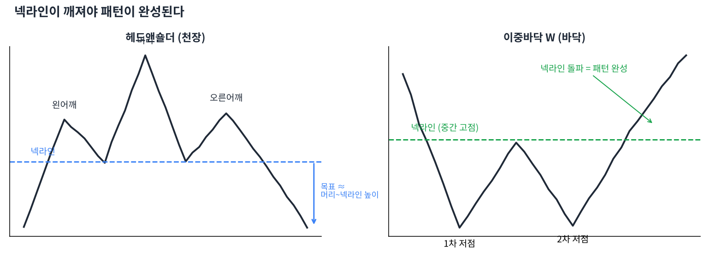
- **차트 패턴**: 캔들 수십 개가 모여 만드는 큰 모양입니다. 캔들 패턴보다 길게(몇 주~몇 달) 영향을 줍니다.
- **헤드앤숄더(머리어깨형)**: 왼쪽 어깨 – 더 높은 머리 – 낮은 오른쪽 어깨로 고점 3개가 생기는 천장 패턴입니다. 가장 유명한 하락 반전 신호입니다.
- **넥라인**: 헤드앤숄더에서 두 저점을 이은 선입니다. 패턴은 넥라인이 깨져야 완성됩니다. 깨지기 전에는 그냥 가능성일 뿐입니다.
- **역헤드앤숄더**: 헤드앤숄더를 뒤집은 바닥 패턴입니다. 넥라인을 위로 돌파할 때 거래량이 늘면 강한 상승 신호입니다.
- **이중천장(M자형)**: 비슷한 높이의 고점이 두 번 생기고 그 사이 저점이 깨지는 패턴입니다. 두 번 시도했는데 못 넘었다는 뜻입니다.
- **이중바닥(W자형)**: 비슷한 높이의 저점이 두 번 생기고 그 사이 고점을 넘는 바닥 패턴입니다. 두 번째 저점에서 거래량이 줄면 매도세가 지쳤다는 좋은 신호입니다.
- **삼중바닥 / 삼중천장**: 같은 자리를 세 번 테스트하는 패턴입니다. 이중 패턴보다 드물지만 완성되면 신뢰도가 높습니다.
- **원형바닥(접시형)**: 천천히 둥글게 바닥을 다지는 모양입니다. 시간이 오래 걸리지만 상승 전환이 길게 이어지는 경우가 많습니다.
- **V자 반등**: 급락 후 바로 급반등하는 모양입니다. 미리 예측하기 어렵고, 패턴이라기보다 큰 뉴스에 의한 반응인 경우가 많습니다.
- **목표가 계산**: 머리(또는 바닥)에서 넥라인까지의 높이만큼 돌파 지점에서 더하거나 뺍니다. 정확한 예언이 아니라 대략적인 가늠자입니다.
- **완성 전에는 기다리기**: "헤드앤숄더 같아서 미리 판다"는 자주 틀립니다. 넥라인 돌파(이탈)를 종가로 확인한 뒤 행동하는 것이 원칙입니다.
- **볼린저와의 연결**: 존 볼린저는 W바닥에서 두 번째 저점이 볼린저 밴드 '안쪽'에서 생기면 더 강한 신호라고 했습니다. (Day 14에서 자세히)

## Day 11 · 지속 패턴 — 잠깐 쉬고 가던 길로
> 추세 중간에 숨을 고르는 모양들. 대부분 원래 방향으로 다시 갑니다.
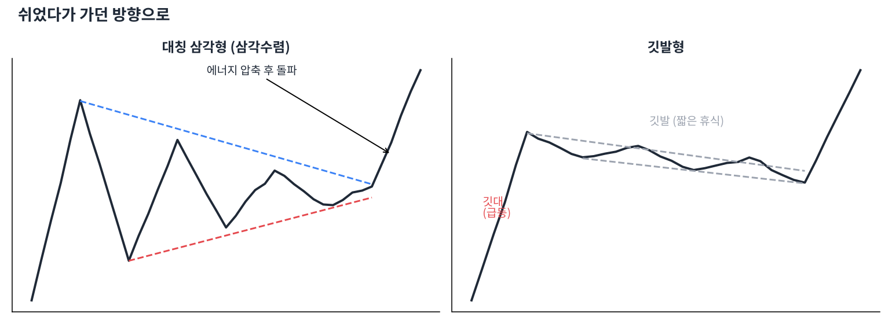
- **지속 패턴**: 추세가 잠시 쉬는 동안 생기는 모양으로, 끝나면 원래 추세 방향으로 이어지는 경우가 많습니다.
- **대칭 삼각형(삼각수렴)**: 고점은 낮아지고 저점은 높아지며 폭이 좁아지는 모양입니다. 에너지가 압축되는 중이고, 어느 쪽으로든 크게 터질 수 있습니다.
- **상승 삼각형**: 위는 수평 저항, 아래는 높아지는 저점입니다. 사는 쪽이 점점 높은 가격에서 사들이는 중이라 위로 돌파할 가능성이 큽니다.
- **하락 삼각형**: 아래는 수평 지지, 위는 낮아지는 고점입니다. 파는 쪽이 점점 낮은 가격에 내놓는 중이라 아래로 깨질 가능성이 큽니다.
- **깃발형**: 급등(깃대) 뒤에 짧게 약간 아래로 기울어진 평행 채널(깃발)이 생기는 모양입니다. 깃발 위로 돌파하면 깃대만큼 더 오르는 경우가 많습니다.
- **페넌트**: 깃발형과 비슷하지만 쉬는 구간이 작은 삼각형 모양입니다. 급등 후 짧게 수렴하고 다시 오릅니다.
- **상승 쐐기형**: 두 선이 모두 위로 기울며 좁아지는 모양입니다. 이름과 달리 힘이 빠지는 상승이라 아래로 깨지는 경우가 많습니다.
- **하락 쐐기형**: 두 선이 모두 아래로 기울며 좁아지는 모양입니다. 하락 힘이 약해지는 중이라 위로 돌파하는 경우가 많습니다.
- **컵앤핸들**: 둥근 바닥(컵) 뒤에 작은 눌림(손잡이)이 생기고 손잡이 고점을 돌파하는 패턴입니다. 성장주 매매에서 인기 있는 매수 신호입니다.
- **수렴 중 거래량**: 패턴이 진행될수록 거래량이 줄어들다가 돌파할 때 확 늘어나는 것이 정석입니다. 볼린저 밴드의 '스퀴즈'와 같은 원리입니다.
- **돌파 방향 확인**: 대칭 삼각형처럼 방향이 정해지지 않은 패턴은 미리 베팅하지 말고 돌파 방향을 확인한 뒤 따라갑니다.
- **패턴 실패 대처**: 돌파했다가 다시 패턴 안으로 들어오면 실패입니다. 이때는 고집하지 말고 손절하는 게 원칙입니다.

## Day 12 · RSI와 스토캐스틱 — 과열을 재는 온도계
> 많이 올랐는지, 많이 떨어졌는지 숫자로 보여 주는 지표들입니다.
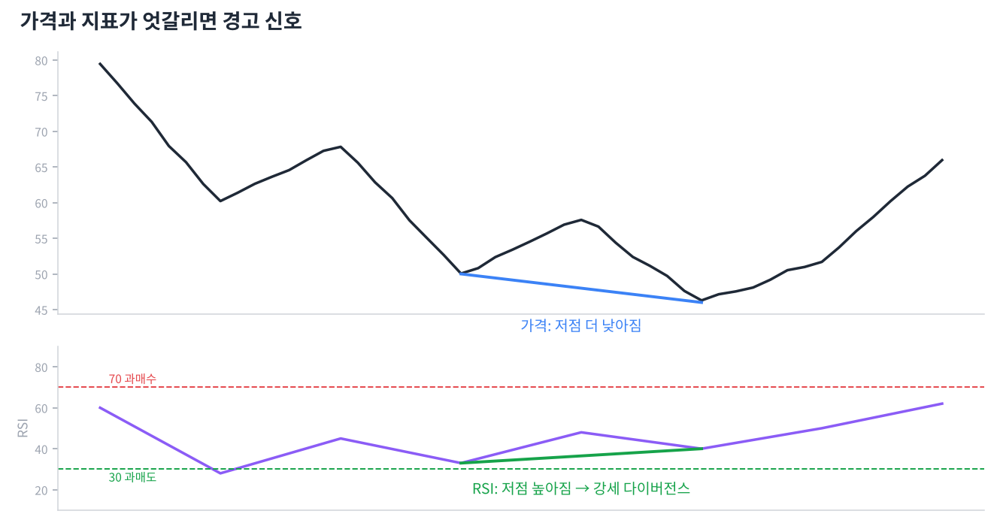
- **보조지표**: 가격과 거래량을 계산해 만든 지표입니다. 차트를 '보조'하는 도구일 뿐, 가격보다 앞설 수는 없습니다.
- **오실레이터**: 0~100처럼 정해진 범위 안에서 오르내리는 지표입니다. 과매수·과매도를 판단할 때 씁니다.
- **RSI(상대강도지수)**: 최근 14일 동안 오른 폭과 내린 폭을 비교해 0~100으로 나타낸 지표입니다. 오른 날의 힘이 셀수록 숫자가 높습니다.
- **70 이상 / 30 이하**: RSI 70 이상은 과매수(많이 올라 과열), 30 이하는 과매도(많이 떨어져 침체)로 봅니다.
- **과매수 ≠ 매도 신호**: 강한 상승추세에서는 RSI가 70 위에 몇 주씩 머물 수 있습니다. 과매수만 보고 팔면 큰 상승을 놓칩니다.
- **RSI 50선**: RSI가 50 위에서 놀면 상승 우위, 아래면 하락 우위입니다. 추세 판단 보조로 쓸 수 있습니다.
- **다이버전스(괴리)**: 가격과 지표가 반대로 움직이는 현상입니다. 추세가 약해지고 있다는 조기 경보입니다.
- **강세 다이버전스**: 가격은 저점을 더 낮췄는데 RSI 저점은 높아진 경우입니다. 떨어지는 힘이 약해졌다는 바닥 신호입니다.
- **약세 다이버전스**: 가격은 고점을 높였는데 RSI 고점은 낮아진 경우입니다. 오르는 힘이 약해졌다는 천장 신호입니다.
- **스토캐스틱**: 최근 N일 가격 범위 중 현재 가격이 어디쯤인지(%)를 보여 줍니다. %K(빠른 선)와 %D(느린 선)의 교차를 봅니다. 80 이상 과매수, 20 이하 과매도입니다.
- **MFI(자금흐름지수)**: RSI에 거래량을 더한 지표입니다. 존 볼린저는 밴드 신호를 확인할 때 MFI 같은 거래량 지표를 함께 쓰라고 했습니다.
- **토스봇 사례**: 토스봇은 자사주 공시로 산 종목을 RSI14가 70을 넘으면 다음 날 시가에 익절합니다. 과열 구간에서 이익을 확정하는 용도입니다.

## Day 13 · MACD와 추세 강도 지표
> 추세의 방향과 힘, 변동성을 재는 지표들입니다.
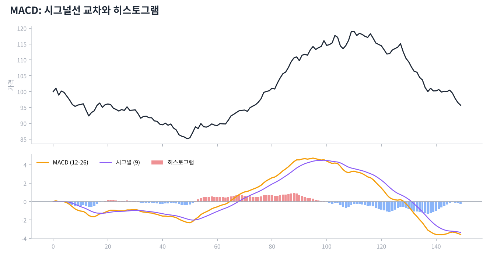
- **MACD**: 12일 지수이평에서 26일 지수이평을 뺀 값입니다. 단기 흐름이 장기 흐름보다 얼마나 앞서 있는지를 보여 줍니다.
- **시그널선**: MACD의 9일 지수이평입니다. MACD가 시그널선을 위로 뚫으면 매수 신호, 아래로 뚫으면 매도 신호로 봅니다.
- **히스토그램**: MACD와 시그널선의 차이를 막대로 그린 것입니다. 막대가 짧아지기 시작하면 추세의 힘이 줄어드는 중입니다.
- **0선 교차**: MACD가 0 위로 올라가면 단기 이평이 장기 이평 위에 있다는 뜻(골든크로스와 같은 의미)입니다.
- **MACD 다이버전스**: RSI처럼 가격과 MACD가 반대로 가면 추세 약화 신호입니다. 일봉보다 주봉에서 나올 때 더 의미 있습니다.
- **ADX(추세 강도)**: 방향과 관계없이 추세가 얼마나 강한지를 0~100으로 보여 줍니다. 25 이상이면 추세장, 20 이하면 횡보장으로 봅니다.
- **ADX 활용**: ADX가 낮을 때(횡보)는 RSI 같은 오실레이터가, 높을 때(추세)는 이평선·MACD 같은 추세 지표가 잘 맞습니다.
- **ATR(평균 실제 범위)**: 최근 14일 동안 하루 평균 얼마나 움직였는지를 가격으로 보여 줍니다. 손절 폭을 정할 때 유용합니다(예: 매수가 − 2×ATR).
- **일목균형표**: 일본에서 만든 종합 지표로, '구름대'가 핵심입니다. 가격이 구름 위면 상승, 아래면 하락, 구름 안이면 혼조로 봅니다.
- **선행 vs 후행 지표**: RSI·스토캐스틱은 비교적 빠르고(헛신호 많음), 이평선·MACD는 느립니다(늦지만 안정적). 장단점이 서로 반대입니다.
- **지표 과다 주의**: 지표 5~6개를 동시에 켜면 서로 다른 말을 해서 오히려 판단이 어려워집니다. 추세 지표 1개 + 오실레이터 1개 + 거래량 정도면 충분합니다.
- **지표는 가격의 그림자**: 모든 지표는 가격과 거래량에서 나온 2차 가공품입니다. 지표가 좋아 보여도 가격이 지지선을 깨면 가격을 믿습니다.

## Day 14 · 볼린저 밴드 — 존 볼린저의 방법
> 『Bollinger on Bollinger Bands』의 핵심. 우리 봇에 들어간 그 지표입니다.
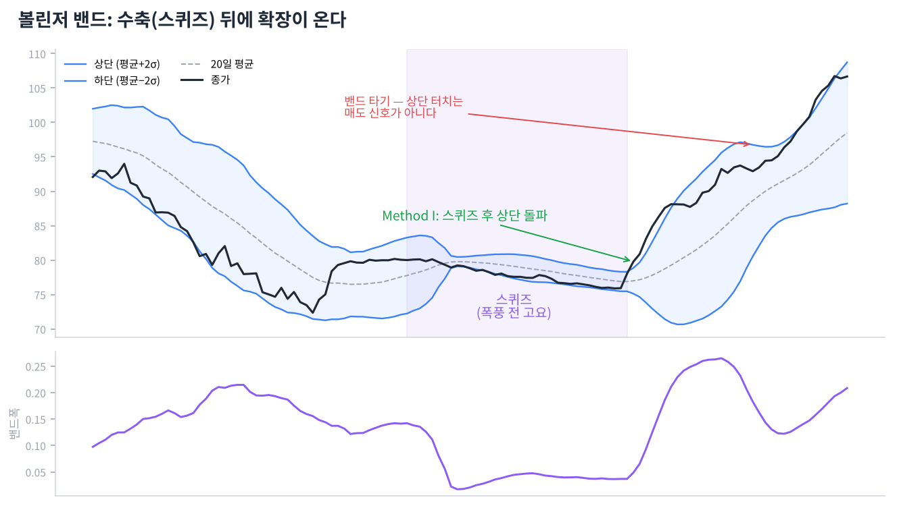
- **볼린저 밴드**: 존 볼린저가 1980년대에 만든 지표입니다. 20일 이동평균을 중심으로 위아래에 '표준편차 × 2'만큼 띄운 띠입니다.
- **표준편차**: 가격이 평균에서 얼마나 흩어져 있는지를 재는 통계 값입니다. 변동성이 크면 밴드가 넓어지고, 작으면 좁아집니다.
- **기본 설정 (20, 2)**: 책의 기본값입니다. 볼린저는 10일이면 1.9, 50일이면 2.1처럼 기간에 따라 배수를 조금 바꾸라고 권했습니다.
- **밴드는 상대적 고저**: 상단 근처면 '최근 기준으로 비싼 편', 하단 근처면 '싼 편'이라는 뜻입니다. 절대적인 매수·매도 가격이 아닙니다.
- **터치는 신호가 아니다**: 책에서 가장 강조하는 말입니다. 상단에 닿았다고 팔고 하단에 닿았다고 사는 건 오해이며, 반드시 다른 지표로 확인해야 합니다.
- **%b**: 가격이 밴드 안 어디쯤 있는지 숫자로 나타낸 것입니다. 1이면 상단, 0이면 하단, 0.5면 중심선, 1 초과면 상단 밖, 0 미만이면 하단 밖입니다.
- **밴드폭(BandWidth)**: (상단 − 하단) ÷ 중심선입니다. 밴드가 얼마나 넓은지를 숫자로 보여 줍니다.
- **스퀴즈**: 밴드폭이 최근 6개월 중 가장 좁아진 상태입니다. 변동성이 극도로 줄어 큰 움직임을 앞둔 '폭풍 전 고요'로 봅니다.
- **Method I — 스퀴즈 돌파**: 스퀴즈 후 가격이 밴드 밖으로 뚫고 나가는 방향을 따라가는 방법입니다. 거래량 지표가 같은 방향을 가리켜야 합니다.
- **헤드페이크**: 스퀴즈 후 처음에 반대 방향으로 살짝 속였다가 진짜 방향으로 크게 가는 움직임입니다. 첫 돌파를 무조건 믿지 않는 이유입니다.
- **밴드 타기(Walking the bands)**: 강한 추세에서는 가격이 상단 밴드에 붙어서 계속 올라갑니다. 이때 상단 터치를 매도 신호로 쓰면 큰 상승을 놓칩니다.
- **Method II — 추세 확인**: %b가 0.8 이상이고 MFI가 80 이상이면, 가격과 거래량이 같이 강한 상승으로 보고 따라갑니다.
- **Method III — W바닥 반전**: 첫 저점은 하단 밴드 밖, 두 번째 저점은 비슷한 가격이지만 밴드 안에서 생기면 매도세가 약해진 것입니다. 중간 고점을 넘을 때 삽니다.
- **M천장**: W바닥의 반대입니다. 두 번째 고점이 상단 밴드에 못 미치면 상승 힘이 약해진 천장 신호입니다.
- **우리 봇의 조합**: 차트 페이지는 볼린저 신호(스퀴즈 돌파 또는 W바닥) + 자사주 공시 + 외국인 순매수가 모두 맞을 때만 '매수'로 표시합니다.

## Day 15 · 피보나치와 갭
> 되돌림이 어디까지 올지, 빈 공간이 무엇을 뜻하는지 봅니다.
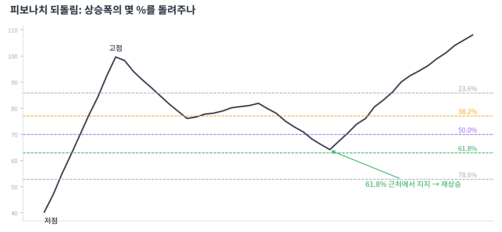
- **피보나치 되돌림**: 큰 상승(또는 하락) 폭의 23.6%, 38.2%, 50%, 61.8%, 78.6% 지점에 선을 그어 되돌림 목표를 가늠하는 도구입니다.
- **그리는 법**: 상승 구간이면 저점에서 고점으로 끌어 그립니다. 그러면 고점에서 아래로 각 비율의 가격선이 생깁니다.
- **38.2% 되돌림**: 강한 추세에서의 얕은 눌림입니다. 여기서 버티면 추세가 매우 강하다는 뜻입니다.
- **50% 되돌림**: 피보나치 수는 아니지만 '절반은 돌려준다'는 심리 때문에 많이 봅니다.
- **61.8% 되돌림**: '황금비율'로 불리는 자리로, 추세가 살아 있다면 마지막 방어선 역할을 하는 경우가 많습니다. 이 아래로 깨지면 추세 전환 가능성이 커집니다.
- **피보나치 확장(161.8%)**: 이전 고점을 돌파한 뒤 다음 목표가를 가늠할 때 씁니다.
- **겹치는 자리가 강하다**: 피보나치 선이 지지선, 이평선과 같은 가격대에 겹치면 그 자리의 신뢰도가 크게 올라갑니다.
- **보통 갭**: 횡보 중에 생기는 작은 갭입니다. 대부분 며칠 안에 메워지며 큰 의미가 없습니다.
- **돌파 갭**: 박스권·패턴을 벗어나면서 생기는 갭입니다. 거래량이 크게 실리면 새 추세의 시작으로 봅니다.
- **진행 갭**: 추세 중간에 한 번 더 생기는 갭입니다. 추세가 아직 한창이라는 뜻입니다.
- **소멸 갭**: 긴 추세 끝에서 마지막으로 생기는 갭입니다. 직후 반대로 꺾이며 갭을 메우면 추세 끝 신호입니다.
- **갭 메우기**: 가격이 다시 돌아와 갭 구간을 채우는 것입니다. 갭은 지지·저항 역할을 하지만, "모든 갭은 반드시 메워진다"는 말은 사실이 아닙니다.

## Day 16 · 수급과 공시 — 차트 뒤의 사람들
> 차트를 움직이는 건 결국 누가 사고 파느냐입니다.
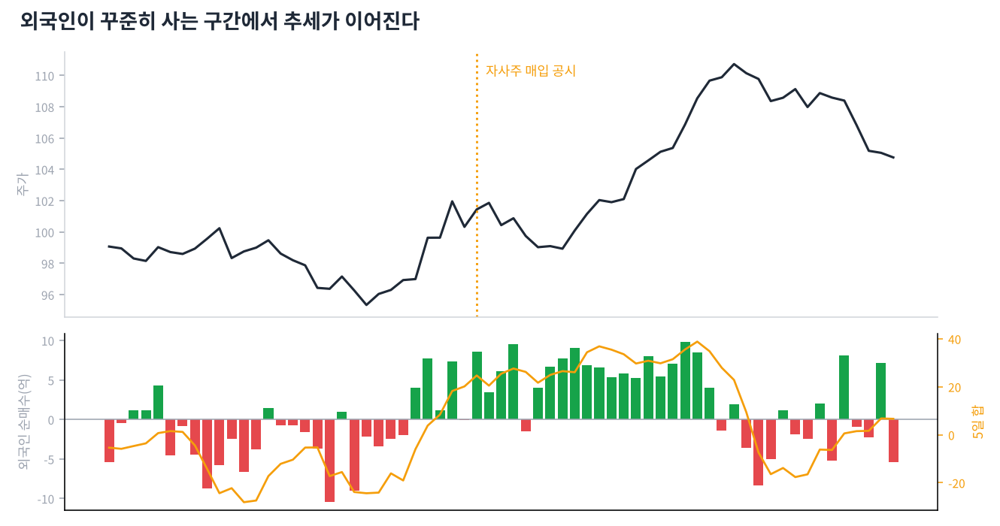
- **수급**: 수요(사려는 힘)와 공급(팔려는 힘)입니다. 한국 시장에서는 보통 개인·외국인·기관의 순매수를 말합니다.
- **외국인**: 해외 투자자입니다. 자금 규모가 크고 꾸준해서, 외국인이 며칠 연속 사는 종목은 추세가 이어지는 경우가 많습니다.
- **기관**: 연기금, 자산운용사, 보험사, 은행 등입니다. 연기금은 장기 자금, 투신(펀드)은 수익률 경쟁 자금이라 성격이 다릅니다.
- **개인**: 개인 투자자입니다. 개인만 사고 외국인·기관이 계속 파는 상승은 오래 못 가는 경우가 많습니다.
- **순매수**: 산 금액에서 판 금액을 뺀 값입니다. 양수면 더 많이 산 것입니다. 우리 봇은 외국인 5일 순매수 합계가 플러스인지를 봅니다.
- **프로그램 매매**: 컴퓨터가 정해진 조건에 따라 대량으로 주문하는 것입니다. 지수(코스피200) 대형주에 큰 영향을 줍니다.
- **공매도 잔고**: 주식을 빌려서 먼저 판 뒤 아직 갚지 않은 물량입니다. 많이 쌓인 종목이 오르기 시작하면 갚으려는 매수(숏커버링)로 급등하기도 합니다.
- **자사주 매입 공시**: 회사가 자기 돈으로 자기 주식을 사겠다는 공시입니다. 유통 주식이 줄고 '회사가 싸다고 본다'는 신호라 주가에 긍정적인 경우가 많습니다. 토스봇의 한국 전략이 바로 이것입니다.
- **취득결정 vs 신탁계약**: 취득결정은 회사가 직접 사는 것, 신탁계약은 증권사에 맡겨 나눠 사는 것입니다. 둘 다 매수 신호로 보지만 처분결정·신탁해지는 반대 신호입니다.
- **실적 발표와 갭**: 실적이 예상보다 좋거나 나쁘면 다음 날 큰 갭이 생깁니다. 실적 발표일 전후는 차트 신호가 무력해질 수 있습니다.
- **배당락 / 권리락**: 배당이나 무상증자 기준일 다음 날 주가가 기계적으로 조정되는 것입니다. 차트상 갑자기 떨어진 것처럼 보여도 실제 손해가 아닙니다.
- **VI(변동성 완화장치)**: 한국 시장에서 주가가 짧은 시간에 급변하면 2분간 단일가 매매로 바뀌는 장치입니다. VI 발동 직후는 가격이 크게 튈 수 있습니다.

## Day 17 · 매매 계획과 리스크 관리
> 차트 실력보다 더 중요한 것. 오래 살아남는 사람은 손실을 관리합니다.
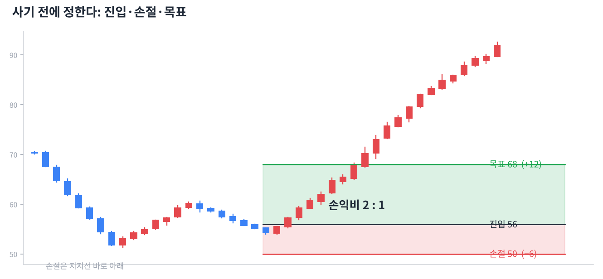
- **매매 계획**: 사기 전에 ① 어디서 살지 ② 어디서 손절할지 ③ 어디서 이익을 볼지를 미리 정하는 것입니다. 계획 없는 매수는 도박에 가깝습니다.
- **손절**: 내 판단이 틀렸다고 인정하고 손실을 확정하는 것입니다. 작은 손절은 큰 손실을 막는 보험료입니다.
- **손절 위치**: 차트상 '여기가 깨지면 내 근거가 무너진다'는 자리 바로 아래에 둡니다. 예: 지지선을 보고 샀다면 지지선 조금 아래입니다.
- **손익비**: 기대 이익 ÷ 감수할 손실입니다. 최소 2:1 이상인 자리만 고르면, 절반을 틀려도 돈을 벌 수 있습니다.
- **승률과 손익비**: 승률 40%라도 손익비가 2:1 이상이면 이익입니다. 승률만 높이려고 손절을 미루면 한 번의 큰 손실로 다 잃습니다.
- **포지션 크기 (1~2% 룰)**: 한 번의 매매에서 잃을 수 있는 금액을 전체 자금의 1~2%로 제한합니다. 손절 폭이 넓으면 그만큼 적게 삽니다.
- **분할 매수 / 분할 매도**: 한 번에 다 사지 않고 2~3번 나눠 사고팝니다. 평균 가격을 안정시키고 판단 실수의 충격을 줄입니다.
- **추격 매수 금지**: 이미 급등한 캔들을 보고 따라 사면 손절 자리가 멀어져 손익비가 나빠집니다. 눌림을 기다리는 습관이 중요합니다.
- **물타기 vs 불타기**: 물타기는 떨어질 때 더 사서 평단을 낮추는 것, 불타기는 맞았을 때 더 사는 것입니다. 초보에게 계획 없는 물타기는 가장 위험한 습관입니다.
- **멀티 타임프레임 확인**: 매수 전에 주봉 추세 → 일봉 자리 → (필요하면) 60분봉 타이밍 순서로 확인하면 실수가 줄어듭니다.
- **백테스트**: 과거 데이터로 전략을 시험해 보는 것입니다. 토스봇 전략도 2015~2026년 데이터로 검증했습니다.
- **과최적화 주의**: 과거 데이터에 딱 맞게 조건을 계속 고치면, 과거엔 완벽하지만 미래엔 안 맞는 전략이 됩니다. 단순한 규칙이 오래 갑니다.
- **수수료와 슬리피지**: 실제 매매에는 수수료·세금과 원하는 가격보다 불리하게 체결되는 차이(슬리피지)가 있습니다. 자주 사고팔수록 이 비용이 커집니다.

## Day 18 · 투자 심리와 습관
> 마지막 날. 차트를 아는 것과 차트대로 행동하는 것은 다릅니다.
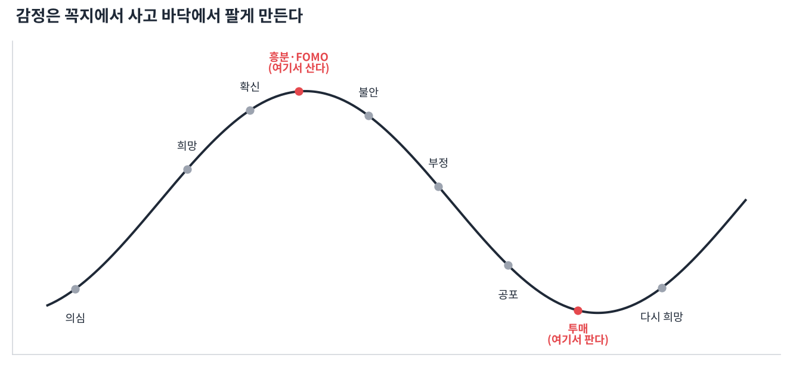
- **FOMO(놓칠까 봐 두려움)**: 남들이 버는 걸 보고 급하게 따라 사는 심리입니다. 이미 많이 오른 뒤 꼭지에서 사게 만드는 가장 흔한 원인입니다.
- **손실 회피**: 사람은 같은 금액이라도 잃는 고통을 얻는 기쁨보다 2배쯤 크게 느낍니다. 그래서 손절을 미루고 이익은 너무 빨리 확정하게 됩니다.
- **확증 편향**: 내가 산 종목에 유리한 정보만 찾고 불리한 신호는 무시하는 심리입니다. 매수 전에 '이게 틀렸다면 어떤 신호가 나올까'를 먼저 적어 보세요.
- **본전 심리**: "본전만 오면 팔겠다"는 생각은 손절 시점을 놓치게 하고, 본전이 오면 또 욕심이 생깁니다. 차트의 손절 자리가 기준이지 내 매수가가 기준이 아닙니다.
- **과신**: 몇 번 연속으로 맞으면 규칙을 무시하고 크게 베팅하게 됩니다. 연승 뒤일수록 포지션 크기 규칙을 지켜야 합니다.
- **보복 매매**: 손실 직후 만회하려고 충동적으로 매매하는 것입니다. 큰 손실 다음 날은 매매를 쉬는 규칙을 두면 좋습니다.
- **매매일지**: 산 이유, 판 이유, 결과, 감정을 기록하는 것입니다. 실력을 늘리는 가장 확실한 방법이고, 가치주 봇도 매매일지에서 출발했습니다.
- **복기**: 매매가 끝난 뒤 차트를 다시 보며 계획대로 했는지 확인하는 것입니다. 결과(수익/손실)보다 '규칙을 지켰는가'로 평가합니다.
- **체크리스트**: 매수 전 확인 목록입니다. 예: 주봉 추세 ↑? 지지선 근처? 거래량 확인? 손절 자리? 손익비 2:1 이상? 하나라도 '아니오'면 패스합니다.
- **쉬는 것도 매매**: 확실한 자리가 없으면 현금으로 기다리는 것도 훌륭한 선택입니다. 매일 사고팔 필요는 없습니다.
- **자동매매의 장점**: 봇은 감정 없이 규칙대로 움직입니다. 사람이 하기 어려운 손절·익절 규칙을 봇에게 맡기는 이유입니다.
- **지금부터 할 일**: 매일 관심 종목 하나를 정해 오늘 배운 개념(추세, 지지·저항, 거래량, 볼린저)을 차트에 직접 찾아보세요. 보는 눈은 반복으로만 생깁니다.
