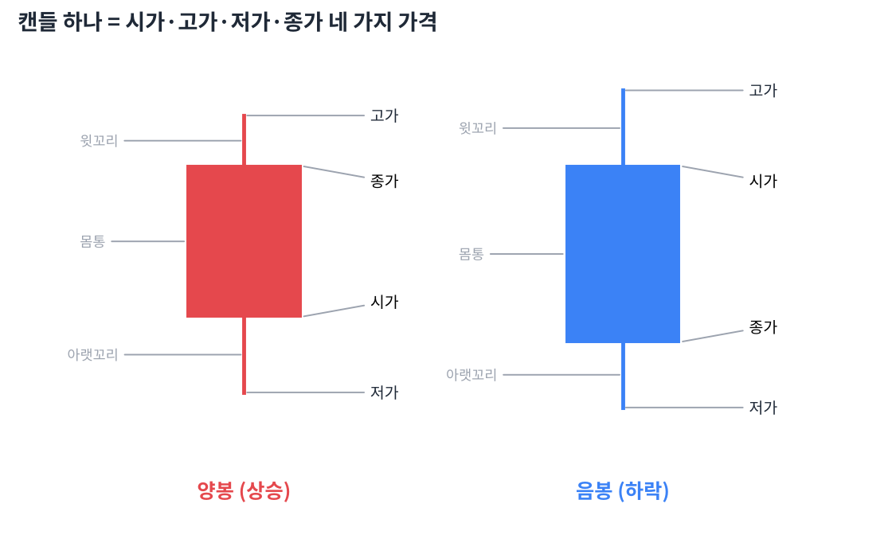

# Day 1 · 캔들 차트 첫걸음

> 차트의 가장 작은 단위, 캔들(봉) 하나를 읽는 법부터 시작합니다.

📚 차트 공부 1/18일차 · 개념 13개 · [전체 목차](../README.md)

그림: 캔들 하나의 구조 (개념 설명용 가상 데이터)

---

### 1. 차트

가격이 시간에 따라 어떻게 움직였는지 그린 그림입니다. 가로축은 시간, 세로축은 가격입니다.

### 2. 캔들(봉)

정해진 시간(하루, 일주일 등) 동안의 가격 움직임을 막대 하나로 압축한 것입니다. 일본 쌀 상인들이 쓰던 표기법이라 '일본식 캔들차트'라고도 부릅니다.

### 3. 시가

그 기간에 처음 거래된 가격입니다. 일봉이면 오전 9시 첫 체결 가격입니다.

### 4. 종가

그 기간의 마지막 가격입니다. 하루의 최종 합의 가격이라 네 가지 가격 중 가장 중요하게 봅니다.

### 5. 고가 / 저가

그 기간 중 가장 비쌌던 가격과 가장 쌌던 가격입니다.

### 6. 양봉

종가가 시가보다 높게 끝난 캔들입니다. 한국 차트에서는 빨간색입니다.

### 7. 음봉

종가가 시가보다 낮게 끝난 캔들입니다. 한국 차트에서는 파란색입니다.

### 8. 색깔 주의 (한국 vs 미국)

한국은 상승=빨강·하락=파랑, 미국은 상승=초록·하락=빨강입니다. 미국 주식을 볼 때 빨간색은 '떨어졌다'는 뜻입니다.

### 9. 몸통

시가와 종가 사이의 굵은 부분입니다. 몸통이 길수록 한쪽(매수 또는 매도)이 강하게 이겼다는 뜻입니다.

### 10. 윗꼬리

몸통 위로 뻗은 선입니다. 장중에 올라갔다가 밀려 내려왔다는 뜻으로, 위에서 파는 힘(매도 압력)이 있었다는 흔적입니다.

### 11. 아랫꼬리

몸통 아래로 뻗은 선입니다. 장중에 떨어졌다가 다시 올라왔다는 뜻으로, 아래에서 사는 힘(매수세)이 있었다는 흔적입니다.

### 12. 꼬리 읽기 연습

같은 양봉이라도 윗꼬리가 길면 "올랐지만 위에서 많이 팔았다", 아랫꼬리가 길면 "떨어졌지만 많이 사들였다"로 읽습니다.

### 13. 거래량 막대

차트 아래의 막대는 그 기간 동안 거래된 주식 수입니다. 가격이 '무엇이 일어났는지'라면 거래량은 '얼마나 많은 사람이 참여했는지'입니다.

---

### ✍️ 오늘의 연습

관심 종목 하나를 골라 오늘 배운 개념을 실제 차트에서 찾아보세요. 찾은 자리를 캡처해 두면 복습할 때 큰 도움이 됩니다.

---

[목차](../README.md) · [Day 2 시간의 단위 — 분봉에서 연봉까지 →](day02.md)
