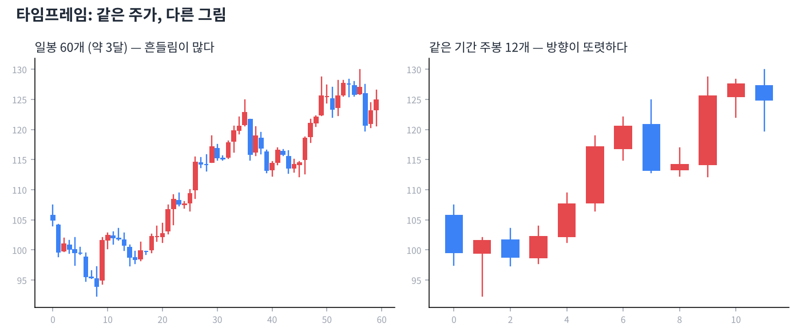

# Day 2 · 시간의 단위 — 분봉에서 연봉까지

> 같은 종목도 어떤 시간 단위로 보느냐에 따라 완전히 다르게 보입니다.

📚 차트 공부 2/18일차 · 개념 12개 · [전체 목차](../README.md)

그림: 같은 주가, 일봉 vs 주봉 (개념 설명용 가상 데이터)

---

### 1. 타임프레임

캔들 하나가 담는 시간의 길이입니다. 분봉·일봉·주봉·월봉·연봉이 있습니다.

### 2. 분봉

1분, 5분, 15분, 60분 등 하루 안의 움직임을 보는 차트입니다. 단타(데이트레이딩)용이며 잡음(의미 없는 흔들림)이 많습니다.

### 3. 일봉

캔들 하나 = 하루입니다. 가장 기본이 되는 차트로, 며칠~몇 주 보유하는 스윙 매매의 기준입니다.

### 4. 주봉

캔들 하나 = 일주일(월요일 시가 ~ 금요일 종가)입니다. 일봉의 잡음이 걸러져 중기 추세가 잘 보입니다.

### 5. 월봉

캔들 하나 = 한 달입니다. 몇 년 단위의 큰 흐름과 역사적 고점·저점을 확인할 때 씁니다.

### 6. 연봉

캔들 하나 = 1년입니다. 기업의 장기 성장 궤적을 볼 때 유용하고, 가치투자자가 즐겨 봅니다.

### 7. 큰 그림부터 (탑다운)

월봉/주봉으로 큰 방향을 먼저 보고, 일봉으로 들어갈 자리를 찾는 순서가 기본입니다. 주봉이 하락 중인데 일봉 반등만 보고 사면 역행하기 쉽습니다.

### 8. 타임프레임과 신뢰도

긴 시간 단위의 신호일수록 더 믿을 만합니다. 월봉의 지지선은 5분봉의 지지선보다 훨씬 강합니다.

### 9. 등락률

전날 종가 대비 오늘 가격이 몇 % 올랐거나 내렸는지입니다. '시가 대비'가 아니라 '전일 종가 대비'라는 점이 중요합니다.

### 10. 상한가 / 하한가

한국 주식은 하루에 전일 종가 대비 ±30%까지만 움직일 수 있습니다. 미국 주식에는 이런 제한이 없습니다.

### 11. 갭(Gap)

오늘 시가가 어제 가격 범위를 벗어나서 시작해 차트에 빈 공간이 생긴 것입니다. 밤사이 큰 뉴스(공시, 실적)가 있었다는 신호입니다.

### 12. 시가총액

주가 × 발행 주식 수, 즉 회사 전체의 시장 가격입니다. 주가 자체가 싸다고 회사가 싼 것은 아닙니다.

---

### ✍️ 오늘의 연습

관심 종목 하나를 골라 오늘 배운 개념을 실제 차트에서 찾아보세요. 찾은 자리를 캡처해 두면 복습할 때 큰 도움이 됩니다.

---

[← Day 1 캔들 차트 첫걸음](day01.md) · [목차](../README.md) · [Day 3 캔들 하나로 읽는 심리 →](day03.md)
