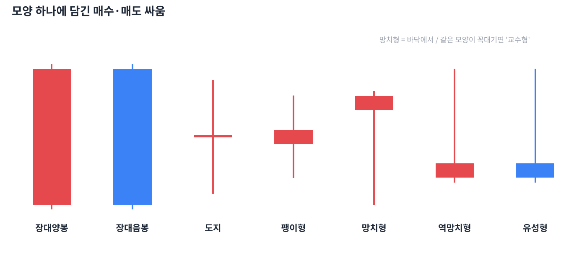

# Day 3 · 캔들 하나로 읽는 심리

> 모양이 독특한 캔들 하나에도 매수·매도 세력의 싸움이 담겨 있습니다.

📚 차트 공부 3/18일차 · 개념 12개 · [전체 목차](../README.md)

그림: 대표적인 단일 캔들 (개념 설명용 가상 데이터)

---

### 1. 장대양봉

몸통이 아주 긴 양봉입니다. 시작부터 끝까지 매수세가 압도했다는 뜻으로, 바닥권이나 저항 돌파 시점에 나오면 강한 신호입니다.

### 2. 장대음봉

몸통이 아주 긴 음봉입니다. 매도세가 압도했다는 뜻이며, 지지선을 깨면서 나오면 위험 신호입니다.

### 3. 도지(십자형)

시가와 종가가 거의 같아 몸통이 선처럼 얇은 캔들입니다. 사는 쪽과 파는 쪽이 팽팽했다는 뜻이고, 긴 추세 끝에 나오면 방향 전환의 예고일 수 있습니다.

### 4. 팽이형

몸통이 작고 위아래 꼬리가 비슷한 캔들입니다. 망설임·관망을 뜻하며 단독으로는 큰 의미가 없습니다.

### 5. 망치형

하락 추세 끝에서 몸통은 작고 아랫꼬리가 몸통의 2배 이상 긴 캔들입니다. 많이 떨어졌다가 강하게 되사들였다는 뜻으로 바닥 신호 후보입니다.

### 6. 교수형

망치형과 모양은 같지만 상승 추세 꼭대기에서 나온 것입니다. 장중 매도가 쏟아졌다는 경고로 읽습니다.

### 7. 역망치형

하락 추세 끝에서 윗꼬리가 긴 작은 캔들입니다. 매수세가 시험 삼아 올려 본 흔적이라, 다음 날 양봉이 나와야 의미가 생깁니다.

### 8. 유성형

역망치형과 모양은 같지만 상승 추세 꼭대기에서 나온 것입니다. 올랐다가 크게 밀렸다는 뜻이라 천장 신호 후보입니다.

### 9. 같은 모양, 다른 이름

망치형·교수형, 역망치형·유성형은 모양이 같습니다. 이름(의미)을 정하는 건 '어디서 나왔느냐(위치)'입니다.

### 10. 위치가 전부

캔들 신호는 추세의 끝, 지지선·저항선 근처에서 나올 때만 의미가 있습니다. 박스권 한가운데의 망치형은 그냥 잡음입니다.

### 11. 확인 캔들

신호 캔들 다음 날 캔들이 방향을 확인해 줘야 합니다. 망치형 다음 날 양봉으로 망치형 고가를 넘으면 신뢰도가 크게 올라갑니다.

### 12. 거래량 확인

신호 캔들에 평소보다 많은 거래량이 실리면 더 믿을 만합니다. 거래량 없는 신호는 소수의 움직임일 수 있습니다.

---

### ✍️ 오늘의 연습

관심 종목 하나를 골라 오늘 배운 개념을 실제 차트에서 찾아보세요. 찾은 자리를 캡처해 두면 복습할 때 큰 도움이 됩니다.

---

[← Day 2 시간의 단위 — 분봉에서 연봉까지](day02.md) · [목차](../README.md) · [Day 4 캔들 2~3개 조합 패턴 →](day04.md)
