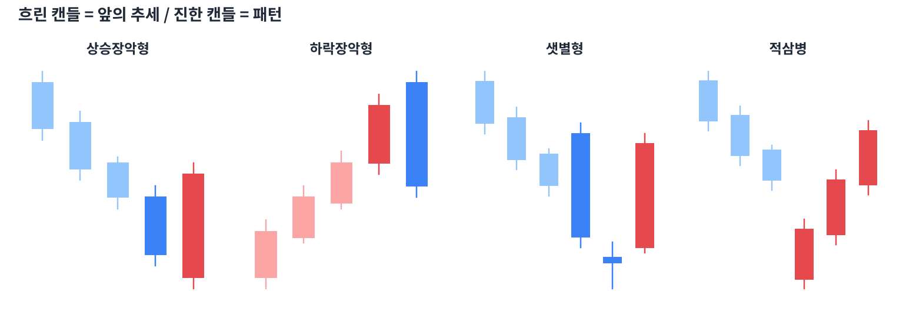

# Day 4 · 캔들 2~3개 조합 패턴

> 캔들 여러 개가 만드는 패턴은 하나짜리보다 신뢰도가 높습니다.

📚 차트 공부 4/18일차 · 개념 12개 · [전체 목차](../README.md)

그림: 대표적인 복합 캔들 패턴 (개념 설명용 가상 데이터)

---

### 1. 상승장악형

하락 중 작은 음봉 다음에 그 몸통을 완전히 감싸는 큰 양봉이 나온 패턴입니다. 매도세를 매수세가 '장악'했다는 뜻의 바닥 신호입니다.

### 2. 하락장악형

상승 중 작은 양봉 다음에 그 몸통을 완전히 감싸는 큰 음봉이 나온 패턴입니다. 천장 신호입니다.

### 3. 상승잉태형(하라미)

큰 음봉 다음에 그 몸통 안에 쏙 들어가는 작은 캔들이 나온 패턴입니다. 하락 힘이 약해졌다는 뜻이지만 장악형보다는 약한 신호입니다.

### 4. 관통형

하락 중 음봉 다음 날 갭하락으로 시작했다가 전날 음봉 몸통의 절반 이상까지 올라온 양봉입니다. 바닥 반전 신호입니다.

### 5. 먹구름형

관통형의 반대입니다. 상승 중 양봉 다음 날 갭상승으로 시작했다가 전날 양봉 몸통 절반 아래까지 밀린 음봉입니다.

### 6. 샛별형(모닝스타)

큰 음봉 → 작은 캔들(별) → 큰 양봉의 3개 조합입니다. 어둠 끝에 샛별이 뜬다는 뜻의 강한 바닥 신호입니다.

### 7. 석별형(이브닝스타)

큰 양봉 → 작은 캔들(별) → 큰 음봉입니다. 샛별형의 반대인 강한 천장 신호입니다.

### 8. 적삼병

양봉 3개가 연속으로 종가를 높여 가는 패턴입니다. 바닥권에서 나오면 상승 전환의 신호입니다.

### 9. 흑삼병

음봉 3개가 연속으로 종가를 낮춰 가는 패턴입니다. 고점권에서 나오면 하락 전환 신호입니다.

### 10. 패턴 신뢰도 높이는 3가지

① 추세 끝에서 나왔는가 ② 지지·저항 근처인가 ③ 거래량이 늘었는가. 셋 다 맞으면 신뢰도가 높습니다.

### 11. 캔들 패턴의 한계

캔들 패턴은 '단기(며칠)' 심리 변화를 보여 줄 뿐 목표가를 알려 주지 않습니다. 추세·지지저항과 함께 봐야 합니다.

### 12. 외우기보다 읽기

패턴 이름을 외우는 것보다 "누가 이겼고, 진 쪽이 얼마나 버텼나"를 캔들에서 읽는 연습이 훨씬 중요합니다.

---

### ✍️ 오늘의 연습

관심 종목 하나를 골라 오늘 배운 개념을 실제 차트에서 찾아보세요. 찾은 자리를 캡처해 두면 복습할 때 큰 도움이 됩니다.

---

[← Day 3 캔들 하나로 읽는 심리](day03.md) · [목차](../README.md) · [Day 5 추세 — 차트의 방향 →](day05.md)
