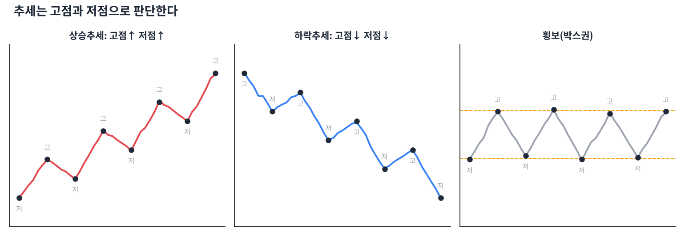

# Day 5 · 추세 — 차트의 방향

> "추세는 친구다." 방향을 아는 것이 모든 매매의 출발점입니다.

📚 차트 공부 5/18일차 · 개념 12개 · [전체 목차](../README.md)

그림: 상승·하락·횡보 추세 (개념 설명용 가상 데이터)

---

### 1. 추세

가격이 일정 기간 한 방향으로 움직이는 경향입니다. 상승, 하락, 횡보 세 가지뿐입니다.

### 2. 상승추세

고점과 저점이 계속 높아지는 상태입니다. (고점↑ 저점↑) 눌릴 때마다 사는 사람이 더 높은 가격에서 기다린다는 뜻입니다.

### 3. 하락추세

고점과 저점이 계속 낮아지는 상태입니다. (고점↓ 저점↓) 반등할 때마다 파는 사람이 더 낮은 가격에서 기다립니다.

### 4. 횡보(박스권)

고점과 저점이 일정한 범위 안에서 반복되는 상태입니다. 방향이 정해지지 않은 '힘 비축' 구간입니다.

### 5. 고점·저점 찾기

주변 캔들보다 확실히 튀어나온 꼭짓점이 고점, 움푹 들어간 곳이 저점입니다. 추세 판단은 이 꼭짓점들을 잇는 것에서 시작합니다.

### 6. 추세 전환 신호

상승추세에서 직전 저점이 깨지면(저점↓) 추세가 꺾였을 가능성이 커집니다. 하락추세에서는 직전 고점 돌파가 전환 신호입니다.

### 7. 다우 이론

찰스 다우가 정리한 추세 이론으로, 시장에는 주추세(1년 이상)·중기추세(몇 주~몇 달)·단기추세(며칠)가 겹쳐 있다고 봅니다.

### 8. 추세의 관성

한 번 생긴 추세는 확실한 반전 신호가 나올 때까지 이어지려는 성질이 있습니다. "바닥 같다"는 느낌만으로 하락추세를 거슬러 사면 안 됩니다.

### 9. 추세 순응 매매

상승추세에서는 사는 쪽(눌림목 매수)만, 하락추세에서는 쉬거나 현금 보유가 초보에게 가장 안전한 원칙입니다.

### 10. 눌림목

상승추세 중 잠깐 쉬며 내려오는 구간입니다. 추세가 살아 있다면 눌림목은 싸게 살 기회입니다.

### 11. 추세의 기간

일봉으로는 하락인데 주봉으로는 상승일 수 있습니다. 내가 몇 일~몇 주 보유할 계획인지에 맞는 타임프레임의 추세를 기준으로 삼습니다.

### 12. 횡보에서의 함정

박스권 안에서는 추세 신호(돌파처럼 보이는 움직임)가 자주 실패합니다. 박스를 확실히 벗어날 때까지 추세 매매를 쉬는 것도 방법입니다.

---

### ✍️ 오늘의 연습

관심 종목 하나를 골라 오늘 배운 개념을 실제 차트에서 찾아보세요. 찾은 자리를 캡처해 두면 복습할 때 큰 도움이 됩니다.

---

[← Day 4 캔들 2~3개 조합 패턴](day04.md) · [목차](../README.md) · [Day 6 추세선과 채널 →](day06.md)
