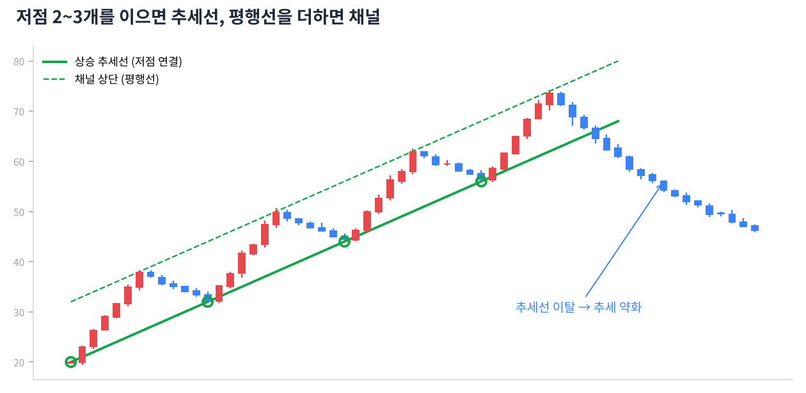

# Day 6 · 추세선과 채널

> 고점과 저점을 선으로 이으면 추세가 눈에 보이게 됩니다.

📚 차트 공부 6/18일차 · 개념 12개 · [전체 목차](../README.md)

그림: 추세선과 채널 (개념 설명용 가상 데이터)

---

### 1. 추세선

상승추세에서는 저점들을, 하락추세에서는 고점들을 이은 직선입니다.

### 2. 상승 추세선 긋기

최소 2개의 저점을 잇고, 3번째 저점이 선에 닿으면 '확인된' 추세선이 됩니다. 닿은 횟수가 많을수록 강합니다.

### 3. 하락 추세선 긋기

낮아지는 고점 2~3개를 잇습니다. 이 선을 뚫고 올라가는 것이 하락추세 탈출의 첫 신호입니다.

### 4. 꼬리냐 몸통이냐

추세선을 꼬리 끝에 맞출지 몸통(종가)에 맞출지 정답은 없습니다. 많은 점에 자연스럽게 닿는 쪽을 고르고, 일관되게 쓰는 게 중요합니다.

### 5. 추세선 이탈

상승 추세선 아래로 종가가 확실히 내려가면 추세가 약해졌다는 신호입니다. 하루 살짝 뚫은 것보다 2~3일 연속 이탈이나 큰 음봉 이탈을 더 믿습니다.

### 6. 기울기

추세선이 너무 가파르면(급등) 오래 못 갑니다. 45도 안팎의 완만한 추세가 오래 지속되는 경향이 있습니다.

### 7. 추세선 다시 긋기

추세가 빨라지거나 느려지면 새 저점을 기준으로 선을 다시 긋습니다. 차트는 계속 업데이트하는 지도입니다.

### 8. 채널

추세선과 평행하게 반대쪽 꼭짓점에 선을 하나 더 그은 것입니다. 가격이 두 선 사이를 오가는 통로가 됩니다.

### 9. 상승 채널 활용

아래 선 근처는 매수 후보 자리, 위 선 근처는 일부 이익 실현 자리로 봅니다.

### 10. 채널 이탈

상승 채널 위로 강하게 뚫으면 가속, 아래로 뚫으면 추세 약화입니다. 어느 쪽이든 거래량이 실려야 진짜입니다.

### 11. 역할 전환

깨진 상승 추세선은 이후 반등 때 저항선 역할을 하는 경우가 많습니다. 다시 올라와 선에 닿고 밀리면 이탈이 확인된 것입니다.

### 12. 선은 영역이다

추세선을 칼같은 한 가격으로 보지 말고 약간의 폭이 있는 '구역'으로 보세요. 몇 원 차이로 판단을 뒤집지 않게 됩니다.

---

### ✍️ 오늘의 연습

관심 종목 하나를 골라 오늘 배운 개념을 실제 차트에서 찾아보세요. 찾은 자리를 캡처해 두면 복습할 때 큰 도움이 됩니다.

---

[← Day 5 추세 — 차트의 방향](day05.md) · [목차](../README.md) · [Day 7 지지선과 저항선 →](day07.md)
