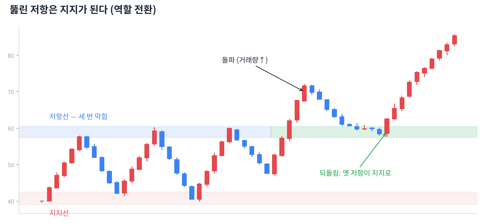

# Day 7 · 지지선과 저항선

> 가격이 자꾸 멈추는 자리에는 이유가 있습니다.

📚 차트 공부 7/18일차 · 개념 12개 · [전체 목차](../README.md)

그림: 지지·저항과 역할 전환 (개념 설명용 가상 데이터)

---

### 1. 지지선

가격이 내려오다 여러 번 멈추고 반등한 가격대입니다. 그 가격이면 사겠다는 사람이 많이 모여 있는 곳입니다.

### 2. 저항선

가격이 올라가다 여러 번 막히고 밀린 가격대입니다. 그 가격이면 팔겠다는 사람이 많은 곳입니다.

### 3. 왜 생길까 (심리)

예전에 그 가격에 산 사람은 본전이 오면 팔고 싶고(저항), 놓친 사람은 다시 오면 사고 싶어 합니다(지지). 사람의 기억이 선을 만듭니다.

### 4. 매물대

과거에 거래가 많이 일어난 가격 구간입니다. 그 가격에 물려 있는 사람이 많아 위로는 저항, 아래로는 지지가 되기 쉽습니다.

### 5. 전고점 / 전저점

직전 고점과 저점은 가장 기본적인 저항과 지지입니다. 많은 사람이 같은 자리를 보기 때문에 실제로 반응이 잘 나옵니다.

### 6. 라운드 넘버

10,000원, 50,000원, 100달러 같은 딱 떨어지는 가격도 심리적 지지·저항이 됩니다.

### 7. 역할 전환

저항선을 뚫고 올라가면 그 선이 이후 지지선이 되고, 지지선이 깨지면 저항선이 됩니다. 가장 자주 쓰이는 차트 원리 중 하나입니다.

### 8. 돌파

종가가 저항선 위에서 마감하는 것입니다. 장중에 잠깐 넘은 건 돌파가 아닙니다. 거래량이 평소의 1.5~2배 이상 실리면 신뢰도가 높습니다.

### 9. 거짓 돌파(속임수)

저항을 넘는 것처럼 보이다가 다시 아래로 들어오는 것입니다. 돌파 직후 바로 따라 사면 이런 함정에 자주 걸립니다.

### 10. 되돌림(풀백) 매수

돌파 후 가격이 다시 내려와 옛 저항선(이제 지지선)에서 버티는지 확인하고 사는 방법입니다. 추격 매수보다 안전합니다.

### 11. 여러 번 테스트

지지선을 여러 번 건드릴수록 그 자리의 매수 물량이 소진되어 결국 깨질 가능성도 커집니다. "많이 버텼다 = 영원히 버틴다"가 아닙니다.

### 12. 박스권 매매

횡보장에서는 지지선 근처에서 사고 저항선 근처에서 파는 전략을 씁니다. 단, 지지선이 깨지면 바로 손절하는 규칙이 꼭 필요합니다.

---

### ✍️ 오늘의 연습

관심 종목 하나를 골라 오늘 배운 개념을 실제 차트에서 찾아보세요. 찾은 자리를 캡처해 두면 복습할 때 큰 도움이 됩니다.

---

[← Day 6 추세선과 채널](day06.md) · [목차](../README.md) · [Day 8 거래량 — 가격의 연료 →](day08.md)
