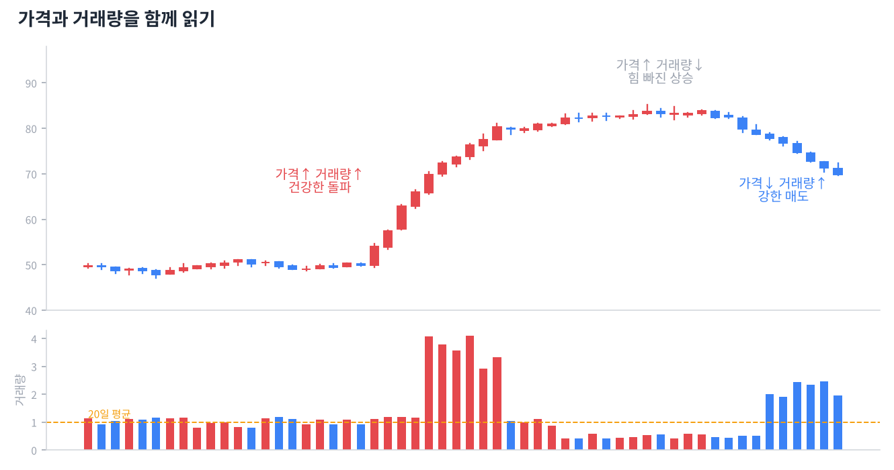

# Day 8 · 거래량 — 가격의 연료

> 가격은 거짓말을 해도 거래량은 잘 속이지 못합니다.

📚 차트 공부 8/18일차 · 개념 12개 · [전체 목차](../README.md)

그림: 가격과 거래량의 조합 (개념 설명용 가상 데이터)

---

### 1. 거래량

일정 기간 거래된 주식 수입니다. 시장 참여자들의 관심과 확신의 크기를 보여 줍니다.

### 2. 거래대금

거래량 × 가격, 즉 실제로 오간 돈의 양입니다. 주가가 다른 종목끼리 비교할 때는 거래대금이 더 정확합니다.

### 3. 가격↑ 거래량↑

건강한 상승입니다. 많은 사람이 높은 가격에도 사려고 한다는 뜻입니다.

### 4. 가격↑ 거래량↓

힘 빠진 상승입니다. 사는 사람이 줄고 있어 오래 못 갈 수 있습니다.

### 5. 가격↓ 거래량↑

강한 매도입니다. 특히 지지선을 깨면서 거래량이 터지면 위험 신호입니다.

### 6. 가격↓ 거래량↓

매도세가 지쳐 가는 하락입니다. 바닥이 가까울 수 있지만 반등 확인이 필요합니다.

### 7. 거래량 급증

평소의 3~5배 이상 거래량이 터지면 큰 뉴스나 큰손의 움직임이 있다는 뜻입니다. 위치(바닥/천장)에 따라 의미가 정반대가 됩니다.

### 8. 바닥권 대량 거래

오래 떨어진 뒤 큰 거래량과 함께 아랫꼬리가 나오면 '투매 후 손바뀜'으로 바닥 신호일 수 있습니다.

### 9. 천장권 대량 거래

오래 오른 뒤 거래량이 폭발하는데 가격이 더 못 오르면, 큰손이 개인에게 물량을 넘기는 '설거지' 신호일 수 있습니다.

### 10. 평균 거래량

보통 최근 20일 평균과 비교합니다. "오늘 거래량이 많다/적다"는 항상 평소 대비로 판단합니다.

### 11. 유동성

거래가 얼마나 활발한지입니다. 거래대금이 너무 적은 종목은 원하는 가격에 사고팔기 어렵고, 소수가 가격을 흔들기 쉽습니다.

### 12. OBV(누적 거래량)

오른 날 거래량은 더하고 내린 날은 빼서 누적한 지표입니다. 가격은 제자리인데 OBV가 오르면 조용히 매집 중일 가능성이 있습니다.

---

### ✍️ 오늘의 연습

관심 종목 하나를 골라 오늘 배운 개념을 실제 차트에서 찾아보세요. 찾은 자리를 캡처해 두면 복습할 때 큰 도움이 됩니다.

---

[← Day 7 지지선과 저항선](day07.md) · [목차](../README.md) · [Day 9 이동평균선 →](day09.md)
