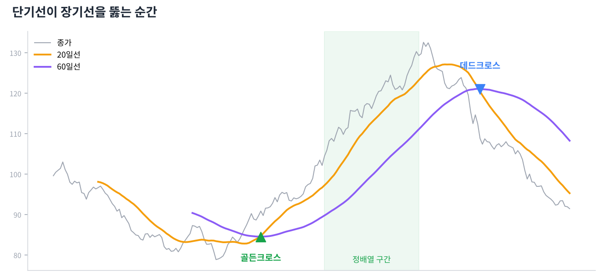

# Day 9 · 이동평균선

> 들쭉날쭉한 가격을 부드럽게 만든 선. 추세를 한눈에 보는 가장 대중적인 도구입니다.

📚 차트 공부 9/18일차 · 개념 12개 · [전체 목차](../README.md)

그림: 정배열과 골든크로스·데드크로스 (개념 설명용 가상 데이터)

---

### 1. 이동평균선(이평선)

최근 N일 종가의 평균을 이어 그린 선입니다. 20일선 = 최근 20거래일 평균 가격입니다.

### 2. 주요 이평선

5일(1주), 20일(1달), 60일(분기), 120일(반년), 200일·240일(1년)이 많이 쓰입니다.

### 3. 단기 vs 장기

짧은 이평선은 가격을 빠르게 따라가고, 긴 이평선은 천천히 움직이며 큰 추세를 보여 줍니다.

### 4. 단순(SMA) vs 지수(EMA)

단순이평은 모든 날을 똑같이, 지수이평은 최근 가격에 더 큰 비중을 줍니다. 지수이평이 더 빨리 반응합니다.

### 5. 이평선 위/아래

가격이 이평선 위에 있으면 그 기간 평균 매수자들이 이익 상태, 아래면 손실 상태입니다. 그래서 이평선 자체가 지지·저항이 됩니다.

### 6. 정배열

위에서부터 단기 → 장기 순서로 이평선이 나란히 놓인 상태(5 > 20 > 60 > 120)입니다. 건강한 상승추세의 모습입니다.

### 7. 역배열

장기 → 단기 순서로 위에서부터 놓인 상태입니다. 하락추세이며, 반등이 나와도 위의 이평선들이 차례로 저항이 됩니다.

### 8. 골든크로스

단기 이평선이 장기 이평선을 아래에서 위로 뚫는 것입니다. 상승 전환 신호로 봅니다.

### 9. 데드크로스

단기 이평선이 장기 이평선을 위에서 아래로 뚫는 것입니다. 하락 전환 신호로 봅니다.

### 10. 200일선

1년 평균 가격으로, 장기 추세의 기준선입니다. 토스봇 미국 전략도 QQQ가 200일선 위에 있을 때만 레버리지를 씁니다.

### 11. 이격도

현재 가격이 이평선에서 얼마나 떨어져 있는지(%)입니다. 너무 멀리 떨어지면 다시 평균 쪽으로 돌아오려는 경향이 있습니다.

### 12. 이평선의 약점(후행성)

과거 평균이라 항상 늦습니다. 골든크로스가 나왔을 때는 이미 꽤 오른 뒤인 경우가 많고, 횡보장에서는 크로스가 자주 헛신호를 냅니다.

---

### ✍️ 오늘의 연습

관심 종목 하나를 골라 오늘 배운 개념을 실제 차트에서 찾아보세요. 찾은 자리를 캡처해 두면 복습할 때 큰 도움이 됩니다.

---

[← Day 8 거래량 — 가격의 연료](day08.md) · [목차](../README.md) · [Day 10 반전 패턴 — 추세가 뒤집힐 때 →](day10.md)
