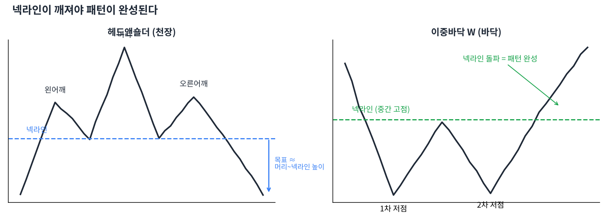

# Day 10 · 반전 패턴 — 추세가 뒤집힐 때

> 오래 이어진 추세가 끝날 때 차트에 자주 나타나는 모양들입니다.

📚 차트 공부 10/18일차 · 개념 12개 · [전체 목차](../README.md)

그림: 헤드앤숄더와 이중바닥 (개념 설명용 가상 데이터)

---

### 1. 차트 패턴

캔들 수십 개가 모여 만드는 큰 모양입니다. 캔들 패턴보다 길게(몇 주~몇 달) 영향을 줍니다.

### 2. 헤드앤숄더(머리어깨형)

왼쪽 어깨 – 더 높은 머리 – 낮은 오른쪽 어깨로 고점 3개가 생기는 천장 패턴입니다. 가장 유명한 하락 반전 신호입니다.

### 3. 넥라인

헤드앤숄더에서 두 저점을 이은 선입니다. 패턴은 넥라인이 깨져야 완성됩니다. 깨지기 전에는 그냥 가능성일 뿐입니다.

### 4. 역헤드앤숄더

헤드앤숄더를 뒤집은 바닥 패턴입니다. 넥라인을 위로 돌파할 때 거래량이 늘면 강한 상승 신호입니다.

### 5. 이중천장(M자형)

비슷한 높이의 고점이 두 번 생기고 그 사이 저점이 깨지는 패턴입니다. 두 번 시도했는데 못 넘었다는 뜻입니다.

### 6. 이중바닥(W자형)

비슷한 높이의 저점이 두 번 생기고 그 사이 고점을 넘는 바닥 패턴입니다. 두 번째 저점에서 거래량이 줄면 매도세가 지쳤다는 좋은 신호입니다.

### 7. 삼중바닥 / 삼중천장

같은 자리를 세 번 테스트하는 패턴입니다. 이중 패턴보다 드물지만 완성되면 신뢰도가 높습니다.

### 8. 원형바닥(접시형)

천천히 둥글게 바닥을 다지는 모양입니다. 시간이 오래 걸리지만 상승 전환이 길게 이어지는 경우가 많습니다.

### 9. V자 반등

급락 후 바로 급반등하는 모양입니다. 미리 예측하기 어렵고, 패턴이라기보다 큰 뉴스에 의한 반응인 경우가 많습니다.

### 10. 목표가 계산

머리(또는 바닥)에서 넥라인까지의 높이만큼 돌파 지점에서 더하거나 뺍니다. 정확한 예언이 아니라 대략적인 가늠자입니다.

### 11. 완성 전에는 기다리기

"헤드앤숄더 같아서 미리 판다"는 자주 틀립니다. 넥라인 돌파(이탈)를 종가로 확인한 뒤 행동하는 것이 원칙입니다.

### 12. 볼린저와의 연결

존 볼린저는 W바닥에서 두 번째 저점이 볼린저 밴드 '안쪽'에서 생기면 더 강한 신호라고 했습니다. (Day 14에서 자세히)

---

### ✍️ 오늘의 연습

관심 종목 하나를 골라 오늘 배운 개념을 실제 차트에서 찾아보세요. 찾은 자리를 캡처해 두면 복습할 때 큰 도움이 됩니다.

---

[← Day 9 이동평균선](day09.md) · [목차](../README.md) · [Day 11 지속 패턴 — 잠깐 쉬고 가던 길로 →](day11.md)
