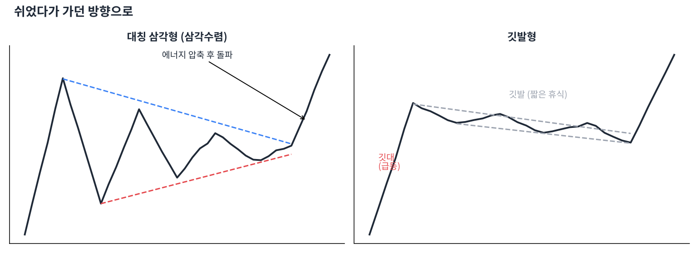

# Day 11 · 지속 패턴 — 잠깐 쉬고 가던 길로

> 추세 중간에 숨을 고르는 모양들. 대부분 원래 방향으로 다시 갑니다.

📚 차트 공부 11/18일차 · 개념 12개 · [전체 목차](../README.md)

그림: 삼각수렴과 깃발형 (개념 설명용 가상 데이터)

---

### 1. 지속 패턴

추세가 잠시 쉬는 동안 생기는 모양으로, 끝나면 원래 추세 방향으로 이어지는 경우가 많습니다.

### 2. 대칭 삼각형(삼각수렴)

고점은 낮아지고 저점은 높아지며 폭이 좁아지는 모양입니다. 에너지가 압축되는 중이고, 어느 쪽으로든 크게 터질 수 있습니다.

### 3. 상승 삼각형

위는 수평 저항, 아래는 높아지는 저점입니다. 사는 쪽이 점점 높은 가격에서 사들이는 중이라 위로 돌파할 가능성이 큽니다.

### 4. 하락 삼각형

아래는 수평 지지, 위는 낮아지는 고점입니다. 파는 쪽이 점점 낮은 가격에 내놓는 중이라 아래로 깨질 가능성이 큽니다.

### 5. 깃발형

급등(깃대) 뒤에 짧게 약간 아래로 기울어진 평행 채널(깃발)이 생기는 모양입니다. 깃발 위로 돌파하면 깃대만큼 더 오르는 경우가 많습니다.

### 6. 페넌트

깃발형과 비슷하지만 쉬는 구간이 작은 삼각형 모양입니다. 급등 후 짧게 수렴하고 다시 오릅니다.

### 7. 상승 쐐기형

두 선이 모두 위로 기울며 좁아지는 모양입니다. 이름과 달리 힘이 빠지는 상승이라 아래로 깨지는 경우가 많습니다.

### 8. 하락 쐐기형

두 선이 모두 아래로 기울며 좁아지는 모양입니다. 하락 힘이 약해지는 중이라 위로 돌파하는 경우가 많습니다.

### 9. 컵앤핸들

둥근 바닥(컵) 뒤에 작은 눌림(손잡이)이 생기고 손잡이 고점을 돌파하는 패턴입니다. 성장주 매매에서 인기 있는 매수 신호입니다.

### 10. 수렴 중 거래량

패턴이 진행될수록 거래량이 줄어들다가 돌파할 때 확 늘어나는 것이 정석입니다. 볼린저 밴드의 '스퀴즈'와 같은 원리입니다.

### 11. 돌파 방향 확인

대칭 삼각형처럼 방향이 정해지지 않은 패턴은 미리 베팅하지 말고 돌파 방향을 확인한 뒤 따라갑니다.

### 12. 패턴 실패 대처

돌파했다가 다시 패턴 안으로 들어오면 실패입니다. 이때는 고집하지 말고 손절하는 게 원칙입니다.

---

### ✍️ 오늘의 연습

관심 종목 하나를 골라 오늘 배운 개념을 실제 차트에서 찾아보세요. 찾은 자리를 캡처해 두면 복습할 때 큰 도움이 됩니다.

---

[← Day 10 반전 패턴 — 추세가 뒤집힐 때](day10.md) · [목차](../README.md) · [Day 12 RSI와 스토캐스틱 — 과열을 재는 온도계 →](day12.md)
