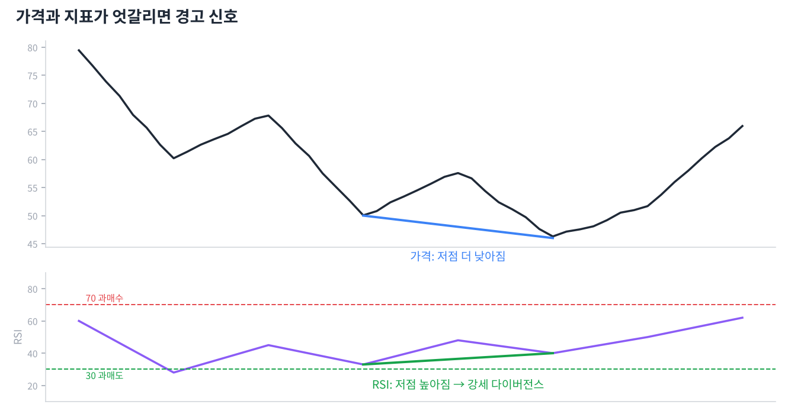

# Day 12 · RSI와 스토캐스틱 — 과열을 재는 온도계

> 많이 올랐는지, 많이 떨어졌는지 숫자로 보여 주는 지표들입니다.

📚 차트 공부 12/18일차 · 개념 12개 · [전체 목차](../README.md)

그림: RSI와 다이버전스 (개념 설명용 가상 데이터)

---

### 1. 보조지표

가격과 거래량을 계산해 만든 지표입니다. 차트를 '보조'하는 도구일 뿐, 가격보다 앞설 수는 없습니다.

### 2. 오실레이터

0~100처럼 정해진 범위 안에서 오르내리는 지표입니다. 과매수·과매도를 판단할 때 씁니다.

### 3. RSI(상대강도지수)

최근 14일 동안 오른 폭과 내린 폭을 비교해 0~100으로 나타낸 지표입니다. 오른 날의 힘이 셀수록 숫자가 높습니다.

### 4. 70 이상 / 30 이하

RSI 70 이상은 과매수(많이 올라 과열), 30 이하는 과매도(많이 떨어져 침체)로 봅니다.

### 5. 과매수 ≠ 매도 신호

강한 상승추세에서는 RSI가 70 위에 몇 주씩 머물 수 있습니다. 과매수만 보고 팔면 큰 상승을 놓칩니다.

### 6. RSI 50선

RSI가 50 위에서 놀면 상승 우위, 아래면 하락 우위입니다. 추세 판단 보조로 쓸 수 있습니다.

### 7. 다이버전스(괴리)

가격과 지표가 반대로 움직이는 현상입니다. 추세가 약해지고 있다는 조기 경보입니다.

### 8. 강세 다이버전스

가격은 저점을 더 낮췄는데 RSI 저점은 높아진 경우입니다. 떨어지는 힘이 약해졌다는 바닥 신호입니다.

### 9. 약세 다이버전스

가격은 고점을 높였는데 RSI 고점은 낮아진 경우입니다. 오르는 힘이 약해졌다는 천장 신호입니다.

### 10. 스토캐스틱

최근 N일 가격 범위 중 현재 가격이 어디쯤인지(%)를 보여 줍니다. %K(빠른 선)와 %D(느린 선)의 교차를 봅니다. 80 이상 과매수, 20 이하 과매도입니다.

### 11. MFI(자금흐름지수)

RSI에 거래량을 더한 지표입니다. 존 볼린저는 밴드 신호를 확인할 때 MFI 같은 거래량 지표를 함께 쓰라고 했습니다.

### 12. 토스봇 사례

토스봇은 자사주 공시로 산 종목을 RSI14가 70을 넘으면 다음 날 시가에 익절합니다. 과열 구간에서 이익을 확정하는 용도입니다.

---

### ✍️ 오늘의 연습

관심 종목 하나를 골라 오늘 배운 개념을 실제 차트에서 찾아보세요. 찾은 자리를 캡처해 두면 복습할 때 큰 도움이 됩니다.

---

[← Day 11 지속 패턴 — 잠깐 쉬고 가던 길로](day11.md) · [목차](../README.md) · [Day 13 MACD와 추세 강도 지표 →](day13.md)
