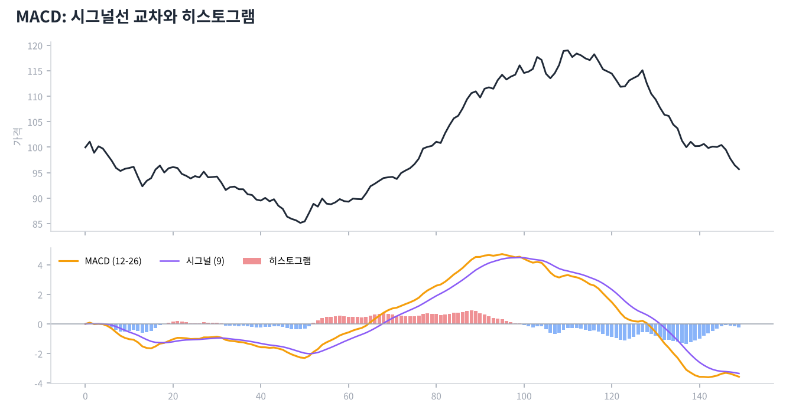

# Day 13 · MACD와 추세 강도 지표

> 추세의 방향과 힘, 변동성을 재는 지표들입니다.

📚 차트 공부 13/18일차 · 개념 12개 · [전체 목차](../README.md)

그림: MACD 구성 (개념 설명용 가상 데이터)

---

### 1. MACD

12일 지수이평에서 26일 지수이평을 뺀 값입니다. 단기 흐름이 장기 흐름보다 얼마나 앞서 있는지를 보여 줍니다.

### 2. 시그널선

MACD의 9일 지수이평입니다. MACD가 시그널선을 위로 뚫으면 매수 신호, 아래로 뚫으면 매도 신호로 봅니다.

### 3. 히스토그램

MACD와 시그널선의 차이를 막대로 그린 것입니다. 막대가 짧아지기 시작하면 추세의 힘이 줄어드는 중입니다.

### 4. 0선 교차

MACD가 0 위로 올라가면 단기 이평이 장기 이평 위에 있다는 뜻(골든크로스와 같은 의미)입니다.

### 5. MACD 다이버전스

RSI처럼 가격과 MACD가 반대로 가면 추세 약화 신호입니다. 일봉보다 주봉에서 나올 때 더 의미 있습니다.

### 6. ADX(추세 강도)

방향과 관계없이 추세가 얼마나 강한지를 0~100으로 보여 줍니다. 25 이상이면 추세장, 20 이하면 횡보장으로 봅니다.

### 7. ADX 활용

ADX가 낮을 때(횡보)는 RSI 같은 오실레이터가, 높을 때(추세)는 이평선·MACD 같은 추세 지표가 잘 맞습니다.

### 8. ATR(평균 실제 범위)

최근 14일 동안 하루 평균 얼마나 움직였는지를 가격으로 보여 줍니다. 손절 폭을 정할 때 유용합니다(예: 매수가 − 2×ATR).

### 9. 일목균형표

일본에서 만든 종합 지표로, '구름대'가 핵심입니다. 가격이 구름 위면 상승, 아래면 하락, 구름 안이면 혼조로 봅니다.

### 10. 선행 vs 후행 지표

RSI·스토캐스틱은 비교적 빠르고(헛신호 많음), 이평선·MACD는 느립니다(늦지만 안정적). 장단점이 서로 반대입니다.

### 11. 지표 과다 주의

지표 5~6개를 동시에 켜면 서로 다른 말을 해서 오히려 판단이 어려워집니다. 추세 지표 1개 + 오실레이터 1개 + 거래량 정도면 충분합니다.

### 12. 지표는 가격의 그림자

모든 지표는 가격과 거래량에서 나온 2차 가공품입니다. 지표가 좋아 보여도 가격이 지지선을 깨면 가격을 믿습니다.

---

### ✍️ 오늘의 연습

관심 종목 하나를 골라 오늘 배운 개념을 실제 차트에서 찾아보세요. 찾은 자리를 캡처해 두면 복습할 때 큰 도움이 됩니다.

---

[← Day 12 RSI와 스토캐스틱 — 과열을 재는 온도계](day12.md) · [목차](../README.md) · [Day 14 볼린저 밴드 — 존 볼린저의 방법 →](day14.md)
