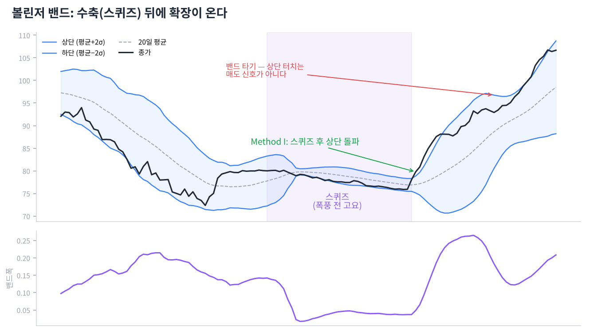

# Day 14 · 볼린저 밴드 — 존 볼린저의 방법

> 『Bollinger on Bollinger Bands』의 핵심. 우리 봇에 들어간 그 지표입니다.

📚 차트 공부 14/18일차 · 개념 15개 · [전체 목차](../README.md)

그림: 볼린저 밴드 — 스퀴즈와 돌파 (개념 설명용 가상 데이터)

---

### 1. 볼린저 밴드

존 볼린저가 1980년대에 만든 지표입니다. 20일 이동평균을 중심으로 위아래에 '표준편차 × 2'만큼 띄운 띠입니다.

### 2. 표준편차

가격이 평균에서 얼마나 흩어져 있는지를 재는 통계 값입니다. 변동성이 크면 밴드가 넓어지고, 작으면 좁아집니다.

### 3. 기본 설정 (20, 2)

책의 기본값입니다. 볼린저는 10일이면 1.9, 50일이면 2.1처럼 기간에 따라 배수를 조금 바꾸라고 권했습니다.

### 4. 밴드는 상대적 고저

상단 근처면 '최근 기준으로 비싼 편', 하단 근처면 '싼 편'이라는 뜻입니다. 절대적인 매수·매도 가격이 아닙니다.

### 5. 터치는 신호가 아니다

책에서 가장 강조하는 말입니다. 상단에 닿았다고 팔고 하단에 닿았다고 사는 건 오해이며, 반드시 다른 지표로 확인해야 합니다.

### 6. %b

가격이 밴드 안 어디쯤 있는지 숫자로 나타낸 것입니다. 1이면 상단, 0이면 하단, 0.5면 중심선, 1 초과면 상단 밖, 0 미만이면 하단 밖입니다.

### 7. 밴드폭(BandWidth)

(상단 − 하단) ÷ 중심선입니다. 밴드가 얼마나 넓은지를 숫자로 보여 줍니다.

### 8. 스퀴즈

밴드폭이 최근 6개월 중 가장 좁아진 상태입니다. 변동성이 극도로 줄어 큰 움직임을 앞둔 '폭풍 전 고요'로 봅니다.

### 9. Method I — 스퀴즈 돌파

스퀴즈 후 가격이 밴드 밖으로 뚫고 나가는 방향을 따라가는 방법입니다. 거래량 지표가 같은 방향을 가리켜야 합니다.

### 10. 헤드페이크

스퀴즈 후 처음에 반대 방향으로 살짝 속였다가 진짜 방향으로 크게 가는 움직임입니다. 첫 돌파를 무조건 믿지 않는 이유입니다.

### 11. 밴드 타기(Walking the bands)

강한 추세에서는 가격이 상단 밴드에 붙어서 계속 올라갑니다. 이때 상단 터치를 매도 신호로 쓰면 큰 상승을 놓칩니다.

### 12. Method II — 추세 확인

%b가 0.8 이상이고 MFI가 80 이상이면, 가격과 거래량이 같이 강한 상승으로 보고 따라갑니다.

### 13. Method III — W바닥 반전

첫 저점은 하단 밴드 밖, 두 번째 저점은 비슷한 가격이지만 밴드 안에서 생기면 매도세가 약해진 것입니다. 중간 고점을 넘을 때 삽니다.

### 14. M천장

W바닥의 반대입니다. 두 번째 고점이 상단 밴드에 못 미치면 상승 힘이 약해진 천장 신호입니다.

### 15. 우리 봇의 조합

차트 페이지는 볼린저 신호(스퀴즈 돌파 또는 W바닥) + 자사주 공시 + 외국인 순매수가 모두 맞을 때만 '매수'로 표시합니다.

---

### ✍️ 오늘의 연습

관심 종목 하나를 골라 오늘 배운 개념을 실제 차트에서 찾아보세요. 찾은 자리를 캡처해 두면 복습할 때 큰 도움이 됩니다.

---

[← Day 13 MACD와 추세 강도 지표](day13.md) · [목차](../README.md) · [Day 15 피보나치와 갭 →](day15.md)
