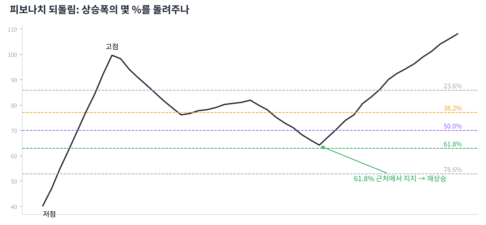

# Day 15 · 피보나치와 갭

> 되돌림이 어디까지 올지, 빈 공간이 무엇을 뜻하는지 봅니다.

📚 차트 공부 15/18일차 · 개념 12개 · [전체 목차](../README.md)

그림: 피보나치 되돌림 (개념 설명용 가상 데이터)

---

### 1. 피보나치 되돌림

큰 상승(또는 하락) 폭의 23.6%, 38.2%, 50%, 61.8%, 78.6% 지점에 선을 그어 되돌림 목표를 가늠하는 도구입니다.

### 2. 그리는 법

상승 구간이면 저점에서 고점으로 끌어 그립니다. 그러면 고점에서 아래로 각 비율의 가격선이 생깁니다.

### 3. 38.2% 되돌림

강한 추세에서의 얕은 눌림입니다. 여기서 버티면 추세가 매우 강하다는 뜻입니다.

### 4. 50% 되돌림

피보나치 수는 아니지만 '절반은 돌려준다'는 심리 때문에 많이 봅니다.

### 5. 61.8% 되돌림

'황금비율'로 불리는 자리로, 추세가 살아 있다면 마지막 방어선 역할을 하는 경우가 많습니다. 이 아래로 깨지면 추세 전환 가능성이 커집니다.

### 6. 피보나치 확장(161.8%)

이전 고점을 돌파한 뒤 다음 목표가를 가늠할 때 씁니다.

### 7. 겹치는 자리가 강하다

피보나치 선이 지지선, 이평선과 같은 가격대에 겹치면 그 자리의 신뢰도가 크게 올라갑니다.

### 8. 보통 갭

횡보 중에 생기는 작은 갭입니다. 대부분 며칠 안에 메워지며 큰 의미가 없습니다.

### 9. 돌파 갭

박스권·패턴을 벗어나면서 생기는 갭입니다. 거래량이 크게 실리면 새 추세의 시작으로 봅니다.

### 10. 진행 갭

추세 중간에 한 번 더 생기는 갭입니다. 추세가 아직 한창이라는 뜻입니다.

### 11. 소멸 갭

긴 추세 끝에서 마지막으로 생기는 갭입니다. 직후 반대로 꺾이며 갭을 메우면 추세 끝 신호입니다.

### 12. 갭 메우기

가격이 다시 돌아와 갭 구간을 채우는 것입니다. 갭은 지지·저항 역할을 하지만, "모든 갭은 반드시 메워진다"는 말은 사실이 아닙니다.

---

### ✍️ 오늘의 연습

관심 종목 하나를 골라 오늘 배운 개념을 실제 차트에서 찾아보세요. 찾은 자리를 캡처해 두면 복습할 때 큰 도움이 됩니다.

---

[← Day 14 볼린저 밴드 — 존 볼린저의 방법](day14.md) · [목차](../README.md) · [Day 16 수급과 공시 — 차트 뒤의 사람들 →](day16.md)
