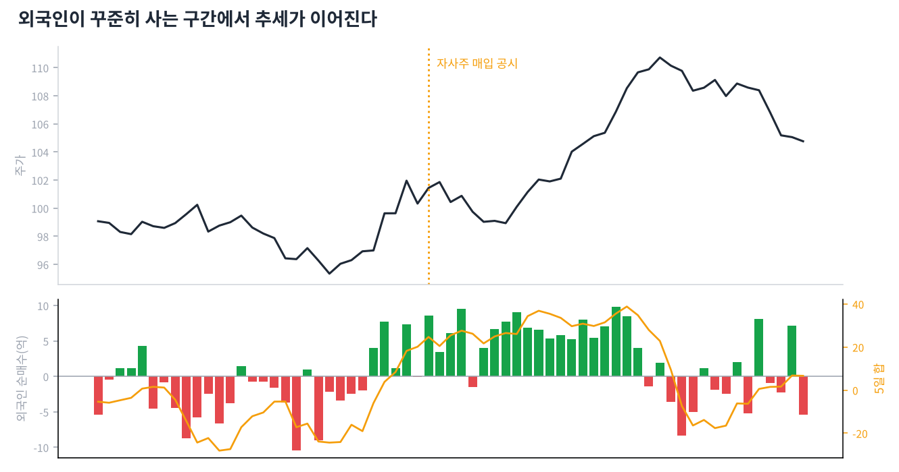

# Day 16 · 수급과 공시 — 차트 뒤의 사람들

> 차트를 움직이는 건 결국 누가 사고 파느냐입니다.

📚 차트 공부 16/18일차 · 개념 12개 · [전체 목차](../README.md)

그림: 외국인 수급과 주가 (개념 설명용 가상 데이터)

---

### 1. 수급

수요(사려는 힘)와 공급(팔려는 힘)입니다. 한국 시장에서는 보통 개인·외국인·기관의 순매수를 말합니다.

### 2. 외국인

해외 투자자입니다. 자금 규모가 크고 꾸준해서, 외국인이 며칠 연속 사는 종목은 추세가 이어지는 경우가 많습니다.

### 3. 기관

연기금, 자산운용사, 보험사, 은행 등입니다. 연기금은 장기 자금, 투신(펀드)은 수익률 경쟁 자금이라 성격이 다릅니다.

### 4. 개인

개인 투자자입니다. 개인만 사고 외국인·기관이 계속 파는 상승은 오래 못 가는 경우가 많습니다.

### 5. 순매수

산 금액에서 판 금액을 뺀 값입니다. 양수면 더 많이 산 것입니다. 우리 봇은 외국인 5일 순매수 합계가 플러스인지를 봅니다.

### 6. 프로그램 매매

컴퓨터가 정해진 조건에 따라 대량으로 주문하는 것입니다. 지수(코스피200) 대형주에 큰 영향을 줍니다.

### 7. 공매도 잔고

주식을 빌려서 먼저 판 뒤 아직 갚지 않은 물량입니다. 많이 쌓인 종목이 오르기 시작하면 갚으려는 매수(숏커버링)로 급등하기도 합니다.

### 8. 자사주 매입 공시

회사가 자기 돈으로 자기 주식을 사겠다는 공시입니다. 유통 주식이 줄고 '회사가 싸다고 본다'는 신호라 주가에 긍정적인 경우가 많습니다. 토스봇의 한국 전략이 바로 이것입니다.

### 9. 취득결정 vs 신탁계약

취득결정은 회사가 직접 사는 것, 신탁계약은 증권사에 맡겨 나눠 사는 것입니다. 둘 다 매수 신호로 보지만 처분결정·신탁해지는 반대 신호입니다.

### 10. 실적 발표와 갭

실적이 예상보다 좋거나 나쁘면 다음 날 큰 갭이 생깁니다. 실적 발표일 전후는 차트 신호가 무력해질 수 있습니다.

### 11. 배당락 / 권리락

배당이나 무상증자 기준일 다음 날 주가가 기계적으로 조정되는 것입니다. 차트상 갑자기 떨어진 것처럼 보여도 실제 손해가 아닙니다.

### 12. VI(변동성 완화장치)

한국 시장에서 주가가 짧은 시간에 급변하면 2분간 단일가 매매로 바뀌는 장치입니다. VI 발동 직후는 가격이 크게 튈 수 있습니다.

---

### ✍️ 오늘의 연습

관심 종목 하나를 골라 오늘 배운 개념을 실제 차트에서 찾아보세요. 찾은 자리를 캡처해 두면 복습할 때 큰 도움이 됩니다.

---

[← Day 15 피보나치와 갭](day15.md) · [목차](../README.md) · [Day 17 매매 계획과 리스크 관리 →](day17.md)
