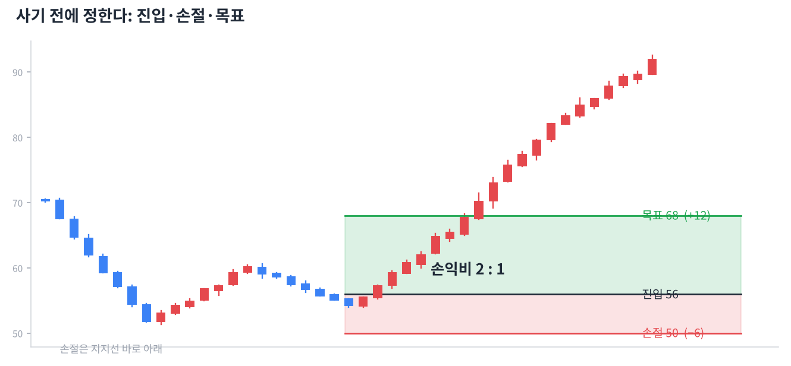

# Day 17 · 매매 계획과 리스크 관리

> 차트 실력보다 더 중요한 것. 오래 살아남는 사람은 손실을 관리합니다.

📚 차트 공부 17/18일차 · 개념 13개 · [전체 목차](../README.md)

그림: 진입·손절·목표와 손익비 (개념 설명용 가상 데이터)

---

### 1. 매매 계획

사기 전에 ① 어디서 살지 ② 어디서 손절할지 ③ 어디서 이익을 볼지를 미리 정하는 것입니다. 계획 없는 매수는 도박에 가깝습니다.

### 2. 손절

내 판단이 틀렸다고 인정하고 손실을 확정하는 것입니다. 작은 손절은 큰 손실을 막는 보험료입니다.

### 3. 손절 위치

차트상 '여기가 깨지면 내 근거가 무너진다'는 자리 바로 아래에 둡니다. 예: 지지선을 보고 샀다면 지지선 조금 아래입니다.

### 4. 손익비

기대 이익 ÷ 감수할 손실입니다. 최소 2:1 이상인 자리만 고르면, 절반을 틀려도 돈을 벌 수 있습니다.

### 5. 승률과 손익비

승률 40%라도 손익비가 2:1 이상이면 이익입니다. 승률만 높이려고 손절을 미루면 한 번의 큰 손실로 다 잃습니다.

### 6. 포지션 크기 (1~2% 룰)

한 번의 매매에서 잃을 수 있는 금액을 전체 자금의 1~2%로 제한합니다. 손절 폭이 넓으면 그만큼 적게 삽니다.

### 7. 분할 매수 / 분할 매도

한 번에 다 사지 않고 2~3번 나눠 사고팝니다. 평균 가격을 안정시키고 판단 실수의 충격을 줄입니다.

### 8. 추격 매수 금지

이미 급등한 캔들을 보고 따라 사면 손절 자리가 멀어져 손익비가 나빠집니다. 눌림을 기다리는 습관이 중요합니다.

### 9. 물타기 vs 불타기

물타기는 떨어질 때 더 사서 평단을 낮추는 것, 불타기는 맞았을 때 더 사는 것입니다. 초보에게 계획 없는 물타기는 가장 위험한 습관입니다.

### 10. 멀티 타임프레임 확인

매수 전에 주봉 추세 → 일봉 자리 → (필요하면) 60분봉 타이밍 순서로 확인하면 실수가 줄어듭니다.

### 11. 백테스트

과거 데이터로 전략을 시험해 보는 것입니다. 토스봇 전략도 2015~2026년 데이터로 검증했습니다.

### 12. 과최적화 주의

과거 데이터에 딱 맞게 조건을 계속 고치면, 과거엔 완벽하지만 미래엔 안 맞는 전략이 됩니다. 단순한 규칙이 오래 갑니다.

### 13. 수수료와 슬리피지

실제 매매에는 수수료·세금과 원하는 가격보다 불리하게 체결되는 차이(슬리피지)가 있습니다. 자주 사고팔수록 이 비용이 커집니다.

---

### ✍️ 오늘의 연습

관심 종목 하나를 골라 오늘 배운 개념을 실제 차트에서 찾아보세요. 찾은 자리를 캡처해 두면 복습할 때 큰 도움이 됩니다.

---

[← Day 16 수급과 공시 — 차트 뒤의 사람들](day16.md) · [목차](../README.md) · [Day 18 투자 심리와 습관 →](day18.md)
