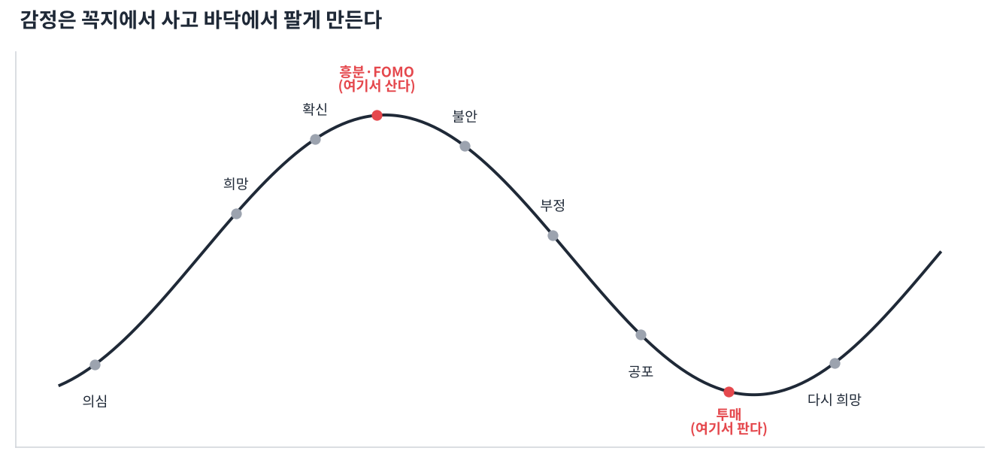

# Day 18 · 투자 심리와 습관

> 마지막 날. 차트를 아는 것과 차트대로 행동하는 것은 다릅니다.

📚 차트 공부 18/18일차 · 개념 12개 · [전체 목차](../README.md)

그림: 흔한 실수의 감정 사이클 (개념 설명용 가상 데이터)

---

### 1. FOMO(놓칠까 봐 두려움)

남들이 버는 걸 보고 급하게 따라 사는 심리입니다. 이미 많이 오른 뒤 꼭지에서 사게 만드는 가장 흔한 원인입니다.

### 2. 손실 회피

사람은 같은 금액이라도 잃는 고통을 얻는 기쁨보다 2배쯤 크게 느낍니다. 그래서 손절을 미루고 이익은 너무 빨리 확정하게 됩니다.

### 3. 확증 편향

내가 산 종목에 유리한 정보만 찾고 불리한 신호는 무시하는 심리입니다. 매수 전에 '이게 틀렸다면 어떤 신호가 나올까'를 먼저 적어 보세요.

### 4. 본전 심리

"본전만 오면 팔겠다"는 생각은 손절 시점을 놓치게 하고, 본전이 오면 또 욕심이 생깁니다. 차트의 손절 자리가 기준이지 내 매수가가 기준이 아닙니다.

### 5. 과신

몇 번 연속으로 맞으면 규칙을 무시하고 크게 베팅하게 됩니다. 연승 뒤일수록 포지션 크기 규칙을 지켜야 합니다.

### 6. 보복 매매

손실 직후 만회하려고 충동적으로 매매하는 것입니다. 큰 손실 다음 날은 매매를 쉬는 규칙을 두면 좋습니다.

### 7. 매매일지

산 이유, 판 이유, 결과, 감정을 기록하는 것입니다. 실력을 늘리는 가장 확실한 방법이고, 가치주 봇도 매매일지에서 출발했습니다.

### 8. 복기

매매가 끝난 뒤 차트를 다시 보며 계획대로 했는지 확인하는 것입니다. 결과(수익/손실)보다 '규칙을 지켰는가'로 평가합니다.

### 9. 체크리스트

매수 전 확인 목록입니다. 예: 주봉 추세 ↑? 지지선 근처? 거래량 확인? 손절 자리? 손익비 2:1 이상? 하나라도 '아니오'면 패스합니다.

### 10. 쉬는 것도 매매

확실한 자리가 없으면 현금으로 기다리는 것도 훌륭한 선택입니다. 매일 사고팔 필요는 없습니다.

### 11. 자동매매의 장점

봇은 감정 없이 규칙대로 움직입니다. 사람이 하기 어려운 손절·익절 규칙을 봇에게 맡기는 이유입니다.

### 12. 지금부터 할 일

매일 관심 종목 하나를 정해 오늘 배운 개념(추세, 지지·저항, 거래량, 볼린저)을 차트에 직접 찾아보세요. 보는 눈은 반복으로만 생깁니다.

---

### ✍️ 오늘의 연습

관심 종목 하나를 골라 오늘 배운 개념을 실제 차트에서 찾아보세요. 찾은 자리를 캡처해 두면 복습할 때 큰 도움이 됩니다.

---

[← Day 17 매매 계획과 리스크 관리](day17.md) · [목차](../README.md)
