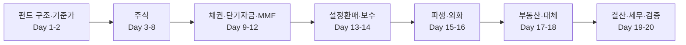

# 📘 펀드회계 백과 — 펀드회계 실무자를 위한 자산별 회계처리

운용이 아니라 **회계처리와 업무 프로세스** 관점에서 주식·채권·단기자금·파생·외화·부동산·대체자산을 정리한 백과입니다.
같은 내용을 토스봇의 **펀드로드** 앱(로드맵·확인 문제·분개 훈련·검색)과 아래 포스팅으로 봅니다. 텔레그램 자동 발송은 중단했습니다.

총 **20일 · 항목 155개** — 항목마다 개념 → 프로세스 → 분개 예시 → 평가·기준가 영향 → 실무 체크포인트 순서

| Day | 주제 | 항목 |
|:-:|---|:-:|
| 1 | [펀드의 뼈대 — 구조와 기준가격](posts/day01.md) | 8 |
| 2 | [펀드회계의 기본 원리](posts/day02.md) | 9 |
| 3 | [상장주식 매매의 회계처리](posts/day03.md) | 8 |
| 4 | [배당 — 기준일, 배당락, 미수배당금](posts/day04.md) | 8 |
| 5 | [무상증자·액면분할·병합](posts/day05.md) | 8 |
| 6 | [유상증자의 전 과정](posts/day06.md) | 9 |
| 7 | [유상증자의 펀드 회계처리](posts/day07.md) | 10 |
| 8 | [그 밖의 주식 기업행위](posts/day08.md) | 9 |
| 9 | [채권의 기초](posts/day09.md) | 9 |
| 10 | [채권 매매와 평가의 회계처리](posts/day10.md) | 9 |
| 11 | [단기자금 — 예금·콜론·RP·CD·CP·전단채](posts/day11.md) | 7 |
| 12 | [MMF의 특별한 회계](posts/day12.md) | 5 |
| 13 | [설정과 환매의 회계처리](posts/day13.md) | 7 |
| 14 | [보수와 비용](posts/day14.md) | 6 |
| 15 | [파생상품의 회계처리](posts/day15.md) | 7 |
| 16 | [해외자산과 외화 회계](posts/day16.md) | 6 |
| 17 | [부동산펀드의 회계](posts/day17.md) | 8 |
| 18 | [비상장·재간접·대체투자와 공정가치](posts/day18.md) | 7 |
| 19 | [결산, 이익분배, 세무](posts/day19.md) | 7 |
| 20 | [기준가 검증, 오류 처리, 실무 체크리스트](posts/day20.md) | 8 |

## 구성

## 주의

- 분개 예시 숫자는 가정이며, 계정과목·처리 방식은 회사마다 다를 수 있습니다.
- 세율·결제주기·평가 규정 등은 바뀔 수 있으니 실무 적용 전 최신 법령·사내 기준을 확인하세요.

## 파일

- `lessons_1.md`, `lessons_2.md` — 원본 (고친 뒤 `python fund-study/build_app.py`로 앱 데이터 갱신)
- `toss-bot/static/fundroad/` — 펀드로드 앱 (`quiz.js`는 확인 문제 원본)
- `posts/` — Day별 포스팅 (`python fund-study/study_bot.py build`)
- 발송: `.github/workflows/fund-study.yml` (수동 실행만, 개인 채팅 전용)
