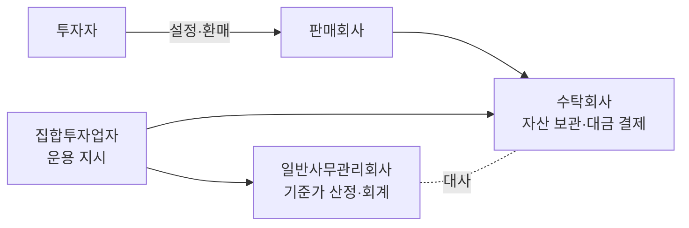
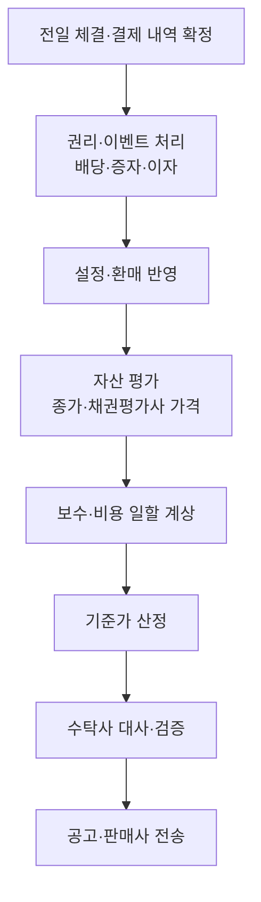
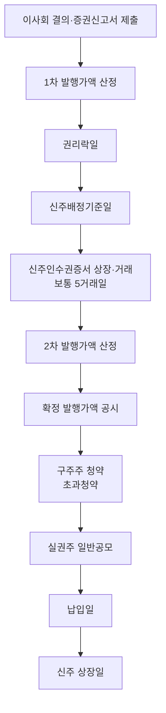
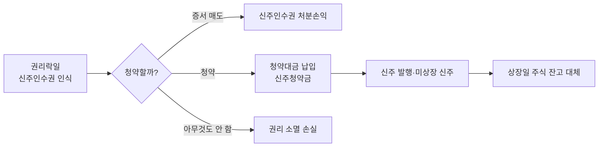

# 펀드회계 백과 — 1부 (Day 1~10)

형식: `## Day N · 제목` / `> 소개` / `### 항목` 아래 본문·`- 목록`·```분개 블록```·```mermaid 블록```(포스팅 전용)
분개 예시의 숫자는 이해를 돕기 위한 가정이며, 계정과목 명칭은 사무관리회사·운용사마다 조금씩 다릅니다.

## Day 1 · 펀드의 뼈대 — 구조와 기준가격
> 펀드회계의 모든 숫자는 결국 '기준가격' 하나로 모입니다. 누가 무엇을 하고, 기준가가 어떻게 나오는지부터 잡습니다.

### 집합투자기구(펀드)
여러 투자자의 돈을 모아 집합투자업자(운용사)가 운용하고 그 결과를 투자자에게 돌려주는 구조입니다. 자본시장법상 법적 형태에 따라 투자신탁, 투자회사, 투자유한회사, 투자합자회사, 투자익명조합 등으로 나뉘며 국내 공모펀드의 대부분은 투자신탁입니다.
- 투자신탁: 운용사(위탁자)와 수탁회사(수탁자)가 신탁계약을 맺는 계약형 구조. 펀드 자체는 법인이 아니고, 재산의 법적 명의는 수탁회사입니다.
- 투자회사: 펀드가 상법상 주식회사(서류상 회사)인 회사형 구조. 이사회·주주총회가 있고 투자자는 주주가 됩니다.
- 실무 포인트: 장부상 '펀드'는 하나의 독립된 회계 실체로 보고 운용사 고유재산과 완전히 분리해 기록합니다.

### 펀드 관계회사 4곳의 역할
- 집합투자업자(운용사): 무엇을 사고팔지 결정하고 수탁회사에 운용 지시를 내립니다.
- 판매회사(은행·증권사): 투자자에게 펀드를 팔고 설정·환매 주문을 받습니다.
- 신탁업자(수탁회사): 펀드 재산을 보관하고 대금 결제를 실행하며, 운용 지시가 법령·규약에 맞는지 감시합니다.
- 일반사무관리회사: 매일 펀드 장부를 기장하고 자산을 평가해 기준가격을 산정합니다. 펀드회계 실무의 중심입니다.
- 실무 포인트: 사무관리회사가 계산한 기준가와 수탁회사가 따로 계산한 값(또는 잔고)을 매일 맞춰 보는 것을 '대사(reconciliation)'라고 합니다.

### 좌수와 원본
펀드 지분의 단위가 좌(座)입니다. 국내 투자신탁은 보통 최초 설정 시 1,000좌 = 1,000원(1좌 = 1원)으로 시작하며, 이 '좌수 × 1원' 부분을 원본이라고 부릅니다.
- 투자자가 보유한 것은 '돈'이 아니라 '좌수'입니다. 펀드 가치가 변하면 좌수는 그대로이고 1좌의 값(기준가)이 변합니다.
- 원본은 회계상 자본(순자산) 중 출자 부분에 해당합니다. 순자산에서 원본을 뺀 나머지가 그동안 쌓인 이익(또는 손실)입니다.

### 기준가격
펀드 1,000좌의 가격입니다. 매일 산정해 공고하며 설정·환매 가격의 기준이 됩니다.
```분개
기준가격 = (자산총액 − 부채총액) ÷ 총좌수 × 1,000
         = 순자산총액 ÷ 총좌수 × 1,000
예) 순자산 10,500,000,000원 / 총좌수 10,000,000,000좌 × 1,000 = 1,050.00원
```
- 소수점 처리: 보통 원 미만 둘째 자리까지 공고합니다(셋째 자리에서 처리 방식은 규약·사무관리 기준에 따름).
- 실무 포인트: 기준가가 전일보다 크게 움직이면 시장 움직임으로 설명되는지 반드시 확인합니다. 설명이 안 되면 권리 처리 누락, 체결 누락, 단가 오류 같은 장부 오류일 가능성이 큽니다.

### 순자산(NAV)의 구성
- 자산: 주식·채권·파생상품·예금·콜론·RP 같은 투자자산과 미수입금, 미수이자, 미수배당금 같은 미수 항목
- 부채: 미지급금(매수 결제대금), 미지급환매금, 미지급보수, 기타 미지급비용
- 순자산 = 원본 + 이익잉여금(또는 결손금). 이익잉여금 안에 당기 매매손익·평가손익·이자배당수익·비용이 누적됩니다.

### 회계기간과 결산
펀드는 규약에서 정한 회계기간(보통 1년)마다 결산을 합니다. 결산일에 그 기간의 이익을 확정하고 이익분배금을 지급하거나 재투자합니다.
- 일일 결산: 펀드는 매일 기준가를 내야 하므로 사실상 매일 결산하듯 손익을 발생주의로 반영합니다.
- 결산 분배: 결산일에 분배금을 지급하면 순자산이 줄어 기준가가 다시 1,000원 근처로 낮아지는 경우가 많습니다(재투자하면 좌수가 늘어남).

### 공모펀드와 사모펀드
- 공모: 불특정 다수에게 판매. 공시·평가·보수 규제가 엄격하고 기준가를 매일 공고합니다.
- 사모: 소수 투자자 대상. 기관전용 사모와 일반 사모로 나뉘며 기준가 산정 주기·평가 방법이 규약에 따라 다양합니다. 비상장·대체자산 비중이 높아 평가 난이도가 높습니다.

### 기준가 산정의 하루 흐름

- 실무 포인트: 오류는 대부분 앞단(체결·권리 처리)에서 생기고 뒷단(기준가)에서 발견됩니다. 숫자가 이상하면 거꾸로 거슬러 올라가며 확인합니다.

## Day 2 · 펀드회계의 기본 원리
> 일반 기업회계와 펀드회계가 어떻게 다른지. 이 차이를 알면 나머지가 쉬워집니다.
### 발생주의
현금이 오갔는지와 관계없이 거래나 사건이 '발생한 날' 수익과 비용을 인식합니다. 주식을 팔고 대금은 이틀 뒤 들어와도 매매손익은 체결일에, 이자는 받기 전이라도 매일 쌓이는 만큼 인식합니다.
- 그래서 펀드 장부에는 미수입금, 미지급금, 미수이자, 미수배당금, 미지급보수 같은 '미'자 계정이 많습니다.

### 시가평가 원칙
펀드 자산은 매일 시장가격(공정가치)으로 평가합니다. 자본시장법은 신뢰할 만한 시가가 있으면 시가로, 없으면 공정가액으로 평가하도록 정하고 있습니다.
- 상장주식: 평가기준일 거래소 종가
- 채권: 채권평가회사들이 제공하는 가격을 기초로 평가
- 시가가 없는 자산(비상장, 거래정지 등): 집합투자재산평가위원회가 정한 방법으로 공정가액 평가
- 예외: MMF는 일정 요건 아래 장부가로 평가합니다(Day 12).

### 실현손익과 평가손익
- 매매손익(실현): 실제로 팔아서 확정된 손익 = 처분가액 − 처분분 장부가액
- 평가손익(미실현): 보유 중인 자산을 오늘 시가로 다시 평가해 생긴 차이 = 오늘 평가액 − 장부가액
- 두 가지 모두 순자산에 그대로 반영되므로 기준가에 똑같이 영향을 줍니다. 다만 세무(과세표준)에서는 다르게 취급될 수 있습니다(Day 19).

### 장부가액의 의미
펀드에서 '장부가'는 보통 취득원가(평균단가 × 수량)를 말하고, 평가는 장부가와 별도로 평가손익 계정으로 관리하는 방식이 일반적입니다. 처분 시 평가손익 누계를 정리하고 매매손익을 계산합니다.
- 회사·시스템마다 '매일 평가 후 장부가를 갱신'하는 방식과 '취득원가 유지 + 평가차익 누계'를 쓰는 방식이 있으니 사내 시스템의 기준을 먼저 확인하세요.

### 평균단가법
같은 종목을 여러 번 사면 단가를 가중평균해 장부단가로 씁니다. 일부를 팔면 평균단가 × 매도수량만큼 장부가에서 뺍니다.
```분개
1차 매수 100주 × 10,000원 = 1,000,000원
2차 매수 100주 × 12,000원 = 1,200,000원
평균단가 = 2,200,000 ÷ 200 = 11,000원
150주를 13,000원에 매도 → 매매이익 = (13,000 − 11,000) × 150 = 300,000원
잔여 50주 장부가 = 11,000 × 50 = 550,000원
```

### 약정일 기준 회계
매매는 결제일이 아니라 체결(약정)일에 장부에 반영합니다. 결제 전까지의 대금은 미수입금(팔았을 때)·미지급금(샀을 때)으로 둡니다.
- 국내 상장주식은 T+2 결제(체결일 + 2영업일)가 일반적입니다.
- 실무 포인트: 결제일에 미수·미지급이 예금과 정확히 상계되는지 확인하는 것이 일일 점검의 기본입니다. 남아 있으면 결제 실패나 기록 오류입니다.

### 보수의 일할 계상
운용·판매·수탁·사무관리 보수는 연율로 정해져 있고 매일 순자산에 비례해 비용으로 쌓습니다(미지급보수). 실제 지급은 분기 등 정해진 주기에 합니다.
```분개
일 보수 = 전일(또는 기준일) 순자산 × 연 보수율 ÷ 365
예) 순자산 100억 × 0.80% ÷ 365 ≈ 219,178원
차) 운용보수(비용) 219,178 / 대) 미지급운용보수 219,178
```

### 기준가 적용 시점(T와 T+1)
투자자가 설정·환매를 신청한 날의 기준가가 아니라, 규약이 정한 날의 기준가를 적용합니다. 이렇게 하는 이유는 신청 시점에 아직 모르는 가격으로 거래하게 해서(미래가격 방식) 기존 투자자에게 불리한 거래를 막기 위해서입니다.
- 예: 국내 주식형은 보통 오후 3시 30분 이전 신청분은 다음 영업일(T+1) 기준가, 이후는 T+2 기준가 적용(펀드마다 다름).
- 해외 펀드는 해외 시장 종가 반영 시차 때문에 T+2~T+3 등 더 늦은 기준가를 씁니다.

### 중요성과 오류 정정
기준가는 한 번 공고되면 그 가격으로 설정·환매가 체결되므로, 오류가 나면 투자자 간 부당한 이전이 생깁니다. 법령은 일정 범위를 넘는 기준가 오류가 생기면 기준가를 변경하고 그 사실을 공고하도록 정하고 있습니다.
- 실무 포인트: 허용 오차와 변경 절차는 펀드 유형(MMF 여부 등)에 따라 다르므로 규약과 내부 기준가 오류 처리 기준을 확인하세요(Day 20).

## Day 3 · 상장주식 매매의 회계처리
> 가장 기본이 되는 주식 매수·매도가 장부에 어떻게 찍히는지 분개로 봅니다.
### 매수 체결일(T)
매수가 체결되면 주식이 늘고, 아직 내지 않은 대금은 미지급금으로 잡습니다.
```분개
삼성전자 100주 × 70,000원 매수, 위탁수수료 7,000원 가정
차) 주식            7,000,000   대) 미지급금(매수대금)  7,007,000
    매매수수료(비용)     7,000
```
- 매매수수료 처리: 펀드는 증권 매매수수료를 별도 비용 계정으로 관리하는 경우가 많고, 공시에서도 총보수비용비율과 별도로 '매매·중개수수료 비율'을 표시합니다. 취득원가에 가산하는 방식을 쓰는 곳도 있으니 사내 기준을 확인하세요.

### 매수 결제일(T+2)
```분개
차) 미지급금 7,007,000   대) 예금(현금성자산) 7,007,000
```
- 결제일에 잔액이 부족하면 결제 불이행이 되므로, 자금 담당은 T일에 결제 예정 금액을 미리 확인합니다.

### 매도 체결일(T)
매도 시 장부가만큼 주식을 줄이고, 처분가액과의 차이를 매매손익으로 인식합니다. 증권거래세는 매도자가 부담합니다.
```분개
보유 100주(장부가 7,000,000) 전량 75,000원 매도, 수수료 7,500원, 거래세 0.15% 가정
처분가액 7,500,000 / 거래세 11,250 / 수수료 7,500
차) 미수입금         7,481,250   대) 주식            7,000,000
    매매수수료(비용)     7,500       주식매매이익      500,000
    증권거래세(비용)    11,250
```
- 증권거래세율은 시장과 연도에 따라 바뀌어 왔습니다. 시스템 세율 테이블이 현행 세율로 갱신됐는지 매년 확인하세요.
- 평가손익 누계가 있었다면 매도 시 함께 정리합니다(시스템 방식에 따라 자동 처리).

### 매도 결제일(T+2)
```분개
차) 예금 7,481,250   대) 미수입금 7,481,250
```

### 일일 평가
장 마감 후 보유 주식을 종가로 다시 평가합니다.
```분개
보유 100주, 장부가 7,000,000, 오늘 종가 72,000원 → 평가액 7,200,000
차) 주식평가차(자산 조정) 200,000   대) 주식평가이익 200,000
다음 날 종가 69,000원 → 평가액 6,900,000 (누계 −100,000으로 조정)
```
- 실무에서는 '전일 평가 환입 후 당일 재평가' 방식과 '누계 차이만 조정' 방식이 있습니다. 결과(순자산)는 같습니다.

### 거래정지·관리종목의 평가
거래정지로 종가가 없으면 마지막 종가를 그대로 쓸지, 할인할지, 평가위원회 가격을 쓸지를 정해야 합니다.
- 정지 사유(합병 등 단순 절차 vs 감사의견 거절·횡령 같은 부실)에 따라 평가가 달라집니다.
- 실무 포인트: 장기 거래정지 종목은 평가위원회 결의 내용과 근거 자료를 반드시 보관합니다. 감사 때 가장 많이 확인하는 부분입니다.

### 체결 확인과 대사
- 운용사(트레이더)의 주문 내역, 증권사 체결 통보, 사무관리 장부, 수탁사 결제 내역이 모두 같아야 합니다.
- 흔한 오류: 체결 누락, 수량·단가 입력 오류, 다른 펀드로 배분(Allocation) 오류, 수수료율 오적용
- 실무 포인트: 체결 확인은 기준가 산정 전에 끝내야 합니다. 늦게 들어온 체결은 기준가 오류의 가장 흔한 원인입니다.

### 펀드 간 배분(Allocation)
운용사는 여러 펀드의 주문을 한꺼번에 내고 체결 후 각 펀드에 나눠 줍니다. 배분 기준(수량 비례, 평균가 배분 등)은 사전에 정해져 있어야 하고 사후에 임의로 바꾸면 안 됩니다.
- 실무 포인트: 평균 체결가 배분 시 단가 소수점 처리 방식을 확인하세요. 원 단위 차이가 쌓이면 대사가 안 맞습니다.

## Day 4 · 배당 — 기준일, 배당락, 미수배당금
> 배당은 가장 흔한 권리 이벤트입니다. '언제 인식하느냐'가 핵심입니다.

### 배당기준일과 배당락일
배당을 받을 주주를 정하는 날이 배당기준일이고, 이날 주주명부에 있으려면 T+2 결제를 감안해 기준일 2영업일 전까지 사야 합니다. 그래서 기준일 1영업일 전이 배당락일이 되고, 이날부터 주가는 배당만큼 떨어진 가격(권리 없는 가격)으로 거래됩니다.
- 배당락일에 주가가 하락해도 펀드 순자산이 줄어서는 안 됩니다. 떨어진 만큼을 받을 배당(미수배당금)으로 채워야 합니다.

### 미수배당금의 인식 시점
원칙은 '배당을 받을 권리가 확정되고 금액을 합리적으로 추정할 수 있을 때'입니다. 실무에서는 배당락일(또는 기준일)에 예상 배당금을 미수배당금으로 잡는 방식이 일반적입니다.
```분개
배당락일: 보유 1,000주 × 주당 예상배당 1,500원
차) 미수배당금 1,500,000   대) 배당금수익 1,500,000
지급일:
차) 예금       1,500,000   대) 미수배당금 1,500,000
```
- 이렇게 해야 배당락으로 떨어진 주가(평가손실)와 미수배당금(수익)이 서로 상쇄되어 기준가가 튀지 않습니다.

### 배당 확정 전 추정과 이후 조정
12월 결산법인은 기준일(연말) 이후 이듬해 주주총회에서 배당금이 확정되는 경우가 많았습니다. 기준일에 추정치로 미수배당금을 잡았다면 확정 공시가 나오면 차액을 조정합니다.
```분개
추정 1,500원 → 확정 1,600원 (1,000주)
차) 미수배당금 100,000   대) 배당금수익 100,000
```
- 추정 근거: 전년도 배당, 배당 정책 공시, 증권사 추정치 등. 근거를 기록해 둡니다.

### 배당 절차 개선(선배당 결정, 후기준일)
2023년부터 상장회사들이 정관을 바꿔 배당금액을 먼저 결정하고 그 뒤에 배당기준일을 정할 수 있게 되었습니다. 이 경우 투자자는 금액을 보고 투자할 수 있고, 펀드는 기준일 시점에 금액이 확정되어 있어 추정 문제가 줄어듭니다.
- 실무 포인트: 회사마다 기준일이 연말이 아니라 2~3월 등으로 바뀌었으므로, 권리 일정 데이터(예탁결제원 등)를 종목별로 확인해야 합니다. '12월 배당락' 습관대로 처리하면 틀립니다.

### 분기·중간배당
분기배당은 분기말 등 정관에서 정한 날을 기준으로, 이사회 결의로 지급합니다. 처리 방식은 현금배당과 같지만 횟수가 많으니 일정 관리가 중요합니다.

### 주식배당
배당을 현금 대신 신주로 주는 것입니다. 펀드 입장에서는 보유 수량이 늘지만 회사 가치는 그대로이므로 권리락만큼 주가가 조정됩니다.
- 회계: 수익으로 인식하지 않고 수량만 늘리며 총 장부가는 그대로 두는 처리가 일반적입니다(단가가 낮아짐). 단주는 현금으로 받습니다.

### 배당과 세금(원천징수)
배당소득은 지급 시 원천징수 대상이 될 수 있습니다. 다만 펀드(집합투자기구) 단계에서의 원천징수 여부와 방식은 펀드 형태, 지급자, 국내·해외 여부에 따라 다르고 세법 개정도 잦습니다.
- 해외주식 배당은 현지에서 원천징수된 뒤 입금되는 경우가 일반적입니다(Day 16).
- 실무 포인트: 입금액이 예상 배당금과 다르면 세금 차감인지 수량 오류인지부터 구분합니다. 세무 처리 기준은 사내 세무 매뉴얼을 따르세요.

### 배당 관련 흔한 실수
- 배당락일에 미수배당금을 안 잡아 기준가가 하락하는 오류
- 매도한 주식의 배당을 누락하거나, 기준일 이후 매수분에 배당을 잘못 잡는 오류
- 대차(빌려준 주식)분 배당 처리 누락 — 대여 주식의 배당은 차입자가 배당 상당액을 보전해 줍니다

## Day 5 · 무상증자·액면분할·병합
> 회사 가치는 그대로인데 주식 수가 바뀌는 이벤트. 수량과 단가를 정확히 고치는 것이 전부입니다.
### 무상증자의 의미
회사가 자본잉여금 등을 자본금으로 옮기면서 기존 주주에게 공짜로 신주를 나눠 주는 것입니다. 회사의 순자산은 변하지 않으므로 주식 수가 늘어난 만큼 주가가 권리락으로 조정됩니다.
- 예: 1주당 1주 무상증자(100%) → 보유 수량 2배, 이론 주가 절반

### 무상증자 일정
- 이사회 결의·공시 → 신주배정기준일 → 권리락일(기준일 1영업일 전, T+2 결제 기준) → 신주 상장일
- 권리락일부터 상장일까지 펀드는 '받을 신주'를 들고 있지만 아직 팔 수 없습니다.

### 권리락 주가
```분개
권리락 기준가 = 권리락 전일 종가 ÷ (1 + 무상증자 비율)
예) 전일 종가 30,000원, 1주당 0.5주 무상 → 30,000 ÷ 1.5 = 20,000원
```

### 무상증자 회계처리
권리락일에 아직 입고되지 않은 신주를 별도 항목(예: 무상신주, 권리주)으로 잡아 평가해야 기준가가 튀지 않습니다.
```분개
보유 1,000주(장부가 30,000,000), 0.5주 무상증자 → 신주 500주
권리락일: 수량 1,500주 체계로 전환(신주 500주는 미상장 권리 상태)
- 총 장부가 30,000,000 유지, 장부단가 20,000원으로 조정
- 평가: 기존 1,000주 × 권리락 종가 + 신주 500주 × 권리락 종가(상장 전까지 같은 가격으로 평가하는 것이 일반적)
상장일: 신주 500주를 일반 주식 잔고로 대체
```
- 수익을 인식하지 않습니다. 순자산이 늘어난 것이 아니기 때문입니다.

### 단주 처리
배정 비율 때문에 1주 미만이 생기면 단주로 현금(단주대금)을 받습니다. 단주대금은 단주 부분의 처분으로 보고 처분손익을 계산하거나, 사내 기준에 따라 수익으로 처리합니다.
```분개
차) 미수금(단주대금) xxx   대) 주식(단주 해당 장부가) xxx / 주식매매이익(차액) xxx
```

### 액면분할
액면가를 쪼개 주식 수를 늘리는 것입니다(예: 5,000원 → 100원, 1주 → 50주). 회사 가치·자본금 변화 없이 수량만 늘어납니다.
- 거래정지 기간: 분할 기간 동안 매매거래가 정지되는 것이 일반적입니다. 이 기간에는 정지 직전 종가 ÷ 분할 비율로 평가합니다.
- 회계: 수량 × 분할비율, 단가 ÷ 분할비율, 총 장부가 불변

### 액면병합(주식병합)
여러 주를 한 주로 합치는 것입니다(예: 10주 → 1주). 분할의 반대로 처리하며, 1주 미만은 단주대금으로 정산합니다.

### 권리 처리 체크리스트
- 예탁결제원 권리 정보와 운용사·사무관리 시스템의 권리 일정이 같은가
- 기준일 현재 보유 수량이 맞는가(기준일 직전 매매분, 대여분 포함)
- 권리락일에 평가가 이론가에 맞게 바뀌었는가(기준가 튐 여부)
- 상장일에 신주가 일반 잔고로 대체되고 수탁사 잔고와 맞는가

## Day 6 · 유상증자의 전 과정
> 가장 복잡한 주식 이벤트. 회사가 새 주식을 팔아 돈을 모으는 과정을 일정 순서대로 봅니다.

### 유상증자의 배정 방식
- 주주배정: 기존 주주에게 보유 비율대로 신주인수권을 줍니다. 실권주는 다시 일반공모하는 '주주배정 후 실권주 일반공모'가 가장 흔합니다.
- 제3자배정: 특정인(전략적 투자자 등)에게만 배정합니다. 기존 주주에게는 권리가 없습니다.
- 일반공모: 처음부터 불특정 다수에게 청약을 받습니다.
- 펀드회계에서 손이 가장 많이 가는 것은 주주배정입니다. 펀드가 신주인수권을 받기 때문입니다.

### 1차 발행가액
증자 일정 초반, 신주배정기준일 전 일정 거래일을 기산일로 과거 주가 평균을 구해 할인율을 적용해 정하는 예정 발행가입니다. 주주배정에서는 실무상 다음과 같은 방식이 널리 쓰입니다.
```분개
기준주가 = 기산일 기준 [1개월 가중평균, 1주일 가중평균, 기산일 가중평균]의 산술평균과
          기산일 가중평균주가 중 낮은 가격
1차 발행가액 = 기준주가 × (1 − 할인율) ÷ (1 + 증자비율 × 할인율)
```
- 분모의 (1 + 증자비율 × 할인율)는 권리락으로 주가가 떨어지는 효과를 미리 반영하는 장치입니다.
- 발행가 산정 방식은 회사가 증권신고서에 정하므로, 실제 처리 시에는 반드시 해당 회사의 증권신고서 문구를 확인하세요.

### 2차 발행가액
구주주 청약일 직전, 최근 주가로 한 번 더 계산하는 발행가입니다. 실무상 청약일 전 제3거래일을 기산일로 1주일 가중평균과 기산일 가중평균의 산술평균에 할인율을 적용하는 방식이 많이 쓰입니다.
```분개
2차 발행가액 = [1주일 가중평균, 기산일 가중평균]의 산술평균 × (1 − 할인율)
```

### 확정 발행가액
보통 1차와 2차 발행가액 중 낮은 가격으로 확정합니다. 다만 2차가 더 낮더라도 1차의 일정 비율(예: 70%) 이상으로 하한을 두는 조건이 붙는 경우가 많고, 액면가 아래로는 발행할 수 없습니다.
- 주가가 떨어지면 발행가도 내려가 회사가 모으는 돈이 줄어듭니다. 증자 일정 중 주가가 하락하는 이유 중 하나입니다.

### 신주인수권과 권리락
주주배정 유상증자에서 기준일 주주는 '신주를 발행가에 살 수 있는 권리(신주인수권)'를 받습니다. 기준일 1영업일 전이 권리락일이며, 이날부터 주가는 권리 가치만큼 떨어진 가격으로 거래됩니다.
```분개
권리락 이론주가 = (권리락 전일 종가 + 예정발행가 × 증자비율) ÷ (1 + 증자비율)
예) 전일 종가 10,000원, 발행가 7,000원, 증자비율 0.3
   (10,000 + 7,000 × 0.3) ÷ 1.3 = 9,307.69원
신주인수권 1주당 이론가치 ≈ 권리락 주가 − 발행가 = 2,307.69원
```

### 신주인수권증서
신주인수권을 증권으로 만든 것입니다. 상장되면 보통 5거래일 정도 거래소에서 사고팔 수 있습니다. 청약할 돈이 없는 주주는 증서를 팔아 권리 가치를 현금화할 수 있습니다.
- 증서 상장 전에는 이론가치로, 상장 기간에는 증서 종가로, 상장 폐지 후 청약 전까지는 다시 이론가치 등으로 평가하는 것이 일반적입니다(사내 평가 기준 확인).
- 증서는 청약 기간 전에 거래가 끝나며, 청약하지 않은 권리는 청약 마감과 함께 소멸합니다.

### 구주주 청약과 초과청약
권리를 가진 주주는 청약 기간에 발행가 × 배정주식 수만큼 청약하고 대금을 냅니다. 회사가 허용하면 배정분의 일정 비율(예: 20%)까지 더 청약하는 초과청약도 가능하며, 실권주가 남으면 초과청약자에게 먼저 배정합니다.
- 초과청약분은 배정받지 못하면 청약증거금이 돌려 나옵니다.

### 실권주 일반공모와 납입
구주주가 청약하지 않은 실권주는 일반 투자자 대상 공모로 다시 팔고, 그래도 남으면 주관사가 인수(잔액인수)하기도 합니다. 납입일에 청약대금이 회사 자본금이 되고 신주가 발행됩니다.

### 신주 상장
납입 후 보통 1~2주 안에 신주가 상장됩니다. 상장일부터 신주를 팔 수 있으므로, 상장일 주가 하락(물량 부담)이 흔합니다.
- 실무 포인트: 납입일부터 상장일까지 펀드는 '납입은 끝났지만 아직 상장되지 않은 신주'를 보유합니다. 이 기간의 평가 방법(보통 해당 종목 종가)을 기준서로 확인하세요.

## Day 7 · 유상증자의 펀드 회계처리
> Day 6의 일정이 펀드 장부에서는 어떤 분개로 바뀌는지 단계별로 따라갑니다.
### 처리 전체 그림

### 권리락일 — 신주인수권 인식
권리락으로 주가가 떨어진 만큼을 신주인수권 평가액으로 채워야 순자산이 유지됩니다.
```분개
보유 1,000주, 증자비율 0.3 → 배정 300주, 권리 1주당 평가 2,300원 가정
차) 신주인수권(평가)  690,000   대) 신주인수권평가이익  690,000
동시에 보유 주식은 권리락 종가로 평가되어 평가손실 발생 → 둘이 상쇄
```
- 신주인수권의 장부가(취득원가)는 0으로 두고 평가액 전부를 평가이익으로 잡는 방식이 흔합니다. 기존 주식 장부가 일부를 신주인수권으로 배분하는 방식을 쓰는 곳도 있으니 사내 기준을 확인하세요.

### 신주인수권증서 입고와 평가
증서가 상장되면 펀드 계좌에 증서가 입고되고, 평가 기준을 이론가치에서 증서 종가로 바꿉니다.
```분개
증서 300주, 증서 종가 2,100원 → 평가액 630,000 (전일 690,000 대비 −60,000)
차) 신주인수권평가손실 60,000   대) 신주인수권(평가) 60,000
```

### 신주인수권증서를 매도할 때
운용사가 청약하지 않고 권리를 팔기로 하면 증서를 거래소에서 매도합니다. 일반 주식 매도와 같은 구조입니다.
```분개
증서 300주를 2,200원에 매도, 수수료 무시
차) 미수입금 660,000   대) 신주인수권(장부가 0) 0
                          신주인수권처분이익 660,000
(이전에 잡아 둔 평가이익 누계는 처분 시 함께 정리)
```

### 청약할 때 — 청약대금 납입
```분개
청약일: 300주 × 확정발행가 7,000원 = 2,100,000원 (초과청약 60주 포함 시 청약증거금 2,520,000)
차) 신주청약금(자산) 2,520,000   대) 예금 2,520,000
```
- 신주청약금은 아직 주식이 아니므로 별도 자산 계정으로 둡니다.

### 배정 확정과 초과청약 환불
```분개
초과청약 60주 중 20주만 배정 → 40주 × 7,000 = 280,000 환불
차) 예금 280,000   대) 신주청약금 280,000
```

### 납입일 — 신주 취득
납입일에 청약금이 주식 취득원가가 됩니다. 상장 전까지는 '미상장 신주' 등으로 따로 관리합니다.
```분개
배정 320주(구주주 300 + 초과 20) × 7,000 = 2,240,000
차) 신주(미상장)  2,240,000   대) 신주청약금 2,240,000
같은 날 신주인수권 평가액 정리 — 청약한 권리는 소멸하고 그 가치는 신주 평가에 흡수
```
- 미상장 신주는 보통 해당 종목 종가로 평가합니다. 발행가보다 종가가 높으면 그 차이가 평가이익으로 잡히는데, 권리락일에 잡은 신주인수권 평가이익이 여기로 옮겨 간다고 이해하면 됩니다.

### 상장일 — 주식 잔고로 대체
```분개
차) 주식 2,240,000   대) 신주(미상장) 2,240,000
→ 기존 1,000주와 합쳐 1,320주, 평균단가 재계산
```

### 청약도 매도도 안 했을 때 — 권리 소멸
청약 마감까지 아무것도 하지 않으면 권리가 사라지고, 그때까지 잡아 둔 신주인수권 평가액이 손실로 바뀝니다.
```분개
차) 신주인수권평가이익(환입) 또는 권리소멸손실 xxx   대) 신주인수권(평가) xxx
```
- 실무 포인트: 운용사에 청약 의사를 반드시 사전에 확인하세요. '운용사가 깜빡해서 권리가 소멸'하는 사고는 펀드에 실제 손실을 끼칩니다. 청약 마감 며칠 전 알림을 두는 곳이 많습니다.

### 유상증자 처리 체크리스트
- 배정 비율과 펀드 보유 수량으로 계산한 배정 주식 수가 예탁원 통지와 같은가
- 1차·2차·확정 발행가가 시스템에 정확히 입력되었는가
- 권리락일 기준가가 튀지 않았는가(주식 평가손실 ≈ 신주인수권 평가이익)
- 청약 의사 결정, 청약 금액, 자금 확보가 마감 전에 끝났는가
- 납입일·상장일에 수탁사 잔고와 수량·금액이 맞는가

## Day 8 · 그 밖의 주식 기업행위
> 감자, 합병, 분할, 전환사채 전환, 상장폐지까지. 수량과 장부가가 어떻게 바뀌는지에 집중합니다.
### 무상감자
회사가 결손을 메우기 위해 주주에게 대가 없이 주식 수를 줄이는 것입니다(예: 5주 → 1주). 주식 수가 줄고 주가는 이론상 비율만큼 오릅니다.
- 회계: 수량 ÷ 감자비율, 총 장부가는 그대로(단가 상승). 손익을 인식하지 않습니다.
- 감자 기간 매매정지 동안은 정지 직전 종가 × 감자비율로 평가하는 것이 일반적입니다.

### 유상감자
회사가 주주에게 돈을 돌려주고 주식을 소각하는 것입니다. 일부 주식을 회사에 넘기고 대가를 받으므로 처분과 같습니다.
```분개
차) 미수금(감자대금) xxx   대) 주식(소각분 장부가) xxx / 주식처분이익 xxx
```

### 합병
두 회사가 하나가 되면서, 소멸회사 주주는 존속회사 주식을 합병비율대로 받습니다. 펀드가 소멸회사 주식을 들고 있었다면 그 주식이 존속회사 주식으로 바뀝니다.
- 회계: 소멸회사 주식 장부가를 존속회사 신주의 취득원가로 승계하는 처리가 일반적입니다. 교환 시점에 손익을 인식할지는 회계기준·사내 기준을 따르세요.
- 합병 반대 시 주식매수청구권을 행사하면 정해진 가격에 회사에 팔 수 있습니다(처분으로 처리).
- 매매정지 기간(구주권 제출 기간 등) 평가: 합병비율 × 존속회사 주가 등으로 이론가를 계산해 평가하는 경우가 많습니다.

### 인적분할과 물적분할
- 인적분할: 회사가 쪼개지고 기존 주주가 신설회사 주식도 비율대로 받습니다. 펀드는 존속회사 주식과 신설회사 주식을 함께 보유하게 됩니다.
- 회계(인적분할): 기존 장부가를 분할비율(보통 순자산 비율)에 따라 두 주식에 나눠 배분합니다. 재상장일 시가로 평가합니다.
- 물적분할: 회사가 사업부를 자회사로 떼어 내고 그 주식을 회사가 갖습니다. 주주가 받는 것이 없으므로 펀드 장부에 수량 변화는 없습니다(주가에는 영향).

### 전환사채(CB)·신주인수권부사채(BW)
- CB: 채권이지만 일정 가격(전환가액)에 주식으로 바꿀 수 있습니다. 전환 시 채권 장부가를 주식 취득원가로 대체합니다.
- BW: 채권에 신주를 살 수 있는 권리(워런트)가 붙어 있습니다. 행사하면 행사가를 내고 신주를 받으며, 채권은 그대로 남습니다(분리형인 경우).
- 리픽싱: 주가가 내려가면 전환가액을 낮추는 조항. 전환 가능 주식 수가 늘어나므로 평가에 반영해야 합니다.
- 평가: 메자닌은 시가가 없는 경우가 많아 채권 가치 + 옵션 가치로 나눠 평가하거나 평가회사 가격을 씁니다.

### 공개매수
특정인이 장외에서 정해진 가격에 주식을 사겠다고 공고하는 것입니다. 펀드가 응모하면 응모 주식은 처분 예정 상태가 되고, 결제일에 처분으로 처리합니다.
- 응모 후 결제 전까지는 응모 주식을 어떤 가격으로 평가할지(시가 vs 공개매수가) 사내 기준을 확인하세요. 안분 배정(응모 초과 시 일부만 매수)도 고려해야 합니다.

### 상장폐지와 정리매매
상장폐지가 결정되면 보통 7거래일 정도 정리매매 기간을 주고 이후 상장이 폐지됩니다. 정리매매 가격은 매우 낮고 변동이 큽니다.
- 상장폐지 후에는 비상장주식으로 바뀌어 평가위원회가 정한 방법(청산가치, 0원 처리 등)으로 평가합니다.
- 실무 포인트: 부실 종목은 평가 결정 근거(공시, 감사보고서, 평가위원회 의사록)를 남기는 것이 핵심입니다.

### 주식 대차(대여)
펀드가 보유 주식을 빌려주고 수수료를 받는 거래입니다. 소유권은 이전되지만 경제적 권리는 펀드에 남는다고 보고, 장부에서는 대여주식으로 구분해 계속 평가합니다.
- 대여 수수료는 발생주의로 일할 수익 인식
- 대여 기간 중 배당·권리는 차입자가 보전 → 배당 상당액을 미수로 잡아야 함

### 기업행위 공통 원칙
- 회사 가치 변화가 없는 이벤트(무상증자, 분할, 병합, 무상감자)는 손익 없이 수량·단가만 조정
- 대가를 주고받는 이벤트(유상감자, 매수청구, 공개매수, 단주대금)는 처분으로 보고 손익 인식
- 권리락·정지 기간에는 이론가로 평가해 기준가가 튀지 않게 할 것

## Day 9 · 채권의 기초
> 펀드회계에서 채권은 금액이 가장 크고 계산이 가장 정교한 자산입니다. 용어부터 정확히.
### 채권의 기본 요소
- 액면(면액): 만기에 돌려받는 원금 기준 금액. 국내 채권 가격은 보통 액면 10,000원당 가격으로 표시합니다.
- 표면금리(쿠폰): 액면에 대해 지급하기로 한 이자율
- 발행일·만기일: 이자 계산의 시작과 끝
- 이자지급주기: 3개월, 6개월, 1년 등
- 수익률(시장금리): 시장에서 거래되는 금리. 가격과 반대로 움직입니다.

### 이자 지급 방식에 따른 분류
- 이표채: 정해진 주기마다 이자를 지급하고 만기에 원금을 줍니다. 국고채·회사채 대부분
- 할인채: 이자 없이 액면보다 싸게 발행하고 만기에 액면을 줍니다. 통안증권 일부, CP 등
- 복리채: 이자를 재투자해 만기에 원리금을 한꺼번에 줍니다. 일부 금융채·국민주택채권 등
- 단리채: 이자를 단리로 쌓아 만기에 한꺼번에 지급

### 발행 주체에 따른 분류
- 국채: 국고채권, 국민주택채권, 재정증권 등
- 통화안정증권(통안채): 한국은행 발행
- 지방채, 특수채(공사·공단채), 금융채(은행채, 카드·캐피탈 같은 여전채)
- 회사채: 일반 기업이 발행. 신용등급에 따라 금리가 크게 다릅니다.
- 단기물: CP(기업어음), 전자단기사채(전단채), CD(양도성예금증서)

### 수익률과 가격의 관계
채권 가격은 미래 현금흐름(이자 + 원금)을 시장금리로 할인한 값입니다. 금리가 오르면 가격이 떨어지고, 금리가 내리면 가격이 오릅니다.
```분개
연 1회 이표, 표면 4%, 잔존 1년, 시장금리 5%인 채권(액면 10,000원)
가격 = (10,000 + 400) ÷ 1.05 = 9,904.76원
```
- 실무 포인트: 국내 채권 가격 계산은 관행상 정해진 공식(이자지급 주기 단위 복리, 잔여 기간 단리 등)을 씁니다. 평가회사·시스템 공식이 같은지 신규 종목 등록 시 확인하세요.

### 경과이자
직전 이자지급일부터 오늘까지 쌓인 이자입니다. 채권을 중간에 사고팔 때 매수자가 매도자에게 경과이자만큼을 더 얹어 줍니다(다음 이자는 매수자가 전부 받기 때문).
```분개
경과이자 ≈ 액면 × 표면금리 × 경과일수 ÷ 365  (실제 계산은 이자주기 기준 일할 방식)
```

### Clean Price와 Dirty Price
- Dirty(전체) 가격: 경과이자를 포함한 실제 결제 가격
- Clean(순수) 가격: 경과이자를 뺀 가격
- 국내 채권 거래는 보통 수익률로 체결하고 그에 해당하는 가격(경과이자 포함)으로 결제합니다. 회계에서는 경과이자를 미수이자로 분리하는 것이 일반적입니다(Day 10).

### 듀레이션
채권 현금흐름의 가중평균 만기이자, 금리 1%포인트 변화에 가격이 대략 몇 % 변하는지를 나타내는 지표입니다. 운용 지표지만 회계 담당자도 '금리 변화 → 평가손익 크기'를 설명할 때 씁니다.
- 예: 듀레이션 3년 채권은 금리 0.1%p 상승 시 가격이 약 0.3% 하락

### 신용등급
신용평가회사(한국기업평가, 한국신용평가, NICE신용평가 등)가 매기는 등급입니다. 장기는 AAA~D, 단기(CP)는 A1~D로 표시합니다.
- 등급 하락이나 부도는 평가 가격 급락으로 이어지고, 펀드 규약상 편입 한도 위반 문제가 생길 수 있습니다.

### 채권 결제 관행
장외 채권 거래는 보통 체결일 다음 영업일(T+1) 결제가 많고, 당일결제(T+0)도 있습니다. 장내 국채 거래도 T+1입니다.
- 결제는 예탁결제원을 통해 증권과 대금이 동시에 교환됩니다(DVP).

## Day 10 · 채권 매매와 평가의 회계처리
> 채권 매수·이자·매도·평가를 분개로 정리합니다. 경과이자 분리가 핵심입니다.
### 채권 매수
결제금액 중 경과이자 부분은 미수이자(이자를 받을 권리를 산 것)로, 나머지는 채권 원가로 잡습니다.
```분개
액면 10억 매수, 결제금액 1,012,000,000 (이 중 경과이자 8,000,000)
체결일:
차) 채권     1,004,000,000   대) 미지급금 1,012,000,000
    미수이자     8,000,000
결제일:
차) 미지급금 1,012,000,000   대) 예금 1,012,000,000
```
- 산 경과이자는 펀드의 수익이 아닙니다. 다음 이자 지급일에 받는 이자 중 이 부분은 '돌려받는 돈'이고, 매수 후 쌓인 부분만 펀드의 이자수익입니다.

### 이자의 일일 발생 인식
보유 기간 동안 매일 이자를 일할 계산해 이자수익으로 인식합니다.
```분개
매일: 차) 미수이자 xxx   대) 채권이자수익 xxx
```
- 실무 포인트: 시스템은 보통 '매일 경과이자 잔액 − 전일 잔액'으로 당일 이자를 구합니다. 이자지급일·휴일 전후에 계산이 맞는지 점검하세요.

### 이자 지급일(이표 수령)
```분개
이표 20,000,000 수령 (매수 시 산 경과이자 8,000,000 + 보유 중 발생 12,000,000)
차) 예금 20,000,000   대) 미수이자 20,000,000
```
- 이자 지급 후 경과이자는 0부터 다시 쌓입니다.

### 채권 매도
매도 결제금액도 경과이자와 원가 부분으로 나눕니다. 매매손익은 경과이자를 뺀 부분으로 계산합니다.
```분개
결제금액 1,015,000,000 (경과이자 5,000,000), 장부가 1,004,000,000
차) 미수입금 1,015,000,000   대) 채권         1,004,000,000
                                미수이자         5,000,000
                                채권매매이익     6,000,000
```

### 채권 평가
펀드 채권은 매일 채권평가회사가 제공하는 가격으로 평가합니다. 자본시장법령은 둘 이상의 채권평가회사가 제공한 가격을 기초로 평가하도록 정하고 있어, 실무에서는 보통 두 곳 이상의 가격을 평균해 씁니다.
```분개
평가액(경과이자 제외 기준) − 장부가 = 평가손익
차) 채권평가차 xxx   대) 채권평가이익 xxx  (또는 반대)
```
- 국내 채권평가회사: KIS자산평가, 한국자산평가, NICE P&I, FN자산평가 등
- 평가회사 가격이 경과이자 포함인지 제외인지 확인하고, 이자를 두 번 잡지 않도록 주의합니다.

### 이자수익과 평가손익의 구분
같은 채권에서 매일 두 종류의 손익이 생깁니다.
- 이자수익: 시간이 지나면서 쌓이는 쿠폰 이자(시장과 무관하게 거의 일정)
- 평가손익: 시장금리가 바뀌어 생기는 가격 변화
- 실무 포인트: 기준가 분석 시 채권형 펀드의 하루 수익 = 이자 발생분 + 평가손익으로 쪼개 보면, 금리 움직임으로 설명되는지 빠르게 확인할 수 있습니다.

### 할인채의 처리
할인채는 쿠폰이 없고 만기에 액면을 받습니다. 액면과 매입가의 차이가 사실상 이자입니다.
- 펀드에서는 매일 평가회사 가격으로 시가평가하므로 이 차이가 시간이 지나며 평가손익(또는 이자 상당액)으로 반영됩니다.
- 이자 상당액을 이자수익으로 따로 인식(상각)할지, 평가손익에 포함할지는 사내 회계 기준을 따르세요. 세무상 이자소득 구분과 연결됩니다.

### 만기 상환
```분개
만기에 액면 10억과 마지막 이표 수령
차) 예금 1,020,000,000   대) 채권 1,000,000,000(만기 평가액 = 액면) / 미수이자 20,000,000
```
- 만기일에는 평가액이 액면에 수렴해 있으므로 큰 손익이 남지 않는 것이 정상입니다.

### 부도·신용사건 채권
채무불이행이 생기면 평가회사 가격이 급락하거나 제공이 중단됩니다. 이 경우 평가위원회에서 회수 가능 금액을 기준으로 평가하고, 이자 발생 인식을 중단하는 것이 일반적입니다.
- 공모펀드는 부실 자산을 분리해 별도 펀드로 옮기는(부실자산 분리, 이른바 사이드포켓) 절차가 있을 수 있습니다.
- 실무 포인트: 이자 인식 중단 시점, 기존 미수이자의 처리, 평가 근거를 문서로 남깁니다.
