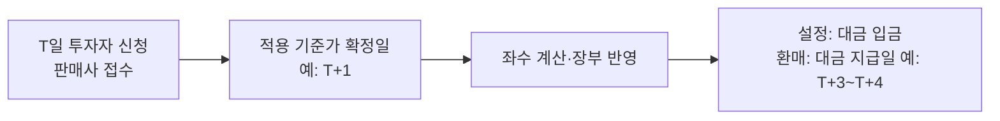
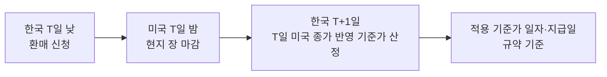
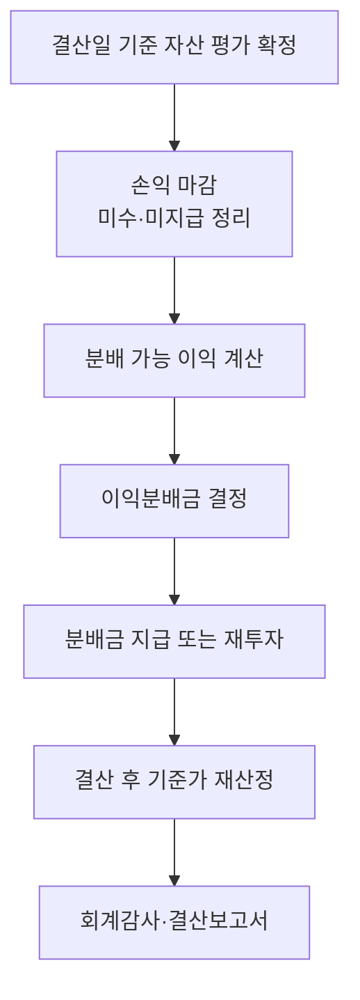

# 펀드회계 백과 — 2부 (Day 11~20)

## Day 11 · 단기자금 — 예금·콜론·RP·CD·CP·전단채
> 펀드의 남는 현금은 하루도 그냥 두지 않습니다. 단기 운용 자산의 회계처리를 정리합니다.
### 단기자금이 중요한 이유
설정·환매 대금, 매매 결제대금, 보수 지급을 위해 펀드는 늘 일정한 현금을 들고 있습니다. 이 현금을 하루짜리 상품에 넣어 이자를 받는 것이 단기자금 운용입니다. 금액이 크고 매일 바뀌어 회계 처리 건수가 많습니다.

### 예금(정기예금·보통예금)
- 수탁회사 계좌의 예금은 일할로 이자를 미수이자로 잡고, 이자 지급일에 정리합니다.
- 정기예금은 만기와 금리가 정해져 있고, 중도해지 시 약정보다 낮은 금리가 적용될 수 있어 해지 손실을 반영해야 합니다.

### 콜론(Call Loan)
금융기관끼리 아주 짧게(대부분 1일) 돈을 빌려주는 거래입니다. 펀드가 빌려주면 콜론, 빌리면 콜머니입니다.
```분개
콜론 실행: 차) 콜론 10,000,000,000   대) 예금 10,000,000,000
다음 날 회수(금리 3.00%, 1일):
차) 예금 10,000,821,918   대) 콜론 10,000,000,000 / 콜론이자수익 821,918
```
- 이자 = 원금 × 금리 × 일수 ÷ 365. 주말·휴일을 끼면 일수가 늘어납니다.

### RP(환매조건부채권) 매수
채권을 담보로 잡고 돈을 빌려주는 거래입니다. 형식은 채권을 샀다가 정해진 날 정해진 가격에 되파는 것이지만, 실질은 담보부 대출입니다. 펀드 입장에서는 'RP 매수'(역RP)라고 부릅니다.
```분개
매수일: 차) RP매수(자산) 5,000,000,000   대) 예금 5,000,000,000
매일:   차) 미수이자 xxx                 대) RP이자수익 xxx
환매일: 차) 예금 원금+이자               대) RP매수 / 미수이자
```
- 담보 채권은 펀드 소유 자산으로 잡지 않습니다(실질이 대출이므로). 담보 가치와 담보 비율은 리스크 관리 차원에서 확인합니다.

### CD(양도성예금증서)
은행이 발행하는 양도 가능한 정기예금증서로, 보통 할인 방식으로 거래합니다. 할인채처럼 평가회사 가격으로 평가합니다.

### CP(기업어음)와 전자단기사채
- CP: 기업이 단기 자금을 조달하려고 발행하는 어음. 할인 발행이 일반적이며 신용등급(A1~D)이 중요합니다.
- 전자단기사채(전단채): CP를 전자 방식으로 발행·유통하도록 만든 단기 사채. 만기 1년 이내이며 실무에서는 CP를 대부분 대체했습니다.
- 회계: 할인 매입 → 일할 이자 상당액 인식 또는 평가 → 만기 액면 상환

### 단기자금 회계의 핵심 점검
- 만기일·이자 지급일에 원금과 이자가 정확히 들어왔는가
- 휴일 일수 계산이 맞는가(금요일 실행 → 월요일 회수는 3일치 이자)
- 펀드 규약상 단기자금 투자 한도와 거래 상대방 제한을 지켰는가

## Day 12 · MMF의 특별한 회계
> 머니마켓펀드는 다른 펀드와 평가 방식이 다릅니다. 장부가평가와 괴리율이 핵심입니다.
### MMF란
단기 금융상품(CP, 전단채, CD, 콜론, 단기채 등)에만 투자해 원금 손실 위험을 최소화한 펀드입니다. 수시 입출금이 가능하고 기준가가 매일 조금씩 오르는 것이 특징입니다.
- 편입 자산의 신용등급, 잔존만기, 가중평균 잔존만기, 유동성 비율 등에 법령상 엄격한 제한이 있습니다.

### 장부가평가
법령은 일정 요건을 갖춘 MMF에 대해 시가 대신 장부가로 평가하는 것을 허용합니다. 장부가 = 매입가에 매일 이자(할인액 상각)를 더해 가는 금액입니다.
```분개
CP 액면 100억을 99억에 매입, 잔존 180일
매일 상각 이자 ≈ (100억 − 99억) ÷ 180일 ≈ 5,555,556원 (정액 가정, 실제는 수익률 기준 상각)
차) CP(장부가 증가) 5,555,556   대) 이자수익 5,555,556
```
- 그래서 MMF 기준가는 시장금리가 움직여도 거의 일정하게 매일 조금씩 오릅니다.

### 괴리율 점검
장부가로 계산한 기준가와 시가로 계산한 기준가의 차이가 괴리율입니다. 법령은 이 차이가 정해진 한도(일반적으로 1,000분의 5 수준)를 넘거나 넘을 우려가 있으면 시가평가로 전환하는 등 필요한 조치를 하도록 정하고 있습니다.
```분개
괴리율 = (장부가 기준가 − 시가 기준가) ÷ 시가 기준가
```
- 실무 포인트: 사무관리회사는 장부가 기준가와 별도로 시가 기준가를 매일 계산해 괴리율을 모니터링합니다. 금리 급등기에는 괴리율이 빠르게 커집니다.

### MMF의 설정·환매
수시 입출금 상품이라 당일 기준가(또는 전일 기준가)로 설정·환매하는 경우가 많고, 대량 환매 시 유동성 관리가 중요합니다.
- 제도 변화: MMF 평가·운용 규제는 시장 상황에 따라 개선 논의가 계속되어 왔습니다(예: 법인용 MMF의 시가평가 도입 논의). 최신 규정을 확인하세요.

### MMF 회계 체크리스트
- 편입 자산이 신용등급·만기 요건을 계속 충족하는가(등급 하락 시 처리)
- 상각 이자 계산이 정확한가
- 괴리율이 한도 안인가, 보고 체계가 작동하는가

## Day 13 · 설정과 환매의 회계처리
> 투자자가 돈을 넣고 뺄 때 펀드 장부에서 일어나는 일. 원본과 조정금 개념이 핵심입니다.

### 설정 좌수 계산
```분개
설정 좌수 = 설정금액 ÷ 적용 기준가 × 1,000  (좌 미만 처리 규칙은 규약 따름)
예) 1억 원, 기준가 1,050원 → 100,000,000 ÷ 1,050 × 1,000 = 95,238,095좌
```

### 설정의 분개 — 원본과 조정금
설정금액 중 '좌수 × 1원'은 원본으로, 나머지(기준가가 1,000원보다 높아서 더 낸 부분)는 이익 조정 계정으로 처리합니다. 이렇게 해야 새로 들어온 투자자가 기존 이익을 나눠 갖는 것이 아니라, 이미 쌓인 이익만큼 값을 치르고 들어왔다는 것이 장부에 남습니다.
```분개
1억 원 설정, 95,238,095좌
차) 예금(또는 미수설정금) 100,000,000   대) 원본         95,238,095
                                          설정조정금    4,761,905
```
- 조정금 계정 이름은 회사마다 다릅니다(설정조정금, 수익조정금, 이익조정금 등).

### 환매의 분개
환매는 설정의 반대입니다. 원본을 줄이고, 기준가와 1,000원의 차이만큼을 환매조정금으로 처리하며, 지급 전까지는 미지급환매금으로 둡니다.
```분개
50,000,000좌 환매, 적용 기준가 1,080원 → 환매금액 54,000,000
환매 확정일:
차) 원본        50,000,000   대) 미지급환매금 54,000,000
    환매조정금   4,000,000
지급일:
차) 미지급환매금 54,000,000  대) 예금 54,000,000
```

### 환매수수료
일정 기간 안에 환매하면 환매수수료를 받는 펀드가 있습니다. 환매수수료는 운용사나 판매사가 아니라 펀드 재산에 귀속되어 남은 투자자에게 돌아갑니다.
```분개
환매수수료 500,000원
차) 미지급환매금 500,000   대) 환매수수료수익(펀드 귀속) 500,000
```

### 환매대금 마련
대량 환매가 들어오면 운용사는 지급일 전에 자산을 팔아 현금을 만들어야 합니다. 회계팀은 환매 예정 금액을 운용·자금 담당에게 미리 공유합니다.
- 환매 연기: 자산을 팔 수 없을 정도의 예외 상황에서는 법령과 규약이 정한 절차에 따라 환매를 연기할 수 있습니다.

### 기준가에 미치는 영향
설정·환매는 원칙적으로 기준가를 바꾸지 않습니다. 기준가대로 돈과 좌수가 같이 들어오고 나가기 때문입니다.
- 실무 포인트: 설정·환매가 많은 날 기준가가 이상하게 움직이면 좌수 계산이나 적용 기준가 일자 오류를 의심하세요.

### 판매사·수탁사·사무관리 대사
- 판매사가 접수한 설정·환매 금액과 좌수, 사무관리회사 장부, 수탁회사 입출금이 모두 일치해야 합니다.
- 흔한 오류: 신청 시간(컷오프) 착오로 다른 날 기준가 적용, 클래스(종류) 착오, 좌수 단수 처리 차이

## Day 14 · 보수와 비용
> 펀드에서 빠져나가는 돈은 모두 정해진 규칙대로 매일 쌓입니다. 종류형(클래스) 펀드까지 정리합니다.
### 보수의 종류
- 운용보수: 운용사 몫
- 판매보수: 판매회사 몫(판매 후 관리 서비스 대가)
- 신탁보수(수탁보수): 수탁회사 몫
- 일반사무관리보수: 사무관리회사 몫
- 이 네 가지를 합친 것을 총보수라고 하고, 기타비용까지 더한 비율이 총보수·비용비율(TER)입니다.

### 보수 계상 방식
보통 매일 순자산(전일 또는 당일 기준, 규약 기준)에 연 보수율을 곱해 365로 나눈 금액을 비용으로 쌓습니다.
```분개
차) 운용보수 xxx       대) 미지급운용보수 xxx
차) 판매보수 xxx       대) 미지급판매보수 xxx
차) 신탁보수 xxx       대) 미지급신탁보수 xxx
차) 사무관리보수 xxx   대) 미지급사무관리보수 xxx
지급일(분기 등): 차) 미지급보수 합계 / 대) 예금
```
- 윤년(366일) 처리 방식, 휴일분 계상 방식(휴일 다음 영업일에 몰아서 vs 일자별)을 규약·시스템 기준으로 확인하세요.

### 성과보수
일정 기준(벤치마크, 기준수익률, 고점 기준선 등)을 넘는 성과에 대해 추가로 받는 보수입니다. 계산 방식이 복잡해 오류가 잦습니다.
- 하이워터마크: 이전 최고 기준가를 넘어선 부분에만 성과보수를 부과하는 방식
- 회계: 결정 주기 전까지 매일 예상 성과보수를 계상(미지급)했다가 확정 시 조정하는 방식이 일반적입니다.

### 기타비용
- 회계감사비, 증권예탁·결제 비용, 지수사용료, 해외보관비용, 펀드 공시 비용 등
- 연간 금액이 정해진 비용은 일할로 쌓고, 건별 비용은 발생 시 인식합니다.
- 매매·중개수수료는 총보수비용비율과 별도로 공시합니다(Day 3).

### 종류형(클래스) 펀드
하나의 펀드 안에서 판매보수·수수료 구조만 다른 여러 클래스(A, C, E, S 등)를 둔 펀드입니다. 자산은 함께 운용하지만 보수가 달라 클래스마다 기준가가 다릅니다.
- A: 선취판매수수료 있고 판매보수 낮음 / C: 선취수수료 없고 판매보수 높음 / e·S: 온라인·펀드슈퍼마켓용으로 보수 낮음
- 회계: 운용 손익은 클래스별 순자산 비율로 배분하고, 클래스별 보수는 각 클래스에만 부과합니다.
```분개
클래스별 순자산 = 펀드 전체 손익 중 해당 클래스 몫 − 해당 클래스 고유 보수
클래스별 기준가 = 클래스 순자산 ÷ 클래스 좌수 × 1,000
```
- 실무 포인트: 손익 배분 기준(전일 순자산 비율 등)이 매일 정확히 적용되는지, 클래스 간 기준가 차이가 보수율 차이로 설명되는지 확인합니다.

### 판매수수료와 보수의 차이
- 판매수수료(선취·후취): 투자자가 가입·환매 시 한 번 내는 돈으로, 펀드 재산을 거치지 않고 판매사가 받는 경우가 일반적입니다(펀드 장부에 비용으로 잡히지 않음).
- 판매보수: 펀드 재산에서 매일 빠져나가는 비용입니다(펀드 장부에 비용).
- 환매수수료: 펀드 재산에 귀속됩니다(Day 13).

## Day 15 · 파생상품의 회계처리
> 선물·옵션·스왑·선물환. 현금흐름 구조가 다르니 처리도 다릅니다.
### 선물의 일일정산
선물은 매일 종가(정산가격)로 손익을 계산해 그날 바로 현금으로 주고받습니다(일일정산). 그래서 선물 자체는 장부에 '자산'으로 크게 잡히지 않고, 매일의 정산차금이 손익으로 인식됩니다.
```분개
코스피200선물 1계약 매수(거래승수 25만 원), 매수가 350.00, 당일 정산가 352.00
정산차금 = (352.00 − 350.00) × 250,000 = 500,000원
차) 미수정산차금(또는 예금) 500,000   대) 선물거래이익 500,000
```
- 다음 날부터는 전일 정산가 대비 차이로 매일 정산합니다.

### 증거금
선물·옵션을 거래하려면 거래소(증권사)에 증거금을 맡겨야 합니다. 증거금은 펀드 자산이지만 마음대로 쓸 수 없는 돈이므로 별도 계정(예: 파생상품 위탁증거금)으로 구분합니다.
```분개
차) 위탁증거금 xxx   대) 예금 xxx
```

### 옵션
- 옵션 매수: 프리미엄을 내고 권리를 삽니다. 낸 프리미엄을 자산(옵션)으로 잡고 매일 시가평가합니다. 최대 손실은 프리미엄입니다.
- 옵션 매도: 프리미엄을 받고 의무를 집니다. 받은 프리미엄을 부채로 잡고 매일 시가평가합니다.
```분개
콜옵션 매수 프리미엄 1,000,000
차) 옵션(자산) 1,000,000   대) 미지급금 1,000,000
평가 시 차) 옵션평가차 / 대) 옵션평가이익 (또는 반대)
만기 소멸 시 장부가 전액 손실
```

### 장외파생 — 스왑
스왑은 두 당사자가 정해진 기간 동안 현금흐름(고정금리 vs 변동금리, 원화 vs 외화 등)을 교환하는 계약입니다. 거래소 가격이 없으므로 평가회사 가격이나 평가모형으로 공정가치를 산정합니다.
- 정기 교환일의 순지급액은 실현손익, 교환 사이의 가치 변동은 평가손익으로 처리합니다.

### 통화선물환(FX Forward)
해외자산 펀드가 환율 변동을 막으려고(환헤지) 미래 특정일에 정해진 환율로 외화를 팔기로 약속하는 계약입니다.
```분개
평가손익 = (계약환율 − 평가일 선도환율) × 계약 외화금액 (매도 계약 기준, 현재가치 할인 가정 생략)
환율 상승 → 해외자산은 원화 기준 이익, 선물환 매도는 평가손실 → 서로 상쇄
```
- 만기에 실제 외화를 주고받거나(실물 인수도) 차액만 정산(NDF)합니다.

### 파생상품 위험평가액
공모펀드는 파생상품 거래로 인한 위험평가액이 순자산의 일정 비율(일반적으로 100%)을 넘지 못하도록 규제를 받습니다. 회계 담당자는 한도 계산에 쓰이는 명목금액·평가 데이터를 정확히 제공해야 합니다.

### 파생상품 회계 체크리스트
- 일일정산 금액이 증권사(FCM) 정산 내역과 일치하는가
- 만기·최종거래일·롤오버(만기 연장 매매)가 정확히 반영되었는가
- 장외파생 평가가격 출처와 평가 시점이 규정에 맞는가

## Day 16 · 해외자산과 외화 회계
> 환율과 시차. 해외 펀드 기준가가 왜 하루 이틀 늦게 나오는지 이해합니다.
### 외화자산의 원화 환산
해외주식·해외채권은 현지 통화로 평가한 뒤 평가일의 환율로 원화로 바꿔 순자산에 넣습니다.
```분개
원화 평가액 = 현지 통화 평가액 × 적용 환율
예) 애플 100주 × 190달러 × 1,380원 = 26,220,000원
```
- 적용 환율: 보통 서울외국환중개가 고시하는 매매기준율 등 규약·기준서에서 정한 환율을 씁니다.

### 환차손익과 평가손익의 분리
해외자산의 원화 가치 변화는 두 부분으로 나눌 수 있습니다.
- 가격 효과: 현지 가격 변화 × 환율
- 환율 효과: 환율 변화 × 현지 평가액
- 시스템에 따라 이를 주식평가손익과 외화환산손익으로 나눠 기록하거나 합쳐서 기록합니다. 손익 분석과 세무 구분에 영향을 주므로 기준을 확인하세요.

### 시차와 기준가 적용일
미국 시장은 한국 시간 밤에 거래되므로, 한국 영업일 기준가에 그날 밤 미국 종가를 반영할 수 없습니다. 그래서 해외주식 펀드는 '전일 해외 종가'를 반영해 기준가를 만들고, 설정·환매 적용 기준가도 국내 펀드보다 늦습니다.

- 실무 포인트: 국내 휴일·해외 휴일이 엇갈리는 날(예: 미국은 쉬고 한국은 개장)의 평가 기준과 환율 적용 기준을 미리 정리해 두세요.

### 해외 매매 결제와 환전
해외주식 매수 시 원화를 외화로 환전해 결제합니다. 체결일, 결제일, 환전일이 서로 다를 수 있어 미지급 외화와 환전 관련 미결제 항목이 생깁니다.
- 환전 시점의 환율과 평가 환율이 다르면 그 차이는 외환 관련 손익이 됩니다.

### 해외 원천징수세
해외주식 배당·해외채권 이자는 현지 국가에서 세금을 떼고 들어오는 경우가 많습니다. 조세조약에 따라 세율이 달라지고, 나중에 일부를 돌려받는 경우(세금 환급, Tax Reclaim)도 있습니다.
```분개
배당 1,000달러, 현지 원천세 15% 가정
차) 미수배당금 850달러 상당   대) 배당금수익 1,000달러 상당
    해외원천세(비용) 150달러 상당
```
- 처리 방식(총액 수익 + 세금 비용 vs 순액 수익)은 사내 기준을 따르세요. 펀드 결산 시 외국납부세액 처리와도 연결됩니다.

### 환헤지 클래스
같은 해외 펀드 안에 환헤지(H) 클래스와 환노출(UH) 클래스를 두는 경우가 있습니다. 선물환 손익은 헤지 클래스에만 배분해야 합니다.
- 실무 포인트: 헤지 비율, 선물환 롤오버 손익의 클래스 배분이 정확한지 확인합니다.

## Day 17 · 부동산펀드의 회계
> 실물 건물부터 PF대출까지. 시가가 매일 없는 자산을 어떻게 다루는지 봅니다.
### 부동산펀드의 유형
- 실물형(임대형): 오피스·물류센터 등 건물을 직접 사서 임대료를 받습니다.
- 대출형(PF형): 부동산 개발사업에 돈을 빌려주고 이자를 받습니다.
- 경공매형, 개발형, 권리형(지상권·임차권 등)
- 부동산 관련 증권(리츠, 부동산 관련 회사 주식·채권)에 투자하는 형태
- 대부분 폐쇄형(중도 환매 불가) 사모펀드이고, 공모 부동산펀드는 상장해서 거래소에서 사고팔게 하는 경우가 많습니다.

### 실물 부동산 취득
건물 매입 가격에 취득세, 중개수수료, 법률·실사 비용 등 부대비용을 더해 취득원가를 잡는 것이 일반적입니다.
```분개
매입가 1,000억, 취득세 등 부대비용 46억 가정
차) 부동산(토지·건물) 1,046억   대) 예금 1,046억
```
- 부대비용을 취득원가에 넣을지 비용 처리할지, 이후 평가 때 어떻게 다룰지는 펀드 회계 기준·규약에 따라 다를 수 있습니다.

### 부동산의 평가
상장주식처럼 매일 시가가 없으므로, 감정평가법인의 감정평가액 등을 기초로 집합투자재산평가위원회가 정한 방법에 따라 평가합니다. 평가 주기(취득 후 일정 기간은 취득가, 이후 정기 감정평가 등)는 규약과 평가 기준서에 따릅니다.
- 감정평가액이 바뀌는 날 기준가가 크게 움직일 수 있습니다. 투자자에게 미리 안내하는 경우가 많습니다.

### 임대수익과 운영비용
```분개
임대료 청구: 차) 미수임대료 xxx   대) 임대료수익 xxx
관리비 수익과 운영비용(시설관리, 보험, 재산세 등)은 각각 수익·비용으로 인식
임차보증금 수령: 차) 예금 xxx   대) 임대보증금(부채) xxx
```
- 임대보증금은 수익이 아니라 돌려줘야 할 부채입니다.
- 렌트프리(무상 임대 기간)가 있는 계약은 전체 임대 기간에 걸쳐 수익을 고르게 인식할지 사내 기준을 확인하세요.

### 차입(레버리지)
실물 부동산펀드는 담보대출로 매입 자금 일부를 조달하는 경우가 많습니다. 차입금은 부채로, 이자는 일할 비용으로 인식합니다.
```분개
차) 이자비용 xxx   대) 미지급이자 xxx
```
- 법령상 부동산펀드의 차입 한도가 정해져 있습니다.
- 금리 상승기에는 이자비용 증가 → 분배금 감소로 이어집니다.

### 감가상각
일반 기업이라면 건물을 감가상각하지만, 펀드가 부동산을 공정가치로 평가하는 경우에는 감가상각 효과가 평가에 반영되므로 별도 상각을 하지 않는 방식이 많습니다. 다만 회계 기준·세무 목적에 따라 다를 수 있으니 펀드별 회계정책을 확인하세요.

### 대출형(PF) 부동산펀드
개발사업에 빌려준 대출채권을 자산으로 잡고 이자를 일할 인식합니다. 사업이 어려워지면 회수 가능성을 평가해 손상(가치 하락)을 반영합니다.
- 실무 포인트: 이자 유예, 만기 연장, 기한이익 상실 같은 사건이 생기면 이자 인식 중단 여부와 평가 조정을 평가위원회 결정에 따라 처리합니다.

### 매각과 청산
부동산 매각 시 매각가와 장부가(평가액)의 차이를 처분손익으로 인식하고, 차입금 상환 후 남은 금액을 투자자에게 분배하며 펀드를 청산합니다.

## Day 18 · 비상장·재간접·대체투자와 공정가치
> 시가가 없는 자산을 어떻게 평가하는지. 평가위원회와 공정가치 위계를 이해합니다.
### 집합투자재산평가위원회
운용사 안에 두는 평가 의사결정 기구입니다. 시가가 없거나 신뢰할 수 없는 자산의 평가 방법을 정하고, 평가 결과와 근거를 기록합니다.
- 구성: 평가 담당 임원, 운용·준법·리스크 담당 등(운용 담당자의 이해상충을 막는 장치 필요)
- 실무 포인트: 회계 담당자는 평가위원회 결의서의 평가가격이 장부에 정확히 반영되었는지, 적용 일자가 맞는지 확인합니다.

### 공정가치 위계(Level 1, 2, 3)
- Level 1: 활성시장의 동일 자산 공시가격(상장주식 종가 등)
- Level 2: 직접·간접 관측 가능한 투입변수로 산정한 가격(채권평가회사 가격, 유사 자산 가격 등)
- Level 3: 관측할 수 없는 투입변수가 중요한 가격(비상장주식 모형 평가, 부동산 감정평가 일부 등)
- 감사·결산 주석에서 자산을 위계별로 구분해 공시하므로, 종목마다 위계를 분류해 둡니다.

### 비상장주식 평가
- 최근 거래가격(투자 라운드 가격), 유사 상장기업 비교(멀티플), 현금흐름할인(DCF), 순자산가치 등을 사용합니다.
- 외부 평가기관 보고서를 받아 평가위원회가 확정하는 방식이 일반적입니다.
- 평가 주기가 길어 평가 변경일에 기준가가 계단식으로 움직입니다.

### 재간접펀드(Fund of Funds)
다른 펀드에 투자하는 펀드입니다. 피투자펀드의 지분(좌수)을 보유하고 피투자펀드 기준가로 평가합니다.
```분개
평가액 = 보유 좌수 × 피투자펀드 기준가 ÷ 1,000
```
- 시차 문제: 피투자펀드 기준가가 늦게 나오면 재간접펀드는 직전에 확인된 기준가로 평가합니다. 해외 펀드·사모펀드는 월 단위로만 가격이 나오기도 합니다.
- 이중 보수: 피투자펀드 보수와 재간접펀드 보수가 겹치는 구조입니다. 공시할 때 합성 총보수비용비율로 안내합니다.

### 모자형 펀드
여러 자펀드(판매용)가 하나의 모펀드(운용용)에 투자하는 구조입니다. 자펀드는 모펀드 수익증권만 들고 있고, 실제 주식·채권 매매는 모펀드에서 일어납니다.
- 회계: 모펀드 기준가를 먼저 산정한 뒤 자펀드가 모펀드 좌수 × 모펀드 기준가로 평가합니다. 같은 날 순서대로 계산해야 합니다.
- 재간접펀드와 달리 같은 운용사 내부 구조이며 보수가 중복 부과되지 않도록 설계합니다.

### 사모펀드(PEF·VC 등)의 특징
- 투자 약정(커밋먼트) 후 필요할 때 출자 요청(캐피탈콜)으로 돈을 받고, 투자 회수 시 분배합니다.
- 기준가를 매일 산정하지 않고 분기·반기 단위로 순자산을 평가하는 경우가 많습니다.
- 회계 포인트: 미납 출자약정, 관리보수 부과 기준(약정액 vs 투자액), 성과보수 배분 순서(워터폴)를 이해해야 합니다.

### 인프라·특별자산
도로·발전소·항공기·선박 같은 실물자산이나 그 관련 대출·지분에 투자합니다. 장기 현금흐름 모형으로 평가하는 경우가 많고, 평가 가정(할인율, 운영 수익 전망)이 바뀔 때 가격이 크게 바뀔 수 있습니다.

## Day 19 · 결산, 이익분배, 세무
> 회계기간 말에 무엇을 하는지, 투자자의 세금은 어떻게 계산되는지 정리합니다.
### 결산 절차


### 이익분배금
결산일에 그 회계기간에 생긴 이익을 투자자에게 나눠 주는 것입니다. 분배 기준(전부 분배, 일부 유보 등)은 규약에 따릅니다.
- 상장주식 매매·평가이익 같은 일부 이익은 분배를 유보할 수 있도록 규약에 정하는 경우가 많습니다(세무상 과세 대상이 아닌 이익이라 분배 실익이 적음).
```분개
분배금 결정 시: 차) 이익잉여금(분배) xxx   대) 미지급분배금 xxx
재투자 시:     차) 미지급분배금 xxx       대) 원본 xxx / 설정조정금 xxx (재투자 좌수 발생)
```

### 재투자와 기준가 변화
분배금을 재투자하면 분배만큼 기준가가 떨어지고, 투자자의 좌수가 늘어납니다. 투자자가 가진 총 평가액은 분배 전후로 같습니다(세금 제외).
- 그래서 결산 다음 날 기준가가 크게 떨어져 보여도 손실이 아닙니다. 투자자 문의가 많은 부분입니다.

### 과세표준 기준가격
펀드 이익 중에는 세금이 붙는 것(이자, 배당, 채권 매매·평가손익 등)과 붙지 않는 것(국내 상장주식 매매·평가손익, 일부 장내파생 손익 등)이 섞여 있습니다. 그래서 세금 계산용으로 비과세 손익을 뺀 '과세표준 기준가'를 따로 산정합니다.
```분개
환매 시 과세 대상 소득 ≈ (환매 시 과표기준가 − 매수 시 과표기준가) × 좌수 ÷ 1,000
```
- 그래서 실제 수익은 손실인데 세금이 나오는 경우가 있습니다(주식에서 손실, 채권 이자로 과표는 이익).

### 투자자 단계의 원천징수
펀드에서 나오는 이익(분배금, 환매 이익 중 과세 부분)은 투자자에게 배당소득으로 과세됩니다. 개인은 원천징수세율 15.4%(소득세 14% + 지방소득세 1.4%)가 일반적이며, 연간 금융소득이 2,000만 원을 넘으면 종합과세 대상이 됩니다.
- 도입이 예정되었던 금융투자소득세는 2024년 말 폐지되어 현행 배당소득 과세 체계가 유지되고 있습니다.
- 원천징수는 보통 판매회사가 지급 시점에 처리하지만, 사무관리회사가 계산한 과표기준가 데이터가 기초가 됩니다.

### 펀드 단계의 세금
투자신탁은 일반적으로 법인세 납세 의무가 없는 도관(통과) 구조로 취급되어, 이익을 투자자에게 넘기고 투자자 단계에서 과세하는 방식이 기본입니다. 다만 펀드 형태·유형별 예외와 세법 개정이 있으므로 사내 세무 기준을 확인하세요.
- 외국납부세액: 해외에서 원천징수된 세금을 투자자 단계에서 공제·환급하는 절차가 있습니다(Day 16과 연결).

### 결산 보고와 감사
- 결산 후 재무제표(재무상태표, 손익계산서 등)와 주석을 작성하고 외부 회계감사를 받습니다.
- 집합투자업자는 자산운용보고서를 정기적으로 투자자에게 제공합니다.
- 실무 포인트: 감사인은 평가(특히 Level 3), 권리 처리, 보수 계산, 대사 결과를 집중적으로 봅니다. 평소 근거 자료를 정리해 두면 결산이 빨라집니다.

## Day 20 · 기준가 검증, 오류 처리, 실무 체크리스트
> 마지막 날. 매일 기준가를 내보내기 전 무엇을 확인해야 하는지, 틀렸을 때 어떻게 하는지 정리합니다.
### 기준가 변동 분석
매일 기준가 등락률을 '설명 가능한 요인'으로 쪼개 봅니다.
- 주식형: 펀드 수익률 ≈ 보유 비중 × 종목 등락률 + 현금 이자 − 보수. 벤치마크(코스피 등) 대비 차이가 비정상적으로 크면 점검
- 채권형: 이자 발생분 + 평가손익(금리 변화 × 듀레이션) − 보수
- 해외형: 현지 수익률 + 환율 변화 + 헤지 손익
- 실무 포인트: '설명이 안 되는 차이'가 오류의 신호입니다. 차이를 설명할 수 있을 때까지 공고하지 않는 것이 원칙입니다.

### 일일 점검 체크리스트
- 체결: 운용사 주문·증권사 체결·장부 수량·단가가 일치하는가
- 결제: 결제 예정 미수·미지급이 예금 변동과 맞는가
- 권리: 오늘 권리락·기준일·지급일 이벤트가 모두 반영되었는가
- 평가: 가격 출처(거래소, 채권평가회사, 환율)가 정상 수신되었는가, 이상가격은 없는가
- 설정·환매: 판매사 접수 내역과 좌수·금액이 맞는가
- 보수: 보수율·기준 순자산이 맞게 적용되었는가
- 대사: 수탁사 잔고(현금·증권)와 장부가 일치하는가

### 기준가 오류의 유형
- 누락: 체결 누락, 권리 미반영, 설정·환매 누락
- 오입력: 수량·단가·금리·보수율 입력 오류
- 평가 오류: 잘못된 가격 출처, 정지 종목 평가 오류, 환율 일자 오류
- 시스템 오류: 계산 로직 변경, 데이터 수신 실패

### 오류 발견 시 처리
법령은 기준가 오류가 일정 범위를 넘으면 지체 없이 기준가를 변경하고 그 내용을 공고하도록 정하고 있으며, 허용 범위는 펀드 유형(MMF와 그 외 등)에 따라 다르게 정해져 있습니다.
- 처리 순서: 오류 범위 파악 → 영향받은 기간·투자자(설정·환매 건) 확인 → 기준가 재산정 → 내부 보고 → 기준 초과 시 변경·공고 → 투자자 손익 보전 여부 결정 → 재발 방지 대책
- 실무 포인트: 오류 금액이 작아도 원인과 조치 내용을 반드시 기록하세요. 같은 유형이 반복되는지가 내부통제 평가의 핵심입니다.

### 대사(Reconciliation)의 종류
- 현금 대사: 장부 예금 잔액 vs 수탁사 계좌 잔액
- 증권 대사: 장부 수량 vs 수탁사·예탁결제원 잔고
- 기준가 대사: 사무관리회사 기준가 vs 수탁사 검증 기준가
- 차이가 나면 '시점 차이'(결제 대기 등)인지 '진짜 차이'인지 구분하고, 진짜 차이는 당일 해소를 원칙으로 합니다.

### 공시와 보고
- 기준가 공고: 매일 금융투자협회 등을 통해 공시
- 자산운용보고서: 정기적으로 투자자에게 제공(운용 내역, 보수, 매매회전율 등)
- 수시공시: 투자운용인력 변경, 환매 연기, 부실자산 발생 등
- 회계 담당자는 공시 숫자의 원천 데이터를 책임집니다.

### 내부통제와 권한 분리
- 입력자와 검증자를 분리하고(메이커·체커), 중요 데이터 변경은 승인 기록을 남깁니다.
- 가격 수동 입력, 기준가 재산정, 보수율 변경은 반드시 이중 확인합니다.

### 앞으로의 공부 방향
- 실제 업무에서 처리한 이벤트(유상증자, 합병, 신규 펀드 설정 등)를 이 백과의 해당 Day와 비교해 '우리 회사 계정과목·처리 순서'로 정리해 보세요.
- 자본시장법 시행령의 집합투자재산 평가·기준가격 조항, 금융투자회사 회계처리 관련 기준, 사내 업무 매뉴얼을 함께 읽으면 이 내용이 실무 언어로 연결됩니다.
- 이 커리큘럼은 계속 보완됩니다. 궁금한 이벤트나 용어가 생기면 추가 항목으로 넣을 수 있습니다.
