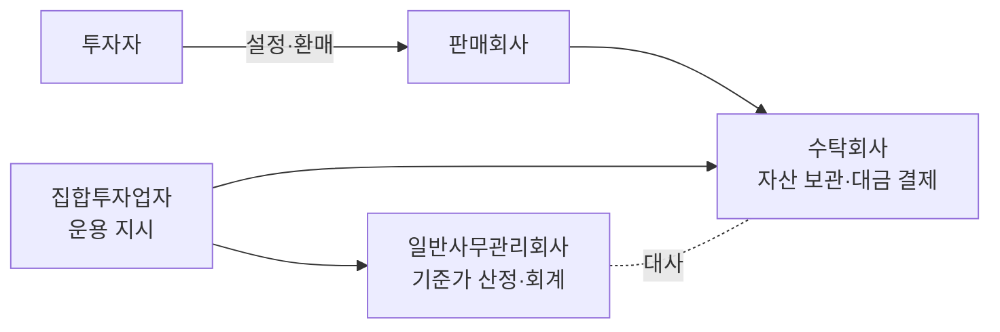
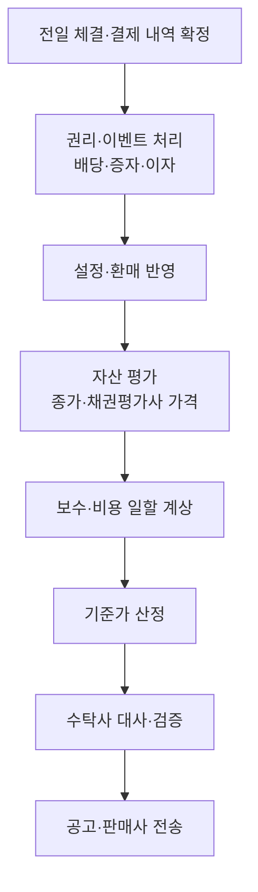

# Day 1 · 펀드의 뼈대 — 구조와 기준가격

> 펀드회계의 모든 숫자는 결국 '기준가격' 하나로 모입니다. 누가 무엇을 하고, 기준가가 어떻게 나오는지부터 잡습니다.

📘 펀드회계 백과 1/20일차 · 항목 8개 · [전체 목차](../README.md)



**오늘의 항목**: 집합투자기구(펀드) · 펀드 관계회사 4곳의 역할 · 좌수와 원본 · 기준가격 · 순자산(NAV)의 구성 · 회계기간과 결산 · 공모펀드와 사모펀드 · 기준가 산정의 하루 흐름

---

## 1. 집합투자기구(펀드)

여러 투자자의 돈을 모아 집합투자업자(운용사)가 운용하고 그 결과를 투자자에게 돌려주는 구조입니다. 자본시장법상 법적 형태에 따라 투자신탁, 투자회사, 투자유한회사, 투자합자회사, 투자익명조합 등으로 나뉘며 국내 공모펀드의 대부분은 투자신탁입니다.

- 투자신탁: 운용사(위탁자)와 수탁회사(수탁자)가 신탁계약을 맺는 계약형 구조. 펀드 자체는 법인이 아니고, 재산의 법적 명의는 수탁회사입니다.
- 투자회사: 펀드가 상법상 주식회사(서류상 회사)인 회사형 구조. 이사회·주주총회가 있고 투자자는 주주가 됩니다.
- 실무 포인트: 장부상 '펀드'는 하나의 독립된 회계 실체로 보고 운용사 고유재산과 완전히 분리해 기록합니다.

## 2. 펀드 관계회사 4곳의 역할

- 집합투자업자(운용사): 무엇을 사고팔지 결정하고 수탁회사에 운용 지시를 내립니다.
- 판매회사(은행·증권사): 투자자에게 펀드를 팔고 설정·환매 주문을 받습니다.
- 신탁업자(수탁회사): 펀드 재산을 보관하고 대금 결제를 실행하며, 운용 지시가 법령·규약에 맞는지 감시합니다.
- 일반사무관리회사: 매일 펀드 장부를 기장하고 자산을 평가해 기준가격을 산정합니다. 펀드회계 실무의 중심입니다.
- 실무 포인트: 사무관리회사가 계산한 기준가와 수탁회사가 따로 계산한 값(또는 잔고)을 매일 맞춰 보는 것을 '대사(reconciliation)'라고 합니다.

## 3. 좌수와 원본

펀드 지분의 단위가 좌(座)입니다. 국내 투자신탁은 보통 최초 설정 시 1,000좌 = 1,000원(1좌 = 1원)으로 시작하며, 이 '좌수 × 1원' 부분을 원본이라고 부릅니다.

- 투자자가 보유한 것은 '돈'이 아니라 '좌수'입니다. 펀드 가치가 변하면 좌수는 그대로이고 1좌의 값(기준가)이 변합니다.
- 원본은 회계상 자본(순자산) 중 출자 부분에 해당합니다. 순자산에서 원본을 뺀 나머지가 그동안 쌓인 이익(또는 손실)입니다.

## 4. 기준가격

펀드 1,000좌의 가격입니다. 매일 산정해 공고하며 설정·환매 가격의 기준이 됩니다.

```text
기준가격 = (자산총액 − 부채총액) ÷ 총좌수 × 1,000
         = 순자산총액 ÷ 총좌수 × 1,000
예) 순자산 10,500,000,000원 / 총좌수 10,000,000,000좌 × 1,000 = 1,050.00원
```

- 소수점 처리: 보통 원 미만 둘째 자리까지 공고합니다(셋째 자리에서 처리 방식은 규약·사무관리 기준에 따름).
- 실무 포인트: 기준가가 전일보다 크게 움직이면 시장 움직임으로 설명되는지 반드시 확인합니다. 설명이 안 되면 권리 처리 누락, 체결 누락, 단가 오류 같은 장부 오류일 가능성이 큽니다.

## 5. 순자산(NAV)의 구성

- 자산: 주식·채권·파생상품·예금·콜론·RP 같은 투자자산과 미수입금, 미수이자, 미수배당금 같은 미수 항목
- 부채: 미지급금(매수 결제대금), 미지급환매금, 미지급보수, 기타 미지급비용
- 순자산 = 원본 + 이익잉여금(또는 결손금). 이익잉여금 안에 당기 매매손익·평가손익·이자배당수익·비용이 누적됩니다.

## 6. 회계기간과 결산

펀드는 규약에서 정한 회계기간(보통 1년)마다 결산을 합니다. 결산일에 그 기간의 이익을 확정하고 이익분배금을 지급하거나 재투자합니다.

- 일일 결산: 펀드는 매일 기준가를 내야 하므로 사실상 매일 결산하듯 손익을 발생주의로 반영합니다.
- 결산 분배: 결산일에 분배금을 지급하면 순자산이 줄어 기준가가 다시 1,000원 근처로 낮아지는 경우가 많습니다(재투자하면 좌수가 늘어남).

## 7. 공모펀드와 사모펀드

- 공모: 불특정 다수에게 판매. 공시·평가·보수 규제가 엄격하고 기준가를 매일 공고합니다.
- 사모: 소수 투자자 대상. 기관전용 사모와 일반 사모로 나뉘며 기준가 산정 주기·평가 방법이 규약에 따라 다양합니다. 비상장·대체자산 비중이 높아 평가 난이도가 높습니다.

## 8. 기준가 산정의 하루 흐름



- 실무 포인트: 오류는 대부분 앞단(체결·권리 처리)에서 생기고 뒷단(기준가)에서 발견됩니다. 숫자가 이상하면 거꾸로 거슬러 올라가며 확인합니다.

---

> 분개 예시의 숫자는 이해를 돕기 위한 가정입니다. 계정과목 명칭·세부 처리는 사무관리회사·운용사 기준과 최신 법령을 확인하세요.

[목차](../README.md) · [Day 2 펀드회계의 기본 원리 →](day02.md)
