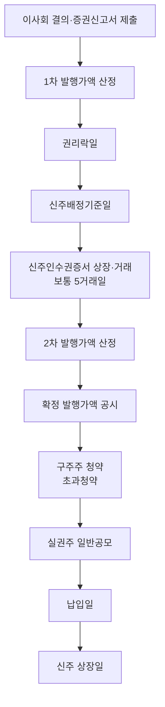

# Day 6 · 유상증자의 전 과정

> 가장 복잡한 주식 이벤트. 회사가 새 주식을 팔아 돈을 모으는 과정을 일정 순서대로 봅니다.

📘 펀드회계 백과 6/20일차 · 항목 9개 · [전체 목차](../README.md)



**오늘의 항목**: 유상증자의 배정 방식 · 1차 발행가액 · 2차 발행가액 · 확정 발행가액 · 신주인수권과 권리락 · 신주인수권증서 · 구주주 청약과 초과청약 · 실권주 일반공모와 납입 · 신주 상장

---

## 1. 유상증자의 배정 방식

- 주주배정: 기존 주주에게 보유 비율대로 신주인수권을 줍니다. 실권주는 다시 일반공모하는 '주주배정 후 실권주 일반공모'가 가장 흔합니다.
- 제3자배정: 특정인(전략적 투자자 등)에게만 배정합니다. 기존 주주에게는 권리가 없습니다.
- 일반공모: 처음부터 불특정 다수에게 청약을 받습니다.
- 펀드회계에서 손이 가장 많이 가는 것은 주주배정입니다. 펀드가 신주인수권을 받기 때문입니다.

## 2. 1차 발행가액

증자 일정 초반, 신주배정기준일 전 일정 거래일을 기산일로 과거 주가 평균을 구해 할인율을 적용해 정하는 예정 발행가입니다. 주주배정에서는 실무상 다음과 같은 방식이 널리 쓰입니다.

```text
기준주가 = 기산일 기준 [1개월 가중평균, 1주일 가중평균, 기산일 가중평균]의 산술평균과
          기산일 가중평균주가 중 낮은 가격
1차 발행가액 = 기준주가 × (1 − 할인율) ÷ (1 + 증자비율 × 할인율)
```

- 분모의 (1 + 증자비율 × 할인율)는 권리락으로 주가가 떨어지는 효과를 미리 반영하는 장치입니다.
- 발행가 산정 방식은 회사가 증권신고서에 정하므로, 실제 처리 시에는 반드시 해당 회사의 증권신고서 문구를 확인하세요.

## 3. 2차 발행가액

구주주 청약일 직전, 최근 주가로 한 번 더 계산하는 발행가입니다. 실무상 청약일 전 제3거래일을 기산일로 1주일 가중평균과 기산일 가중평균의 산술평균에 할인율을 적용하는 방식이 많이 쓰입니다.

```text
2차 발행가액 = [1주일 가중평균, 기산일 가중평균]의 산술평균 × (1 − 할인율)
```

## 4. 확정 발행가액

보통 1차와 2차 발행가액 중 낮은 가격으로 확정합니다. 다만 2차가 더 낮더라도 1차의 일정 비율(예: 70%) 이상으로 하한을 두는 조건이 붙는 경우가 많고, 액면가 아래로는 발행할 수 없습니다.

- 주가가 떨어지면 발행가도 내려가 회사가 모으는 돈이 줄어듭니다. 증자 일정 중 주가가 하락하는 이유 중 하나입니다.

## 5. 신주인수권과 권리락

주주배정 유상증자에서 기준일 주주는 '신주를 발행가에 살 수 있는 권리(신주인수권)'를 받습니다. 기준일 1영업일 전이 권리락일이며, 이날부터 주가는 권리 가치만큼 떨어진 가격으로 거래됩니다.

```text
권리락 이론주가 = (권리락 전일 종가 + 예정발행가 × 증자비율) ÷ (1 + 증자비율)
예) 전일 종가 10,000원, 발행가 7,000원, 증자비율 0.3
   (10,000 + 7,000 × 0.3) ÷ 1.3 = 9,307.69원
신주인수권 1주당 이론가치 ≈ 권리락 주가 − 발행가 = 2,307.69원
```

## 6. 신주인수권증서

신주인수권을 증권으로 만든 것입니다. 상장되면 보통 5거래일 정도 거래소에서 사고팔 수 있습니다. 청약할 돈이 없는 주주는 증서를 팔아 권리 가치를 현금화할 수 있습니다.

- 증서 상장 전에는 이론가치로, 상장 기간에는 증서 종가로, 상장 폐지 후 청약 전까지는 다시 이론가치 등으로 평가하는 것이 일반적입니다(사내 평가 기준 확인).
- 증서는 청약 기간 전에 거래가 끝나며, 청약하지 않은 권리는 청약 마감과 함께 소멸합니다.

## 7. 구주주 청약과 초과청약

권리를 가진 주주는 청약 기간에 발행가 × 배정주식 수만큼 청약하고 대금을 냅니다. 회사가 허용하면 배정분의 일정 비율(예: 20%)까지 더 청약하는 초과청약도 가능하며, 실권주가 남으면 초과청약자에게 먼저 배정합니다.

- 초과청약분은 배정받지 못하면 청약증거금이 돌려 나옵니다.

## 8. 실권주 일반공모와 납입

구주주가 청약하지 않은 실권주는 일반 투자자 대상 공모로 다시 팔고, 그래도 남으면 주관사가 인수(잔액인수)하기도 합니다. 납입일에 청약대금이 회사 자본금이 되고 신주가 발행됩니다.

## 9. 신주 상장

납입 후 보통 1~2주 안에 신주가 상장됩니다. 상장일부터 신주를 팔 수 있으므로, 상장일 주가 하락(물량 부담)이 흔합니다.

- 실무 포인트: 납입일부터 상장일까지 펀드는 '납입은 끝났지만 아직 상장되지 않은 신주'를 보유합니다. 이 기간의 평가 방법(보통 해당 종목 종가)을 기준서로 확인하세요.

---

> 분개 예시의 숫자는 이해를 돕기 위한 가정입니다. 계정과목 명칭·세부 처리는 사무관리회사·운용사 기준과 최신 법령을 확인하세요.

[← Day 5 무상증자·액면분할·병합](day05.md) · [목차](../README.md) · [Day 7 유상증자의 펀드 회계처리 →](day07.md)
