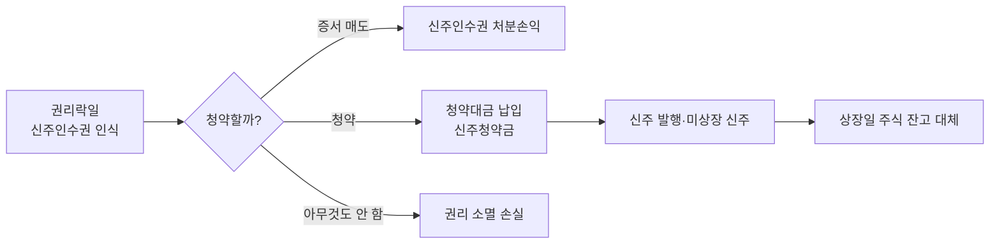

# Day 7 · 유상증자의 펀드 회계처리

> Day 6의 일정이 펀드 장부에서는 어떤 분개로 바뀌는지 단계별로 따라갑니다.

📘 펀드회계 백과 7/20일차 · 항목 10개 · [전체 목차](../README.md)

**오늘의 항목**: 처리 전체 그림 · 권리락일 — 신주인수권 인식 · 신주인수권증서 입고와 평가 · 신주인수권증서를 매도할 때 · 청약할 때 — 청약대금 납입 · 배정 확정과 초과청약 환불 · 납입일 — 신주 취득 · 상장일 — 주식 잔고로 대체 · 청약도 매도도 안 했을 때 — 권리 소멸 · 유상증자 처리 체크리스트

---

## 1. 처리 전체 그림



## 2. 권리락일 — 신주인수권 인식

권리락으로 주가가 떨어진 만큼을 신주인수권 평가액으로 채워야 순자산이 유지됩니다.

```text
보유 1,000주, 증자비율 0.3 → 배정 300주, 권리 1주당 평가 2,300원 가정
차) 신주인수권(평가)  690,000   대) 신주인수권평가이익  690,000
동시에 보유 주식은 권리락 종가로 평가되어 평가손실 발생 → 둘이 상쇄
```

- 신주인수권의 장부가(취득원가)는 0으로 두고 평가액 전부를 평가이익으로 잡는 방식이 흔합니다. 기존 주식 장부가 일부를 신주인수권으로 배분하는 방식을 쓰는 곳도 있으니 사내 기준을 확인하세요.

## 3. 신주인수권증서 입고와 평가

증서가 상장되면 펀드 계좌에 증서가 입고되고, 평가 기준을 이론가치에서 증서 종가로 바꿉니다.

```text
증서 300주, 증서 종가 2,100원 → 평가액 630,000 (전일 690,000 대비 −60,000)
차) 신주인수권평가손실 60,000   대) 신주인수권(평가) 60,000
```

## 4. 신주인수권증서를 매도할 때

운용사가 청약하지 않고 권리를 팔기로 하면 증서를 거래소에서 매도합니다. 일반 주식 매도와 같은 구조입니다.

```text
증서 300주를 2,200원에 매도, 수수료 무시
차) 미수입금 660,000   대) 신주인수권(장부가 0) 0
                          신주인수권처분이익 660,000
(이전에 잡아 둔 평가이익 누계는 처분 시 함께 정리)
```

## 5. 청약할 때 — 청약대금 납입

```text
청약일: 300주 × 확정발행가 7,000원 = 2,100,000원 (초과청약 60주 포함 시 청약증거금 2,520,000)
차) 신주청약금(자산) 2,520,000   대) 예금 2,520,000
```

- 신주청약금은 아직 주식이 아니므로 별도 자산 계정으로 둡니다.

## 6. 배정 확정과 초과청약 환불

```text
초과청약 60주 중 20주만 배정 → 40주 × 7,000 = 280,000 환불
차) 예금 280,000   대) 신주청약금 280,000
```

## 7. 납입일 — 신주 취득

납입일에 청약금이 주식 취득원가가 됩니다. 상장 전까지는 '미상장 신주' 등으로 따로 관리합니다.

```text
배정 320주(구주주 300 + 초과 20) × 7,000 = 2,240,000
차) 신주(미상장)  2,240,000   대) 신주청약금 2,240,000
같은 날 신주인수권 평가액 정리 — 청약한 권리는 소멸하고 그 가치는 신주 평가에 흡수
```

- 미상장 신주는 보통 해당 종목 종가로 평가합니다. 발행가보다 종가가 높으면 그 차이가 평가이익으로 잡히는데, 권리락일에 잡은 신주인수권 평가이익이 여기로 옮겨 간다고 이해하면 됩니다.

## 8. 상장일 — 주식 잔고로 대체

```text
차) 주식 2,240,000   대) 신주(미상장) 2,240,000
→ 기존 1,000주와 합쳐 1,320주, 평균단가 재계산
```

## 9. 청약도 매도도 안 했을 때 — 권리 소멸

청약 마감까지 아무것도 하지 않으면 권리가 사라지고, 그때까지 잡아 둔 신주인수권 평가액이 손실로 바뀝니다.

```text
차) 신주인수권평가이익(환입) 또는 권리소멸손실 xxx   대) 신주인수권(평가) xxx
```

- 실무 포인트: 운용사에 청약 의사를 반드시 사전에 확인하세요. '운용사가 깜빡해서 권리가 소멸'하는 사고는 펀드에 실제 손실을 끼칩니다. 청약 마감 며칠 전 알림을 두는 곳이 많습니다.

## 10. 유상증자 처리 체크리스트

- 배정 비율과 펀드 보유 수량으로 계산한 배정 주식 수가 예탁원 통지와 같은가
- 1차·2차·확정 발행가가 시스템에 정확히 입력되었는가
- 권리락일 기준가가 튀지 않았는가(주식 평가손실 ≈ 신주인수권 평가이익)
- 청약 의사 결정, 청약 금액, 자금 확보가 마감 전에 끝났는가
- 납입일·상장일에 수탁사 잔고와 수량·금액이 맞는가

---

> 분개 예시의 숫자는 이해를 돕기 위한 가정입니다. 계정과목 명칭·세부 처리는 사무관리회사·운용사 기준과 최신 법령을 확인하세요.

[← Day 6 유상증자의 전 과정](day06.md) · [목차](../README.md) · [Day 8 그 밖의 주식 기업행위 →](day08.md)
