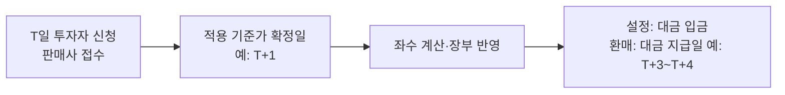

# Day 13 · 설정과 환매의 회계처리

> 투자자가 돈을 넣고 뺄 때 펀드 장부에서 일어나는 일. 원본과 조정금 개념이 핵심입니다.

📘 펀드회계 백과 13/20일차 · 항목 7개 · [전체 목차](../README.md)



**오늘의 항목**: 설정 좌수 계산 · 설정의 분개 — 원본과 조정금 · 환매의 분개 · 환매수수료 · 환매대금 마련 · 기준가에 미치는 영향 · 판매사·수탁사·사무관리 대사

---

## 1. 설정 좌수 계산

```text
설정 좌수 = 설정금액 ÷ 적용 기준가 × 1,000  (좌 미만 처리 규칙은 규약 따름)
예) 1억 원, 기준가 1,050원 → 100,000,000 ÷ 1,050 × 1,000 = 95,238,095좌
```

## 2. 설정의 분개 — 원본과 조정금

설정금액 중 '좌수 × 1원'은 원본으로, 나머지(기준가가 1,000원보다 높아서 더 낸 부분)는 이익 조정 계정으로 처리합니다. 이렇게 해야 새로 들어온 투자자가 기존 이익을 나눠 갖는 것이 아니라, 이미 쌓인 이익만큼 값을 치르고 들어왔다는 것이 장부에 남습니다.

```text
1억 원 설정, 95,238,095좌
차) 예금(또는 미수설정금) 100,000,000   대) 원본         95,238,095
                                          설정조정금    4,761,905
```

- 조정금 계정 이름은 회사마다 다릅니다(설정조정금, 수익조정금, 이익조정금 등).

## 3. 환매의 분개

환매는 설정의 반대입니다. 원본을 줄이고, 기준가와 1,000원의 차이만큼을 환매조정금으로 처리하며, 지급 전까지는 미지급환매금으로 둡니다.

```text
50,000,000좌 환매, 적용 기준가 1,080원 → 환매금액 54,000,000
환매 확정일:
차) 원본        50,000,000   대) 미지급환매금 54,000,000
    환매조정금   4,000,000
지급일:
차) 미지급환매금 54,000,000  대) 예금 54,000,000
```

## 4. 환매수수료

일정 기간 안에 환매하면 환매수수료를 받는 펀드가 있습니다. 환매수수료는 운용사나 판매사가 아니라 펀드 재산에 귀속되어 남은 투자자에게 돌아갑니다.

```text
환매수수료 500,000원
차) 미지급환매금 500,000   대) 환매수수료수익(펀드 귀속) 500,000
```

## 5. 환매대금 마련

대량 환매가 들어오면 운용사는 지급일 전에 자산을 팔아 현금을 만들어야 합니다. 회계팀은 환매 예정 금액을 운용·자금 담당에게 미리 공유합니다.

- 환매 연기: 자산을 팔 수 없을 정도의 예외 상황에서는 법령과 규약이 정한 절차에 따라 환매를 연기할 수 있습니다.

## 6. 기준가에 미치는 영향

설정·환매는 원칙적으로 기준가를 바꾸지 않습니다. 기준가대로 돈과 좌수가 같이 들어오고 나가기 때문입니다.

- 실무 포인트: 설정·환매가 많은 날 기준가가 이상하게 움직이면 좌수 계산이나 적용 기준가 일자 오류를 의심하세요.

## 7. 판매사·수탁사·사무관리 대사

- 판매사가 접수한 설정·환매 금액과 좌수, 사무관리회사 장부, 수탁회사 입출금이 모두 일치해야 합니다.
- 흔한 오류: 신청 시간(컷오프) 착오로 다른 날 기준가 적용, 클래스(종류) 착오, 좌수 단수 처리 차이

---

> 분개 예시의 숫자는 이해를 돕기 위한 가정입니다. 계정과목 명칭·세부 처리는 사무관리회사·운용사 기준과 최신 법령을 확인하세요.

[← Day 12 MMF의 특별한 회계](day12.md) · [목차](../README.md) · [Day 14 보수와 비용 →](day14.md)
