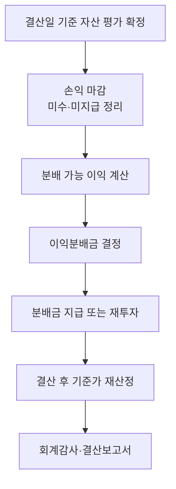

# Day 19 · 결산, 이익분배, 세무

> 회계기간 말에 무엇을 하는지, 투자자의 세금은 어떻게 계산되는지 정리합니다.

📘 펀드회계 백과 19/20일차 · 항목 7개 · [전체 목차](../README.md)

**오늘의 항목**: 결산 절차 · 이익분배금 · 재투자와 기준가 변화 · 과세표준 기준가격 · 투자자 단계의 원천징수 · 펀드 단계의 세금 · 결산 보고와 감사

---

## 1. 결산 절차



## 2. 이익분배금

결산일에 그 회계기간에 생긴 이익을 투자자에게 나눠 주는 것입니다. 분배 기준(전부 분배, 일부 유보 등)은 규약에 따릅니다.

- 상장주식 매매·평가이익 같은 일부 이익은 분배를 유보할 수 있도록 규약에 정하는 경우가 많습니다(세무상 과세 대상이 아닌 이익이라 분배 실익이 적음).

```text
분배금 결정 시: 차) 이익잉여금(분배) xxx   대) 미지급분배금 xxx
재투자 시:     차) 미지급분배금 xxx       대) 원본 xxx / 설정조정금 xxx (재투자 좌수 발생)
```

## 3. 재투자와 기준가 변화

분배금을 재투자하면 분배만큼 기준가가 떨어지고, 투자자의 좌수가 늘어납니다. 투자자가 가진 총 평가액은 분배 전후로 같습니다(세금 제외).

- 그래서 결산 다음 날 기준가가 크게 떨어져 보여도 손실이 아닙니다. 투자자 문의가 많은 부분입니다.

## 4. 과세표준 기준가격

펀드 이익 중에는 세금이 붙는 것(이자, 배당, 채권 매매·평가손익 등)과 붙지 않는 것(국내 상장주식 매매·평가손익, 일부 장내파생 손익 등)이 섞여 있습니다. 그래서 세금 계산용으로 비과세 손익을 뺀 '과세표준 기준가'를 따로 산정합니다.

```text
환매 시 과세 대상 소득 ≈ (환매 시 과표기준가 − 매수 시 과표기준가) × 좌수 ÷ 1,000
```

- 그래서 실제 수익은 손실인데 세금이 나오는 경우가 있습니다(주식에서 손실, 채권 이자로 과표는 이익).

## 5. 투자자 단계의 원천징수

펀드에서 나오는 이익(분배금, 환매 이익 중 과세 부분)은 투자자에게 배당소득으로 과세됩니다. 개인은 원천징수세율 15.4%(소득세 14% + 지방소득세 1.4%)가 일반적이며, 연간 금융소득이 2,000만 원을 넘으면 종합과세 대상이 됩니다.

- 도입이 예정되었던 금융투자소득세는 2024년 말 폐지되어 현행 배당소득 과세 체계가 유지되고 있습니다.
- 원천징수는 보통 판매회사가 지급 시점에 처리하지만, 사무관리회사가 계산한 과표기준가 데이터가 기초가 됩니다.

## 6. 펀드 단계의 세금

투자신탁은 일반적으로 법인세 납세 의무가 없는 도관(통과) 구조로 취급되어, 이익을 투자자에게 넘기고 투자자 단계에서 과세하는 방식이 기본입니다. 다만 펀드 형태·유형별 예외와 세법 개정이 있으므로 사내 세무 기준을 확인하세요.

- 외국납부세액: 해외에서 원천징수된 세금을 투자자 단계에서 공제·환급하는 절차가 있습니다(Day 16과 연결).

## 7. 결산 보고와 감사

- 결산 후 재무제표(재무상태표, 손익계산서 등)와 주석을 작성하고 외부 회계감사를 받습니다.
- 집합투자업자는 자산운용보고서를 정기적으로 투자자에게 제공합니다.
- 실무 포인트: 감사인은 평가(특히 Level 3), 권리 처리, 보수 계산, 대사 결과를 집중적으로 봅니다. 평소 근거 자료를 정리해 두면 결산이 빨라집니다.

---

> 분개 예시의 숫자는 이해를 돕기 위한 가정입니다. 계정과목 명칭·세부 처리는 사무관리회사·운용사 기준과 최신 법령을 확인하세요.

[← Day 18 비상장·재간접·대체투자와 공정가치](day18.md) · [목차](../README.md) · [Day 20 기준가 검증, 오류 처리, 실무 체크리스트 →](day20.md)
