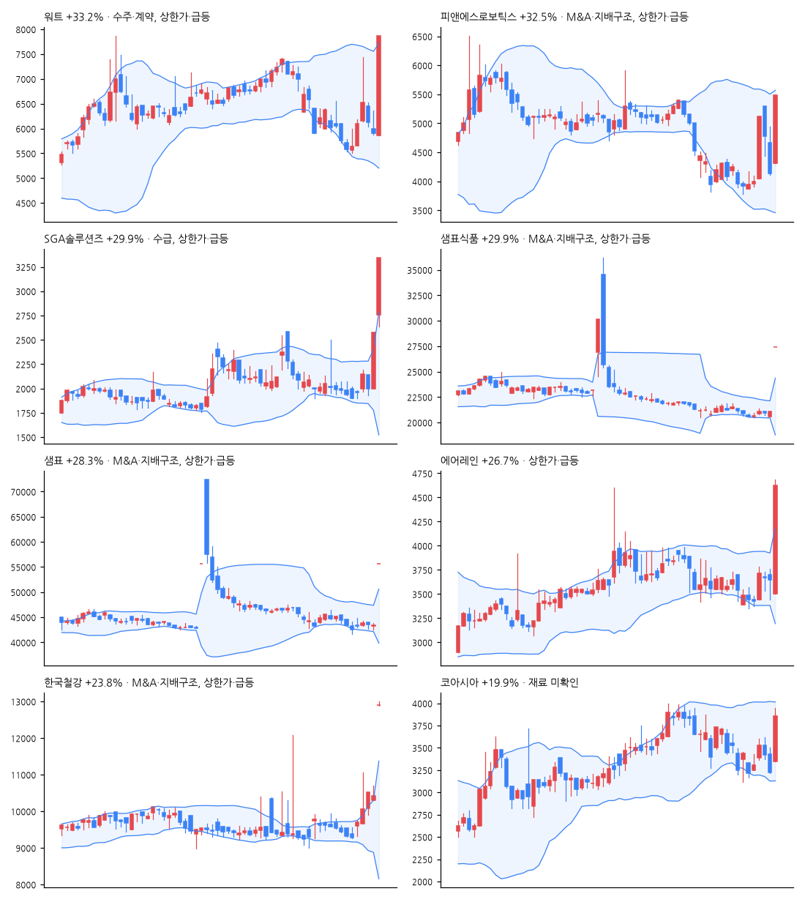

# 급등주 리포트 · 2026-11-02

> 전 종목 2,687 · 상승 1,907 / 하락 621 · 중앙값 +1.53% · **급등(+10%↑) 61종목**, 상한가 4

[목차](../README.md) · [분석 노트](../notes/2026-11-02.md) · [패턴 정리](../PATTERNS.md)

## 급등주 (거래대금 10억 이상 우선)

| 종목 | 등락 | 갭 | 종가위치 | 거래대금 | 거래량배수 | 재료(자동) | 테마 |
|---|--:|--:|--:|--:|--:|---|---|
| 워트 | +33.2% | -0.7% | 1.00 | 460억 | 16.1x | 수주·계약, 상한가·급등 | 바이오, 식품, 광통신 |
| 피앤에스로보틱스 | +32.5% | +4.1% | 1.00 | 204억 | 19.0x | M&A·지배구조, 상한가·급등 | AI, 로봇, 조선 |
| SGA솔루션즈 | +29.9% | +7.2% | 1.00 | 421억 | 63.0x | 수급, 상한가·급등 | 보안, 가상자산 |
| 샘표식품 | +29.9% | +29.9% | 1.00 | 36억 | 8.1x | M&A·지배구조, 상한가·급등 | 바이오, 식품 |
| 샘표 | +28.3% | +28.3% | 1.00 | 19억 | 3.7x | M&A·지배구조, 상한가·급등 | 바이오, 식품 |
| 에어레인 | +26.7% | -4.1% | 0.95 | 195억 | 99.4x | 상한가·급등 | - |
| 한국철강 | +23.8% | +23.7% | 0.18 | 142억 | 34.1x | M&A·지배구조, 상한가·급등 | 식품, 철강 |
| 코아시아 | +19.9% | +3.9% | 0.86 | 23억 | 9.9x | - | 반도체 |
| 태광 | +17.6% | +0.4% | 1.00 | 130억 | 2.9x | 임상·허가, M&A·지배구조, 정책·정부 | - |
| KISCO홀딩스 | +17.6% | +19.3% | 0.27 | 31억 | 27.1x | 상한가·급등 | 철강 |
| HD현대마린엔진 | +17.6% | +0.1% | 0.86 | 224억 | 1.9x | 실적, 수주·계약, 상한가·급등 | 조선, 항공 |
| 한진칼 | +17.2% | -0.7% | 0.82 | 744억 | 8.3x | M&A·지배구조, 투자·시설 | 조선 |
| 메드팩토 | +17.1% | -0.2% | 0.87 | 17억 | 4.2x | 임상·허가, 수급, 상한가·급등 | 바이오 |
| 비아트론 | +17.1% | -0.5% | 0.84 | 103억 | 1.0x | 수주·계약, 신기술·신제품 | 반도체, 건설 |
| 큐리오시스 | +16.8% | -0.7% | 0.88 | 21억 | 2.3x | - | - |
| 라온로보틱스 | +14.8% | +3.2% | 0.77 | 755억 | 13.7x | 실적, 수급, 상한가·급등 | 로봇, 건설 |
| 진코스텍 | +14.8% | +0.9% | 0.81 | 41억 | 0.3x | - | 바이오, 자율주행 |
| OCI홀딩스 | +14.5% | -0.4% | 0.95 | 678억 | 1.6x | - | 반도체 |
| 성광벤드 | +14.1% | +0.6% | 0.90 | 102억 | 2.7x | 실적, 수주·계약 | AI, 조선, 건설 |
| 슈프리마 | +14.0% | -0.1% | 0.93 | 75억 | 3.5x | 수급 | AI, 로봇, 보안 |
| 아모텍 | +13.6% | -0.1% | 0.71 | 129억 | 1.2x | - | 초전도, 전력 |
| 원익홀딩스 | +13.2% | +0.9% | 0.72 | 2,721억 | 5.3x | 실적, 수급 | 반도체, 로봇 |
| 현대제철 | +13.1% | +0.0% | 0.83 | 308억 | 2.4x | 실적, 신기술·신제품, 상한가·급등 | 철강, 금융 |
| 오이솔루션 | +13.1% | -1.1% | 0.96 | 40억 | 0.5x | - | - |
| 에치에프알 | +12.8% | +0.1% | 0.89 | 18억 | 1.1x | 상한가·급등 | - |
| GS건설 | +12.7% | +0.4% | 0.97 | 286억 | 1.1x | 실적, 신기술·신제품 | AI, 건설, 보안 |
| 한화오션 | +12.6% | +2.2% | 0.92 | 1,356억 | 1.2x | 수주·계약, 수급, 상한가·급등 | AI |
| 효성중공업 | +12.5% | -1.3% | 0.84 | 2,042억 | 1.7x | 실적, 수주·계약, 상한가·급등 | 전력, 변압기 |
| HD현대에너지솔루션 | +12.4% | -0.1% | 0.94 | 246억 | 1.0x | 정책·정부, 상한가·급등 | AI, 태양광, 데이터센터 |
| 에코프로에이치엔 | +12.0% | +0.0% | 0.90 | 73억 | 1.5x | 수주·계약, 투자·시설, 수급 | - |

## 급등 전날의 모습 (상위 종목)

| 종목 | %b | 밴드폭 하위% | 스퀴즈 | RSI | 20일선 이격 | 정배열 | 20일 수익률 | 고점 대비 | 전일 거래량배수 |
|---|--:|--:|:-:|--:|--:|:-:|--:|--:|--:|
| 워트 | 0.27 | 59 |  | 36 | -8.1% |  | -15.0% | -46.2% | 0.8x |
| 피앤에스로보틱스 | 0.32 | 68 |  | 45 | -8.1% |  | -18.1% | -72.1% | 3.8x |
| SGA솔루션즈 | 1.28 | 51 |  | 68 | +23.3% | ✓ | +25.0% | -62.1% | 9.6x |
| 샘표식품 | 0.39 | 11 |  | 47 | -0.9% |  | -3.4% | -41.7% | 0.6x |
| 샘표 | 0.23 | 49 |  | 38 | -3.2% |  | -6.5% | -40.7% | 0.9x |
| 에어레인 | 0.49 | 17 |  | 55 | -0.1% |  | -4.2% | -61.8% | 1.7x |
| 한국철강 | 1.09 | 74 |  | 74 | +8.8% |  | +11.8% | -13.7% | 1.3x |
| 코아시아 | 0.10 | 36 |  | 41 | -9.9% |  | -12.0% | -54.8% | 0.7x |

## 공시·뉴스 (상위 종목)

### 워트 (396470) +33.2%

- 📄 [단일판매ㆍ공급계약체결](https://dart.fss.or.kr/dsaf001/main.do?rcpNo=20261030900810) · 20261030
- 📰 워트(396470)저점에선 매수 시점을 노려볼 수 있을듯 보이며 이후 전망 및 대응전략. - ThinkPool
- 📰 워트, 삼성·SK하이닉스·대만 고객사 'EUV용 초정밀 온습도 제어장치' 평가 완료 - 데이터투자
- 📰 [마감분석] 워트 상한가 직행 7860원 마감 확인된 공시 없어 : 기업주식정보 - 재경일보
- 📰 [거래량 상위 종목] 영광, 전일비 31.18%↑... 현재가 22,300원 - 버핏연구소

### 피앤에스로보틱스 (460940) +32.5%

- 📰 [특징주] 피앤에스로보틱스, 재활로봇 사업 확대 기대에 28%↑ - 뉴스핌
- 📰 [상한가 종목] 샘표식품-HLB바이오스텝 이어 피앤에스로보틱스 등 마감 - 이코노뉴스
- 📰 [오전 시황] 샘표·피앤에스로보틱스 상한가…조선주 7%대↑ - 중기이코노미
- 📰 [주식마감] '합병 결정' 샘표·샘표식품 상한가... 디티에스, HLB바이오스텝, 피앤에스로보틱스 등 급등 - 금강일보

### SGA솔루션즈 (184230) +29.9%

- 📰 [공시] SOOP '공매도 금지', SGA솔루션즈 '투자경고종목 지정예고' 등...19건 - 뉴스티앤티
- 📰 SGA솔루션즈 주가, 웃음꽃 활짝... 왜? - 금강일보
- 📰 SGA솔루션즈, 주가 급등으로 11월 3일 투자주의종목 지정 - 톱스타뉴스
- 📰 SGA솔루션즈 29.90% 급등…1165만주 손바뀜 - 잡포스트

### 샘표식품 (248170) +29.9%

- 📄 [주주명부폐쇄기간또는기준일설정](https://dart.fss.or.kr/dsaf001/main.do?rcpNo=20261030801328) · 20261030
- 📄 [주주총회소집결의](https://dart.fss.or.kr/dsaf001/main.do?rcpNo=20261030801319) · 20261030
- 📄 [[첨부정정]주요사항보고서(회사합병결정)](https://dart.fss.or.kr/dsaf001/main.do?rcpNo=20261030000695) · 20261030
- 📄 [주요사항보고서(회사합병결정)](https://dart.fss.or.kr/dsaf001/main.do?rcpNo=20261030000482) · 20261030
- 📄 [매매거래정지및정지해제(중요내용공시)](https://dart.fss.or.kr/dsaf001/main.do?rcpNo=20261030800929) · 20261030
- 📰 샘표·샘표식품 합병 소식에 나란히 상한가 - 연합뉴스TV
- 📰 상장 폐지되면 증여세 폭탄… 샘표가 꺼내 든 '역합병'이라는 궁여지책 - 뉴스톱
- 📰 중복상장 해소 소식에 '들썩'…샘표·샘표식품 나란히 상한가 - 매일경제
- 📰 [주식마감] '합병 결정' 샘표·샘표식품 상한가... 디티에스, HLB바이오스텝, 피앤에스로보틱스 등 급등 - 금강일보

### 샘표 (007540) +28.3%

- 📄 [주주총회소집결의](https://dart.fss.or.kr/dsaf001/main.do?rcpNo=20261030801331) · 20261030
- 📄 [주주명부폐쇄기간또는기준일설정](https://dart.fss.or.kr/dsaf001/main.do?rcpNo=20261030801337) · 20261030
- 📄 [[첨부정정]주요사항보고서(회사합병결정)(자회사의 주요경영사항)](https://dart.fss.or.kr/dsaf001/main.do?rcpNo=20261030801293) · 20261030
- 📄 [[첨부정정]주요사항보고서(회사합병결정)](https://dart.fss.or.kr/dsaf001/main.do?rcpNo=20261030000700) · 20261030
- 📄 [주요사항보고서(회사합병결정)(자회사의 주요경영사항)](https://dart.fss.or.kr/dsaf001/main.do?rcpNo=20261030801011) · 20261030
- 📰 샘표·샘표식품 합병 소식에 나란히 상한가 - 연합뉴스TV
- 📰 상장 폐지되면 증여세 폭탄… 샘표가 꺼내 든 '역합병'이라는 궁여지책 - 뉴스톱
- 📰 중복상장 해소 소식에 '들썩'…샘표·샘표식품 나란히 상한가 - 매일경제
- 📰 [주식마감] '합병 결정' 샘표·샘표식품 상한가... 디티에스, HLB바이오스텝, 피앤에스로보틱스 등 급등 - 금강일보

### 에어레인 (163280) +26.7%

- 📰 [마감분석] 에어레인 26%대 급등 마감하며 4545원 기록 : 기업주식정보 - 재경일보

### 한국철강 (104700) +23.8%

- 📄 [주식등의대량보유상황보고서(일반)](https://dart.fss.or.kr/dsaf001/main.do?rcpNo=20261030000525) · 20261030
- 📄 [주주총회소집결의](https://dart.fss.or.kr/dsaf001/main.do?rcpNo=20261030800840) · 20261030
- 📄 [주주명부폐쇄기간또는기준일설정](https://dart.fss.or.kr/dsaf001/main.do?rcpNo=20261030800751) · 20261030
- 📄 [주요사항보고서(주식교환ㆍ이전결정)](https://dart.fss.or.kr/dsaf001/main.do?rcpNo=20261030000319) · 20261030
- 📄 [매매거래정지및정지해제(중요내용공시)](https://dart.fss.or.kr/dsaf001/main.do?rcpNo=20261030800696) · 20261030
- 📰 공개매수 뜨자 한국철강 23% 급등…추가 상승 가능성은? - 한국경제
- 📰 KISCO홀딩스, 한국철강 잔여 지분 공개매수…주당 1만 3,000원 - 페로타임즈
- 📰 [특징주] 한국철강, KISCO홀딩스 공개매수에 급등…비상장사 전환 추진 - https://www.moneystorm.kr/
- 📰 [특징주] KISCO홀딩스, 한국철강 완전 자회사 편입 추진에 주가 동반 급등 - 뉴스웍스

### 코아시아 (045970) +19.9%

- 📰 코아시아세미, 삼성 파운드리 4나노 반도체 출하 시작 - 디일렉
- 📰 코아시아세미, 삼성 4나노서 'HPC용 빅다이 반도체' 양산 시작 - 머니투데이 - 머니투데이
- 📰 코아시아세미, HPC향 최첨단 빅다이 칩 양산 출하 - 지디넷코리아
- 📰 코아시아세미, 4나노 칩 웨이퍼 양산 - 한스경제

---

※ 재료는 공시 제목·뉴스 제목 키워드로 자동 분류한 것입니다. 판단은 [분석 노트](../notes/) 참고. 투자 권유 아님.
