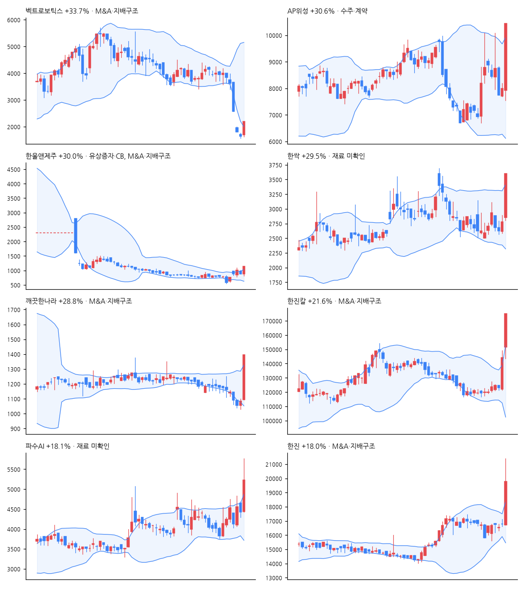

# 급등주 리포트 · 2026-11-03

> 전 종목 2,687 · 상승 586 / 하락 1,944 · 중앙값 -1.50% · **급등(+10%↑) 18종목**, 상한가 3

[목차](../README.md) · [분석 노트](../notes/2026-11-03.md) · [패턴 정리](../PATTERNS.md)

## 급등주 (거래대금 10억 이상 우선)

| 종목 | 등락 | 갭 | 종가위치 | 거래대금 | 거래량배수 | 재료(자동) | 테마 |
|---|--:|--:|--:|--:|--:|---|---|
| 벡트로보틱스 | +33.7% | +3.0% | 1.00 | 96억 | 8.2x | M&A·지배구조 | AI, 로봇 |
| AP위성 | +30.6% | -1.0% | 1.00 | 733억 | 6.7x | 수주·계약 | 우주 |
| 한울앤제주 | +30.0% | -0.1% | 1.00 | 41억 | 5.9x | 유상증자·CB, M&A·지배구조 | - |
| 한싹 | +29.5% | +2.7% | 1.00 | 90억 | 12.5x | - | AI, 금융, 보안 |
| 깨끗한나라 | +28.8% | +0.6% | 1.00 | 40억 | 115.5x | M&A·지배구조 | - |
| 한진칼 | +21.6% | +5.3% | 1.00 | 1,877억 | 12.4x | M&A·지배구조 | 항공 |
| 파수AI | +18.1% | +0.2% | 0.60 | 536억 | 20.6x | - | AI, 금융, 보안 |
| 한진 | +18.0% | -0.4% | 0.66 | 356억 | 49.7x | M&A·지배구조 | - |
| 로킷헬스케어 | +16.5% | +6.7% | 0.55 | 296억 | 5.1x | 임상·허가 | 바이오 |
| 진양폴리 | +15.8% | +0.3% | 0.73 | 110억 | 4.3x | - | 반도체 |
| 현우산업 | +14.4% | +0.2% | 0.63 | 61억 | 37.6x | 실적 | - |
| 아시아나IDT | +14.1% | -0.1% | 0.56 | 397억 | 633.1x | M&A·지배구조 | 항공 |
| 와이바이오로직스 | +11.7% | -1.9% | 0.86 | 12억 | 1.8x | 신기술·신제품 | 바이오, 제약 |
| 엑시온그룹 | +11.0% | +0.0% | 0.84 | 14억 | 1.6x | - | - |
| 에스투더블유 | +10.6% | -0.5% | 0.52 | 233억 | 2.8x | - | AI, 보안 |
| 디지아이 | +15.8% | +4.5% | 0.80 | 0억 | 2.2x | - | - |
| 아시아경제 | +14.9% | -10.9% | 0.98 | 7억 | 6.3x | 자사주·소각, 정책·정부 | - |
| 영우디에스피 | +10.8% | +2.9% | 0.80 | 2억 | 1.2x | 실적 | - |

## 급등 전날의 모습 (상위 종목)

| 종목 | %b | 밴드폭 하위% | 스퀴즈 | RSI | 20일선 이격 | 정배열 | 20일 수익률 | 고점 대비 | 전일 거래량배수 |
|---|--:|--:|:-:|--:|--:|:-:|--:|--:|--:|
| 벡트로보틱스 | -0.20 | 95 |  | 18 | -55.3% |  | -54.1% | -71.3% | 3.1x |
| AP위성 | 0.51 | 68 |  | 56 | +0.4% |  | -14.3% | -64.3% | 0.2x |
| 한울앤제주 | 0.70 | 26 |  | 54 | +7.3% |  | +6.2% | -84.6% | 0.9x |
| 한싹 | 0.43 | 48 |  | 47 | -2.3% |  | -4.8% | -63.9% | 0.7x |
| 깨끗한나라 | 0.03 | 56 |  | 22 | -8.2% |  | -14.0% | -54.9% | 2.1x |
| 한진칼 | 1.20 | 53 |  | 65 | +14.8% |  | +8.9% | -18.1% | 8.3x |
| 파수AI | 0.74 | 30 |  | 52 | +4.6% | ✓ | +14.3% | -35.7% | 0.8x |
| 한진 | 0.54 | 36 |  | 47 | +0.4% |  | +10.2% | -29.1% | 0.7x |

## 공시·뉴스 (상위 종목)

### 벡트로보틱스 (457600) +33.7%

- 📄 [임원ㆍ주요주주특정증권등소유상황보고서](https://dart.fss.or.kr/dsaf001/main.do?rcpNo=20261103000132) · 20261103
- 📄 [주식등의대량보유상황보고서(약식)](https://dart.fss.or.kr/dsaf001/main.do?rcpNo=20261103000130) · 20261103
- 📰 벡트로보틱스, 제조·물류·서비스 현장 연결하는 '피지컬 AI 비전' 첫 선 - 로봇신문
- 📰 벡트로보틱스 10%이상주주 인터페이스홀딩스 제1호 투자조합, 소유 주식 수량 139만2512주 감소…소유 지분율 10.16%p 하락 - 디지털투데이
- 📰 인터페이스홀딩스 제1호 투자조합, 벡트로보틱스 지분 11.67%→1.51% 축소 - 데이터투자
- 📰 인터페이스홀딩스제1호 투자조합 측, 벡트로보틱스 주식등 보유 비율 10.16%p 감소…주식담보대출 반대매매 영향 - 디지털투데이

### AP위성 (211270) +30.6%

- 📰 3조7000억 우주사업 뚫었다…AP위성 핵심장비 첫 납품 - 한국경제
- 📰 [특징주] AP위성, KPS 위성 시험장비 납품에 상한가…우주항법 사업 확대 기대 - https://www.moneystorm.kr/
- 📰 AP위성 주가, 급등세... 이유는? - 금강일보
- 📰 AP위성, 한국형 위성항법시스템 KPS 비행모듈 시험·검증용 AVTS 납품 완료 - 헬로티

### 한울앤제주 (276730) +30.0%

- 📄 [[기재정정]주요사항보고서(타법인주식및출자증권양수결정)](https://dart.fss.or.kr/dsaf001/main.do?rcpNo=20261102000313) · 20261102
- 📄 [임원ㆍ주요주주특정증권등소유상황보고서](https://dart.fss.or.kr/dsaf001/main.do?rcpNo=20261102000009) · 20261102
- 📄 [임원ㆍ주요주주특정증권등소유상황보고서](https://dart.fss.or.kr/dsaf001/main.do?rcpNo=20261102000008) · 20261102
- 📄 [임원ㆍ주요주주특정증권등소유상황보고서](https://dart.fss.or.kr/dsaf001/main.do?rcpNo=20261102000007) · 20261102
- 📄 [주식등의대량보유상황보고서(일반)](https://dart.fss.or.kr/dsaf001/main.do?rcpNo=20261102000006) · 20261102
- 📰 한울앤제주, 운영자금 21억9956만원 조달 위해 일반공모 유상증자 결정 - 디지털투데이
- 📰 한울앤제주 최대주주·경영진, 12만9000주 장내매수 - 디일렉
- 📰 한울앤제주, 책임경영 강화…주식 매입·병합 추진 - 뉴스핌
- 📰 한울앤제주, 최대주주·경영진 12만9002주 장내매수 - 딜사이트

### 한싹 (430690) +29.5%

- 📰 금융권 해킹에 보안주 급등…한싹 상한가·파수AI 15%대↑[이런국장 저런주식] - 서울경제
- 📰 한양증권 고객정보 유출 '보안주 급등'…한싹·파수AI 상한가[핫종목] - 뉴스1
- 📰 한싹(430690)저점에선 매수 관점이 유효할듯 보이며 이후 전망 및 대응전략. - ThinkPool
- 📰 [특징주] 금융권 해킹 사고에 보안주 강세…한싹·파수AI 나란히 급등 - https://www.moneystorm.kr/

### 깨끗한나라 (004540) +28.8%

- 📰 [주식마감] '경영권 분쟁 가능성' 한진칼·한진칼우 상한가... 깨끗한나라, 한울앤제주, AP위성, 한싹 등 급등 - 금강일보
- 📰 읽는 종이에서 담는 종이로…제지업계, 종이 사용처를 넓히다[중기+] - 헤럴드경제
- 📰 배우 배나라·한재아 결혼… “서로 아끼고 의지하는 삶 약속” - Chosunbiz
- 📰 [전날 애프터마켓] 깨끗한나라우 상한가 유지…삼전·SK하닉 추가 상승 - 이투데이

### 한진칼 (180640) +21.6%

- 📄 [임원ㆍ주요주주특정증권등거래계획보고서](https://dart.fss.or.kr/dsaf001/main.do?rcpNo=20261102000331) · 20261102
- 📄 [풍문또는보도에대한해명(미확정)](https://dart.fss.or.kr/dsaf001/main.do?rcpNo=20261102800358) · 20261102
- 📰 호반 vs 조원태 회장, 한진칼 지분 매입 경쟁 본격화하나 - 연합뉴스
- 📰 한진칼 최대주주 놓고…조원태·호반그룹 혈투 - 중앙일보
- 📰 한진칼 지분전 재점화…대한항공 경영권은 '별개' - 글로벌이코노믹
- 📰 한진칼 주식 더 사는 조원태…호반과 지분경쟁 2R - 국제신문

### 파수AI (150900) +18.1%

- 📰 [특징주] 금융권 해킹 사고 잇따르자 보안株 강세…'한싹·파수AI' 30%↑ - 뉴스핌
- 📰 [특징주] 금융권 해킹 사고에 보안주 강세…한싹·파수AI 나란히 급등 - https://www.moneystorm.kr/
- 📰 금융권 해킹에 보안주 급등…한싹 상한가·파수AI 15%대↑[이런국장 저런주식] - 서울경제
- 📰 한양증권 고객정보 유출 '보안주 급등'…한싹·파수AI 상한가[핫종목] - 뉴스1

### 한진 (002320) +18.0%

- 📰 '경영권 분쟁'에 한진칼 단숨에 상한가…호반그룹의 속내는? - 한국경제
- 📰 ‘경영권 분쟁’ 한진칼, 급락장서 상한가…호반 다음 행보에 눈길 - 한겨레
- 📰 호반, 한진칼 최대주주 노리지만 조원태 우호지분 ‘막강’···경영권 변화 가능성 '글쎄' - 시사저널e
- 📰 호반 vs 조원태 회장, 한진칼 지분 매입 경쟁 본격화하나 - 연합뉴스

---

※ 재료는 공시 제목·뉴스 제목 키워드로 자동 분류한 것입니다. 판단은 [분석 노트](../notes/) 참고. 투자 권유 아님.
