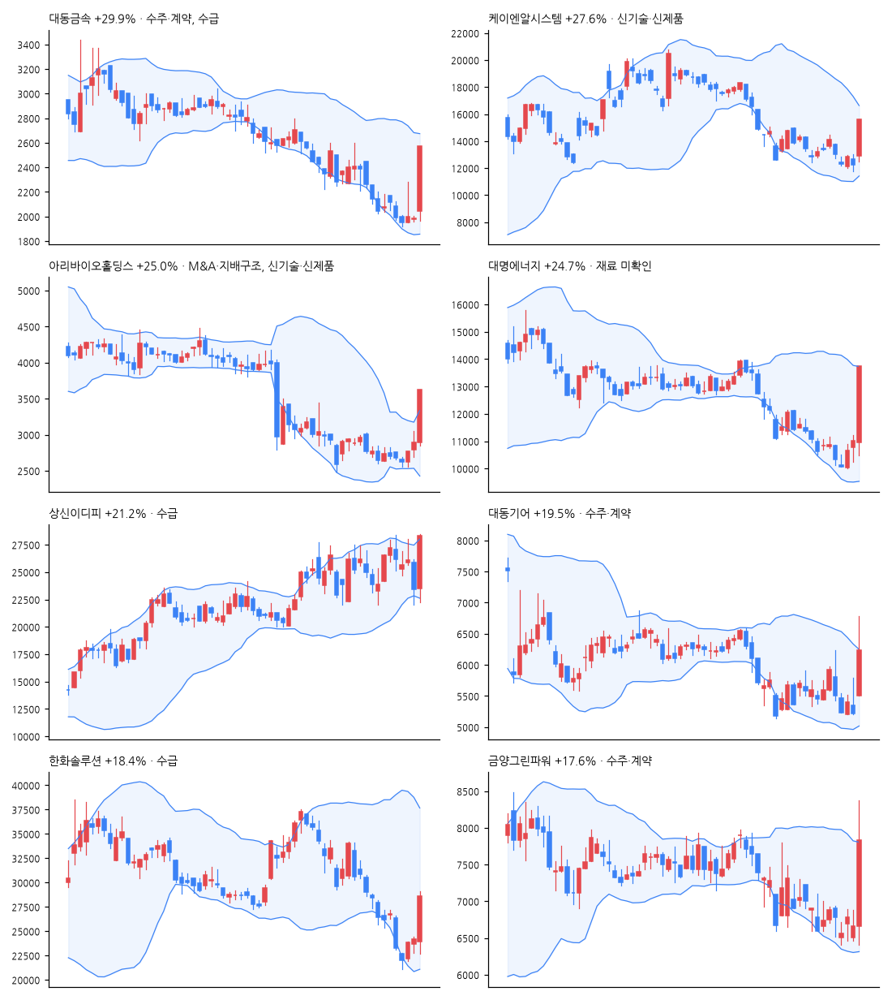

# 급등주 리포트 · 2026-11-04

> 전 종목 2,687 · 상승 1,533 / 하락 976 · 중앙값 +0.41% · **급등(+10%↑) 57종목**, 상한가 1

[목차](../README.md) · [분석 노트](../notes/2026-11-04.md) · [패턴 정리](../PATTERNS.md)

## 급등주 (거래대금 10억 이상 우선)

| 종목 | 등락 | 갭 | 종가위치 | 거래대금 | 거래량배수 | 재료(자동) | 테마 |
|---|--:|--:|--:|--:|--:|---|---|
| 대동금속 | +29.9% | +3.1% | 1.00 | 35억 | 70.5x | 수주·계약, 수급 | - |
| 케이엔알시스템 | +27.6% | +5.4% | 1.00 | 80억 | 11.5x | 신기술·신제품 | 로봇 |
| 아리바이오홀딩스 | +25.0% | +0.0% | 1.00 | 126억 | 6.4x | M&A·지배구조, 신기술·신제품 | 바이오 |
| 대명에너지 | +24.7% | -0.7% | 1.00 | 704억 | 70.7x | - | 반도체, 로봇, 수소 |
| 상신이디피 | +21.2% | +0.4% | 0.98 | 271억 | 1.9x | 수급 | 배터리, 전기차 |
| 대동기어 | +19.5% | +5.4% | 0.57 | 839억 | 66.4x | 수주·계약 | 로봇 |
| 한화솔루션 | +18.4% | -0.8% | 0.92 | 7,453억 | 8.6x | 수급 | 태양광, 건설 |
| 금양그린파워 | +17.6% | +0.0% | 0.72 | 154억 | 149.4x | 수주·계약 | 반도체, 배터리, 수소 |
| 에코앤드림 | +17.2% | +0.0% | 0.98 | 51억 | 0.9x | 수주·계약, 임상·허가, 정책·정부, 신기술·신제품, 수급 | 배터리, 태양광 |
| 포메탈 | +16.6% | +0.4% | 0.70 | 73억 | 12.0x | - | 반도체, 로봇, 방산 |
| 아리바이오랩 | +16.4% | -0.7% | 0.65 | 56억 | 3.5x | M&A·지배구조, 신기술·신제품 | 바이오 |
| 씨메스로보틱스 | +15.9% | +0.1% | 0.78 | 32억 | 6.0x | - | AI, 로봇 |
| 신흥에스이씨 | +15.2% | +0.7% | 0.92 | 82억 | 1.9x | - | 반도체, 배터리, 전기차 |
| 한중엔시에스 | +14.8% | +0.5% | 0.99 | 235억 | 2.3x | - | 배터리, 로봇 |
| 피노 | +14.6% | -1.2% | 0.90 | 240억 | 1.3x | M&A·지배구조, 신기술·신제품 | - |
| 세아제강지주 | +13.9% | -1.8% | 1.00 | 47억 | 2.5x | 실적 | 철강, 데이터센터 |
| 에스피소프트 | +13.7% | -2.3% | 0.67 | 695억 | 6.7x | 신기술·신제품 | AI, 양자 |
| 메지온 | +13.0% | +0.1% | 0.56 | 308억 | 5.5x | 투자·시설, 특허, 임상·허가, M&A·지배구조, 신기술·신제품 | 바이오 |
| 오리엔트정공 | +12.9% | +1.4% | 0.81 | 13억 | 13.0x | 수주·계약 | 로봇 |
| 지앤비에스 에코 | +12.6% | +0.6% | 0.88 | 60억 | 0.9x | 실적 | 반도체 |
| 대주전자재료 | +12.5% | -0.6% | 0.95 | 379억 | 1.3x | 수급 | 배터리 |
| 다스코 | +12.5% | +1.5% | 0.69 | 167억 | 4.7x | M&A·지배구조 | 건설 |
| TYM | +12.4% | +0.2% | 0.71 | 114억 | 17.8x | 실적 | - |
| 엘앤에프 | +11.6% | +0.4% | 0.82 | 874억 | 1.9x | 수주·계약 | 배터리 |
| 심텍홀딩스 | +11.4% | +4.6% | 0.98 | 33억 | 2.2x | 실적 | AI, 반도체, 데이터센터 |
| 두산퓨얼셀 | +11.3% | +2.1% | 0.90 | 227억 | 1.3x | 실적, 수주·계약 | AI, 수소, 태양광 |
| 나노신소재 | +11.2% | +1.1% | 1.00 | 274억 | 3.1x | 실적 | - |
| HD현대에너지솔루션 | +10.9% | -0.9% | 0.92 | 1,274억 | 4.9x | - | 반도체, 배터리, 태양광 |
| 한미사이언스 | +10.8% | +0.1% | 1.00 | 155억 | 1.0x | M&A·지배구조, 실적, 수급 | - |
| DL | +10.7% | +1.9% | 0.75 | 67억 | 3.7x | 실적, 수주·계약, M&A·지배구조 | 조선 |

## 급등 전날의 모습 (상위 종목)

| 종목 | %b | 밴드폭 하위% | 스퀴즈 | RSI | 20일선 이격 | 정배열 | 20일 수익률 | 고점 대비 | 전일 거래량배수 |
|---|--:|--:|:-:|--:|--:|:-:|--:|--:|--:|
| 대동금속 | 0.16 | 74 |  | 23 | -12.5% |  | -26.7% | -77.7% | 0.6x |
| 케이엔알시스템 | 0.19 | 37 |  | 39 | -13.6% |  | -31.9% | -73.0% | 0.5x |
| 아리바이오홀딩스 | 0.56 | 28 |  | 49 | +1.5% |  | -5.7% | -59.6% | 0.7x |
| 대명에너지 | 0.36 | 44 |  | 40 | -5.2% |  | -17.4% | -60.0% | 1.6x |
| 상신이디피 | 0.12 | 6 | ✓ | 42 | -7.0% | ✓ | +4.2% | -25.8% | 1.3x |
| 대동기어 | 0.19 | 33 |  | 42 | -7.6% |  | -18.7% | -72.2% | 0.9x |
| 한화솔루션 | 0.18 | 94 |  | 31 | -19.0% |  | -33.1% | -56.8% | 1.2x |
| 금양그린파워 | 0.23 | 37 |  | 40 | -5.7% |  | -14.5% | -67.0% | 0.9x |

## 공시·뉴스 (상위 종목)

### 대동금속 (020400) +29.9%

- 📰 대동금속 상한가 근접…주물부품 생산능력과 대동그룹 시너지 부각 - 잡포스트
- 📰 [오전시황] 증시 급락 속 대동금속 상한가, 외국인 1조5640억원 순매도 - 중기이코노미
- 📰 [특징주] 농기계 수출 확대 기대감에 관련株 '대동금속·대동기어' 30%↑ - 뉴스핌
- 📰 국제 곡물값 상승에 농업주 불기둥… 대동기어·대동금속 상한가 '정조준' - 핀포인트뉴스

### 케이엔알시스템 (199430) +27.6%

- 📰 [급등락주 짚어보기] 대명에너지·케이엔알시스템 '上'…신재생·로봇 호재 - 이투데이
- 📰 [특징주]케이엔알시스템, 휴머노이드 하체용 고토크 액추에이터 개발에 20.98% 강세 - 남도일보
- 📰 케이엔알시스템, 엑추에이터 풀라인업 구축 … “휴머노이드 판도 바꾼다” - 뉴데일리
- 📰 케이엔알시스템 "로봇 관절용 액추에이터 개발" - 뉴시스

### 아리바이오홀딩스 (290690) +25.0%

- 📰 [특징주] 아리바이오홀딩스,치매치료제 글로벌 3상 발표 앞두고 상한가 마감 - 바이오타임즈
- 📰 아리바이오홀딩스 주가, 급등세... 왜? - 금강일보
- 📰 아리바이오랩, 아리바이오 50억 CB 100억에 인수… 상호 지분 투자로 결속 강화 - 이투데이
- 📰 아리바이오홀딩스 27.8% 급등…합병 철회 뒤 지배구조 변수 부각 - 잡포스트

### 대명에너지 (389260) +24.7%

- 📰 [급등락주 짚어보기] 대명에너지·케이엔알시스템 '上'…신재생·로봇 호재 - 이투데이
- 📰 대명에너지 28% 급등…신재생 프로젝트주 수급 폭발 - 잡포스트
- 📰 [오늘의 특징주] 대명에너지·케이엔알시스템·에스피소프트 - 빅터뉴스
- 📰 태양광·풍력·수소까지 들썩…에너지장비주 매수 불꽃 - 핀포인트뉴스

### 상신이디피 (091580) +21.2%

- 📰 [장중수급포착] 상신이디피, 기관 9일 연속 순매수행진... 주가 +11.60% - 뉴스핌
- 📰 상신이디피 23% 뛰어…원통형 배터리 부품 수요와 자금조달 변수 - 잡포스트
- 📰 [마감분석] 상신이디피, 특별한 공시 없이 23.19% 급등 마감 : 기업주식정보 - 재경일보
- 📰 전기차 넘어 ESS까지…전기제품 관련주 재평가 기대 - 핀포인트뉴스

### 대동기어 (008830) +19.5%

- 📰 [오늘 이 종목] 주주환원 1조 '크래프톤' · 전동화 · 로봇 신사업 '대동기어' 주목 - 머니투데이 - 머니투데이
- 📰 [마감분석] 대동기어 특별한 공시 없이 18.93% 급등 마감 : 기업주식정보 - 재경일보
- 📰 [특징주] 농기계 수출 확대 기대감에 관련株 '대동금속·대동기어' 30%↑ - 뉴스핌
- 📰 대동기어 주가, 갑작스런 급등세... 왜? - 금강일보

### 한화솔루션 (009830) +18.4%

- 📰 美 '블루웨이브' 친환경주 급등…한화솔루션 18%↑[핫종목](종합) - 뉴스1
- 📰 美 '블루 쓰나미'에 태양광 볕드나 … 한화솔루션·OCI 주목 - 뉴데일리
- 📰 한화솔루션 주가, 급등세... 왜? - 금강일보
- 📰 연기금, 코스피 시장에서 한화솔루션 93.83억원 순매수 - ThinkPool

### 금양그린파워 (282720) +17.6%

- 📰 금양그린파워 19.91% 올라…신재생 EPC 수주잔고에 시선 - 잡포스트
- 📰 [마감분석] 금양그린파워 19.91% 급등 7770원 마감 : 기업주식정보 - 재경일보
- 📰 [美 권력 재편]⑦ ’블루웨이브’에 투심 이동…반도체 대신 태양광·배터리로 By EBN - Investing.com 한국어
- 📰 금양그린파워 19.91% 올라…신재생 EPC 수주잔고에 시선 - 잡포스트

---

※ 재료는 공시 제목·뉴스 제목 키워드로 자동 분류한 것입니다. 판단은 [분석 노트](../notes/) 참고. 투자 권유 아님.
