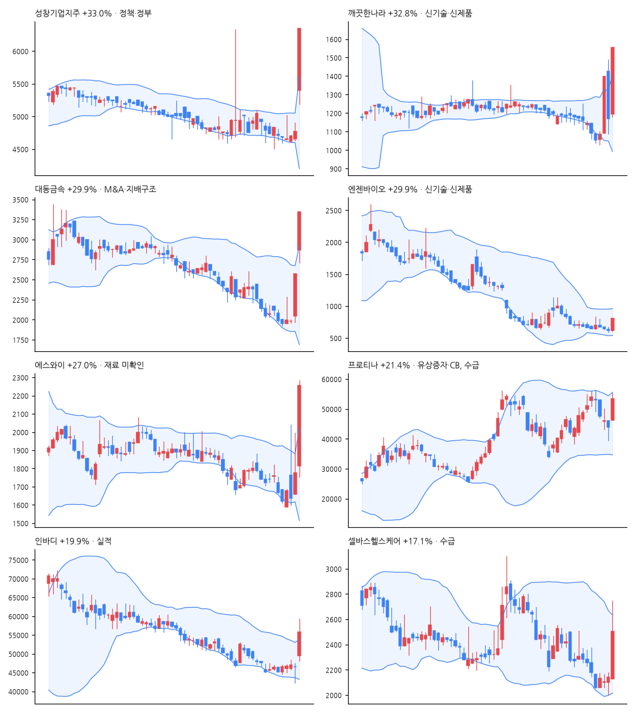

# 급등주 리포트 · 2026-11-05

> 전 종목 2,686 · 상승 669 / 하락 1,849 · 중앙값 -1.55% · **급등(+10%↑) 26종목**, 상한가 5

[목차](../README.md) · [분석 노트](../notes/2026-11-05.md) · [패턴 정리](../PATTERNS.md)

## 급등주 (거래대금 10억 이상 우선)

| 종목 | 등락 | 갭 | 종가위치 | 거래대금 | 거래량배수 | 재료(자동) | 테마 |
|---|--:|--:|--:|--:|--:|---|---|
| 성창기업지주 | +33.0% | +13.1% | 1.00 | 80억 | 49.3x | 정책·정부 | 데이터센터 |
| 깨끗한나라 | +32.8% | +2.2% | 1.00 | 95억 | 18.9x | 신기술·신제품 | - |
| 대동금속 | +29.9% | +11.5% | 1.00 | 55억 | 18.9x | M&A·지배구조 | 건설 |
| 엔젠바이오 | +29.9% | +0.0% | 1.00 | 26억 | 1.5x | 신기술·신제품 | 바이오 |
| 에스와이 | +27.0% | +2.1% | 0.94 | 412억 | 47.7x | - | 반도체, 태양광 |
| 프로티나 | +21.4% | +5.2% | 0.78 | 324억 | 3.2x | 유상증자·CB, 수급 | AI, 바이오 |
| 인바디 | +19.9% | +6.3% | 0.69 | 270억 | 9.3x | 실적 | 바이오 |
| 셀바스헬스케어 | +17.1% | -0.5% | 0.61 | 240억 | 58.6x | 수급 | AI, 반도체 |
| 제주항공 | +14.4% | +6.5% | 0.82 | 251억 | 4.2x | 실적 | 항공 |
| 한울앤제주 | +13.4% | -0.4% | 0.62 | 53억 | 4.5x | 유상증자·CB | 금융 |
| MH머트리얼즈 | +13.0% | -1.2% | 0.66 | 12억 | 10.0x | 자사주·소각 | - |
| 삼성에피스홀딩스 | +12.7% | +5.7% | 0.83 | 530억 | 4.6x | 실적 | 바이오 |
| 메지온 | +12.1% | +3.2% | 0.97 | 169억 | 2.3x | 투자·시설, 특허, 임상·허가, M&A·지배구조, 신기술·신제품 | 바이오 |
| 씨싸이트 | +12.0% | -0.8% | 0.54 | 25억 | 1.6x | M&A·지배구조 | - |
| 금양그린파워 | +11.9% | +5.8% | 0.41 | 676억 | 69.3x | 수주·계약 | - |
| SK바이오팜 | +11.7% | +3.1% | 0.76 | 809억 | 6.5x | 실적, 임상·허가, 투자·시설 | 바이오 |
| 그린플러스 | +11.5% | +3.4% | 0.48 | 14억 | 4.4x | M&A·지배구조 | 바이오, 전기차, 전력 |
| 한국타이어앤테크놀로지 | +10.7% | +0.0% | 0.75 | 393억 | 2.1x | 수급 | - |
| 카카오 | +9.8% | +2.5% | 0.94 | 1,604억 | 3.6x | 실적, 자사주·소각, M&A·지배구조 | AI |
| 한미약품 | +9.1% | +3.9% | 0.67 | 1,267억 | 2.1x | 임상·허가 | 바이오 |
| NAVER | +6.9% | +3.0% | 0.78 | 2,695억 | 2.4x | - | AI |
| 하이브 | +6.7% | +0.1% | 0.76 | 665억 | 1.4x | 실적 | - |
| 셀트리온 | +5.9% | +2.7% | 0.80 | 4,260억 | 3.7x | 신기술·신제품 | 바이오 |
| 에이피알 | +5.3% | +8.7% | 0.23 | 1,215억 | 1.1x | - | - |
| 윙스풋 | +30.0% | -0.4% | 1.00 | 1억 | 0.5x | - | - |
| 에코캡 | +10.5% | +5.0% | 1.00 | 3억 | 2.3x | 수급 | - |

## 급등 전날의 모습 (상위 종목)

| 종목 | %b | 밴드폭 하위% | 스퀴즈 | RSI | 20일선 이격 | 정배열 | 20일 수익률 | 고점 대비 | 전일 거래량배수 |
|---|--:|--:|:-:|--:|--:|:-:|--:|--:|--:|
| 성창기업지주 | 0.39 | 33 |  | 44 | -1.0% |  | -0.9% | -48.4% | 0.7x |
| 깨끗한나라 | 0.44 | 66 |  | 49 | -1.3% |  | -5.3% | -51.4% | 18.2x |
| 대동금속 | 0.88 | 74 |  | 61 | +13.7% |  | -1.5% | -71.1% | 70.5x |
| 엔젠바이오 | 0.20 | 60 |  | 28 | -16.9% |  | -12.8% | -90.9% | 0.1x |
| 에스와이 | 0.60 | 35 |  | 57 | +1.5% |  | -5.8% | -45.8% | 27.3x |
| 프로티나 | 0.47 | 23 |  | 63 | -1.3% | ✓ | -14.6% | -63.4% | 1.2x |
| 인바디 | 0.31 | 18 |  | 49 | -3.7% |  | -11.2% | -36.7% | 1.0x |
| 셀바스헬스케어 | 0.21 | 57 |  | 46 | -8.3% |  | -23.0% | -71.4% | 1.1x |

## 공시·뉴스 (상위 종목)

### 성창기업지주 (000180) +33.0%

- 📄 [조회공시요구(현저한시황변동)](https://dart.fss.or.kr/dsaf001/main.do?rcpNo=20261105800861) · 20261105
- 📰 성창기업지주, 현저한 시황변동 관련 조회공시 요구받아 - 데이터투자
- 📰 [급등락주 짚어보기] 대동금속 사업 확장에 '上'…양 시장 하한가 無 - 이투데이
- 📰 [장중시황] 코스피 5500선 붕괴·코스닥 700선 이탈…급락장 속 상한가 속출 - 아주경제
- 📰 코스피, 美 데이터센터 규제 우려에 장 초반 3% 넘게 하락 - Chosunbiz

### 깨끗한나라 (004540) +32.8%

- 📄 [임시주주총회결과](https://dart.fss.or.kr/dsaf001/main.do?rcpNo=20261104800693) · 20261104
- 📄 [대표이사(대표집행임원)변경(안내공시)](https://dart.fss.or.kr/dsaf001/main.do?rcpNo=20261104800578) · 20261104
- 📰 [특징주] 깨끗한나라, 최현수 단독대표 체제 전환에 上 - 아주경제
- 📰 깨끗한나라, 고객 불만을 신제품 개발로 연결…소비자중심경영 강화 - 한국경제
- 📰 깨끗한나라, 고객 의견 경영 전반에 반영…소비자중심경영 강화 - 전자신문
- 📰 [똑똑한리빙] 깨끗한나라, 한샘, 유한킴벌리, 퍼시스그룹 - 에너지경제신문

### 대동금속 (020400) +29.9%

- 📰 [급등락주 짚어보기] 대동금속 사업 확장에 '上'…양 시장 하한가 無 - 이투데이
- 📰 대동금속 이틀 연속 상한가...한진칼 경영권 경쟁·기업 구조개편주도 급등 - https://www.ppss.kr/
- 📰 [특징주] 농기계 수출 확대 기대감에 관련株 '대동금속·대동기어' 30%↑ - 뉴스핌
- 📰 대동금속 상한가 근접…주물부품 생산능력과 대동그룹 시너지 부각 - 잡포스트

### 엔젠바이오 (354200) +29.9%

- 📄 [기타시장안내 (관리종목 지정사유 추가우려)(주가 1,000원 미달)](https://dart.fss.or.kr/dsaf001/main.do?rcpNo=20261104900699) · 20261104
- 📰 엔젠바이오, AML 재발 추적 기술 특허 확보…위양성 판별 강화 - 약사공론
- 📰 엔젠바이오 "백혈병 진단오류 줄이는 독자 기술 특허 확보" - 한국경제
- 📰 엔젠바이오, AML 재발 추적 'FLT3-ITD' 변이 검출 특허 확보 - 아시아경제
- 📰 엔젠바이오, 백혈병 진단 오류 줄이는 기술 특허…”위양성 변이 94.5% 제거” - 약업닷컴

### 에스와이 (109610) +27.0%

- 📰 [PC 국가대표] 에스와이이앤씨 - 대형 구조물 특화 기술력 강점…반도체 현장만 46건 이상 참여 - 대한경제
- 📰 [마감분석] 에스와이 20%대 급등 2135원 마감 : 기업주식정보 - 재경일보
- 📰 에스와이, 美 민주당 압승에 태양광 '잭팟'…UL·FM 필수 인증으로 텍사스·조지아 '본격 진출' - 프라임경제
- 📰 에스와이춤컴퍼니, 25일 청주아트홀서 무용극 '육거리 시장의 기적' - 충북뉴스

### 프로티나 (468530) +21.4%

- 📄 [주요사항보고서(유상증자결정)](https://dart.fss.or.kr/dsaf001/main.do?rcpNo=20261104000319) · 20261104
- 📄 [주요사항보고서(전환사채권발행결정)](https://dart.fss.or.kr/dsaf001/main.do?rcpNo=20261104000317) · 20261104
- 📰 [특징주] 프로티나, 365억원 조달해 AI 바이오파운드리 구축…12% 강세 - Chosunbiz
- 📰 [장중수급포착] 프로티나, 외국인/기관 동시 순매수… 주가 +25.15% - 뉴스핌
- 📰 프로티나, 73억원 제3자배정 유상증자 - 연합뉴스
- 📰 프로티나, 365억원 자금 조달…AI 바이오파운드리 구축 - Chosunbiz

### 인바디 (041830) +19.9%

- 📄 [주요사항보고서(자기주식처분결정)](https://dart.fss.or.kr/dsaf001/main.do?rcpNo=20261105000245) · 20261105
- 📄 [연결재무제표기준영업(잠정)실적(공정공시)](https://dart.fss.or.kr/dsaf001/main.do?rcpNo=20261105900410) · 20261105
- 📄 [주식등의대량보유상황보고서(약식)](https://dart.fss.or.kr/dsaf001/main.do?rcpNo=20261105000050) · 20261105
- 📰 인바디, 창립 30주년 맞아 임직원 가족 초청 행사 개최 - 뉴스1
- 📰 인바디, 3분기 영업익 193억 껑충…본업 체력 입증 - 경제타임스
- 📰 인바디, 창립 30주년 맞아 임직원 가족과 패밀리데이 - 약사공론
- 📰 인바디, 창립 30주년 맞아 임직원 가족 초청 ‘인바디 패밀리데이’ 개최 - 서울경제

### 셀바스헬스케어 (208370) +17.1%

- 📰 셀바스헬스케어 15% 급등…AI 진단·차세대 진단사업 확장[특징주] - 이데일리
- 📰 셀바스헬스케어 주가, 급등세... 무슨 회사길래? - 금강일보
- 📰 [장중시황] 코스피 5500선 붕괴·코스닥 700선 이탈…급락장 속 상한가 속출 - 아주경제
- 📰 [개장시황] 코스피, 외국인 매도에 5500선 하회…반도체주 낙폭 확대 - 중앙이코노미뉴스

---

※ 재료는 공시 제목·뉴스 제목 키워드로 자동 분류한 것입니다. 판단은 [분석 노트](../notes/) 참고. 투자 권유 아님.
