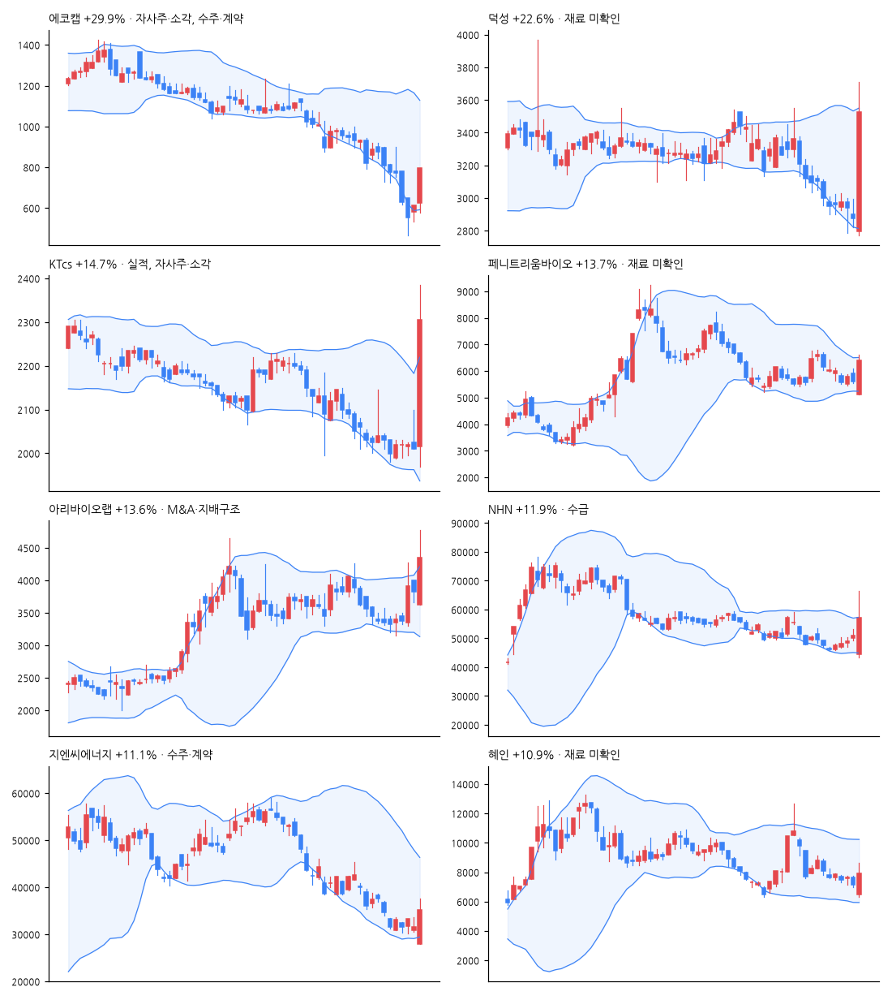

# 급등주 리포트 · 2026-11-06

> 전 종목 2,689 · 상승 455 / 하락 2,084 · 중앙값 -2.34% · **급등(+10%↑) 17종목**, 상한가 3

[목차](../README.md) · [분석 노트](../notes/2026-11-06.md) · [패턴 정리](../PATTERNS.md)

## 급등주 (거래대금 10억 이상 우선)

| 종목 | 등락 | 갭 | 종가위치 | 거래대금 | 거래량배수 | 재료(자동) | 테마 |
|---|--:|--:|--:|--:|--:|---|---|
| 에코캡 | +29.9% | +2.3% | 1.00 | 87억 | 39.9x | 자사주·소각, 수주·계약 | 바이오 |
| 덕성 | +22.6% | -2.8% | 0.80 | 216억 | 132.4x | - | AI |
| KTcs | +14.7% | +0.2% | 0.81 | 149억 | 114.3x | 실적, 자사주·소각, 정책·정부 | AI |
| 페니트리움바이오 | +13.7% | -8.9% | 0.85 | 99억 | 2.6x | - | 바이오 |
| 아리바이오랩 | +13.6% | -5.2% | 0.63 | 164억 | 8.5x | M&A·지배구조 | 바이오 |
| NHN | +11.9% | -13.1% | 0.60 | 445억 | 7.0x | 수급 | AI, 게임 |
| 지엔씨에너지 | +11.1% | -11.5% | 0.75 | 496억 | 3.0x | 수주·계약 | - |
| 혜인 | +10.9% | -9.2% | 0.70 | 146억 | 1.7x | - | - |
| 롯데렌탈 | +10.2% | +10.0% | 1.00 | 1,411억 | 18.4x | 실적, M&A·지배구조 | - |
| 자이에스앤디 | +10.0% | -8.3% | 0.77 | 158억 | 2.7x | 수주·계약, 수급 | - |
| 딜리셔스 | +10.0% | -3.4% | 0.73 | 13억 | 3.7x | - | - |
| 원익홀딩스 | +8.3% | -11.7% | 0.92 | 1,387억 | 2.0x | - | - |
| 한진칼 | +6.6% | -0.3% | 0.33 | 2,683억 | 4.6x | - | 항공, 건설 |
| 삼성에스디에스 | +5.6% | -6.6% | 0.76 | 1,031억 | 2.4x | 실적, 정책·정부 | AI, 로봇, 데이터센터 |
| 윙스풋 | +30.0% | +18.6% | 1.00 | 2억 | 0.7x | - | 바이오 |
| 파이온엑스 | +29.9% | +0.6% | 1.00 | 2억 | 1.2x | 정책·정부 | - |
| 홈캐스트 | +15.5% | -0.6% | 0.93 | 5억 | 5.0x | - | - |

## 급등 전날의 모습 (상위 종목)

| 종목 | %b | 밴드폭 하위% | 스퀴즈 | RSI | 20일선 이격 | 정배열 | 20일 수익률 | 고점 대비 | 전일 거래량배수 |
|---|--:|--:|:-:|--:|--:|:-:|--:|--:|--:|
| 에코캡 | 0.04 | 99 |  | 21 | -30.0% |  | -45.1% | -81.6% | 2.3x |
| 덕성 | 0.07 | 72 |  | 24 | -9.5% |  | -16.9% | -48.7% | 0.7x |
| KTcs | 0.22 | 68 |  | 28 | -3.0% |  | -8.6% | -34.8% | 0.7x |
| 페니트리움바이오 | 0.30 | 0 | ✓ | 48 | -4.3% |  | -15.9% | -73.1% | 0.9x |
| 아리바이오랩 | 0.72 | 17 |  | 47 | +5.2% |  | +3.9% | -43.0% | 1.8x |
| NHN | 0.50 | 36 |  | 50 | +0.1% |  | -9.4% | -34.7% | 2.1x |
| 지엔씨에너지 | 0.14 | 46 |  | 34 | -17.9% |  | -37.9% | -46.4% | 1.1x |
| 혜인 | 0.28 | 74 |  | 49 | -11.5% |  | -14.3% | -46.1% | 0.5x |

## 공시·뉴스 (상위 종목)

### 에코캡 (128540) +29.9%

- 📄 [주요사항보고서(자기주식취득신탁계약체결결정)](https://dart.fss.or.kr/dsaf001/main.do?rcpNo=20261106000091) · 20261106
- 📄 [주식등의대량보유상황보고서(약식)](https://dart.fss.or.kr/dsaf001/main.do?rcpNo=20261106000079) · 20261106
- 📰 에코캡, NH투자증권과 15억원 규모 자기주식취득 신탁계약 체결 - 디지털투데이
- 📰 에코캡, 15억원 규모 자기주식 취득 신탁계약 체결 결정 - 데이터투자
- 📰 [공시 Pick] 급락장 뚫고 상한가…에코캡, 자사주 취득 소식에 ‘급등’ - 뉴스투데이
- 📰 에코캡 주가, 상한가... 무슨 회사길래? - 금강일보

### 덕성 (004830) +22.6%

- 📰 덕성·서울·성신여대, 네이버 커넥트재단과 'AI 교육 협력' 맞손 - 뉴시스
- 📰 덕성여대-서울여대-성신여대, AI 교육 협력 위해 네이버와 MOU - 매일일보
- 📰 덕성여대, 서울여대·성신여대·네이버와 AI 인재 양성 협약 - 교수신문
- 📰 덕성여대 정치외교학전공, 고성·속초서 분단과 안보 현실 체험 - 팝콘뉴스

### KTcs (058850) +14.7%

- 📄 [주식소각결정](https://dart.fss.or.kr/dsaf001/main.do?rcpNo=20261106800829) · 20261106
- 📄 [수시공시의무관련사항(공정공시)](https://dart.fss.or.kr/dsaf001/main.do?rcpNo=20261106800791) · 20261106
- 📄 [영업(잠정)실적(공정공시)](https://dart.fss.or.kr/dsaf001/main.do?rcpNo=20261106800467) · 20261106
- 📄 [연결재무제표기준영업(잠정)실적(공정공시)](https://dart.fss.or.kr/dsaf001/main.do?rcpNo=20261106800464) · 20261106
- 📰 KTcs, 자사주 8.37% 전량 소각…순이익 40% 주주환원 - 뉴스핌
- 📰 [속보] KTcs, 정규장 이후 애프터마켓서 급등…자사주 346만주 소각·주주환원 정책 발표 - CBC뉴스
- 📰 KTcs, 자사주 8.37% 소각 및 순이익 40% 환원 - 데일리바이트(DAILY BYTE)
- 📰 KTcs, 2026년 3분기 영업이익 110억4000만원으로 전년동기 대비 42.5% 증가 - 디지털투데이

### 페니트리움바이오 (187660) +13.7%

- 📰 페니트리움바이오 11.72% 급등…6290원으로 마감 - 잡포스트
- 📰 페니트리움바이오 10.83% 상승…6240원으로 마감 - 잡포스트

### 아리바이오랩 (261780) +13.6%

- 📰 합병 사전 작업 시작됐나... 아리바이오랩, 아리바이오 CB에 ‘50억원 웃돈’ - Chosunbiz
- 📰 아리바이오랩, 아리바이오 26회 CB 100억원 양수 - 비건뉴스
- 📰 신약 합병 접고 온실 쇼핑…아리바이오홀딩스 '외형 불리기' 논란 - 바이오북미디어
- 📰 진단 수요 확대 기대 커지나…백신·방역 관련주 희비 - 핀포인트뉴스

### NHN (181710) +11.9%

- 📰 NHN클라우드, 日 공략 속도…현지 파트너 생태계 확대 - 지디넷코리아
- 📰 NHN클라우드, 日서 첫 파트너 세미나…현지 AI 시장 공략 - 파이낸셜뉴스
- 📰 [장중수급포착] NHN, 기관 6일 연속 순매수행진... 주가 +11.72% - 뉴스핌
- 📰 NHN클라우드, 日예비 파트너사 대상 '제1회 재팬 커넥트 세미나' 개최… “현지 파트너 생태계 구축” - 전자신문

### 지엔씨에너지 (119850) +11.1%

- 📄 [주식등의대량보유상황보고서(약식)](https://dart.fss.or.kr/dsaf001/main.do?rcpNo=20261106000065) · 20261106
- 📰 (르포) 지엔씨에너지 당진 발전기 공장, ‘주문 밀려 야근은 기본’…공급망 쇼티지에 세계서 러브콜 - 전기신문
- 📰 기업 공시 [11월 6일] - 서울경제
- 📰 비오스, 사업 첫해 100억원 수주… 비상발전기 시장 ‘새 경쟁자’로 - 전기신문
- 📰 JP모건 시큐리티즈, 지엔씨에너지 5.07% 보유 보고 - 비건뉴스

### 혜인 (003010) +10.9%

- 📰 국립한국교통대 도시/교통공학전공 박주현/최혜인 학생, '대한국토/도시계획학회 추계학술대회 우수논문상' 수상 - 베리타스알파
- 📰 경찰, ‘공직선거법 위반’ 혐의 용혜인 피의자 조사 - 헤럴드경제
- 📰 하이브·어도어 "민희진이 계약 주체" vs 민희진 "하이브가 초안 작성" - 연합뉴스TV
- 📰 어도어, '미성년 보호 누락' 뉴진스 계약서 반박…"부모 모두 동의" - 뉴스핌

---

※ 재료는 공시 제목·뉴스 제목 키워드로 자동 분류한 것입니다. 판단은 [분석 노트](../notes/) 참고. 투자 권유 아님.
