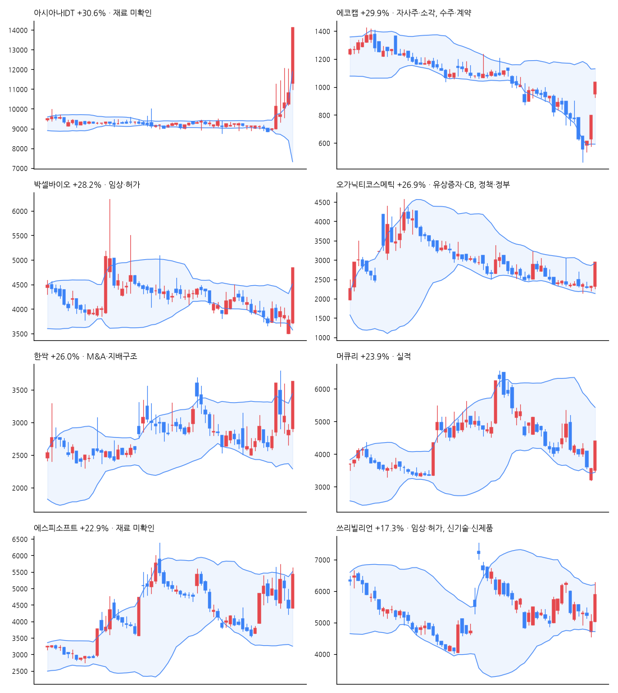

# 급등주 리포트 · 2026-11-09

> 전 종목 2,690 · 상승 874 / 하락 1,658 · 중앙값 -0.77% · **급등(+10%↑) 34종목**, 상한가 5

[목차](../README.md) · [분석 노트](../notes/2026-11-09.md) · [패턴 정리](../PATTERNS.md)

## 급등주 (거래대금 10억 이상 우선)

| 종목 | 등락 | 갭 | 종가위치 | 거래대금 | 거래량배수 | 재료(자동) | 테마 |
|---|--:|--:|--:|--:|--:|---|---|
| 아시아나IDT | +30.6% | +4.3% | 1.00 | 733억 | 7.7x | - | AI, 바이오, 항공 |
| 에코캡 | +29.9% | +19.2% | 1.00 | 15억 | 1.7x | 자사주·소각, 수주·계약, M&A·지배구조 | 바이오, 항공, 광통신 |
| 박셀바이오 | +28.2% | -1.3% | 1.00 | 139억 | 38.7x | 임상·허가 | 바이오 |
| 오가닉티코스메틱 | +26.9% | +0.0% | 1.00 | 15억 | 6.5x | 유상증자·CB, 정책·정부, 수급 | 바이오, 광통신 |
| 한싹 | +26.0% | +0.7% | 1.00 | 69억 | 3.2x | M&A·지배구조 | AI, 항공, 보안 |
| 머큐리 | +23.9% | -1.1% | 1.00 | 109억 | 4.5x | 실적 | 바이오 |
| 에스피소프트 | +22.9% | +0.0% | 0.83 | 480억 | 3.8x | - | AI, 보안 |
| 쓰리빌리언 | +17.3% | +0.0% | 0.69 | 88억 | 3.1x | 임상·허가, 신기술·신제품, 수급 | AI, 바이오 |
| 큐에스아이 | +14.9% | -3.1% | 0.57 | 333억 | 97.5x | 실적 | 광통신 |
| 이노스페이스 | +14.4% | +1.6% | 0.72 | 34억 | 2.7x | - | - |
| HLB테라퓨틱스 | +13.8% | -0.4% | 0.85 | 34억 | 2.3x | 정책·정부 | AI, 로봇, 게임 |
| 큐리옥스바이오시스템즈 | +13.0% | +5.6% | 0.95 | 110억 | 0.8x | - | AI, 바이오 |
| 비엠티 | +12.7% | -4.0% | 0.77 | 38억 | 3.4x | 실적 | 반도체 |
| 상지건설 | +12.7% | -2.0% | 0.60 | 66억 | 2.4x | 유상증자·CB, 정책·정부, 신기술·신제품 | 건설 |
| SFA반도체 | +12.4% | -2.6% | 0.76 | 435억 | 1.9x | - | 반도체 |
| 딜리셔스 | +12.1% | +0.5% | 0.62 | 19억 | 4.5x | M&A·지배구조 | - |
| 한국첨단소재 | +12.1% | +3.2% | 0.53 | 89억 | 5.5x | - | 반도체, 양자, 광통신 |
| 깨끗한나라 | +12.1% | +3.7% | 0.25 | 269억 | 10.5x | - | - |
| 유니퀘스트 | +11.9% | -2.6% | 0.75 | 59억 | 0.8x | 수급 | AI |
| RFHIC | +10.5% | -4.8% | 0.72 | 413억 | 2.3x | - | AI, 광통신, 데이터센터 |
| 아이씨티케이 | +10.1% | +3.6% | 0.71 | 136억 | 1.6x | 수급 | 양자 |
| 동방메디컬 | +10.1% | +2.6% | 0.84 | 10억 | 2.5x | - | 의료기기 |
| 프로티나 | +10.1% | +6.5% | 0.47 | 260억 | 2.0x | 실적 | AI |
| 한진칼 | +9.8% | +1.4% | 0.85 | 1,756억 | 2.2x | M&A·지배구조 | 항공, 건설 |
| LG씨엔에스 | +5.6% | -1.9% | 0.72 | 1,270억 | 1.9x | 수급 | 바이오 |
| 루닛 | +5.1% | -2.6% | 0.66 | 576억 | 1.7x | - | AI, 바이오 |
| 엑스게이트 | +5.0% | +5.7% | 0.18 | 349억 | 1.5x | - | AI, 보안, 양자 |
| 노을 | +30.0% | +1.2% | 1.00 | 10억 | 0.9x | M&A·지배구조 | - |
| 썸에이지 | +30.0% | +0.8% | 1.00 | 3억 | 5.2x | 수급 | 바이오, 게임 |
| 파이온엑스 | +29.9% | +15.5% | 1.00 | 5억 | 2.0x | - | 바이오 |

## 급등 전날의 모습 (상위 종목)

| 종목 | %b | 밴드폭 하위% | 스퀴즈 | RSI | 20일선 이격 | 정배열 | 20일 수익률 | 고점 대비 | 전일 거래량배수 |
|---|--:|--:|:-:|--:|--:|:-:|--:|--:|--:|
| 아시아나IDT | 1.25 | 99 |  | 75 | +15.6% | ✓ | +17.2% | -16.0% | 7.4x |
| 에코캡 | 0.38 | 98 |  | 39 | -7.4% |  | -28.9% | -76.1% | 39.9x |
| 박셀바이오 | 0.11 | 14 |  | 35 | -5.9% |  | -13.6% | -67.3% | 1.2x |
| 오가닉티코스메틱 | 0.23 | 14 |  | 22 | -7.4% |  | -14.5% | -90.6% | 0.3x |
| 한싹 | 0.55 | 49 |  | 50 | +1.8% | ✓ | -8.0% | -62.6% | 1.5x |
| 머큐리 | 0.07 | 36 |  | 30 | -20.9% |  | -39.4% | -72.2% | 0.5x |
| 에스피소프트 | 0.54 | 66 |  | 53 | +1.9% | ✓ | -10.8% | -39.5% | 0.7x |
| 쓰리빌리언 | 0.21 | 12 |  | 44 | -7.9% |  | -14.3% | -75.0% | 0.6x |

## 공시·뉴스 (상위 종목)

### 아시아나IDT (267850) +30.6%

- 📰 [급등락주 짚어보기] 아시아나IDT·박셀바이오 등 15개 종목 상한가…우선주·개별 호재株 강세 - 이투데이
- 📰 [특징주] 아시아나IDT, 장중 12%대 강세 보이며 1만2200원대 거래 : 기업주식정보 - 재경일보
- 📰 오전 이슈 [항공] : 아시아나IDT, 한진칼, 제주항공, 한국공항, 트리니티항공 - 파이낸셜뉴스
- 📰 아시아나IDT 상한가 기염… AI·클라우드 전환 기대에 SI주 '훨훨'' - 핀포인트뉴스

### 에코캡 (128540) +29.9%

- 📄 [주요사항보고서(자기주식취득신탁계약체결결정)](https://dart.fss.or.kr/dsaf001/main.do?rcpNo=20261106000091) · 20261106
- 📄 [주식등의대량보유상황보고서(약식)](https://dart.fss.or.kr/dsaf001/main.do?rcpNo=20261106000079) · 20261106
- 📰 에코캡 상한가…전장 와이어링 부품 수주가 관건 - 잡포스트
- 📰 [급등락주 짚어보기] 아시아나IDT·박셀바이오 등 15개 종목 상한가…우선주·개별 호재株 강세 - 이투데이
- 📰 [주식마감] '호반VS조원태' 경영권 분쟁에 한진칼우·대한항공우 '上'... 아시아사IDT, 깨끗한나라우, 에코캡, 한싹 등 상한가 - 금강일보
- 📰 오전 이슈 [항공] : 아시아나IDT, 한진칼, 제주항공, 한국공항, 트리니티항공 - 파이낸셜뉴스

### 박셀바이오 (323990) +28.2%

- 📰 박셀바이오 상한가…이중표적 CAR-T 간암모델서 완전관해 - 한국경제
- 📰 박셀바이오, 미국면역항암학회서 CAR-T 전임상 결과 발표 - 히트뉴스
- 📰 박셀바이오, 'SITC 2026'서 CAR 치료제 전임상 연구결과 발표 - 팜뉴스
- 📰 [특징주] 박셀바이오, 고형암 치료제 연구 결과 국제학회 공개…上 - Chosunbiz

### 오가닉티코스메틱 (900300) +26.9%

- 📄 [주주총회소집공고](https://dart.fss.or.kr/dsaf001/main.do?rcpNo=20261109000194) · 20261109
- 📄 [주요사항보고서(유상증자결정)](https://dart.fss.or.kr/dsaf001/main.do?rcpNo=20261109000179) · 20261109
- 📄 [[기재정정]주주총회소집결의 (임시주주총회)](https://dart.fss.or.kr/dsaf001/main.do?rcpNo=20261109900348) · 20261109
- 📰 오가닉티코스메틱, 운영자금 1012억5000만원 규모 제3자배정 유상증자 결정 - 디지털투데이
- 📰 오가닉티코스메틱, 1012억5000만원 규모 제3자배정 유상증자 결정 - 데이터투자
- 📰 [급등락주 짚어보기] 아시아나IDT·박셀바이오 등 15개 종목 상한가…우선주·개별 호재株 강세 - 이투데이
- 📰 [마감시황]코스닥, 638.97로 0.82% 하락 마감…기관 순매수에도 시총 상위주 약세 - 서울신문

### 한싹 (430690) +26.0%

- 📰 [주식마감] '호반VS조원태' 경영권 분쟁에 한진칼우·대한항공우 '上'... 아시아사IDT, 깨끗한나라우, 에코캡, 한싹 등 상한가 - 금강일보
- 📰 공공 클라우드 전환에 보안주 강세…한싹·엑스게이트 '눈에 띄네' - 핀포인트뉴스
- 📰 AI·보안 투자 확대에 소프트웨어株 강세…엑스게이트 주가 '신바람' - 핀포인트뉴스

### 머큐리 (100590) +23.9%

- 📄 [연결재무제표기준영업(잠정)실적(공정공시)](https://dart.fss.or.kr/dsaf001/main.do?rcpNo=20261109900171) · 20261109
- 📰 머큐리, 3분기 영업익 40억원 '흑전 성공'…광케이블 사업 성장 견인 - 머니투데이 - 머니투데이
- 📰 머큐리, 3분기 영업익 40억…전분기 대비 198% 증가 - 아시아경제
- 📰 머큐리, 3분기 영업익 40억 '흑자전환'…광케이블 매출 확대에 실적 개선 - 이투데이
- 📰 [더벨]머큐리, 3분기 영업이익률 10% 돌파 - 머니투데이 - 머니투데이

### 에스피소프트 (443670) +22.9%

- 📰 에스피소프트 21.18% 급등…클라우드·DaaS 성장성 부각 - 잡포스트
- 📰 [특징주] 에스피소프트 장중 11%대 강세 나타내 : 기업주식정보 - 재경일보
- 📰 [거래량 상위 종목] 에스피소프트, 전일비 21.18%↑... 현재가 5,350원 - 버핏연구소
- 📰 특징주, 에스피소프트-딥페이크(deepfake) 테마 상승세에 12.68% ↑ - 매일경제 마켓

### 쓰리빌리언 (394800) +17.3%

- 📰 [리포트 브리핑]쓰리빌리언, '희귀질환 분야의 TempusAI' Not Rated - DS투자증권 - 뉴스핌
- 📰 [장중수급포착] 쓰리빌리언, 외국인/기관 동시 순매수… 주가 +21.67% - 뉴스핌
- 📰 쓰리빌리언 15.71% 상승…희귀질환 AI 진단 확장 기대 - 잡포스트
- 📰 K바이오, 유럽 최대 바이오 행사 집결...기술수출·공동개발 모색 - 부산파이낸셜뉴스

## 누적 통계 — 급등 다음에 무슨 일이?

- 표본 61건 · 5거래일 뒤 평균 -11.1% · 중앙값 -12.7% · 플러스 비율 13%

---

※ 재료는 공시 제목·뉴스 제목 키워드로 자동 분류한 것입니다. 판단은 [분석 노트](../notes/) 참고. 투자 권유 아님.
