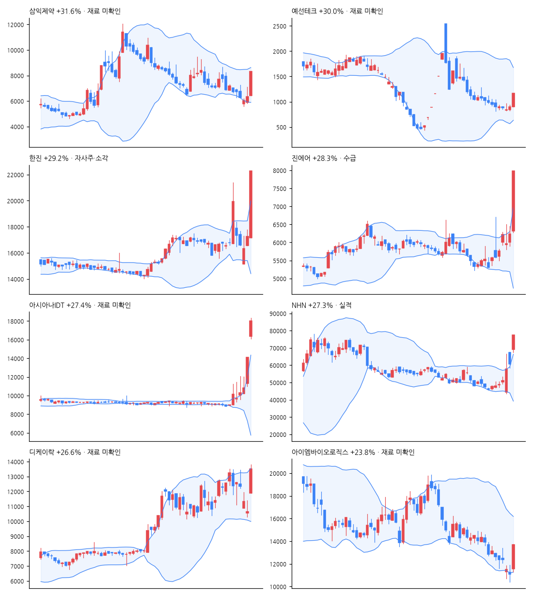

# 급등주 리포트 · 2026-11-10

> 전 종목 2,688 · 상승 2,046 / 하락 486 · 중앙값 +2.05% · **급등(+10%↑) 169종목**, 상한가 6

[목차](../README.md) · [분석 노트](../notes/2026-11-10.md) · [패턴 정리](../PATTERNS.md)

## 급등주 (거래대금 10억 이상 우선)

| 종목 | 등락 | 갭 | 종가위치 | 거래대금 | 거래량배수 | 재료(자동) | 테마 |
|---|--:|--:|--:|--:|--:|---|---|
| 삼익제약 | +31.6% | +1.6% | 1.00 | 227억 | 1.4x | - | 반도체, 제약, 항공 |
| 예선테크 | +30.0% | +0.1% | 1.00 | 12억 | 0.9x | - | 제약, 항공 |
| 한진 | +29.2% | -0.6% | 1.00 | 563억 | 14.0x | 자사주·소각 | 항공 |
| 진에어 | +28.3% | +1.3% | 1.00 | 836억 | 41.2x | 수급 | 항공 |
| 아시아나IDT | +27.4% | +15.8% | 0.84 | 959억 | 5.7x | - | 바이오, 항공 |
| NHN | +27.3% | +13.5% | 1.00 | 1,041억 | 7.9x | 실적 | AI, 데이터센터 |
| 디케이락 | +26.6% | +11.5% | 0.85 | 369억 | 2.9x | - | AI, 원전, 전력 |
| 아이엠바이오로직스 | +23.8% | +4.5% | 0.99 | 18억 | 1.5x | - | 반도체 |
| 한올바이오파마 | +23.1% | +18.6% | 0.70 | 414억 | 4.7x | 임상·허가 | 조선, 바이오 |
| JW신약 | +20.6% | +1.7% | 0.80 | 708억 | 14.6x | 실적, 임상·허가, 수급 | 제약 |
| 코세스 | +19.2% | +14.2% | 0.50 | 99억 | 0.8x | - | AI, 반도체, 2차전지 |
| SNT에너지 | +18.9% | +3.2% | 0.81 | 72억 | 2.9x | M&A·지배구조, 수급 | - |
| 사피엔반도체 | +18.6% | +8.4% | 0.84 | 15억 | 2.0x | 수주·계약 | AI, 반도체 |
| 비나텍 | +18.5% | +8.9% | 0.65 | 271억 | 1.2x | 실적, 수주·계약, 수급 | AI, 데이터센터, 전력 |
| RFHIC | +18.5% | +9.0% | 0.79 | 536억 | 2.3x | 실적, 수급 | 반도체, 방산, 금융 |
| 가온전선 | +18.2% | +8.3% | 0.71 | 394억 | 1.3x | 수주·계약, 수급 | AI, 태양광, 전력 |
| 지니너스 | +16.8% | +2.0% | 0.90 | 11억 | 1.7x | - | - |
| 전진건설로봇 | +16.7% | +6.0% | 0.77 | 218억 | 5.6x | - | 로봇, 건설 |
| 아스플로 | +16.6% | +9.0% | 0.83 | 48억 | 1.0x | - | AI, 반도체 |
| 앱클론 | +16.5% | +3.1% | 0.84 | 42억 | 1.1x | 수주·계약 | 바이오 |
| 대동기어 | +15.9% | +4.1% | 0.73 | 584억 | 3.5x | - | 로봇 |
| 서울바이오시스 | +15.7% | +7.8% | 0.84 | 20억 | 0.8x | 실적 | 바이오, 광통신 |
| LIG디펜스앤에어로스페이스 | +15.6% | +3.8% | 0.92 | 695억 | 1.2x | 실적, 수주·계약 | - |
| 엘오티베큠 | +15.5% | +4.2% | 0.76 | 13억 | 0.9x | - | AI, 반도체 |
| 에어부산 | +15.2% | +1.4% | 0.69 | 312억 | 33.8x | - | - |
| 노랑풍선 | +15.0% | -1.5% | 0.60 | 104억 | 93.2x | - | - |
| RF머트리얼즈 | +15.0% | +10.8% | 0.55 | 257억 | 0.8x | - | 반도체, 광통신, 데이터센터 |
| 이오테크닉스 | +14.9% | +8.8% | 0.67 | 345억 | 1.1x | 실적 | AI, 반도체 |
| 넥사다이내믹스 | +14.9% | +1.5% | 0.90 | 11억 | 0.7x | 유상증자·CB, 수급 | - |
| 금양그린파워 | +14.8% | -4.3% | 0.74 | 595억 | 9.4x | 수주·계약 | AI, 원전, 풍력 |

## 급등 전날의 모습 (상위 종목)

| 종목 | %b | 밴드폭 하위% | 스퀴즈 | RSI | 20일선 이격 | 정배열 | 20일 수익률 | 고점 대비 | 전일 거래량배수 |
|---|--:|--:|:-:|--:|--:|:-:|--:|--:|--:|
| 삼익제약 | 0.16 | 12 |  | 31 | -12.2% |  | -14.5% | -74.7% | 1.9x |
| 예선테크 | 0.27 | 80 |  | 12 | -24.6% |  | -40.3% | -73.1% | 0.1x |
| 한진 | 0.61 | 82 |  | 52 | +1.9% | ✓ | +0.8% | -27.0% | 1.1x |
| 진에어 | 0.94 | 63 |  | 60 | +8.5% |  | +9.7% | -25.7% | 2.3x |
| 아시아나IDT | 1.49 | 99 |  | 87 | +47.1% | ✓ | +52.3% | +0.0% | 7.7x |
| NHN | 1.11 | 46 |  | 64 | +18.0% |  | +14.3% | -22.3% | 3.7x |
| 디케이락 | 0.18 | 61 |  | 50 | -8.7% | ✓ | -2.6% | -21.2% | 0.7x |
| 아이엠바이오로직스 | -0.02 | 33 |  | 25 | -20.0% |  | -35.8% | -89.4% | 0.5x |

## 공시·뉴스 (상위 종목)

### 삼익제약 (014950) +31.6%

- 📰 [속보] 삼익제약 주가 상한가 도달…코스닥 4%대 상승 속 '눈길' - CBC뉴스
- 📰 [마감분석] 삼익제약 29.95% 급등하며 상한가 기록 : 기업주식정보 - 재경일보
- 📰 삼익제약 주가, 상한가... 왜? - 금강일보
- 📰 코스닥 제약지수 2.66% 반등, 삼익제약 상한가 - 의약뉴스

### 예선테크 (250930) +30.0%

- 📰 [특징주] 예선테크, 다시 상한가…급등락 반복에 투자경고 후폭풍 주의 - https://www.moneystorm.kr/
- 📰 예선테크 주가, 상한가... 왜? - 금강일보
- 📰 [급등락주 짚어보기] 대한항공우·NHN 등 13개 종목 상한가…항공주·우선주 강세 - 이투데이
- 📰 옥주현 ‘190억원 한남더힐’, 법원 임의경매 이어 구청 압류 - Chosunbiz

### 한진 (002320) +29.2%

- 📄 [주식소각결정](https://dart.fss.or.kr/dsaf001/main.do?rcpNo=20261110800680) · 20261110
- 📄 [주식등의대량보유상황보고서(약식)](https://dart.fss.or.kr/dsaf001/main.do?rcpNo=20261110000332) · 20261110
- 📰 한진, 애프터마켓서 10%대 급등 - 연합뉴스
- 📰 한진칼 지분 경쟁에 대한항공우 이틀 연속 상한가[핫종목] - 뉴스1
- 📰 한진, 자사주 47만주 전량 소각…발행주식 3.07% 규모 - 머니투데이 - 머니투데이
- 📰 한진, 200억 규모 자사주 전량 소각…"주주가치 제고" - 뉴시스

### 진에어 (272450) +28.3%

- 📰 [리포트 브리핑]진에어, 'LCC에게도 통합이 좋다' 목표가 7,000원 - 하나증권 - 뉴스핌
- 📰 진에어, 에어부산·에어서울 통합 기대…목표가 1만원 유지-NH - 이데일리
- 📰 [리포트 브리핑]진에어, '통합으로 국내 LCC 시장 주도' 목표가 10,000원 - NH투자증권 - 뉴스핌
- 📰 [장중수급포착] 진에어, 외국인/기관 동시 순매수… 주가 +23.09% - 뉴스핌

### 아시아나IDT (267850) +27.4%

- 📰 [급등락주 짚어보기] 아시아나IDT·박셀바이오 등 15개 종목 상한가…우선주·개별 호재株 강세 - 이투데이
- 📰 [마감분석] 아시아나IDT, 26% 넘게 급등하며 17,870원 마감 : 기업주식정보 - 재경일보
- 📰 [상한가 종목] 아시아나IDT-박셀바이오 이어 머큐리 등 마감 - 이코노뉴스
- 📰 [특징주] 대한항공·아시아나 통합 시너지 시동… 아시아나IDT ‘上’ - Chosunbiz

### NHN (181710) +27.3%

- 📄 [임원ㆍ주요주주특정증권등소유상황보고서](https://dart.fss.or.kr/dsaf001/main.do?rcpNo=20261110000063) · 20261110
- 📄 [연결재무제표기준영업(잠정)실적(공정공시)](https://dart.fss.or.kr/dsaf001/main.do?rcpNo=20261110800041) · 20261110
- 📄 [영업(잠정)실적(공정공시)](https://dart.fss.or.kr/dsaf001/main.do?rcpNo=20261110800035) · 20261110
- 📰 [특징주] NHN, 3분기 호실적·데이터센터 기대에 상한가(종합) - 연합뉴스
- 📰 NHN, 분기 최대 실적에 상한가…클라우드 매출이 효자 - 한국경제
- 📰 NHN, 분기 최대 실적에 GPU 대여 5년치 완판…클라우드 사업 '청신호'(종합2보) - 뉴시스
- 📰 NHN, 3분기 영업익 113% 급증에 상한가…‘AI 클라우드 수익 창출 단계 진입’ - 한국경제

### 디케이락 (105740) +26.6%

- 📰 디케이락 24.44% 급등…계장용 피팅·밸브 수출 재점검 - 잡포스트
- 📰 [인터뷰] 디케이락, '88조' 중동 재건의 '숨은 진주'…"카타르·UAE와 함께 핵심 입지 굳힌다" - 프라임경제
- 📰 디케이락(105740)저점을 줄때마다 물량 모아둘 기회로 보이며 이후 전망 및 대응전략. - ThinkPool
- 📰 AI 전력 수요에 원전주 들썩…디케이락·두산에너빌리티에 탑승할까 - 핀포인트뉴스

### 아이엠바이오로직스 (493280) +23.8%

- 📰 8.2조 흥행 반도체주 ‘동원파츠’, 오늘(10일) 코스닥 상장 - 뉴스웰

## 누적 통계 — 급등 다음에 무슨 일이?

- 표본 79건 · 5거래일 뒤 평균 -8.5% · 중앙값 -11.2% · 플러스 비율 18%

---

※ 재료는 공시 제목·뉴스 제목 키워드로 자동 분류한 것입니다. 판단은 [분석 노트](../notes/) 참고. 투자 권유 아님.
