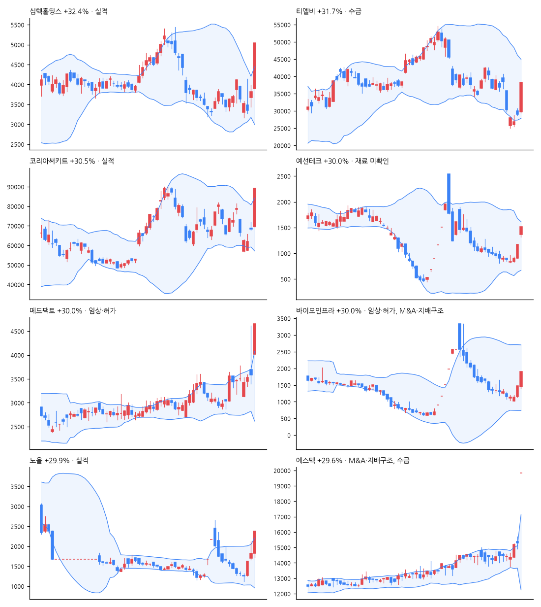

# 급등주 리포트 · 2026-11-11

> 전 종목 2,687 · 상승 1,872 / 하락 657 · 중앙값 +1.27% · **급등(+10%↑) 178종목**, 상한가 8

[목차](../README.md) · [분석 노트](../notes/2026-11-11.md) · [패턴 정리](../PATTERNS.md)

## 급등주 (거래대금 10억 이상 우선)

| 종목 | 등락 | 갭 | 종가위치 | 거래대금 | 거래량배수 | 재료(자동) | 테마 |
|---|--:|--:|--:|--:|--:|---|---|
| 심텍홀딩스 | +32.4% | +2.0% | 1.00 | 297억 | 11.1x | 실적 | 반도체 |
| 티엘비 | +31.7% | +2.2% | 1.00 | 485억 | 2.1x | 수급 | AI |
| 코리아써키트 | +30.5% | +1.9% | 0.99 | 1,449억 | 2.0x | 실적 | 반도체 |
| 예선테크 | +30.0% | +16.2% | 1.00 | 15억 | 0.8x | - | 반도체, 2차전지, 제약 |
| 메드팩토 | +30.0% | +12.0% | 1.00 | 99억 | 8.2x | 임상·허가 | 바이오 |
| 바이오인프라 | +30.0% | -1.6% | 1.00 | 21억 | 1.4x | 임상·허가, M&A·지배구조 | 바이오, 항공 |
| 노을 | +29.9% | +0.0% | 1.00 | 110억 | 5.0x | 실적 | AI, 조선 |
| 에스텍 | +29.6% | +29.6% | 1.00 | 12억 | 3.9x | M&A·지배구조, 수급 | 금융 |
| 씨케이솔루션 | +28.6% | +28.6% | 1.00 | 18억 | 5.4x | 실적, 수주·계약 | 반도체, 배터리 |
| 에코캡 | +28.0% | -1.4% | 1.00 | 146억 | 9.6x | - | 반도체 |
| 티에스이 | +26.5% | +1.1% | 0.91 | 540억 | 2.1x | 실적, 수급 | 반도체 |
| 샘씨엔에스 | +25.4% | +2.8% | 0.93 | 370억 | 2.2x | 수급 | 반도체, HBM, 원전 |
| 아스플로 | +23.9% | +0.6% | 0.96 | 116억 | 1.9x | - | 반도체 |
| 디아이 | +23.7% | +1.5% | 0.93 | 508억 | 1.7x | M&A·지배구조, 신기술·신제품 | AI, HBM, 건설 |
| 삼현 | +23.4% | +6.4% | 0.90 | 553억 | 4.1x | 수주·계약, 신기술·신제품, 수급 | AI, 로봇 |
| 테크윙 | +23.0% | +0.3% | 0.98 | 447억 | 2.0x | - | AI, 반도체, HBM |
| 이수페타시스 | +22.5% | +1.8% | 1.00 | 1,161억 | 2.4x | 실적 | AI, 반도체, 우주 |
| 타이거일렉 | +22.3% | -0.7% | 1.00 | 92억 | 1.0x | - | AI, 반도체, HBM |
| 에스티아이 | +21.5% | +0.8% | 0.85 | 73억 | 1.1x | 실적, 수주·계약 | AI, 반도체, HBM |
| 원익IPS | +21.4% | +0.6% | 0.87 | 1,048억 | 1.8x | 실적, 수급 | 금융 |
| 에프엔에스테크 | +21.3% | +0.3% | 0.91 | 48억 | 4.9x | 실적, 수급 | AI, 반도체, HBM |
| 후성 | +21.0% | +0.0% | 0.82 | 316억 | 2.0x | 수주·계약, 임상·허가, 정책·정부, 신기술·신제품 | - |
| 메타랩스 | +20.5% | +18.5% | 0.65 | 105억 | 116.6x | 실적 | AI, 로봇, 항공 |
| 피에스케이홀딩스 | +20.5% | +0.3% | 0.99 | 435억 | 1.2x | 수급 | 반도체, 광통신 |
| 뉴파워프라즈마 | +20.3% | +0.3% | 0.96 | 301억 | 1.1x | - | AI, 반도체, HBM |
| 시선AI | +20.3% | -1.1% | 0.76 | 12억 | 2.8x | 실적, 수주·계약 | AI, 금융, 보안 |
| 주성엔지니어링 | +19.9% | +0.3% | 0.99 | 4,250억 | 1.7x | 실적, 수급 | 반도체 |
| 메가터치 | +19.7% | -1.8% | 0.86 | 36억 | 1.2x | 실적 | AI, 반도체, HBM |
| 유니퀘스트 | +19.7% | +1.6% | 0.97 | 75억 | 0.8x | - | - |
| 코미코 | +19.7% | +0.9% | 0.96 | 94억 | 1.3x | - | - |

## 급등 전날의 모습 (상위 종목)

| 종목 | %b | 밴드폭 하위% | 스퀴즈 | RSI | 20일선 이격 | 정배열 | 20일 수익률 | 고점 대비 | 전일 거래량배수 |
|---|--:|--:|:-:|--:|--:|:-:|--:|--:|--:|
| 심텍홀딩스 | 0.62 | 17 |  | 52 | +3.4% |  | -18.4% | -41.3% | 3.0x |
| 티엘비 | 0.09 | 65 |  | 36 | -20.9% |  | -42.8% | -57.0% | 0.6x |
| 코리아써키트 | 0.42 | 14 |  | 47 | -2.3% |  | -15.0% | -53.9% | 0.7x |
| 예선테크 | 0.51 | 75 |  | 37 | +1.3% |  | -40.3% | -65.1% | 0.9x |
| 메드팩토 | 0.87 | 51 |  | 55 | +10.0% | ✓ | +23.6% | -58.6% | 16.2x |
| 바이오인프라 | 0.37 | 78 |  | 26 | -14.6% |  | -3.4% | -72.8% | 0.8x |
| 노을 | 0.79 | 81 |  | 62 | +18.8% |  | +23.7% | -88.5% | 6.7x |
| 에스텍 | 1.12 | 54 |  | 66 | +6.3% | ✓ | +11.8% | -8.3% | 2.5x |

## 공시·뉴스 (상위 종목)

### 심텍홀딩스 (036710) +32.4%

- 📰 심텍홀딩스, 장 마감 29.82% 급등…반도체 PCB 호황과 연결 실적 점검 - 잡포스트
- 📰 [특징주] 심텍홀딩스 20% 급등·이수페타시스 강세…반도체 기판주 전반적 상승세 - CBC뉴스
- 📰 [오늘의 IR] 두산로보틱스ㆍ크래프톤ㆍ심텍홀딩스 등 - 이투데이
- 📰 오후 이슈 [반도체 기판] : 코리아써키트, 기가비스, 심텍홀딩스, 이수페타시스, 인텍플러스 - 파이낸셜뉴스

### 티엘비 (356860) +31.7%

- 📰 [장중수급포착] 티엘비, 외국인/기관 동시 순매수… 주가 +16.13% - 뉴스핌
- 📰 [리포트 브리핑]티엘비, '3Q 호조, 4Q 더 좋다' 목표가 60,000원 - 대신증권 - 뉴스핌
- 📰 티엘비 주가, 11월 11일 애프터마켓 38,250원 29.88% 상한가 기록 - 중앙이코노미뉴스
- 📰 티엘비·한양대 ERICA, 지역사회 환경정화 활동 펼쳐 > 도·시·정뉴스 - 안산방송

### 코리아써키트 (007810) +30.5%

- 📰 코리아써키트 10%대 급등…반도체 기판주 동반 상승 - 머니투데이 - 머니투데이
- 📰 코리아써키트, 소캠2·FC-BGA로 체질 전환…4분기 영업이익 104% 급증 전망 - 리드경제
- 📰 코리아써키트 거래량 527,610주…실적 변수는 - 잡포스트
- 📰 오후 이슈 [반도체 기판] : 코리아써키트, 기가비스, 심텍홀딩스, 이수페타시스, 인텍플러스 - 파이낸셜뉴스

### 예선테크 (250930) +30.0%

- 📰 [특징주] 예선테크, 다시 상한가…급등락 반복에 투자경고 후폭풍 주의 - https://www.moneystorm.kr/
- 📰 [N2 증시 풍향계] 2차전지·반도체장비·보안주 대거 ‘불기둥’…에스텍·씨케이솔루션·예선테크 등 ‘상한가’ - 뉴스투데이
- 📰 예선테크 주가, 상한가... 왜? - 금강일보
- 📰 [급등락주 짚어보기] 대한항공우·NHN 등 13개 종목 상한가…항공주·우선주 강세 - 이투데이

### 메드팩토 (235980) +30.0%

- 📰 메드팩토, 항암 신약 글로벌 기술이전 기대감에 상한가 - 한국경제
- 📰 메드팩토, 바이오 유럽 참가…항암제 후보물질 기술이전 추진 - 뉴스핌
- 📰 메드팩토, 바이오유럽서 차세대 항암제 MP010 기술이전 논의 - 한국경제
- 📰 메드팩토, '바이오 유럽' 참가… MP010 글로벌 협업 확대 - 머니투데이 - 머니투데이

### 바이오인프라 (199730) +30.0%

- 📄 [주주명부폐쇄기간또는기준일설정](https://dart.fss.or.kr/dsaf001/main.do?rcpNo=20261110900439) · 20261110
- 📄 [주주총회소집결의 (임시주주총회)](https://dart.fss.or.kr/dsaf001/main.do?rcpNo=20261110900417) · 20261110
- 📄 [주식등의대량보유상황보고서(일반)](https://dart.fss.or.kr/dsaf001/main.do?rcpNo=20261111000412) · 20261111
- 📰 바이오인프라 29.92% 급등…임상시험 수탁과 합병 절차 재점검 - 잡포스트
- 📰 [속보] 상한가 7개 종목 동반 질주…바이오인프라·메드팩토 등 가격제한폭 도달, 한진칼우는 상한가 이탈 - CBC뉴스
- 📰 바이오인프라, 자본준비금 전입안 12월 주총 상정 - 비건뉴스
- 📰 바이오인프라 주가, 상한가... 이유는? - 금강일보

### 노을 (376930) +29.9%

- 📰 노을, 지구홀딩스 최대주주 합류…국내 진단 시장 진출 시동 - 약업신문
- 📰 [더벨]노을, 새 최대주주로 지구홀딩스 합류 - 머니투데이 - 머니투데이
- 📰 노을, 27억5000만원 유상증자 완료…지구홀딩스로 최대 주주 변경 - 디지틀조선일보
- 📰 [핫 컴퍼니]노을, AI 진단으로 유럽·중남미 공략 “반복 매출로 흑자 기반 만들 것” - 한국경제

### 에스텍 (069510) +29.6%

- 📄 [공개매수설명서](https://dart.fss.or.kr/dsaf001/main.do?rcpNo=20261111000002) · 20261111
- 📄 [공개매수신고서](https://dart.fss.or.kr/dsaf001/main.do?rcpNo=20261111000001) · 20261111
- 📰 [특징주] 에스텍, 공개매수 후 상장폐지 소식에 ‘상한가’ - Chosunbiz
- 📰 에스텍, 상장폐지 공개매수..주당 2.4만원 - 스마트투데이
- 📰 [장중수급포착] 에스앤에스텍, 외국인/기관 동시 순매수… 주가 +17.79% - 뉴스핌
- 📰 에스텍 주가, 상한가... 왜? - 금강일보

## 누적 통계 — 급등 다음에 무슨 일이?

- 표본 136건 · 5거래일 뒤 평균 -5.1% · 중앙값 -5.7% · 플러스 비율 27%

---

※ 재료는 공시 제목·뉴스 제목 키워드로 자동 분류한 것입니다. 판단은 [분석 노트](../notes/) 참고. 투자 권유 아님.
