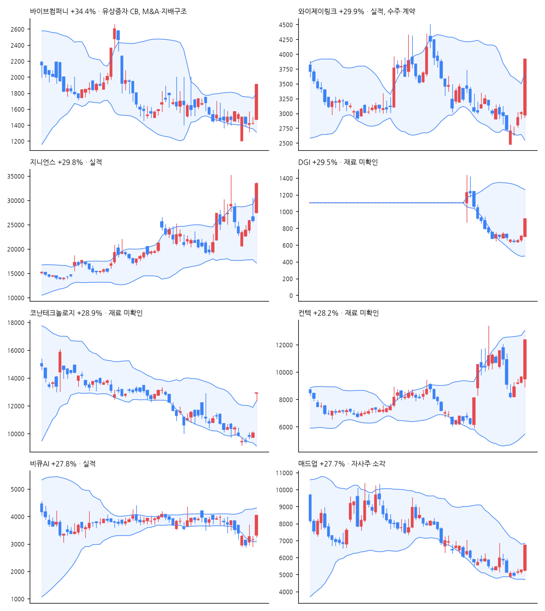

# 급등주 리포트 · 2026-11-12

> 전 종목 2,689 · 상승 643 / 하락 1,876 · 중앙값 -1.24% · **급등(+10%↑) 34종목**, 상한가 6

[목차](../README.md) · [분석 노트](../notes/2026-11-12.md) · [패턴 정리](../PATTERNS.md)

## 급등주 (거래대금 10억 이상 우선)

| 종목 | 등락 | 갭 | 종가위치 | 거래대금 | 거래량배수 | 재료(자동) | 테마 |
|---|--:|--:|--:|--:|--:|---|---|
| 바이브컴퍼니 | +34.4% | +3.6% | 1.00 | 31억 | 32.8x | 유상증자·CB, M&A·지배구조, 수주·계약 | AI, 금융 |
| 와이제이링크 | +29.9% | -1.5% | 1.00 | 107억 | 12.2x | 실적, 수주·계약 | AI, 금융, 데이터센터 |
| 지니언스 | +29.8% | +6.2% | 0.98 | 2,706억 | 6.6x | 실적 | AI, 보안 |
| DGI | +29.5% | -0.3% | 1.00 | 18억 | 1.8x | - | AI |
| 코난테크놀로지 | +28.9% | +28.4% | 1.00 | 25억 | 18.2x | - | AI |
| 컨텍 | +28.2% | -1.6% | 1.00 | 352억 | 2.3x | - | 우주 |
| 비큐AI | +27.8% | +5.1% | 1.00 | 34억 | 21.3x | 실적 | AI |
| 매드업 | +27.7% | -0.4% | 1.00 | 380억 | 9.8x | 자사주·소각 | - |
| 이노메트리 | +26.8% | -2.7% | 0.93 | 67억 | 29.2x | 수주·계약 | 보안 |
| 에스텍 | +20.1% | +19.8% | 0.50 | 307억 | 69.7x | M&A·지배구조 | - |
| 이렘 | +20.0% | +2.9% | 0.99 | 12억 | 6.2x | - | - |
| 케이아이이 | +16.6% | +1.1% | 0.87 | 11억 | 10.8x | 자사주·소각, 신기술·신제품, 수급 | - |
| 비아트론 | +16.4% | -0.2% | 0.85 | 198억 | 3.3x | - | - |
| AP위성 | +15.8% | -0.7% | 0.76 | 762억 | 4.0x | 수주·계약, 신기술·신제품 | - |
| 진양화학 | +15.5% | +0.0% | 0.89 | 63억 | 0.7x | 실적, 임상·허가 | - |
| 셀바스AI | +15.0% | +13.2% | 0.81 | 140억 | 10.6x | - | AI, 바이오 |
| 파이버프로 | +14.7% | -2.1% | 0.61 | 188억 | 12.9x | - | 광통신 |
| 유티아이 | +14.4% | +4.0% | 0.64 | 12억 | 2.4x | - | - |
| 심텍홀딩스 | +13.9% | +0.0% | 0.75 | 491억 | 10.6x | 실적, 수급 | 반도체 |
| 지씨지놈 | +13.6% | +0.3% | 0.93 | 57억 | 0.9x | 신기술·신제품 | AI, 바이오 |
| 폴라리스AI | +12.9% | +6.8% | 0.31 | 144억 | 2.3x | 수급 | AI, 제약 |
| YG PLUS | +12.8% | -0.5% | 0.79 | 171억 | 25.5x | 실적, 수급 | 엔터 |
| SH에너지화학 | +12.0% | +21.0% | 0.50 | 11억 | 5.8x | 실적, 수급 | - |
| 제이앤티씨 | +11.8% | -1.9% | 0.47 | 791억 | 7.4x | - | - |
| 로체시스템즈 | +10.3% | +0.1% | 0.89 | 26억 | 1.4x | - | 반도체 |
| 베셀 | +30.0% | -5.0% | 1.00 | 7억 | 11.5x | - | - |
| 모아라이프플러스 | +30.0% | +11.1% | 1.00 | 8억 | 3.1x | 유상증자·CB, M&A·지배구조, 실적, 수급 | AI |
| 케이지에이 | +17.8% | +3.2% | 0.87 | 4억 | 8.5x | - | 2차전지, 금융 |
| 인티큐브 | +15.7% | +0.8% | 0.99 | 1억 | 0.5x | - | - |
| E8 | +13.1% | -5.9% | 0.97 | 3억 | 2.1x | - | - |

## 급등 전날의 모습 (상위 종목)

| 종목 | %b | 밴드폭 하위% | 스퀴즈 | RSI | 20일선 이격 | 정배열 | 20일 수익률 | 고점 대비 | 전일 거래량배수 |
|---|--:|--:|:-:|--:|--:|:-:|--:|--:|--:|
| 바이브컴퍼니 | 0.18 | 12 |  | 32 | -8.0% |  | -16.5% | -65.7% | 0.6x |
| 와이제이링크 | 0.44 | 12 |  | 44 | -1.8% |  | -13.1% | -70.9% | 0.5x |
| 지니언스 | 0.70 | 96 |  | 61 | +9.7% | ✓ | +11.7% | -26.7% | 4.2x |
| DGI | 0.29 | 99 |  | 18 | -19.3% |  | -36.1% | -50.9% | 0.1x |
| 코난테크놀로지 | 0.27 | 28 |  | 33 | -5.5% |  | -13.5% | -65.7% | 0.6x |
| 컨텍 | 0.59 | 93 |  | 65 | +7.9% | ✓ | +40.3% | -63.4% | 0.1x |
| 비큐AI | 0.07 | 47 |  | 30 | -13.9% |  | -17.5% | -67.0% | 0.8x |
| 매드업 | 0.27 | 18 |  | 38 | -8.3% |  | -24.0% | -76.5% | 0.4x |

## 공시·뉴스 (상위 종목)

### 바이브컴퍼니 (301300) +34.4%

- 📄 [주주총회소집결의 (임시주주총회)](https://dart.fss.or.kr/dsaf001/main.do?rcpNo=20261112901139) · 20261112
- 📄 [주주명부폐쇄기간또는기준일설정](https://dart.fss.or.kr/dsaf001/main.do?rcpNo=20261112901130) · 20261112
- 📄 [주요사항보고서(유상증자결정)](https://dart.fss.or.kr/dsaf001/main.do?rcpNo=20261112000665) · 20261112
- 📄 [주요사항보고서(유상증자결정)](https://dart.fss.or.kr/dsaf001/main.do?rcpNo=20261112000633) · 20261112
- 📄 [경영권변경등에관한계약체결](https://dart.fss.or.kr/dsaf001/main.do?rcpNo=20261112900980) · 20261112
- 📰 바이브컴퍼니, 29억9천만원 제3자배정 유상증자 - 연합뉴스
- 📰 바이브컴퍼니, 50억원 유상증자…에이아이블레이저에 제3자배정 - 연합뉴스
- 📰 바이브컴퍼니, 50억원 유상증자…에이아이블레이저에 제3자배정 - www.ebn.co.kr
- 📰 바이브컴퍼니, 우리카드 ‘AI KMS’ 재구축 수주…업무 에이전트 확장 기반 마련 - 테크월드

### 와이제이링크 (209640) +29.9%

- 📄 [주식등의대량보유상황보고서(일반)](https://dart.fss.or.kr/dsaf001/main.do?rcpNo=20261112000533) · 20261112
- 📄 [분기보고서 (2026.09)](https://dart.fss.or.kr/dsaf001/main.do?rcpNo=20261112000193) · 20261112
- 📰 와이제이링크, 美데이터센터 수주 11배 급증…3Q누적 72억 흑자전환 - 머니투데이 - 머니투데이
- 📰 와이제이링크 박순일, 주식담보대출 이자율·만기 조건 변경 - 데이터투자
- 📰 [급등락주 짚어보기] 호실적·주주환원 업은 AI·장비주 '질주'…넥스아이 상장 첫날 '下' - 이투데이
- 📰 금융당국 "13일 코스닥 추가대책 사실 아냐, 풍문유포 엄정 조치" - 머니투데이 - 머니투데이

### 지니언스 (263860) +29.8%

- 📄 [기업설명회(IR)개최](https://dart.fss.or.kr/dsaf001/main.do?rcpNo=20261111900231) · 20261111
- 📄 [분기보고서 (2026.09)](https://dart.fss.or.kr/dsaf001/main.do?rcpNo=20261112000006) · 20261112
- 📰 지니언스, AI 보안 수요 확대에 영업익 3.5배 ‘쑥’ - 서울경제
- 📰 지니언스, 3분기 영업익 2.7배 증가...NAC·EDR 쌍끌이 성장 - 디일렉
- 📰 지니언스, 누적 영업익 3배 넘게 늘었다…NAC·EDR로 ‘폭풍성장’ - 매일경제
- 📰 지니언스, 3Q 누적 영업익 81억…전년比 273% 급등 - 이투데이

### DGI (099520) +29.5%

- 📰 DGI 주가, 상한가... 무슨 회사길래? - 금강일보
- 📰 DGI 장중 상한가…913원까지 올라 - 비건뉴스
- 📰 특징주, DGI-CCTV＆DVR 테마 상승세에 28.02% ↑ - 매일경제 마켓
- 📰 특징주, 비츠로시스-CCTV＆DVR 테마 상승세에 9.97% ↑ - 매일경제 마켓

### 코난테크놀로지 (402030) +28.9%

- 📰 [오늘의 특징주] 코난테크놀로지·모아라이프플러스 상한가…AI 호재에 상폐 위험주도 급등 - https://www.ppss.kr/
- 📰 코난테크놀로지, 철도학회로부터 부산역 AI 다국어 안내 성과 인정 - 더에이아이
- 📰 코난테크놀로지, 부산역 AI 역무원 운영 분석으로 철도학회 우수상 - 아이뉴스24
- 📰 코난테크놀로지, 부산역 AI 다국어 안내 성과로 한국철도학회 논문 우수상 - 테크월드

### 컨텍 (451760) +28.2%

- 📰 [단독] 컨텍 "블루오리진 등과 안테나 200기 공급 논의…최소 1조원 규모" - 한국경제
- 📰 [단독] 컨텍, 블루오리진 등 안테나 대량 공급 - 한국경제
- 📰 [속보] 컨텍 주가, 상한가 도달…코스닥 약세 속 급등 - CBC뉴스
- 📰 "기술은 기본, 관건은 우주 외교"…이성희 컨텍 대표 제언 - 중도일보

### 비큐AI (148780) +27.8%

- 📰 비큐AI 주가, 상한가... 이유는? - 금강일보
- 📰 비큐AI 주가 장중 상한가…3분기 순이익 흑자전환 - 비건뉴스
- 📰 [급등락주 짚어보기] 호실적·주주환원 업은 AI·장비주 '질주'…넥스아이 상장 첫날 '下' - 이투데이
- 📰 비큐AI, 퓨리오사AI 투자 평가이익 반영…3분기 순이익 큰 폭 개선 : 네이버 블로그 - Naver Blog

### 매드업 (0039P0) +27.7%

- 📄 [임원ㆍ주요주주특정증권등소유상황보고서](https://dart.fss.or.kr/dsaf001/main.do?rcpNo=20261112000502) · 20261112
- 📄 [분기보고서 (2026.09)](https://dart.fss.or.kr/dsaf001/main.do?rcpNo=20261112000169) · 20261112
- 📄 [주요사항보고서(자기주식취득결정)](https://dart.fss.or.kr/dsaf001/main.do?rcpNo=20261112000145) · 20261112
- 📄 [현금ㆍ현물배당결정 (분기배당)](https://dart.fss.or.kr/dsaf001/main.do?rcpNo=20261112900257) · 20261112
- 📄 [중간(분기)배당을위한주주명부폐쇄(기준일)결정](https://dart.fss.or.kr/dsaf001/main.do?rcpNo=20261112900242) · 20261112
- 📰 매드업, 3분기 누적 영업익 102% 증가…연매출 조기 돌파·56억원 주주환원 - 이투데이
- 📰 [1112시황레이더] 매드업, 20억 원 규모 자사주 취득 결정 등에 장중 상한가 By 인포스탁데일리 - Investing.com 한국어
- 📰 매드업 주가, 급등세... 무슨 회사길래? - 금강일보
- 📰 [특징주] 매드업, 3분기 만에 작년 연매출 돌파·대규모 주주환원 호재에 상한가 육박 - 와이드경제

## 누적 통계 — 급등 다음에 무슨 일이?

- 표본 162건 · 5거래일 뒤 평균 -4.4% · 중앙값 -4.2% · 플러스 비율 28%

---

※ 재료는 공시 제목·뉴스 제목 키워드로 자동 분류한 것입니다. 판단은 [분석 노트](../notes/) 참고. 투자 권유 아님.
