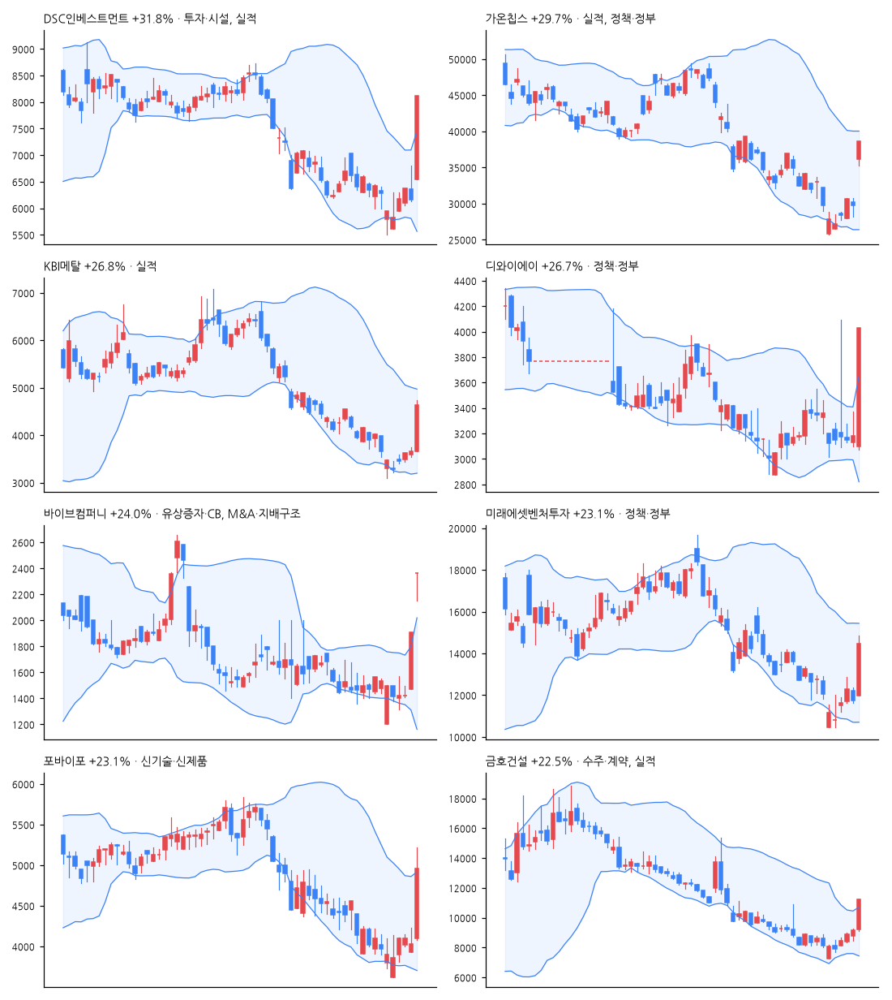

# 급등주 리포트 · 2026-11-13

> 전 종목 2,689 · 상승 1,418 / 하락 1,077 · 중앙값 +0.18% · **급등(+10%↑) 64종목**, 상한가 4

[목차](../README.md) · [분석 노트](../notes/2026-11-13.md) · [패턴 정리](../PATTERNS.md)

## 급등주 (거래대금 10억 이상 우선)

| 종목 | 등락 | 갭 | 종가위치 | 거래대금 | 거래량배수 | 재료(자동) | 테마 |
|---|--:|--:|--:|--:|--:|---|---|
| DSC인베스트먼트 | +31.8% | +6.3% | 1.00 | 320억 | 42.4x | 투자·시설, 실적, 정책·정부 | AI, 반도체, 건설 |
| 가온칩스 | +29.7% | +21.1% | 1.00 | 323억 | 18.2x | 실적, 정책·정부, 수급 | AI, 반도체, 건설 |
| KBI메탈 | +26.8% | +0.0% | 0.91 | 1,048억 | 30.3x | 실적 | - |
| 디와이에이 | +26.7% | -2.5% | 1.00 | 26억 | 51.9x | 정책·정부 | - |
| 바이브컴퍼니 | +24.0% | +24.0% | 1.00 | 15억 | 5.1x | 유상증자·CB, M&A·지배구조 | - |
| 미래에셋벤처투자 | +23.1% | +2.0% | 0.86 | 160억 | 5.0x | 정책·정부 | AI |
| 포바이포 | +23.1% | +1.7% | 0.77 | 95억 | 58.0x | 신기술·신제품 | AI |
| 금호건설 | +22.5% | +0.5% | 1.00 | 986억 | 7.5x | 수주·계약, 실적 | 반도체, 건설 |
| 금호전기 | +22.2% | +1.6% | 0.84 | 860억 | 5.7x | 유상증자·CB, 실적 | 반도체, 건설 |
| 에이디테크놀로지 | +20.6% | +18.0% | 0.52 | 231억 | 11.0x | - | 반도체 |
| TS인베스트먼트 | +20.0% | -1.0% | 0.71 | 50억 | 58.0x | 실적, 정책·정부 | AI, 반도체, 건설 |
| 제닉스로보틱스 | +19.8% | +1.4% | 0.64 | 102억 | 13.4x | 수주·계약 | 바이오, 식품, 건설 |
| 원익QnC | +18.9% | +3.3% | 0.83 | 345억 | 6.5x | 실적 | AI, 반도체 |
| 진양화학 | +18.4% | -1.9% | 1.00 | 77억 | 0.7x | 실적, 수주·계약, 정책·정부 | 건설 |
| 에스와이 | +18.4% | -0.6% | 0.81 | 299억 | 3.2x | 수주·계약 | 조선, 데이터센터 |
| 다원넥스뷰 | +16.8% | +7.3% | 0.93 | 41억 | 2.1x | 실적 | 반도체 |
| 진양폴리 | +16.3% | +0.9% | 0.84 | 32억 | 0.8x | 실적 | - |
| 오킨스전자 | +16.2% | +4.6% | 0.87 | 219억 | 1.3x | - | AI, 반도체 |
| 선익시스템 | +15.2% | +6.6% | 0.73 | 99억 | 1.4x | 수주·계약, 수급 | - |
| 노랑풍선 | +15.2% | -0.3% | 0.71 | 411억 | 13.4x | 정책·정부 | - |
| 인텍플러스 | +14.9% | +1.9% | 0.63 | 583억 | 2.3x | 실적, 수급 | 반도체 |
| 비츠로시스 | +14.8% | -0.1% | 0.78 | 12억 | 10.6x | 신기술·신제품 | 원전 |
| 프로텍 | +14.7% | +2.5% | 0.62 | 82억 | 3.6x | - | AI, 반도체 |
| 유티아이 | +14.2% | +2.2% | 0.62 | 21억 | 3.7x | - | AI |
| 동운아나텍 | +13.9% | +1.9% | 0.98 | 43억 | 2.2x | - | AI, 반도체, 로봇 |
| 아리바이오랩 | +13.9% | +1.0% | 0.71 | 176억 | 4.5x | 신기술·신제품 | 바이오, 제약 |
| M83 | +13.8% | +1.6% | 0.63 | 10억 | 11.4x | 수급 | AI, 로봇 |
| 휴마시스 | +13.6% | -1.1% | 0.49 | 22억 | 20.5x | 자사주·소각 | - |
| 현대바이오 | +13.5% | +2.0% | 0.58 | 207억 | 4.0x | 임상·허가 | 바이오 |
| 네오오토 | +13.1% | -0.1% | 0.77 | 14억 | 2.0x | - | 로봇, 우주 |

## 급등 전날의 모습 (상위 종목)

| 종목 | %b | 밴드폭 하위% | 스퀴즈 | RSI | 20일선 이격 | 정배열 | 20일 수익률 | 고점 대비 | 전일 거래량배수 |
|---|--:|--:|:-:|--:|--:|:-:|--:|--:|--:|
| DSC인베스트먼트 | 0.27 | 26 |  | 48 | -4.5% |  | -3.3% | -68.7% | 0.9x |
| 가온칩스 | 0.25 | 60 |  | 42 | -10.3% |  | -14.5% | -64.2% | 0.8x |
| KBI메탈 | 0.26 | 32 |  | 38 | -10.6% |  | -20.2% | -68.9% | 0.8x |
| 디와이에이 | 0.45 | 0 | ✓ | 59 | -0.6% |  | -2.0% | -52.5% | 0.3x |
| 바이브컴퍼니 | 1.22 | 24 |  | 60 | +22.6% |  | +15.1% | -53.9% | 32.8x |
| 미래에셋벤처투자 | 0.22 | 40 |  | 39 | -10.2% |  | -11.0% | -83.4% | 0.6x |
| 포바이포 | 0.26 | 46 |  | 35 | -6.2% |  | -9.3% | -72.6% | 1.0x |
| 금호건설 | 0.54 | 18 |  | 47 | +1.3% |  | -6.3% | -52.8% | 1.3x |

## 공시·뉴스 (상위 종목)

### DSC인베스트먼트 (241520) +31.8%

- 📄 [[기재정정]주요사항보고서(유형자산양수결정)](https://dart.fss.or.kr/dsaf001/main.do?rcpNo=20261113001398) · 20261113
- 📄 [분기보고서 (2026.09)](https://dart.fss.or.kr/dsaf001/main.do?rcpNo=20261113001187) · 20261113
- 📰 [마감분석] DSC인베스트먼트 상한가 직행하며 8120원 마감 : 기업주식정보 - 재경일보
- 📰 [오늘의 특징주] DSC인베스트먼트·금호건설 상한가…벤처투자 정책·실적 개선에 매수세 - https://www.ppss.kr/
- 📰 [특징주] 李대통령 벤처투자 개선 주문에…DSC인베스트먼트 상한가 - 뉴스핌
- 📰 DSC인베스트먼트 주가, 상한가... 무슨 회사길래? - 금강일보

### 가온칩스 (399720) +29.7%

- 📰 [장중수급포착] 가온칩스, 외국인/기관 동시 순매수… 주가 +27.73% - 뉴스핌
- 📰 [마감분석] 가온칩스 29.92% 급등 상한가 마감 : 기업주식정보 - 재경일보
- 📰 가온칩스 주가, 상한가... 무슨 회사길래? - 금강일보
- 📰 가온칩스 장중 27% 급등…반도체 설계주 강세 - 비건뉴스

### KBI메탈 (024840) +26.8%

- 📄 [분기보고서 (2026.09)](https://dart.fss.or.kr/dsaf001/main.do?rcpNo=20261113000180) · 20261113
- 📰 KBI메탈, 3분기 누적 영업이익 308억원..."역대 최대 실적" - 뉴스핌
- 📰 KBI메탈 3분기 누적 영업이익 308억원…390% 증가 - 매일경제
- 📰 KBI메탈, 3분기 누적 영업익 308억원 '역대 최대' - 매일일보
- 📰 KBI메탈, 3분기 누적 영업익 역대 최대 실적 달성 - 스틸데일리

### 디와이에이 (002880) +26.7%

- 📄 [분기보고서 (2026.09)](https://dart.fss.or.kr/dsaf001/main.do?rcpNo=20261113000492) · 20261113
- 📰 디와이에이, 3분기 영업익 136억…전년比 128.2%↑ - 뉴시스
- 📰 디와이에이, 3분기 누적 매출 6885억·전년比 50% ↑ - 뉴스핌
- 📰 [공시 Pick] 디와이에이, 3분기 영업익 128% 급증에 상한가 달성 - 뉴스투데이
- 📰 "얌체 같아" 성시경, 술 안 마시는 규현에 독설 - Chosunbiz

### 바이브컴퍼니 (301300) +24.0%

- 📄 [주주총회소집결의 (임시주주총회)](https://dart.fss.or.kr/dsaf001/main.do?rcpNo=20261112901139) · 20261112
- 📄 [주주명부폐쇄기간또는기준일설정](https://dart.fss.or.kr/dsaf001/main.do?rcpNo=20261112901130) · 20261112
- 📄 [주요사항보고서(유상증자결정)](https://dart.fss.or.kr/dsaf001/main.do?rcpNo=20261112000665) · 20261112
- 📄 [주요사항보고서(유상증자결정)](https://dart.fss.or.kr/dsaf001/main.do?rcpNo=20261112000633) · 20261112
- 📄 [경영권변경등에관한계약체결](https://dart.fss.or.kr/dsaf001/main.do?rcpNo=20261112900980) · 20261112
- 📰 바이브컴퍼니, 에이아이블레이저에 경영권 매각…80억 규모 유상증자도 추진 - 지디넷코리아
- 📰 바이브컴퍼니, 50억원 유상증자…에이아이블레이저에 제3자배정 - 연합뉴스
- 📰 바이브컴퍼니, 29억9천만원 제3자배정 유상증자 - 연합뉴스
- 📰 [특징주] 바이브컴퍼니, 최대주주 변경·80억원 유상증자에 이틀째 급등…상한가 마감 - https://www.moneystorm.kr/

### 미래에셋벤처투자 (100790) +23.1%

- 📄 [분기보고서 (2026.09)](https://dart.fss.or.kr/dsaf001/main.do?rcpNo=20261113001394) · 20261113
- 📰 특징주, 미래에셋벤처투자-창투사 테마 상승세에 5.46% ↑ - 매일경제 마켓
- 📰 [특징주] 李대통령 벤처투자 개선 주문에…DSC인베스트먼트 상한가 - 뉴스핌
- 📰 미래에셋, 印 패션 스타트업에 180억 투자…매장 150곳 낸다 - 한국신용신문
- 📰 AI 팹리스 투자수익·IPO 훈풍에 창투사 테마 '활활'…DSC인베스트먼트·TS인베스트먼트 급등 - 핀포인트뉴스

### 포바이포 (389140) +23.1%

- 📄 [분기보고서 (2026.09)](https://dart.fss.or.kr/dsaf001/main.do?rcpNo=20261113001237) · 20261113
- 📰 포바이포, ‘AI PIXELL’ 다빈치·누크 플러그인 공개… 전문 영상 후반 작업 지원 확대 - 한국시민기자협회 뉴스포털1
- 📰 포바이포, 영상 플러그인 공개… 다빈치 리졸브·누크 지원 전문가용 신제품 - 한스경제
- 📰 포바이포, 맥·편집툴로 AI 화질 개선 확대…생성 이후 공정 겨냥 - K-EnterTech Hub
- 📰 포바이포, 11월 18일 Inter BEE 2026서 AI PIXELL PRO 맥버전 첫 공개 - 스페셜타임스

### 금호건설 (002990) +22.5%

- 📄 [단일판매ㆍ공급계약체결](https://dart.fss.or.kr/dsaf001/main.do?rcpNo=20261112801117) · 20261112
- 📄 [분기보고서 (2026.09)](https://dart.fss.or.kr/dsaf001/main.do?rcpNo=20261112000211) · 20261112
- 📰 금호건설 상한가…호실적에 호남 반도체 클러스터 기대 - 한국경제
- 📰 금호건설, 3분기 영업이익 222억원…전년比 44.2% 증가 - 서울경제TV
- 📰 [특징주] 금호건설 상한가…7000억 수주·실적 개선 겹호재 - 뉴스핌
- 📰 금호건설, 영업익 44% 증가·수주 목표 조기 달성에 상한가[핫종목] - 뉴스1

## 누적 통계 — 급등 다음에 무슨 일이?

- 표본 179건 · 5거래일 뒤 평균 -3.2% · 중앙값 -3.2% · 플러스 비율 32%

---

※ 재료는 공시 제목·뉴스 제목 키워드로 자동 분류한 것입니다. 판단은 [분석 노트](../notes/) 참고. 투자 권유 아님.
