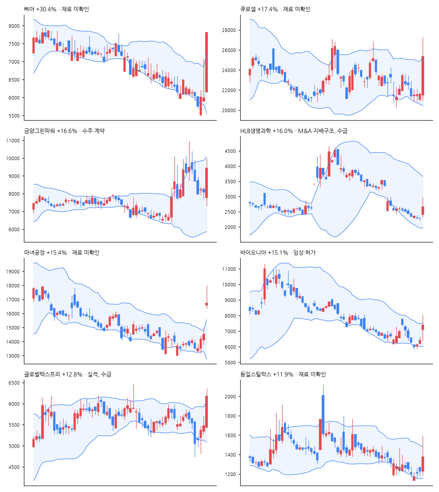

# 급등주 리포트 · 2026-11-20

> 전 종목 2,686 · 상승 278 / 하락 2,280 · 중앙값 -3.49% · **급등(+10%↑) 13종목**, 상한가 3

[목차](../README.md) · [분석 노트](../notes/2026-11-20.md) · [패턴 정리](../PATTERNS.md)

## 급등주 (거래대금 10억 이상 우선)

| 종목 | 등락 | 갭 | 종가위치 | 거래대금 | 거래량배수 | 재료(자동) | 테마 |
|---|--:|--:|--:|--:|--:|---|---|
| 삐아 | +30.4% | +2.8% | 1.00 | 59억 | 30.4x | - | 화장품 |
| 큐로셀 | +17.4% | -0.5% | 0.70 | 40억 | 5.7x | - | 바이오 |
| 금양그린파워 | +16.6% | -4.0% | 0.80 | 167억 | 1.1x | 수주·계약 | AI, 원전, 데이터센터 |
| HLB생명과학 | +16.0% | +5.0% | 0.51 | 177억 | 27.2x | M&A·지배구조, 수급 | - |
| 마녀공장 | +15.4% | +14.3% | 0.23 | 608억 | 30.0x | - | - |
| 바이오니아 | +15.1% | +10.6% | 0.60 | 274억 | 15.4x | 임상·허가 | 바이오 |
| 글로벌텍스프리 | +12.8% | -0.7% | 0.81 | 318억 | 7.2x | 실적, 수급 | - |
| 동일스틸럭스 | +11.9% | -0.1% | 0.46 | 23억 | 18.6x | - | - |
| 한진칼 | +8.8% | +0.5% | 0.63 | 1,331억 | 0.9x | M&A·지배구조, 수급 | - |
| 한미약품 | +6.2% | -2.8% | 0.70 | 944억 | 1.5x | 임상·허가 | - |
| 타임X AI | +182.7% | +117.5% | 1.00 | 2억 | 0.0x | 유상증자·CB | AI, 화장품 |
| 드림인사이트 | +32.2% | +2.5% | 1.00 | 4억 | 7.3x | M&A·지배구조 | 바이오 |
| 멤레이비티 | +10.5% | +0.0% | 0.77 | 2억 | 0.6x | 실적 | - |

## 급등 전날의 모습 (상위 종목)

| 종목 | %b | 밴드폭 하위% | 스퀴즈 | RSI | 20일선 이격 | 정배열 | 20일 수익률 | 고점 대비 | 전일 거래량배수 |
|---|--:|--:|:-:|--:|--:|:-:|--:|--:|--:|
| 삐아 | 0.18 | 52 |  | 40 | -5.3% |  | -11.9% | -47.9% | 30.3x |
| 큐로셀 | 0.24 | 18 |  | 38 | -4.9% |  | -7.5% | -67.3% | 0.3x |
| 금양그린파워 | 0.56 | 83 |  | 61 | +3.2% | ✓ | +15.6% | -60.0% | 0.1x |
| HLB생명과학 | 0.18 | 68 |  | 18 | -19.9% |  | -34.8% | -57.1% | 0.8x |
| 마녀공장 | 0.81 | 0 | ✓ | 63 | +3.4% |  | -1.6% | -31.7% | 4.7x |
| 바이오니아 | 0.27 | 17 |  | 46 | -4.8% |  | -12.4% | -58.6% | 1.2x |
| 글로벌텍스프리 | 0.44 | 23 |  | 49 | -0.9% |  | +0.9% | -24.2% | 2.9x |
| 동일스틸럭스 | 0.23 | 32 |  | 32 | -7.1% |  | -15.4% | -74.8% | 0.4x |

## 공시·뉴스 (상위 종목)

### 삐아 (451250) +30.4%

- 📰 [특징주] 삐아, 한한령 완화 기대에 상한가…화장품주 매수세 유입 - https://www.moneystorm.kr/
- 📰 [속보] 삐아·마녀공장·한국화장품 주가 급등…화장품 관련주 장초반 강세 - CBC뉴스
- 📰 삐아 장중 7810원 상한가…화장품주 강세 - 비건뉴스
- 📰 삐아 주가, 상한가... 이유는? - 금강일보

### 큐로셀 (372320) +17.4%

- 📰 큐로셀, 애프터마켓서 10%대 급등 - 연합뉴스
- 📰 큐로셀 ‘림카토’, 12월부터 건강보험 적용…1회 약가 2.8억 - 팜이데일리
- 📰 큐로셀 "CAR-T 치료제 림카토에 내달부터 건강보험 적용" - 연합뉴스
- 📰 큐로셀, '림카토' 건정심 상정..12월1일부터 급여 - 바이오스펙테이터

### 금양그린파워 (282720) +16.6%

- 📄 [단일판매ㆍ공급계약체결](https://dart.fss.or.kr/dsaf001/main.do?rcpNo=20261120900630) · 20261120
- 📰 금양그린파워, 2300억원 규모 공급계약 체결 - 이데일리
- 📰 금양그린파워, 22.19% 급등…9,690원 마감 - 잡포스트
- 📰 [속보] 금양그린파워, 2300억원 규모 AI데이터센터 전기·통신 공사 계약…지난해 매출액의 86.87% - CBC뉴스
- 📰 금양그린파워, 2300억원 규모 원주 AI데이터센터 전기·통신 공사 수주 - 디지털투데이

### HLB생명과학 (067630) +16.0%

- 📄 [[첨부추가]주요사항보고서(회사합병결정)](https://dart.fss.or.kr/dsaf001/main.do?rcpNo=20261119000371) · 20261119
- 📄 [주권매매거래정지 (합병)](https://dart.fss.or.kr/dsaf001/main.do?rcpNo=20261119900675) · 20261119
- 📄 [교환가액의조정 (제16회차)](https://dart.fss.or.kr/dsaf001/main.do?rcpNo=20261120900769) · 20261120
- 📰 [장중수급포착] HLB생명과학, 외국인/기관 동시 순매수… 주가 +11.38% - 뉴스핌
- 📰 [장중수급포착] HLB생명과학, 기관 6일 연속 순매수행진... 주가 +12.91% - 뉴스핌
- 📰 [특징주] HLB생명과학, HLB와 흡수합병 추진에 24%↑ - 뉴스웍스
- 📰 HLB생명과학 주가 24% 급등…수차례 VI 발동 속 변동성, 전일 합병 공시도 눈길 - CBC뉴스

### 마녀공장 (439090) +15.4%

- 📰 [특징주] 마녀공장, 한한령 완화 기대감 수혜…장 후반 20%대 강세 - 아주경제
- 📰 마녀공장, 거래 342만주 몰리며 18.66% 급등 - 잡포스트
- 📰 [특징주] 마녀공장 장중 16%대 급등 1만6800원선 거래 : 기업주식정보 - 재경일보
- 📰 마녀공장 주가, 11월 20일 장중 16,760원 15.83% 상승 - 중앙이코노미뉴스

### 바이오니아 (064550) +15.1%

- 📰 바이오니아, ‘간 밖’으로 나온 RNAi 플랫폼으로 글로벌 기술이전 타진 - 한국경제
- 📰 바이오니아, 유럽서 '세미 RNA' 경쟁력 부각…"전신 부작용 최소화" - 머니투데이 - 머니투데이
- 📰 [특징주] 바이오니아, 증시 약세 속 20% 급등…RNAi 플랫폼 확장성 부각 - 바이오타임즈
- 📰 바이오니아 주가 21% 급등…코스피·코스닥 동반 급락 속 '역주행' - CBC뉴스

### 글로벌텍스프리 (204620) +12.8%

- 📰 [장중수급포착] 글로벌텍스프리, 외국인 5일 연속 순매수행진... 주가 +10.91% - 뉴스핌
- 📰 [장중수급포착] 글로벌텍스프리, 외국인/기관 동시 순매수… 주가 +9.72% - 뉴스핌
- 📰 글로벌텍스프리 주가 두 자릿수 강세…장중 고가 6,360원 - 잡포스트
- 📰 [특징주] '연말 유커 특수' 면세점株 강세…글로벌텍스프리 8%↑ - 뉴스핌

### 동일스틸럭스 (023790) +11.9%

- 📰 동일스틸럭스, 정규장서 24.69%…사업 변수도 점검 - 잡포스트
- 📰 제이쓴, 子 할로윈 의상 직접 제작 "새벽 1시까지···팔아달라고 아우성"('홍쓴TV') - Chosunbiz
- 📰 엄정화, 코펜하겐서 블랙 드레스 착용→바로 시상식 가도 되겠어 - Chosunbiz
- 📰 '야호' 리센느 미나미, 고향 일본에서 MAMA 레드카펫 [O! STAR 숏폼] - Chosunbiz

## 누적 통계 — 급등 다음에 무슨 일이?

- 표본 658건 · 5거래일 뒤 평균 -5.4% · 중앙값 -6.4% · 플러스 비율 26%

---

※ 재료는 공시 제목·뉴스 제목 키워드로 자동 분류한 것입니다. 판단은 [분석 노트](../notes/) 참고. 투자 권유 아님.
