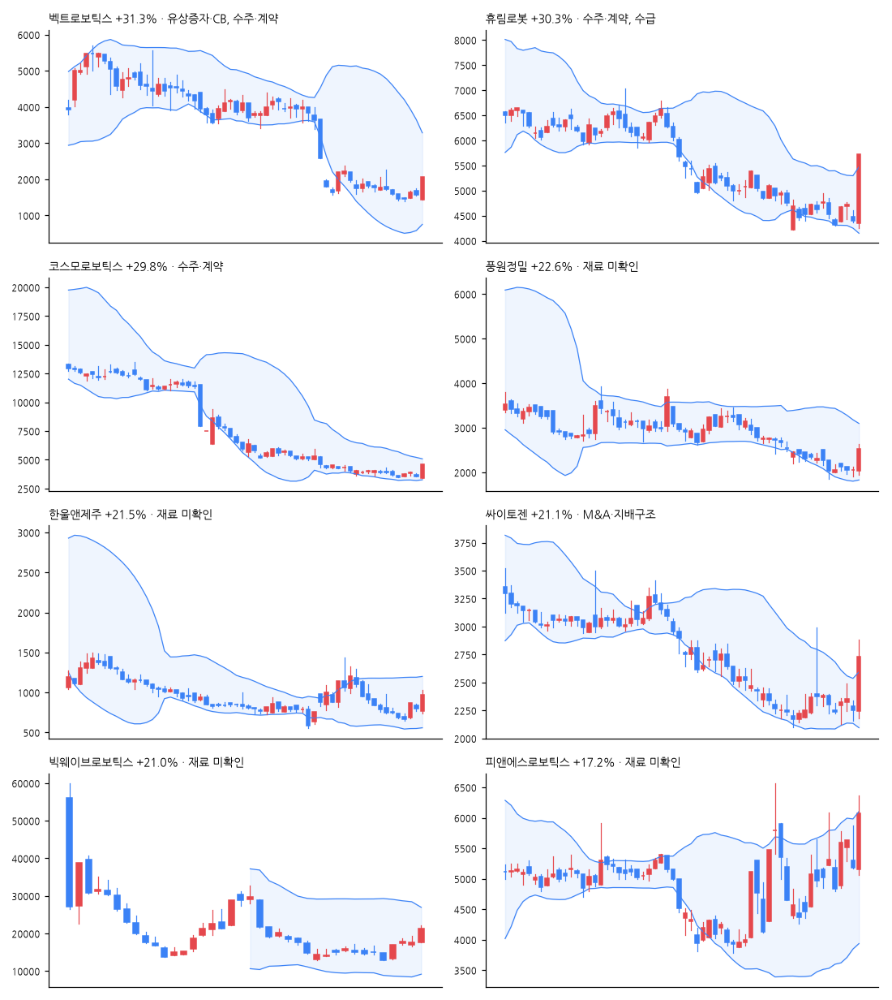

# 급등주 리포트 · 2026-11-23

> 전 종목 2,687 · 상승 608 / 하락 1,926 · 중앙값 -1.75% · **급등(+10%↑) 36종목**, 상한가 3

[목차](../README.md) · [분석 노트](../notes/2026-11-23.md) · [패턴 정리](../PATTERNS.md)

## 급등주 (거래대금 10억 이상 우선)

| 종목 | 등락 | 갭 | 종가위치 | 거래대금 | 거래량배수 | 재료(자동) | 테마 |
|---|--:|--:|--:|--:|--:|---|---|
| 벡트로보틱스 | +31.3% | -8.7% | 1.00 | 19억 | 0.9x | 유상증자·CB, 수주·계약 | AI, 로봇, 데이터센터 |
| 휴림로봇 | +30.3% | -0.8% | 1.00 | 590억 | 13.3x | 수주·계약, 수급 | AI, 로봇, 데이터센터 |
| 코스모로보틱스 | +29.8% | -4.9% | 1.00 | 345억 | 10.3x | 수주·계약 | AI, 로봇, 데이터센터 |
| 풍원정밀 | +22.6% | -1.2% | 0.83 | 17억 | 9.5x | - | - |
| 한울앤제주 | +21.5% | -3.7% | 0.79 | 34억 | 2.2x | - | 식품 |
| 싸이토젠 | +21.1% | -0.4% | 0.79 | 26억 | 23.9x | M&A·지배구조 | 바이오, 제약 |
| 빅웨이브로보틱스 | +21.0% | -0.1% | 0.80 | 1,443억 | 2.9x | - | 로봇 |
| 피앤에스로보틱스 | +17.2% | -0.4% | 0.77 | 308억 | 2.5x | - | 로봇, 의료기기 |
| 아이엠바이오로직스 | +16.3% | +1.9% | 0.74 | 21억 | 1.8x | - | 바이오, 제약 |
| 에이치브이엠 | +16.2% | -4.3% | 0.83 | 116억 | 1.4x | 수급 | 우주, 항공 |
| 페니트리움바이오 | +16.1% | +0.5% | 0.76 | 156억 | 2.3x | 임상·허가 | 바이오 |
| SFA반도체 | +14.4% | -2.4% | 0.82 | 786억 | 2.2x | 실적, 수급 | AI, 반도체, HBM |
| 타임X AI | +13.5% | +26.7% | 0.50 | 103억 | 903.5x | - | - |
| 디케이티 | +11.5% | -1.4% | 0.93 | 357억 | 2.4x | 수급 | 반도체, 로봇 |
| RFHIC | +11.2% | -1.4% | 0.83 | 455억 | 1.4x | 수급 | AI, 로봇, 광통신 |
| 사피엔반도체 | +10.4% | -2.7% | 0.81 | 18억 | 0.9x | 수주·계약 | AI, 반도체, HBM |
| 스피어 | +10.3% | -2.0% | 0.93 | 256억 | 1.9x | 수주·계약, 신기술·신제품 | 조선, 제약 |
| 매드업 | +10.2% | -0.6% | 0.63 | 273억 | 2.0x | 실적, 정책·정부 | 로봇 |
| 아스플로 | +10.1% | -0.4% | 0.81 | 54억 | 0.8x | 실적 | AI, 반도체, HBM |
| 아이로보틱스 | +10.1% | -3.9% | 0.50 | 70억 | 16.8x | M&A·지배구조 | 로봇 |
| 에이피알 | +9.9% | -0.6% | 0.80 | 1,418억 | 1.6x | 수급 | 로봇, 화장품 |
| 피에스케이홀딩스 | +7.1% | +0.5% | 0.91 | 284억 | 1.0x | - | 반도체, 바이오 |
| RF머트리얼즈 | +6.7% | -2.4% | 0.95 | 157억 | 0.5x | 신기술·신제품 | AI, 반도체, 우주 |
| 원익홀딩스 | +6.5% | -1.1% | 0.88 | 1,538억 | 1.1x | 실적, 수급 | 반도체, 금융 |
| 로보티즈 | +6.4% | -1.7% | 0.82 | 990억 | 1.6x | 수주·계약, 신기술·신제품 | 반도체, 로봇 |
| 심텍 | +6.3% | -0.6% | 0.95 | 1,516억 | 1.4x | 수급 | AI |
| 제주반도체 | +6.2% | -0.5% | 0.98 | 541억 | 1.1x | M&A·지배구조, 실적, 신기술·신제품 | 반도체, 화장품 |
| 두산 | +6.2% | -1.5% | 0.86 | 825억 | 1.1x | 신기술·신제품 | 건설, 전력 |
| 코리아써키트 | +5.6% | +0.0% | 0.97 | 868억 | 1.0x | 실적, 수급 | AI, 식품 |
| 이수페타시스 | +5.5% | -0.3% | 0.86 | 1,000억 | 1.4x | - | AI, 항공, 금융 |

## 급등 전날의 모습 (상위 종목)

| 종목 | %b | 밴드폭 하위% | 스퀴즈 | RSI | 20일선 이격 | 정배열 | 20일 수익률 | 고점 대비 | 전일 거래량배수 |
|---|--:|--:|:-:|--:|--:|:-:|--:|--:|--:|
| 벡트로보틱스 | 0.32 | 95 |  | 48 | -25.5% |  | -60.1% | -72.4% | 0.5x |
| 휴림로봇 | 0.13 | 27 |  | 36 | -8.0% |  | -12.1% | -83.5% | 0.8x |
| 코스모로보틱스 | 0.19 | 18 |  | 27 | -15.0% |  | -30.2% | -94.8% | 0.3x |
| 풍원정밀 | 0.18 | 82 |  | 13 | -17.5% |  | -36.5% | -89.7% | 2.1x |
| 한울앤제주 | 0.39 | 66 |  | 47 | -8.0% |  | +1.3% | -85.8% | 0.5x |
| 싸이토젠 | 0.30 | 25 |  | 44 | -3.4% |  | -10.2% | -79.9% | 0.7x |
| 빅웨이브로보틱스 | 0.46 | 0 |  | 42 | -4.6% |  | -17.7% | -70.7% | 1.4x |
| 피앤에스로보틱스 | 0.62 | 53 |  | 47 | +5.4% | ✓ | +32.0% | -65.0% | 0.6x |

## 공시·뉴스 (상위 종목)

### 벡트로보틱스 (457600) +31.3%

- 📄 [소액공모공시서류(지분증권)](https://dart.fss.or.kr/dsaf001/main.do?rcpNo=20261123000386) · 20261123
- 📄 [주주총회소집결의 (임시주주총회)](https://dart.fss.or.kr/dsaf001/main.do?rcpNo=20261123900601) · 20261123
- 📄 [주요사항보고서(유상증자결정)](https://dart.fss.or.kr/dsaf001/main.do?rcpNo=20261123000342) · 20261123
- 📰 벡트로보틱스, 10억원 제3자배정 유상증자 - 연합뉴스
- 📰 벡트로보틱스 29.78% 급등…유상증자 납입 일정 재조정 - 잡포스트
- 📰 벡트로보틱스, 10억원 규모 제3자배정 유상증자 결정 - 데이터투자
- 📰 [급등락주 짚어보기] 2300억 AI 데이터센터 수주에 금양그린파워 ‘上’…휴림로봇·큐로셀도 급등 - 이투데이

### 휴림로봇 (090710) +30.3%

- 📰 [특징주] 휴림로봇, 글로벌 전자부품 제조사 로봇 공급 본계약 체결에 23%↑ - 뉴스핌
- 📰 휴림로봇, 한화로보틱스 등과 자동화 장비 로봇 공급 계약 체결 - 머니투데이 - 머니투데이
- 📰 휴림로봇 주가 ‘불기둥’...한화로보틱스와 로봇 공급 계약 [오늘, 이 종목] - 매일경제
- 📰 휴림로봇, '글로벌 부품 제조사 자동화 공급망' 진입…한화로보틱스와 본계약 - 파이낸셜뉴스

### 코스모로보틱스 (439960) +29.8%

- 📰 [마감분석] 코스모로보틱스 상한가 기록하며 4640원 마감 : 기업주식정보 - 재경일보
- 📰 코스모로보틱스 22.97% 급등…웨어러블 로봇 기대 속 수급 쏠림 - 잡포스트
- 📰 코스모로보틱스 ‘35억 매출’ 의혹 수사…IPO 검증 책임 쟁점 - 쿠키뉴스
- 📰 코스모로보틱스 주가, 급등세... 이유는? - 금강일보

### 풍원정밀 (371950) +22.6%

- 📰 풍원정밀 26.60% 올라…매출 증가 속 누적 영업손실 107억원 - 잡포스트
- 📰 OLED 밸류체인에 번진 차익 실현…장비·소재주까지 줄줄이 밀린 이유 보니 - 핀포인트뉴스

### 한울앤제주 (276730) +21.5%

- 📄 [[기재정정]주식등의대량보유상황보고서(일반)](https://dart.fss.or.kr/dsaf001/main.do?rcpNo=20261120000629) · 20261120
- 📄 [주식등의대량보유상황보고서(일반)](https://dart.fss.or.kr/dsaf001/main.do?rcpNo=20261120000591) · 20261120
- 📰 한울앤제주 21.50% 상승…5대 1 주식병합 일정 앞둬 - 잡포스트
- 📰 농심·삼양식품까지 내림세…음식료 업종 발목 잡은 원가 부담 - 핀포인트뉴스

### 싸이토젠 (217330) +21.1%

- 📰 싸이토젠 22.05% 상승…게놈케어 합병 이후 손실 축소 과제 - 잡포스트
- 📰 싸이토젠, 장중 2800원 터치 후 18.49% 상승 마감 - 비건뉴스
- 📰 [바이오 마감 브리핑]제약 4.9% 하락에 대형주 약세…큐로셀·애드바이오텍 상한가 - 메디코파마

### 빅웨이브로보틱스 (0035S0) +21.0%

- 📰 빅웨이브로보틱스 13.06% 급등…신규 상장 로봇주에 거래 집중 - 잡포스트
- 📰 빅웨이브로보틱스 : 로봇 자동화 플랫폼 기업(9월 상장) - 네이버 프리미엄콘텐츠
- 📰 [특징주]하락장 속 로봇주 강세…휴림로봇 27%·빅웨이브로보틱스 13% '상승' - 아주경제
- 📰 [특징주] 빅웨이브로보틱스, CES 2027 앞두고 로봇주 강세에 14%대 급등 - 와이드경제

### 피앤에스로보틱스 (460940) +17.2%

- 📰 [마감분석] 피앤에스로보틱스, 전일 대비 12.13% 상승하며 6,100원 마감 : 기업주식정보 - 재경일보
- 📰 피앤에스로보틱스 거래 373만주…12.13% 상승 마감 - 잡포스트
- 📰 재활 로봇은 뛰고 진단주는 주춤… 의료기기 테마 엇갈린 행보 - 핀포인트뉴스
- 📰 루닛·뷰노부터 클래시스까지 흔들… 의료기기주 옥석 가리기 시작됐나 - 핀포인트뉴스

## 누적 통계 — 급등 다음에 무슨 일이?

- 표본 658건 · 5거래일 뒤 평균 -5.4% · 중앙값 -6.4% · 플러스 비율 26%

---

※ 재료는 공시 제목·뉴스 제목 키워드로 자동 분류한 것입니다. 판단은 [분석 노트](../notes/) 참고. 투자 권유 아님.
