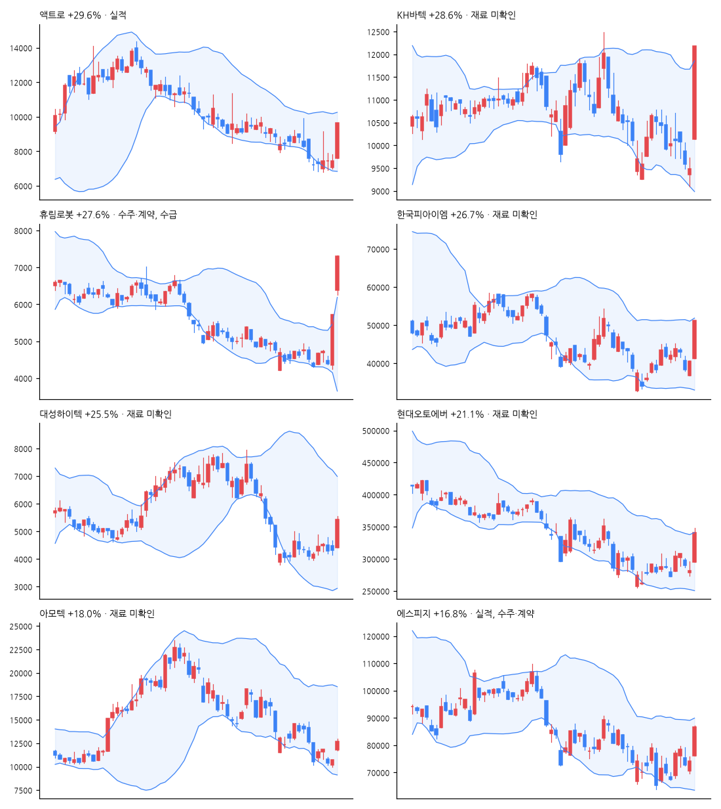

# 급등주 리포트 · 2026-11-24

> 전 종목 2,683 · 상승 1,738 / 하락 771 · 중앙값 +0.99% · **급등(+10%↑) 83종목**, 상한가 3

[목차](../README.md) · [분석 노트](../notes/2026-11-24.md) · [패턴 정리](../PATTERNS.md)

## 급등주 (거래대금 10억 이상 우선)

| 종목 | 등락 | 갭 | 종가위치 | 거래대금 | 거래량배수 | 재료(자동) | 테마 |
|---|--:|--:|--:|--:|--:|---|---|
| 액트로 | +29.6% | +2.2% | 1.00 | 18억 | 8.5x | 실적 | AI, 로봇 |
| KH바텍 | +28.6% | +7.0% | 1.00 | 318억 | 20.0x | - | AI, 로봇, 금융 |
| 휴림로봇 | +27.6% | +11.5% | 0.98 | 1,009억 | 11.0x | 수주·계약, 수급 | AI, 로봇, 데이터센터 |
| 한국피아이엠 | +26.7% | +2.0% | 1.00 | 79억 | 2.2x | - | AI, 로봇 |
| 대성하이텍 | +25.5% | +2.0% | 0.89 | 27억 | 1.7x | - | - |
| 현대오토에버 | +21.1% | +4.6% | 0.88 | 307억 | 1.6x | - | AI, 로봇 |
| 아모텍 | +18.0% | +9.9% | 0.75 | 125억 | 1.8x | - | AI |
| 에스피지 | +16.8% | +2.4% | 0.96 | 249억 | 1.1x | 실적, 수주·계약 | 배터리, 로봇 |
| 덕산하이메탈 | +16.1% | +5.7% | 1.00 | 39억 | 0.8x | 수급 | 반도체, 바이오 |
| 리브스메드 | +15.2% | +1.3% | 0.91 | 158억 | 0.8x | - | AI, 의료기기 |
| 이수스페셜티케미컬 | +14.6% | +3.0% | 0.87 | 148억 | 0.8x | 실적 | AI, 2차전지, 전기차 |
| 하이젠알앤엠 | +14.5% | +2.6% | 0.96 | 33억 | 1.0x | 실적 | AI, 로봇, 바이오 |
| 유진로봇 | +14.1% | +1.1% | 0.84 | 61억 | 1.9x | 실적 | AI, 로봇, 철강 |
| 두산 | +13.8% | +16.3% | 0.18 | 291억 | 0.3x | - | AI, 반도체 |
| HT로보틱스 | +12.7% | +1.5% | 0.90 | 78억 | 0.6x | - | 로봇, 전기차 |
| 에스비비테크 | +12.7% | +1.4% | 0.84 | 27억 | 1.3x | 실적 | 로봇, 금융 |
| LG전자 | +12.7% | +4.2% | 0.97 | 453억 | 0.5x | - | AI |
| 심텍홀딩스 | +12.4% | +6.6% | 0.89 | 92억 | 0.8x | 수급 | AI |
| 로보티즈 | +12.4% | +4.4% | 0.86 | 592억 | 0.8x | 실적, 수주·계약 | - |
| 클로봇 | +12.0% | +1.3% | 0.95 | 36억 | 1.1x | 실적, 수주·계약 | 로봇, 철강 |
| 브릴스 | +12.0% | +0.8% | 0.57 | 77억 | 0.9x | - | 로봇 |
| 벡트로보틱스 | +11.6% | -0.7% | 0.52 | 42억 | 1.7x | 유상증자·CB, 신기술·신제품 | AI, 로봇, 조선 |
| 마키나락스 | +11.4% | +3.0% | 0.83 | 22억 | 0.9x | 수주·계약 | AI, 로봇 |
| 삼현 | +11.3% | +6.0% | 0.70 | 361억 | 1.2x | - | 로봇 |
| 다원넥스뷰 | +11.2% | +2.8% | 0.90 | 19억 | 0.9x | 수급 | AI, 반도체, HBM |
| 한라캐스트 | +10.9% | +2.4% | 0.74 | 113억 | 1.1x | - | AI, 로봇, 자율주행 |
| 두산로보틱스 | +10.9% | +0.7% | 0.92 | 111억 | 0.8x | 실적 | AI, 로봇 |
| 한선엔지니어링 | +10.8% | +4.2% | 0.74 | 21억 | 0.3x | 실적 | - |
| 빅웨이브로보틱스 | +10.6% | +4.0% | 0.83 | 590억 | 1.1x | - | 로봇 |
| 원익홀딩스 | +10.6% | +3.4% | 0.81 | 1,183억 | 0.7x | 실적, 수급 | 반도체, 금융 |

## 급등 전날의 모습 (상위 종목)

| 종목 | %b | 밴드폭 하위% | 스퀴즈 | RSI | 20일선 이격 | 정배열 | 20일 수익률 | 고점 대비 | 전일 거래량배수 |
|---|--:|--:|:-:|--:|--:|:-:|--:|--:|--:|
| 액트로 | 0.17 | 55 |  | 28 | -12.7% |  | -20.1% | -77.2% | 1.3x |
| KH바텍 | 0.15 | 60 |  | 36 | -8.7% |  | -11.5% | -52.5% | 0.6x |
| 휴림로봇 | 1.19 | 42 |  | 62 | +18.9% |  | +14.4% | -78.5% | 13.3x |
| 한국피아이엠 | 0.40 | 30 |  | 45 | -4.1% |  | -12.5% | -77.3% | 0.6x |
| 대성하이텍 | 0.34 | 92 |  | 32 | -14.1% |  | -30.5% | -71.8% | 0.6x |
| 현대오토에버 | 0.35 | 33 |  | 46 | -4.5% |  | -9.9% | -73.5% | 1.1x |
| 아모텍 | 0.16 | 70 |  | 30 | -23.1% |  | -26.2% | -66.8% | 0.7x |
| 에스피지 | 0.41 | 39 |  | 46 | -2.9% |  | -5.6% | -55.2% | 1.2x |

## 공시·뉴스 (상위 종목)

### 액트로 (290740) +29.6%

- 📰 스마트폰 부품 넘어 자동차·로봇으로…액트로 사업 체질 바뀐다 - 핀포인트뉴스
- 📰 로봇 카메라 시장 커지는데 관련주는 하락…실적이 가른 희비 - 핀포인트뉴스
- 📰 스마트폰 부품주 줄줄이 하락…폴더블 성장 기대도 못 막았다 - 핀포인트뉴스
- 📰 폴더블·온디바이스 AI 기대도 역부족…스마트폰 관련주 매도세 확산 - 핀포인트뉴스

### KH바텍 (060720) +28.6%

- 📰 [특징주] 삼성 휴머노이드 본격화 소식에…KH바텍 ‘상한가’ - Chosunbiz
- 📰 KH바텍, ‘AI Datacenter 및 Chip 부품’ 내년 매출 1,000억원 - 금융소비자뉴스
- 📰 KH바텍 주가, 상한가... 무슨 회사길래? - 금강일보
- 📰 [특징주] 레인보우로보틱스·로보티즈 주가 급등…로봇주 '후끈' - CBC뉴스

### 휴림로봇 (090710) +27.6%

- 📰 [특징주] 휴림로봇, 글로벌 전자부품 제조사 로봇 공급 본계약 체결에 23%↑ - 뉴스핌
- 📰 휴림로봇 주가 ‘불기둥’...한화로보틱스와 로봇 공급 계약 [오늘, 이 종목] - 매일경제
- 📰 휴림로봇, 한화로보틱스 등과 자동화 장비 로봇 공급 계약 체결 - 머니투데이 - 머니투데이
- 📰 [장중수급포착] 휴림로봇, 외국인/기관 동시 순매수… 주가 +30.00% - 뉴스핌

### 한국피아이엠 (448900) +26.7%

- 📰 [특징주] 레인보우로보틱스·로보티즈 주가 급등…로봇주 '후끈' - CBC뉴스
- 📰 [MK시그널] 에스피지, 로봇용 정밀 감속기 생산 기술력 부각에 주가 상승세... MK시그널 추천 후 상승률 23.27% 기록 - 매일경제 마켓
- 📰 레인보우로보틱스·로보티즈 등 로봇주 일제히 하락…두산로보틱스·에스엘도 약세 - CBC뉴스
- 📰 휴림로봇 상한가…피지컬 AI 확산에 로봇주 '들썩' - 핀포인트뉴스

### 대성하이텍 (129920) +25.5%

- 📰 대성하이텍에 쌓이는 일감…4분기 매출 성장 이어질까 - 핀포인트뉴스
- 📰 대구국제기계산업대전 성료… 제조 AX 미래 방향 제시 - OMATE 시니어
- 📰 대구국제기계산업대전 상담액 1468억 돌파 - 뉴스클레임
- 📰 대구·경북지역 기계·장비업체 44% 매출 축소…상장사 수익성도 ‘빨간불’ - 대구일보

### 현대오토에버 (307950) +21.1%

- 📰 현대오토에버 19%대 급등...로봇주 '활활' [종목NOW] - 파이낸셜뉴스
- 📰 [특징주] 젠슨 황 복귀에 로봇주 일제히 강세…현대오토에버 22% 급등 - Chosunbiz
- 📰 현대오토에버 주가 11,000원 하락 후 장마감 - 아시아뉴스통신
- 📰 현대오토에버 주가 하락 중 - 아시아뉴스통신

### 아모텍 (052710) +18.0%

- 📰 [리포트 브리핑]아모텍, 'AI 숫자는 탄탄 그 이상' 목표가 25,000원 - IBK투자증권 - 뉴스핌
- 📰 전자부품 기술 경쟁력 강화…아모텍, 하반기 신입·경력 수시채용 - 잡포스트

### 에스피지 (058610) +16.8%

- 📰 [MK시그널] 에스피지, 로봇용 정밀 감속기 생산 기술력 부각에 주가 상승세... MK시그널 추천 후 상승률 23.27% 기록 - 매일경제 마켓
- 📰 대기업 투자 기대 무색… 에스피지 7% 하락, 로봇주 투심 얼어붙었다 - 핀포인트뉴스
- 📰 배터리 소재부터 장비까지 매도 확산…전기제품주 반등 열쇠는 수주와 실적 - 핀포인트뉴스

## 누적 통계 — 급등 다음에 무슨 일이?

- 표본 658건 · 5거래일 뒤 평균 -5.4% · 중앙값 -6.4% · 플러스 비율 26%

---

※ 재료는 공시 제목·뉴스 제목 키워드로 자동 분류한 것입니다. 판단은 [분석 노트](../notes/) 참고. 투자 권유 아님.
