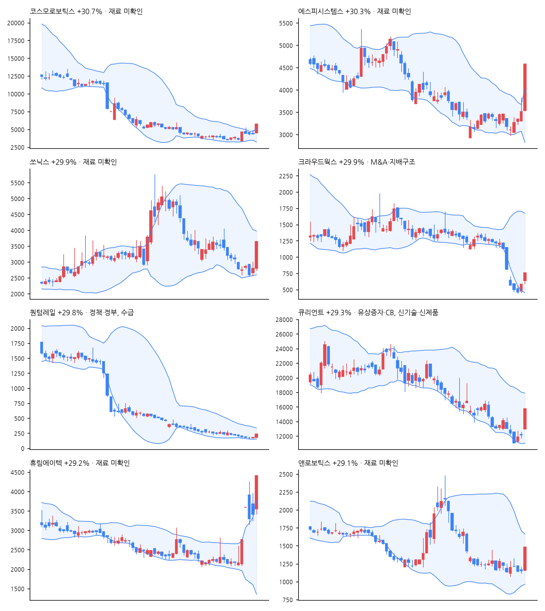

# 급등주 리포트 · 2026-11-27

> 전 종목 2,689 · 상승 2,215 / 하락 328 · 중앙값 +3.37% · **급등(+10%↑) 264종목**, 상한가 6

[목차](../README.md) · [분석 노트](../notes/2026-11-27.md) · [패턴 정리](../PATTERNS.md)

## 급등주 (거래대금 10억 이상 우선)

| 종목 | 등락 | 갭 | 종가위치 | 거래대금 | 거래량배수 | 재료(자동) | 테마 |
|---|--:|--:|--:|--:|--:|---|---|
| 코스모로보틱스 | +30.7% | +2.9% | 1.00 | 371억 | 4.6x | - | 로봇 |
| 에스피시스템스 | +30.3% | +0.6% | 1.00 | 29억 | 23.5x | - | AI, 반도체, 로봇 |
| 쏘닉스 | +29.9% | +0.0% | 1.00 | 15억 | 4.3x | - | 반도체, 로봇, 수소 |
| 크라우드웍스 | +29.9% | +8.5% | 1.00 | 76억 | 8.5x | M&A·지배구조 | AI, 로봇 |
| 퀀텀레일 | +29.8% | +0.0% | 1.00 | 13억 | 3.7x | 정책·정부, 수급 | 로봇 |
| 큐리언트 | +29.3% | +6.7% | 1.00 | 80억 | 1.7x | 유상증자·CB, 신기술·신제품 | 바이오 |
| 휴림에이텍 | +29.2% | +4.1% | 1.00 | 265억 | 9.7x | - | AI, 로봇 |
| 앤로보틱스 | +29.1% | +0.7% | 1.00 | 304억 | 5.8x | - | 로봇, 자율주행 |
| 영흥 | +28.2% | +3.4% | 1.00 | 12억 | 16.2x | 수급 | - |
| 에이비엘바이오 | +26.6% | +1.2% | 0.96 | 728억 | 4.6x | - | 바이오, 제약 |
| 대성하이텍 | +26.4% | -2.2% | 1.00 | 198억 | 4.4x | 실적, 수주·계약 | AI, 로봇 |
| 온코닉테라퓨틱스 | +25.7% | +10.2% | 0.86 | 204억 | 9.3x | 임상·허가 | - |
| 제닉스로보틱스 | +25.7% | +4.7% | 1.00 | 182억 | 3.6x | - | 로봇 |
| 클로봇 | +25.4% | +5.3% | 1.00 | 730억 | 14.1x | 신기술·신제품, 수급 | AI, 로봇 |
| 지니너스 | +24.4% | +7.8% | 0.80 | 12억 | 1.5x | - | 바이오 |
| 삼화전기 | +24.2% | -0.2% | 0.85 | 87억 | 3.1x | 수급 | AI, 전력 |
| 지씨지놈 | +24.2% | +0.7% | 0.87 | 216억 | 4.4x | 실적 | - |
| 엔켐 | +22.4% | +0.3% | 0.88 | 127억 | 4.9x | M&A·지배구조 | - |
| 앱클론 | +21.7% | -1.2% | 0.91 | 122억 | 2.4x | 정책·정부, 수급 | 바이오 |
| 카나프테라퓨틱스 | +21.5% | +1.0% | 0.96 | 18억 | 4.3x | - | - |
| SAMG엔터 | +20.9% | -0.7% | 0.86 | 57억 | 4.2x | 실적 | 엔터 |
| 리가켐바이오 | +20.5% | +0.9% | 0.94 | 525억 | 3.0x | 임상·허가 | 바이오 |
| 오름테라퓨틱 | +19.9% | +1.7% | 0.97 | 58억 | 3.1x | 신기술·신제품 | 바이오, 제약 |
| 썸에이지 | +19.8% | +0.0% | 0.78 | 14억 | 0.7x | M&A·지배구조 | 게임 |
| 라온로보틱스 | +19.6% | +3.2% | 0.74 | 756억 | 4.1x | 수주·계약 | 반도체, 로봇, 바이오 |
| 케이엠더블유 | +19.3% | +1.2% | 0.83 | 298억 | 5.7x | 수급 | 우주, 광통신, 데이터센터 |
| 아톤 | +18.9% | -0.3% | 0.83 | 297억 | 8.3x | - | AI, 금융, 보안 |
| 에치에프알 | +18.9% | +2.7% | 0.77 | 42억 | 3.1x | - | - |
| 이스트소프트 | +18.8% | -1.7% | 0.80 | 25억 | 9.8x | 수급 | AI, 보안 |
| 라온시큐어 | +18.8% | -1.1% | 0.74 | 977억 | 2.5x | - | AI, 화장품, 보안 |

## 급등 전날의 모습 (상위 종목)

| 종목 | %b | 밴드폭 하위% | 스퀴즈 | RSI | 20일선 이격 | 정배열 | 20일 수익률 | 고점 대비 | 전일 거래량배수 |
|---|--:|--:|:-:|--:|--:|:-:|--:|--:|--:|
| 코스모로보틱스 | 0.73 | 7 | ✓ | 56 | +7.1% |  | -4.6% | -93.6% | 1.5x |
| 에스피시스템스 | 0.74 | 0 | ✓ | 60 | +4.2% |  | -6.5% | -79.7% | 4.2x |
| 쏘닉스 | 0.16 | 60 |  | 33 | -14.9% |  | -36.1% | -67.5% | 0.3x |
| 크라우드웍스 | 0.08 | 99 |  | 25 | -46.5% |  | -56.9% | -89.5% | 9.2x |
| 퀀텀레일 | 0.16 | 67 |  | 27 | -28.0% |  | -49.6% | -94.9% | 0.7x |
| 큐리언트 | 0.17 | 86 |  | 34 | -16.0% |  | -31.6% | -79.7% | 2.3x |
| 휴림에이텍 | 1.05 | 74 |  | 75 | +38.3% |  | +27.2% | -77.7% | 10.5x |
| 앤로보틱스 | 0.27 | 75 |  | 37 | -13.3% |  | -42.1% | -76.9% | 0.3x |

## 공시·뉴스 (상위 종목)

### 코스모로보틱스 (439960) +30.7%

- 📰 내년 기대감에 로봇株 82개 중 78개 상승…코스모로보틱스 24%대↑ - 머니투데이 - 머니투데이
- 📰 [특징주] 코스모로보틱스, 휴머노이드 시장 성장 기대에 29%대 급등 - 브릿지경제
- 📰 [특징주] 코스모로보틱스 가격제한폭까지 상승 : 기업주식정보 - 재경일보
- 📰 [급등락주 짚어보기] 로봇株 무더기 상한가…코스모로보틱스·대성하이텍 등 12종목 ‘上’ - 이투데이

### 에스피시스템스 (317830) +30.3%

- 📰 [특징주] 에스피시스템스, CES 2027 휴머노이드 기대감 속 로봇주 강세에 28%대 급등 - 와이드경제
- 📰 "반도체 공장에 로봇 더 들어온다"…제닉스·에스피시스템스 상한가 [주가동향] - 조세일보
- 📰 특징주, 에스피시스템스-로봇(산업용/협동로봇 등) 테마 상승세에 9.93% ↑ - 매일경제 마켓
- 📰 [급등락주 짚어보기] 로봇株 무더기 상한가…코스모로보틱스·대성하이텍 등 12종목 ‘上’ - 이투데이

### 쏘닉스 (088280) +29.9%

- 📰 [급등락주 짚어보기] 로봇株 무더기 상한가…코스모로보틱스·대성하이텍 등 12종목 ‘上’ - 이투데이
- 📰 ‘롯데 단장’ 된 이택근, 파이터즈 최초 영구결번 되나..선수단 반대 속출 (‘불꽃야구2’) - Chosunbiz
- 📰 김연경 감독, 예지력 켜졌다…베트남 원정서 첫 셧아웃 승리 거머쥘까(‘신인감독2’) - Chosunbiz
- 📰 야노 시호, 침대 옆엔 850만 원 수소 호흡기…베개 밑엔 17만 원짜리 운석 가루 ('편스토랑') - Chosunbiz

### 크라우드웍스 (355390) +29.9%

- 📄 [주식등의대량보유상황보고서(일반)](https://dart.fss.or.kr/dsaf001/main.do?rcpNo=20261127001741) · 20261127
- 📄 [조회공시요구(현저한시황변동)](https://dart.fss.or.kr/dsaf001/main.do?rcpNo=20261127900840) · 20261127
- 📄 [[기재정정]최대주주변경](https://dart.fss.or.kr/dsaf001/main.do?rcpNo=20261127900180) · 20261127
- 📰 크라우드웍스 1004만주 거래…760원에 상한가 마감 - 잡포스트
- 📰 크라우드웍스, 100억 가압류에도 상한가 왜? - 센트럴경제
- 📰 크라우드웍스 585원 상한가…최대주주 측 주식 가압류 공시 - 잡포스트
- 📰 특징주, 크라우드웍스-피지컬 AI/휴머노이드 로봇 테마 상승세에 7.87% ↑ - 매일경제 마켓

### 퀀텀레일 (070300) +29.8%

- 📰 [장중수급포착] 퀀텀레일, 외국인 6일 연속 순매수행진... 주가 +29.83% - 뉴스핌
- 📰 퀀텀레일 235원 상한가…무상감자 비율 88.89%로 정정 - 잡포스트
- 📰 퀀텀레일, 매출채권 82.8%·CB 결정액 기말현금의 182.9%로 유동성·희석 동시 리스크 - 데일리연합
- 📰 [급등락주 짚어보기] 로봇株 무더기 상한가…코스모로보틱스·대성하이텍 등 12종목 ‘上’ - 이투데이

### 큐리언트 (115180) +29.3%

- 📄 [유상증자또는주식관련사채등의청약결과(자율공시)](https://dart.fss.or.kr/dsaf001/main.do?rcpNo=20261126900973) · 20261126
- 📄 [[기재정정]유상증자또는주식관련사채등의청약결과(자율공시)](https://dart.fss.or.kr/dsaf001/main.do?rcpNo=20261127900871) · 20261127
- 📰 [숏폼] 큐리언트, 706억 유상증자 초과청약에 상한가 - 히트뉴스
- 📰 [특징주] 큐리언트, 706억원 규모 유상증자 초과 청약에…24% 급등 - Chosunbiz
- 📰 큐리언트, 706억 유증 청약 완료에 상한가…신약 개발 재원 확보 [Why 바이오] - 서울경제
- 📰 큐리언트, 706억 규모 유상증자 성공 소식에 … 장 초반 20% 급등 - 한국경제

### 휴림에이텍 (078590) +29.2%

- 📰 휴림에이텍 장중 4405원 상한가…자동차 부품 3분기 적자 - 잡포스트
- 📰 휴림에이텍(078590), 유상증자 철회 뒤 테마 급등에도 적자 지속 - 시사매거진
- 📰 [급등락주 짚어보기] 로봇株 무더기 상한가…코스모로보틱스·대성하이텍 등 12종목 ‘上’ - 이투데이
- 📰 [특징주] 삼성전자 휴머노이드 공개 기대감에…로봇주 上 - Chosunbiz

### 앤로보틱스 (138360) +29.1%

- 📰 [특징주] 앤로보틱스, 특별한 공시 없이 장중 26%대 급등세 : 기업주식정보 - 재경일보
- 📰 앤로보틱스 주가, 급등세... 무슨 회사길래? - 금강일보
- 📰 [특징주] 앤로보틱스, 로봇 테마 매수세 유입에 급등…산업용·자율주행 로봇 솔루션 부각 - 와이드경제
- 📰 [급등락주 짚어보기] 로봇株 무더기 상한가…코스모로보틱스·대성하이텍 등 12종목 ‘上’ - 이투데이

## 누적 통계 — 급등 다음에 무슨 일이?

- 표본 671건 · 5거래일 뒤 평균 -5.2% · 중앙값 -6.3% · 플러스 비율 26%

---

※ 재료는 공시 제목·뉴스 제목 키워드로 자동 분류한 것입니다. 판단은 [분석 노트](../notes/) 참고. 투자 권유 아님.
